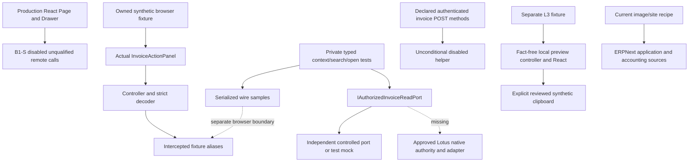

# Lotus Fin — independent final integration and release acceptance

12 October 2026, Asia/Saigon. **OVERALL_RELEASE = BLOCKED.** Original reproduced P2-B and L3 corrections pass their fresh offline rechecks. Expanded independent testing still finds malformed-search handle retention and invalid source observation timestamps. The product has no approved native invoice/tenant authority, native adapter or qualified serving HTTP journey, and its runtime recipe still requires ERPNext. Source and running image do not match.

## Required final decisions

| Verdict | Decision | Evidence-backed scope |
| --- | --- | --- |
| `LOTUS_CHATBOT_OFFLINE_ACCEPTANCE` | **CHANGES_REQUIRED — not accepted as a complete candidate** | P1/P2-A and original UI/L3 vectors pass. New Node oracle 25 PASS/16 FAIL; actual React 36 PASS/3 FAIL. FIN-F07 search cleanup and FIN-F12 source timestamp remain. |
| `LOTUS_CHATBOT_LIVE_ACCEPTANCE` | **BLOCKED / NOT_RUN** | No approved native source/target; actual declarations/controller disabled, no native adapter, no real authenticated HTTP. |
| `LOTUS_PRODUCT_INDEPENDENCE` | **FAIL for current product/runtime recipe** | ERPNext base and site installation; AI001–003 still use ERP accounting sources. ERP-free positive operation **NOT_RUN**, not inferred from isolated imports. |
| `LOTUS_CHATBOT_SECURITY` | **CHANGES_REQUIRED offline; BLOCKED live** | Original P1 lifecycle corrections pass; residual strict contract defects persist; native tenant/document/field/auth/audit/resource/no-write qualification absent. |
| `G10_JUDGE_READINESS` | **BLOCKED / NO-GO** | No reproducible accepted native image/ordinary-user route/judge journey, incorrect quick-start composition, missing packaging and live rollback evidence. |
| `OVERALL_RELEASE` | **BLOCKED** | FIN-F02 P1 lineage remains, native permissions unqualified, ERPNext mandatory, live composition absent, remaining UI contract failures. |

No historical/builder PASS transfers to these decisions. A historical failure also is not automatically retained when the exact current reproduction passes. There is no new asserted P0 exploit or observed live cross-company leak.

## Candidate identity and preservation

Repository `E:/lotus-fin`; branch **`codex/p2a-invoice-read-backend`**; HEAD **`5f805ef34f788245a3ec0e9c2f44e224eb16c305`**. Working tree is dirty: 12 initially modified tracked files and extensive untracked material. [Full initial status](docs/reviews/evidence/lotus-final-acceptance-2026-10-12-01a130c1/GIT_STATUS.txt), [diff stat](docs/reviews/evidence/lotus-final-acceptance-2026-10-12-01a130c1/GIT_DIFF_STAT.txt).

Exact tested source identity: [SOURCE_MANIFEST.json](docs/reviews/evidence/lotus-final-acceptance-2026-10-12-01a130c1/SOURCE_MANIFEST.json), SHA256 **`a59b5b472d44d3251a92247d281627ce7f3d4cfa93acdf58158bf3c4df1a3d40`**, **549 files: 500 tracked, 49 untracked**. Scope includes actual frontend/backend/test/runtime inputs and baseline metadata; it excludes installed dependencies, generated caches and running worker bytes. Two pre-existing plan files, `.env.example` and frontend ignore metadata account for four additions to the prior 545-file inventory. All 545 common files match the earlier A2 snapshot; this equality is a lineage fact, not acceptance evidence.

The clean HEAD archive was freshly created with `git archive --format=tar --output=<evidence>/HEAD_SOURCE.tar HEAD`, exit **0**, SHA256 **`c2e6a81b24a2508b02d4c002ca309a7b87baee2067c45d39dd23ee380b9317ae`**. It omits 49 inventoried working-tree paths, including action/L3 source and fixtures. HEAD alone cannot reproduce this tested candidate. Dirty backend bytes are also not HEAD bytes. [Provenance](docs/reviews/evidence/lotus-final-acceptance-2026-10-12-01a130c1/PROVENANCE.json) lists every omission.

Final rehash: **549/549 unchanged**, HEAD unchanged, **222/222 selected original report/harness/result files unchanged**. [Integrity](docs/reviews/evidence/lotus-final-acceptance-2026-10-12-01a130c1/FINAL_INTEGRITY.json). Only independent assessment reports/harnesses/evidence and evidence-only build/archive outputs were created. No automatic product source fix, permission/flag change, commit, push, image build or deployment.

## A0–A3 and original evidence reconciliation

The authority/report inventory records 74 actual files with hashes; filenames govern what exists, rather than an assumed batch PASS. [Inventory](docs/reviews/evidence/lotus-final-acceptance-2026-10-12-01a130c1/REPORTS_AND_AUTHORITIES.json). Actual reconciliation:

| Requested evidence area | Actual files read | Treatment |
| --- | --- | --- |
| A0 architectural/native authority | LOTUS_FIN_PRODUCT_INDEPENDENCE_AUDIT, ARCHITECTURE_DEPENDENCY_MATRIX, NATIVE_DATA_AUTHORITY_MAP, CHATBOT_NATIVE_INTEGRATION_DESIGN, INTEGRATION_IMPLEMENTATION_HANDOFF, RUNTIME_REPRODUCIBILITY_PLAN | Audit/design records. Native authority UNKNOWN; proposed contracts and N0 approvals do not become implementations. |
| A1 UI/L3 corrections | P2B_FINAL_CORRECTION_REPORT; L3_LIFECYCLE_CORRECTION_REPORT; earlier correction REPORT and original Round2/final independent harnesses | Builder claims treated as hypotheses. Original adversarial assertions rerun against actual source; new independent arrangements added. |
| A2 native/integration candidate | LOTUS_CHATBOT_NATIVE_INTEGRATION_REPORT, NATIVE_AUTHORIZATION_TESTS, REAL_HTTP_EVIDENCE, REPRODUCIBLE_CANDIDATE, INDEPENDENCE_VERIFICATION, INTEGRATION_WORK_TO_CHAT; 545-file candidate manifest | Previous source snapshot and blocked reports. Fresh tests, hashes, image probe and bundle inspection supply present evidence. |
| A3 release/runtime/proposal outputs available | CHATBOT_PRIVATE_RUNTIME_QUALIFICATION, ERP_TARGET_READINESS, AUTHORIZED_READ_ADAPTER_REPORT, G10_PREFLIGHT; final integration/security packet; V1/L3/L4 contracts/proposal handoffs | Discovery/design and earlier independent evidence. No separately completed native release, approved target, signed N0 authority or A3 completion approval was identified. No batch completeness inferred. |

Original independent FIN-F01–FIN-F10 reproductions, source manifests and red results remain preserved. Security Code V3 and ADR001 are read as requirements, not control proof. Frozen P2-B wire is scoped to private DTO/fixture integration; older ERP design assumptions cannot override this user's Lotus independence requirement. L3/V1/L4 proposed documents are not product/security approval records.

## Observed architecture

No concrete read adapter exists outside two test mocks. The authorizer checks a configured site/company and actual Company permission interface in its controlled seam; document method remains disabled and source mode remains ERP_READ. Company access does not establish native tenant membership, row/document or field/masking rights. Public API does not connect required resolver/read services/terminal sink. Production client performs no network, even with its flag on; neither action panel nor L3 is imported by the production UI outside their own directories.

GitNexus was queried first. Bound repository `lotus-fin`, branch above, index timestamp `2026-10-12T07:02:27.060Z`; FTS disabled, concept query empty. Working-tree/source additions and old controller line ranges make full current coverage unqualified. Exact UID SearchInvoicesService upstream impact: **LOW**, one controller-file importer, zero indexed processes. Exact API file impact: **UNKNOWN**, zero resolvable callers; dynamic declarations and tests were then confirmed by source/text inspection. UNKNOWN was not read as unused/safe. Initial ambiguity/runner failures and final exact results are retained. [Graph/execution record](docs/reviews/evidence/lotus-final-acceptance-2026-10-12-01a130c1/SUPPLEMENTAL_EXECUTION.json). No product function was edited; no commit-time graph change check is claimed because no commit occurs.

## Fresh execution ledger

All commands below actually ran on this source; [full argv/cwd/exits](docs/reviews/evidence/lotus-final-acceptance-2026-10-12-01a130c1/COMMANDS_AND_EXITS.json) expands the 22 backend modules, each harness and each runtime invocation. Process timings are test timings, not product SLOs.

| Actual command group | Exit | Result and limit |
| --- | --- | --- |
| `python -B -m pytest -p no:cacheprovider --noconftest -q <22 focused modules>` | 0 | **343 passed**, isolated P1/P2-A regressions. |
| `python -B <evidence>/BACKEND_ORACLE_REPRODUCTION.txt`, boundary reproduction, source oracle | 0 each | **36 + 14 + 12** independent private assertions; overlapping core reruns not summed. |
| `python -B <evidence>/A16_CURRENT/REPRODUCTION.txt`, B03 equivalent | 0 each | **14**, **8**; terminal sink and exact Company seam. |
| `node --experimental-strip-types <evidence>/original23.mjs`, `fresh_oracle.mjs` | 0 each | **23/23**, **96/96** retained independent assertions. |
| `node --experimental-strip-types <evidence>/new_oracle.mjs` | **1** | **25 PASS / 16 FAIL**; independent fresh constants/arrangements, no builder expectations. |
| `python -B <evidence>/P2B_REACT_QUALIFIED.py` | 0 | **34/34** retained actual React cases. |
| `python -B <evidence>/P2B_REACT_NEW_QUALIFIED.py` | **1** | **36 PASS / 3 FAIL**, actual React; two timezone additions and three residual defect assertions. |
| L3 independent controller / React | 0 each | **16/16**, **11/11**. Fake clipboard, actual React lifecycle. |
| `node --experimental-strip-types --test <3 P2-B and 2 L3 test files>` | 0 | **86 passed** (66 + 20), supplemental units. |
| Three separate browser fixture pytest commands | 0 each | P2-B **3**, B1-S **4**, L3 **1**. Intercepted fixture transport, not serving HTTP. |
| `python -B <evidence>/features_oracle.py` | 0 | **393 passed, 7 subtests separately**, AI001/AI002/AI003/numeric/plugin host regressions. |
| `python -B -m pytest ... test_security_hardening.py` | **2** | Collection error: missing Frappe. No framework cases executed; unverified, not PASS. |
| `python -B <evidence>/deny_oracle.py` | 0 | **12/12** offline unknown-tool/public-disabled checks. |
| App/node `tsc -p <config> --noEmit --tsBuildInfoFile <evidence>` | 0 each | Host TypeScript checks. |
| `node .../vite.js build --configLoader runner --outDir <evidence>/BUILD` | 0 | Host production build; chunk warning; no action/L3 markers/mount. |
| `node .../oxlint <action and prepare dirs>` / full `src` | 0 / **1** | Selected one warning/no errors; full conditional-hook baseline errors. |
| `git archive ... HEAD` | 0 | Fresh clean HEAD archive; source omissions documented. |
| Read-only Docker ps/selected inspect/source hash probe | 0 after sandbox retry | Exact container/image metadata; **17/17 source files absent**. No business or site access. |

`<evidence>` is `E:/lotus-fin/docs/reviews/evidence/lotus-final-acceptance-2026-10-12-01a130c1`. Node `v22.19.0`; host Python `3.13.7`; Pydantic `2.12.5`; Playwright `1.58.0`. Tests/build use installed host dependencies. No clean dependency installation or ERP-free image/site start was executed; host PASS does not qualify clean build/image reproducibility. [Build manifest](docs/reviews/evidence/lotus-final-acceptance-2026-10-12-01a130c1/BUILD_MANIFEST.json).

Harness setup failures are disclosed rather than hidden: initial browser started before wire sample creation; old copied sequence attempted reuse after corrected invalid-open cleanup; UTF8 snapshot read required explicit host encoding. Qualified copies preserve assertions, refresh before the independent empty scenario, and freeze browser time at backend sample observation. [Supplemental attempts](docs/reviews/evidence/lotus-final-acceptance-2026-10-12-01a130c1/SUPPLEMENTAL_EXECUTION.json). No test expectation/source fix was used to close findings.

## Source/image/runtime lineage

Fresh observed backend: container `a857658a101bbe5304d16160d65c5669878e9b5eada9b3d288666236c84f0b55`, image `sha256:ed6e02f587eb450a0882ecb4b6fbb259d1a1f27f549e1cc4bbe21a660b3017b7`, started `2026-10-12T12:02:39.933486043Z`, Python `3.14.7`. Mounts are sites/logs only. Read-only filesystem checks freshly find all 17 sampled backend API/controller/services/ports/schema/reference/audit paths absent. [Metadata](docs/reviews/evidence/lotus-final-acceptance-2026-10-12-01a130c1/DOCKER_METADATA.txt), [source probe](docs/reviews/evidence/lotus-final-acceptance-2026-10-12-01a130c1/RUNTIME_SOURCE.txt). This is not a resident-worker, site app, auth or readiness certification.

Dockerfile uses `frappe/erpnext:v16.35.0`; judge init installs `erpnext`. AI001's serving composition injects ERP report fetcher, AI002 uses ERP GL/Trial Balance/Account/Invoice inputs, AI003 uses ERP-derived AR/AP/Purchase Invoice evidence. The owned deterministic calculations remain useful, but their raw source/update authority is not native. No separate approved Frappe-only core recipe/data contract exists. Frappe as framework is permissible; the ERPNext application must become optional or be removed from the independent core with qualified native sources.

Current source build does not import InvoiceActionPanel/FollowupPreview in production; compiled JS contains none of `invoice.context`, `invoice.search`, `invoice.open`, `followup.neutral.vi.v1`. A successful build of an unmounted feature is not integrated release acceptance. Recipe copies Desk assets, not this React feature bundle. Python runtime dependencies are undeclared in pyproject and ranged in requirements; base/framework/platform and clean installation remain unqualified.

## Remaining blockers and verified limits

**P1: FIN-F02 remains open.** Accepted source cannot be reconstructed from HEAD/current image, nor served through a qualified production mount. **Native architecture/permission/HTTP absence and ERPNext dependence block release** under explicit release rules. No P0 severity is invented for missing evidence. Previously reproduced admission and L3 P1 defects pass exact offline rechecks; residual FIN-F07/FIN-F12 are P2 contract failures, and whole-app lint remains P3 baseline debt.

Company/site/session/reference/source isolation is verified at controlled private boundaries. Genuine native tenant, document/field/mask/custom-hook rights, disabled actor/logout/revocation, real CSRF/POST/wrapping/status/CID/cache-control/body size/duplicate JSON keys and multiworker authority are **NOT_RUN**. Required audit acknowledgement and logical resource tests pass offline; durable deployed audit, physical source/hydration/cancellation limits and actual business no-write are **NOT_RUN**. Future V1/L4/L5 are proposal gaps, not delivered capabilities or a reason to silently expand scope.

## Honest demonstration and stop

A bounded **synthetic technical fixture** can demonstrate metadata search, explicit selection, minimum reader and a separate fact-free unsaved/unsent local preview. It must disclose simulated transport/records/clipboard, residual negative failures, no native permissions/live data, no saved Draft or overdue/financial truth, and no judge release acceptance. The production product cannot currently demonstrate the requested native journey.

See [E2E matrix](LOTUS_CHATBOT_E2E_MATRIX.md), [security recheck](LOTUS_CHATBOT_SECURITY_RECHECK.md), [G10 decision](LOTUS_CHATBOT_G10_FINAL_READINESS.md), [proposal coverage](LOTUS_CHATBOT_PROPOSAL_COVERAGE_FINAL.md), and [final handoff](LOTUS_CHATBOT_FINAL_HANDOFF.md). No approved native source/target exists in reviewed records; no ERP/synthetic substitute is used for live PASS. **STOP after this assessment.**
