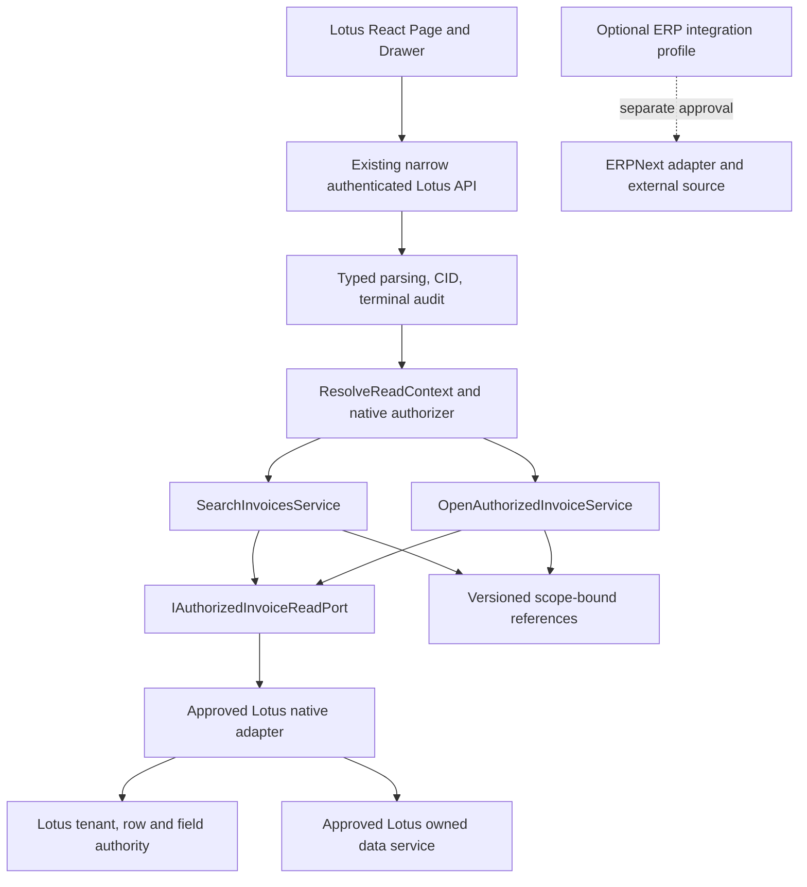

# Lotus Fin chatbot native integration design

12 October 2026, Asia/Saigon. **PROPOSED — architecture approval required; CHATBOT_NATIVE_INTEGRATION_READINESS = BLOCKED.** Design aligns with existing Python/Frappe + React code and the authoritative independent-product directive. It is not an implementation or release approval. Current evidence/identity: [audit](LOTUS_FIN_PRODUCT_INDEPENDENCE_AUDIT.md); [native authority map](LOTUS_FIN_NATIVE_DATA_AUTHORITY_MAP.md). Paths are relative to `E:/lotus-fin`.

## Smallest target architecture

Frappe may remain Lotus's framework and site runtime. The approved core site/image must run without the ERPNext application, installed ERP DocTypes/reports/roles or credentials. Keeping Frappe is not a product-dependence failure. A native source may be in-process or an existing owned service; source location is undecided. A remote owned service needs delegated actor/tenant policy and bounded authenticated transport; SDK language does not justify a new backend.

Initial scope is typed metadata context/search/explicit selection/minimum read. Use the existing three declarations in `api/invoice_actions_api.py`; do not add a generic execute endpoint, second ActionExecutor, second agent loop or arbitrary RPC bridge. Deterministic intent parsing/clarification is sufficient initially; no LLM or paid provider needed. Ordinary UI may reuse the same typed use cases. Generic `dataProvider.ts` fields=* CRUD never becomes this port.

## P1/P2-A reuse assessment

| Component | Reuse decision | Concrete requirement |
| --- | --- | --- |
| `ResolveReadContextService` | Reusable without orchestration change | Existing IReadAuthorizerPort injected with native policy, not ERP Company checks. Candidate company remains untrusted. |
| `SearchInvoicesService`, `OpenAuthorizedInvoiceService` | Reusable behind native adapter; preserve algorithm | Keep bounded filters/pages/query fingerprint, source validation, denial precedence, explicit selected identity/version, partial non-actionability and budgets. Approved native semantics may require versioned date/status/order adjustments. |
| `IAuthorizedInvoiceReadPort` | Reusable typed application boundary | Implement native search/open with fresh row/document/field grants and all I/O counted. Review ERP term DocType in contract as resource-type semantics; no new competing port just for naming. |
| `FrappeInvoiceAuthorizer` | Current implementation bound to ERP schema | Keep framework current user/sid/site/timezone access and fail-closed pattern; use owned membership/company/capability authority. Current disabled document method is not native authorization. |
| ApprovedConnection/config/context fingerprint | Reusable security pattern | Server config selects source, allowed company, policy/version. Product/site/connection are native provenance namespaces, not client URLs. Missing map/key/policy/timezone fails closed. |
| `AuthorizedReadContext`, SourceEvidence | Requires approved contract revision | Current enums allow ERP_READ/DEMO_ISOLATED only. Proposed native mode must be explicitly approved and versioned; ERP_READ must never falsely label native data and native label never bless ERP fixtures. |
| ActionReferenceCodec and InvoiceReferenceV2Codec | Preserve cryptographic/security behavior | Keep HMAC/canonical strict parsing, purpose, opaque actor/session, key/version, company/product/site/source/projection/context/expiry/query binding and revocation precedence. Do not strip fields to remove ERP wording. |
| SelectionClaimsV2 / cursor / schemas | ERP assumptions require migration | `doc_type='Sales Invoice'`, docstatus0/1, order `name ASC` are not native truth by themselves. Approve entity/status/order mapping or introduce explicitly versioned successors; reject cross-version replay. |
| Controller/API/delivery | Keep typed controller/delivery; composition missing | Controller search/open currently return disabled unconditionally, public endpoints run disabled helper. Wire existing services after native adapter and policy qualify; retain terminal audit and disabled default until readiness gates close. |
| React action reader/decoders | Reusable after FIN-F01/F06–F09 corrections | Exact envelope/source/mode/timezone/expiry/lifecycle and pagination guards. Bind actual authenticated transport and production mount only when qualified. |
| Existing AgentRunner/registry | Keep existing execution boundary for future approved intent tools | Six current financial tools are separate scope. Do not inherit legacy administrator/guest fallback/session behavior; do not register new reads as unrestricted generic invocations. |

## Context/source/reference migration decision

Recommended: approve an explicit native contract/projection/reference revision where mode/entity semantics change. Exact new literal/version names are Product/Security decisions, not frozen by this document. Reject old ERP references at native boundary even if company names overlap. Change policy/source/contract fingerprint and, where required by Security, key namespace; no unsafe dual-verifier accepting either source for one request. Keep old disabled or optional ERP path explicit if retained.

Do not edit accepted P1 compatibility methods casually: historical P1 verifies expiry with `now > expires_at`; P2 v2 uses `now >= expires_at`; UI requires expiry at equality. Record this known difference and approve future harmonization/migration explicitly. Preserve historical tests in their original version scope. Strengthen native admission, never use the old equality rule to accept protected UI state after expiry.

Native context must derive actor/sid from framework, tenant/company from owned policy, source from approved server configuration, timezone from approved authority, and stable context version from all effective scope/config/key/projection values. Request body contains only typed candidates/handles/filters and RID; never source URL, user, sid, role, SQL, arbitrary method or field list. Server generates CID. Membership/policy/source version changes invalidate references; same-scope replay still checks current rights.

## Request and response sequence

1. Authenticate framework session; reject Guest/disabled/expired identity before source access. Enforce POST, CSRF/origin, bounded raw body and duplicate-key rejection. CID exists for handled requests; preserve framework errors as transport failures rather than fabricated success.
2. Resolve candidate company with Lotus membership/capability policy and approved native source mapping. Get server timezone/default 90-day inclusive posting window, signed context handle and actual token expiry. No global default company or Administrator fallback.
3. Search validates ref/current scope, canonical paired dates, prefix and page limit. Native adapter applies authorization in bounded query plus per-row/field policy as necessary; search grant and open grant differ. Stable authorized ordering/lookahead drives signed cursor, never unrestricted count or complete-empty after failed source.
4. UI accepts only current RID/capability/generation/context/source and unexpired context. Complete rows require explicit user choice even with one result. PARTIAL exposes no actionable selection/cursor. Invalid response clears protected state and pending handles.
5. Open verifies signed purpose/scope/entity/version/query/expiry, then **freshly** checks membership/document/field rights and exact record version. Revocation wins over stale-version diagnosis. Return approved five-field projection and fixed LOTUS_READ_VIEW descriptor; no full form/onload/children/attachments/URL hydration.
6. Terminal delivery requires safe audit acknowledgement, matching body/header CID, no-store/nosniff and exact typed outcome. Required audit failure prevents protected success; actual durable sink guarantees need separate approval. SQL/bytes/deadline limits include permission metadata, lookahead, hidden/lazy I/O and response serialization.

Source unavailable → truthful SOURCE_ERROR/NOT_AVAILABLE according to approved status/reason matrix with null protected data/source. Authorized successful empty page → EMPTY_RESULT only with qualified complete page coverage. Native service unavailable never falls back to ERPNext, test fixtures, global defaults, cached authorization or LLM numbers. Cooperative deadline alone is insufficient proof of actual DB/request cancellation.

## Financial domain continuity

Native minimum reader adds no amounts/due dates/overdue calculations. AI001 formulas, AI002 engine and AI003 policy remain deterministic. Before enabling native financial analysis, provide normalized owned inputs preserving cutoff versus observation time, net versus positive exposure, credits/returns, currency, schedule/allocation identity, coverage and reconciliation. Approve source equivalence independently of arithmetic.

AI002 future-source default must remain unavailable without approved confirmed commitments. AI002 Amendment A1 explicitly does not authorize a new commitment DocType. AI003 demo-only policy stays demo-only; new data is not calibration. V1 PastFinalDue/customer/form-prefill/mutations are not implemented by connecting generic reads. L3 fact-free local preview is separate and has FIN-F03–F05/F10 acceptance gaps; mount/template/TTL/clipboard approval is still required.

## Approval boundary and unresolved choices

Product/Data must choose existing owned records or approve a native data model and minimum release scope. Security must approve owned membership/field policy, native source/reference contract migration, sink/retention, lifecycle and deny behavior. Platform must approve a Frappe-only artifact/site topology, actual React route and isolated qualification lifecycle. Optional ERP adapter needs its own mapping/delegation/security contract and cannot be core fallback. Future L4/L5 remain disabled; no new write executor/ledger is approved here.

Unresolved: exact owned service/database, canonical status/entity/order names, freshness SLA, audit storage, historical financial semantics, production route/base path and native version literals. Eight frontend source/test files changed concurrently after the audit baseline; FIN correction acceptance must be freshly established, not inferred from old failures or new source edits. These are explicit blockers, not permission to invent new entities. Proceed to the handoff only after named decisions; this audit made no production source or runtime changes.
