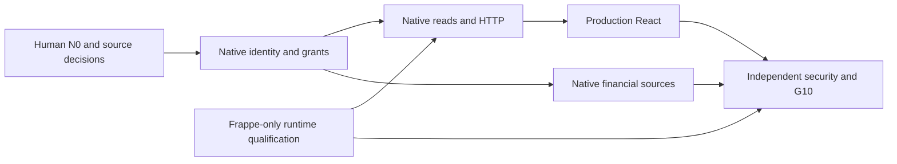

# Lotus Fin — full independence execution plan

13 October 2026 · Asia/Saigon · `E:/lotus-fin` · **PROPOSED / NOT APPROVED; NO EXECUTION DISPATCH**.

Source basis: [full inventory](LOTUS_FULL_ERP_DEPENDENCY_INVENTORY.md), [N0 sheet](LOTUS_FINAL_N0_APPROVAL_SHEET.md), [native architecture](LOTUS_NATIVE_ARCHITECTURE_FROZEN_PROPOSAL.md), [migration plan](LOTUS_TOKEN_PERMISSION_MIGRATION_PLAN.md), [latest execution](docs/reviews/evidence/chatbot-release-candidate-2026-10-13-01a132c2/LOTUS_CHATBOT_FINAL_INTEGRATION_EXECUTION.md) and [gate ledger](docs/reviews/evidence/chatbot-release-candidate-2026-10-13-01a132c2/GATE_VERDICTS.json). Current source includes concurrent P0 additions and changed helpers/hooks; older HEAD/reports do not define the next candidate. Every implementation task must recapture bytes and current graph context before edits.

## Delivery dependencies and ownership

P0 platform analysis does not wait for invoice model approval. P1 authority/schema cannot be invented while waiting. P4 finance design can be assessed after identity semantics, but source implementation additionally requires N0-13; metadata authority approval alone does not close it. P3 and P4 can run in separate scopes after their dependencies; P5 verification design can begin early, while acceptance waits for all enabled capabilities and an immutable artifact.

Named human owners are **UNASSIGNED**. Roles below are disjoint proposed ownership slots, not spawned agents. One writer owns each file family. Shared contracts are frozen before dependants edit. A later writer requiring a shared file requests a documented sequential ownership transfer, not simultaneous edits.

For paths, `L/` is `E:/lotus-fin/lotus_fin/lotus_fin/`, `F/` is `E:/lotus-fin/frontend/src/`; other paths are repository-relative under `E:/lotus-fin`.

## P0 — Frappe-only runtime independence

**Owner: Platform/Runtime.** Exclusive write scope in a subsequent authorized task: `docker/lotus-core/**`, `docker/compose.lotus-core.yml`, `docker/compose.judge.yml` release classification, `run.ps1`, `run.sh`, runtime dependency manifests `lotus_fin/pyproject.toml` and approved lockfiles, root runbook/README, `L/hooks.py`, `L/runtime/**`, JSON Page/Workspace install declarations under `L/lotus_fin_ai/**`, core asset packaging and app-install configuration. Legacy recipe/harness histories remain explicitly labeled. P4 owns Desk/public JavaScript behavior, while P0 owns installed metadata/asset inclusion; coordinate through a frozen catalog without overlapping edits. Do not edit finance providers, native schemas, token claims or React behavior in P0.

Current progress: new Dockerfile builds React assets, pins Frappe build/base and framework commit, installs only framework/Lotus, checks ERPNext absent; core init omits ERP install; helper replaces shared default startup; hooks clear ERP event/fixture/scheduler declarations; old Company fixture deleted. These are **observed concurrent source changes, not this review's implementation or independent acceptance**. Continue by qualifying them, not reimplementing from old reports.

Required tasks:

1. Reconcile a stable source manifest including new/untracked runtime files, dependencies and compiled React bundle; record clean transfer/image/build identities. Verify transitive resolution, framework version/commit and copied support paths.
2. Approve isolated project/site/volumes/port/secret custody and cleanup before creating a site/account. Qualification uses only Frappe/Lotus installed apps, no ERPNext package, Company/Sales Invoice/GL/report/ERP role bootstrap, no ERP credentials/egress. Never inspect or mutate shared business data as a shortcut.
3. Qualify clean install and framework schema upgrade/startup, worker/job/cache/HTTP boot, hooks/pages/role declaration behavior and effective absence of old imported fixtures/jobs. Existing-site cleanup is a separate approved migration, not implied by source deletion.
4. Verify before_request coverage for method paths/cmd/version variants and inaccessible unqualified legacy Lotus RPCs. Generic framework business-resource admission and native React catalogs are contracts handed to P1/P3, not proven by this RPC list.
5. Reconcile app_home/React serving base path and real user login route; packaged `/assets/lotus_fin/core/index.html` alone is not a production route journey. Keep legacy financial APIs/tools/Desk actions unqualified until native migration.

**Exit:** immutable reproducible Frappe-only serving shell; clean install/migrate/restart/import/health and denial evidence; ordinary framework identity without ERP roles. Must report exactly “P0 runtime shell qualified” if finance/source/native reads remain blocked. This cannot set FULL_PRODUCT_INDEPENDENCE_READINESS PASS.

**Can proceed:** read-only source/artifact/recipe review and dependency lock design immediately. Build/provision/enable in a later task only within its actual authorization and target lifecycle. No actions executed by this package.

## P1 — Native tenant/source and permissions

**Owners: Data/Native Storage and Security/Contracts, disjoint.** Data exclusively owns approved new native domain/persistence records/migrations/update use cases and fixture schema definitions under approved cohesive domain/infrastructure paths. Security exclusively owns `L/domain/model/authorized_read_context.py`, `user_context.py`, `domain/schema/action_outcome.py`, `infrastructure/security/{frappe_invoice_authorizer,action_reference_codec,invoice_reference_codec,invoice_reference_claims}.py`, `infrastructure/config/invoice_actions_config*.py`, `domain/policy/permission_policy.py`, `security/access.py` and `infrastructure/security/frappe_access_gateway.py` core-policy seam. No concurrent edits of the same file. Security freezes the owned policy/identity/source/claim contract before Data implementations depend on it.

**Must wait for:** signed N0-01…N0-10 and storage/schema/update authority; target provision approval N0-11. Source and grant design can be discussed before approval; implementation/schema/migration cannot.

Required tasks: independently author owned identity/metadata schema (no ERP copy); implement versioned membership/capability/row/document/field rules; operator/read separation and transactional record versions; approved timezone/currency/source-health authority; policy/revocation epochs and durable audit custody; native v2 wire/projection and ref.v3 family; historical v1/v2 rejection and native key namespace; generic framework route admission for native resources. Security may implement a fresh owned adapter behind existing ports rather than changing valid resolver orchestration.

**Exit:** signed schema/policy/wire/source versions, owned update custodian, native ordinary-user two-tenant fixtures and positive/negative row/field/revocation tests; data import remains explicitly separate if not approved. Tenant existence is not company/doc/field access. No complete-native claim with only a Company permission check.

## P2 — Native Search/Open and HTTP

**Owner: Backend Read/Delivery.** Exclusive write scope: `L/application/port/i_authorized_invoice_read.py`, `i_invoice_references.py` after P1 contract freeze; `application/service/{resolve_read_context,search_invoices,open_authorized_invoice,invoice_read_validation}.py`, approved budget helper changes; `domain/schema/invoice_read.py`, `presentation/dto/invoice_action*.py`, `presentation/controller/invoice_actions_controller.py`, `api/invoice_actions_api.py`, `presentation/response/{action_response,invoice_action_delivery}.py`, action event port/sink wiring and one approved native read adapter/query implementation. Security owns codecs/config/authorizer permanently; Backend consumes them or requests sequential transfer. Backend does not create a second executor/agent or use generic CRUD as the read adapter.

**Must wait for:** P1 signed identities/grants/wire/source, concrete operational source, P0 qualified isolated target, sink/key/fixture lifecycle approval. Current injected controller wiring is already present; preserve it. Do not repeat obsolete fixes or silently alter old HMAC semantics.

Required tasks: preserve typed algorithms/denial precedence; distinguish native selected key from display label; bound prefix/date/order/keyset/lookahead queries and every permission/DB/byte/audit call; fresh open/revocation/version checks; truthful complete-empty/partial/outage; compose existing get_context/search_invoices/open_invoice methods with real native source and required terminal sink; preserve newest strict admission, Werkzeug single envelope, CID/private-no-store/nosniff. Qualify real Frappe POST/session/enabled-user/CSRF/origin/errors and actual DB cancellation; no transport-intercepted native PASS.

**Exit:** ordinary user Context→Search→explicit selection→Open through actual serving HTTP, exact minimum projection, ERP-free source and live grant oracle; all negative cases no protected response; before/after business data unchanged while auth/audit writes documented separately. Both Search/Open stay disabled until each meets the shared enablement gate.

## P3 — Production React chatbot and product route independence

**Owner: Frontend/Product UI.** Exclusive write scope all `F/**`, frontend build config and tests, including action/prepare components, App/main, providers, page/drawer, membership selector, home/layout/sidebar/header, dynamic report/workspace/page/list/form routes and finance view capability admission. Do not edit backend contract or security to make a decoder pass. P0 only packages the frontend outputs without changing UI source.

**Must wait for live transport/mount:** P2 wire/HTTP acceptance, Product-approved core entrypoint/capability catalog and P1 owned membership selector. UI can prepare a successor fixture branch after wire approval; that is not live acceptance.

Required tasks: server-owned allowed company list and qualified context; mount native reader in actual `/copilot` page/drawer; narrow authenticated transport to the existing three methods; closed successor decoders; explicit click even one result; reset on scope/version/logout/revocation/expiry; reject late/racing/malformed/CID/RID/source/version responses; partial no handles, XSS/plain text minimum view. Correct actual conditional hooks in UniversalPageView, not suppress full lint. Remove mandatory ERP sales-funnel/POS/Company/GL/ERP menu defaults and generic deep links from core. If Product keeps equivalent capabilities, implement them against separately approved native APIs; route hiding alone does not close server bypasses. Coordinate generic resource restrictions with P1.

L3 stays a separate Product/Security template/TTL/clipboard/local-state decision. Native minimum metadata does not authorize customer-prefill, save/send, V1 overdue or paid/amount conclusions.

**Exit:** actual production bundle/page/drawer/native HTTP with ordinary users and no intercepted transport; native menu/default selectors/deep links; lifecycle/security browser suite and full required lint/type/build pass. Showing a disabled UI is useful containment, not full financial-product delivery.

## P4 — Native financial feature-source migration

**Owner: Financial Sources/Engines.** Exclusive write scope `L/api/{ai_insights,key_reports,cashflow_api,copilot_api,events,workspace_sync}.py`, `core/use_cases` financial source/snapshot/metric composition, `core/domain` financial source/evidence adapters, `core/adapters/erpnext_gateway.py`, `infrastructure/erpnext/**`, `modules/f001_health` through `f007_copilot`, `core/ai/**`, `core/plugin/**`, `application/agent/**`, `application/service/copilot_service.py`, `presentation/controller/copilot_controller.py`, tool registry/invoker/impl and chat session persistence; also JavaScript Desk feature behavior under `L/lotus_fin_ai/page/**` and `L/public/js/**` (not P0-owned JSON install metadata or asset-inclusion hooks). P1 retains principal/security/shared config; P3 retains React UI; P0 retains runtime/hooks. Framework access policy/evidence contract changes are coordinated through Security's frozen interface, not parallel edits.

**Must wait for implementation:** P1 identities/security and signed N0-13 per-source authority, update/reconciliation owner, cutoff/history/currency/credits/account scope/commitment grants. A metadata store cannot supply these requirements.

Order:

1. Define approved normalized observation schemas and source-mode/evidence versions, preserving formula math and financial cutoff versus observed/known-at time. Choose an owned observation/import source or separately approved accounting authority; do not create a renamed ERP ledger.
2. AI001: replace key-report/source-fetcher composition; qualify P&L/AR/AP/cash/account/dedupe/credit/reconciliation coverage and status equivalence. Preserve1.0.0/formula2026.1 numeric gold; move ERP-only normalization/Report admission outside core.
3. AI002: migrate company/account-scope source, cash balance and independent reconciliation, residual trade/allocations/schedules; fresh cached-resource authorization, typed native evidence and provenance labels. Preserve1.2.1 STRICT_BASELINE_V1, negative cash, TRADE_ONLY disclosures and no inferred FIFO. Confirmed future events need their own A1 approval; remain unavailable without it.
4. AI003: consume native validated AI001 AR, native AP and schedule providers via ServiceDeps; migrate ERP_AP_REPORT/report-name/schema/evidence assertions; preserve V2.2 method and DEMO_ONLY policy/calibration restrictions. Historic replay cannot be silently re-attested.
5. AI004: native baseline and truthful outage semantics; remove source-failure→zero/empty. AI005: replace hardcoded company/profile/default snapshot truth with approved native/profile/user scenario source and current catalog authority. AI006: keep deterministic terms math; qualify user/source terms and principal separately.
6. Legacy Copilot/AgentRunner/plugins: retain one controlled loop, select only qualified tools, fix actual tool dispatch/signature/user-scope composition, remove admin/guest/fallback authority and unsafe session identities. Disabled native invoice reads are not generic agent tools. No model-produced source or money truth.
7. Migrate every exposed report/export/Desk event/evidence/page consumer, including non-AI selling/buying/assets/stock capabilities if Product includes them. Optional ERP connector gets its own later package/profile/mapping/delegation approval; never core dependency or source-outage fallback. Preserve old adapters/gold only with explicit legacy labels.

**Exit:** independent native source fixtures/oracles validate equivalent numbers/statuses/cutoffs/evidence and all enabled tools/reports without ERPNext app/schemas/roles/reports/credentials. A feature may be unqualified rather than fabricate truth, but full-product independence remains blocked until Product signs scope and all included capabilities work natively. Disabling AI001–003 to manufacture PASS is prohibited.

## P5 — Integrated independent security and G10

**Owner: Independent QA/Security Acceptance, separate from builders.** Exclusive write scope new cohesive native acceptance tests under `L/tests/` and `tests_e2e/`, evidence/report manifests and required CI gates; frontend test changes are sequentially transferred from P3 after bundle freeze. Read-only access to implementation. QA must not modify production behavior or weaken assertions to obtain green. Fixture provisioning/mutations are a separately approved Data/Platform lifecycle, never hidden in verification setup.

**Must wait for acceptance:** completed applicable P0–P4, stable source/image/worker/bundle identities, signed source/policy contracts, approved isolated target/ordinary synthetic fixture users/key/sink custody and rollback plan.

Minimum integrated gates:

| Gate | Required evidence |
| --- | --- |
| Runtime/default independence | Clean build, fresh site/install/migrate, second restart; no ERP package/app/schema/report/role/credentials/egress required. All app services share immutable lineage. Inspect installed state and worker imports, not just host files. |
| Actual ordinary-user business success | Owned two-tenant data including same invoice labels; Context→Search→click→Open on production React/HTTP; every Product-included financial tool/report executes against approved native inputs. |
| Native security | Tenant/company/source/purpose isolation; field/filter/query-vs-open grants; disable/logout/revoke/regrant; old tokens valid under legacy keys rejected; tamper/expiry/version/CSRF/GET/guest/body/CID races; generic framework route bypass tests. |
| Financial truth/equivalence | Independent normalized-source oracle for cutoff/history/credit/allocation/zero/error/partial/currency/negative cash/reconciliation/known-at limits. Preserve formula gold; test f005 hardcoded/f004 error fallbacks cannot masquerade as truth. |
| Delivery, revocation and bounds | Required audit outage denies protected success; durable retention/ACL/custody proven to signed contract; late in-flight response after revoke fenced; actual DB/audit cancellation, queue admission and full I/O accounting. |
| No business writes | Approved before/after native business-store snapshot; framework auth, telemetry and audit writes classified separately; no row/version/lifecycle mutation from read/finance requests. |
| Release and rollback | Source manifest→build/dependencies→image→resident worker→served browser bundle chain; known disabled native artifact rollback, key/epoch retirement, UI clearing and independent recheck. |
| G10 decision | Named independent reviewer plus human Product/Security/Platform release acceptance; offline/self-verification and architecture approval alone cannot close it. |

Inherited reports cite438 backend host/image and393+7 feature offline tests, plus retained UI/browser fixture successes. Counts overlap. Keep their original meanings; tests against doubles/interception and a no-Frappe image are not native runtime/business security evidence. Native financial production calibration remains separate where required.

## Immediate work, blocked work and stop boundary

Immediately available after this package: human N0 review, read-only current-source/hash/graph inspection, P0 recipe/artifact review, per-source finance mapping and independent acceptance-oracle design. Preparatory work may identify unknowns without choosing authority on behalf of Product/Data/Security.

Wait: native schema/write/import authority, grants, successor code/token changes, migrations, native adapters/HTTP enablement, production UI transport/mount, native finance ingestion, isolated site/users/secrets provisioning and release. A future task needs scope and approvals appropriate to its phase. New concurrent P0 edits do not provide those approvals for this task.

Open: N0-01…N0-15, named human owners, stable candidate, target lifecycle, generic framework policy coverage, native finance update owners, numeric freshness/revocation/audit values and G10 acceptance. Final verdicts remain those in the [N0 sheet](LOTUS_FINAL_N0_APPROVAL_SHEET.md). **STOP: no commit, push, source/schema change or deployment in this decision task.**
