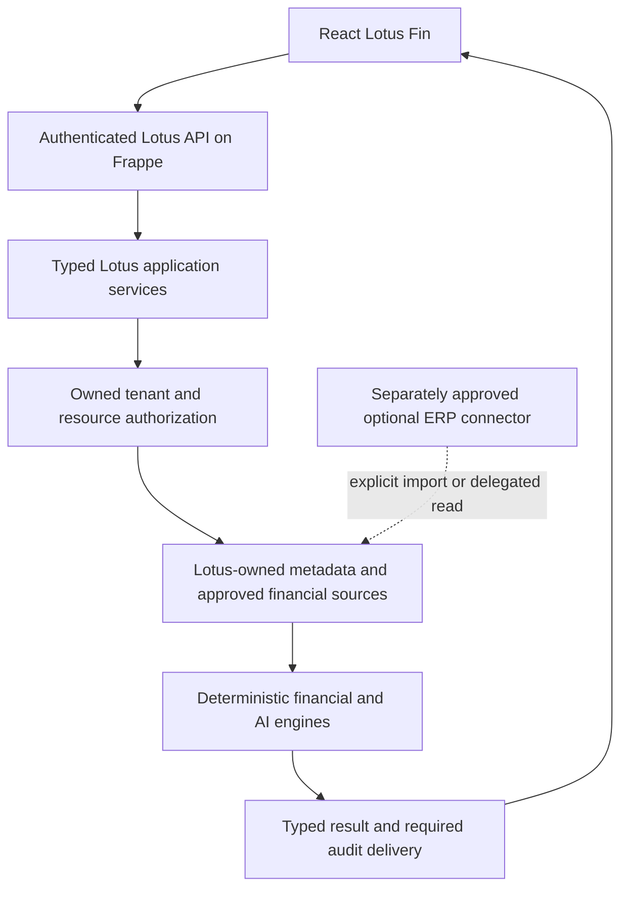

# Lotus Fin — native architecture frozen proposal

13 October 2026 · Asia/Saigon · `E:/lotus-fin` · **PROPOSED / NOT APPROVED / NOT CONTRACT-FROZEN**.

“Frozen proposal” means a reviewable decision baseline. It does not mean Product, Data or Security has approved it. Governing evidence and approval IDs are in the [N0 sheet](LOTUS_FINAL_N0_APPROVAL_SHEET.md); working-source locations, hashes and drift limits are in the [inventory](LOTUS_FULL_ERP_DEPENDENCY_INVENTORY.md). No schema, code or migration is created here.

## Target architecture

Keep Python/Frappe, existing typed service boundaries, React and valid HMAC/delivery implementation. Do not introduce another backend, generic action executor, agent loop or ERP-shaped ledger to solve source composition. Domain identity, grants and truth belong to Lotus; Frappe supplies authentication/session, HTTP, ORM, job/cache/site infrastructure. Any later connector is external, disabled by default, with no implicit source substitution.

Current [request boundary](lotus_fin/lotus_fin/runtime/boundary.py) proposes a narrow core RPC allowlist and denies legacy Lotus methods unless a qualified `lotus_erpnext` app plus ERPNext is installed. A separate [integration prototype](integrations/lotus_erpnext/README.md) appeared during final inspection; its hooks require ERPNext/Lotus and an explicit qualification flag, and it is outside the core Dockerfile's app copy. Its README explicitly says business/security acceptance is absent. This is containment/integration source, not a completed optional integration or native financial migration. The core boundary does not control generic `frappe.client` or `/api/resource` calls. Current [React App](frontend/src/App.tsx), [Company selector](frontend/src/pages/copilot/LotusCopilotPage.tsx) and dynamic pages therefore still need a native catalog and authorization boundary.

## Source discovery and smallest native authority

Inspected active schema JSON defines Desk pages/workspace; no owned operational tenant, membership, invoice or financial store was found. [InvoiceReadDocument](lotus_fin/lotus_fin/domain/schema/invoice_read.py) is a projection, [FinancialSnapshot](lotus_fin/lotus_fin/core/domain/entities/financial_snapshot.py) a derived result, and [IAuthorizedInvoiceReadPort](lotus_fin/lotus_fin/application/port/i_authorized_invoice_read.py) an interface with test implementations only. [Authority map](LOTUS_FIN_NATIVE_DATA_AUTHORITY_MAP.md) and the [latest N0 packet](docs/reviews/evidence/chatbot-release-candidate-2026-10-13-01a132c2/N0_PRODUCT_DATA_SECURITY_DECISION_PACKET.md) agree. External owned services remain UNKNOWN, not disproved globally.

Recommend a **metadata authority**, with independently designed Frappe-owned records on the existing MariaDB deployment. Do not inherit ERP controllers, child tables, naming series, tax/stock/account posting rules or Company/Invoice/GL permissions. Exact DocType names below are proposals, not installed schemas. Storage names may be adjusted by Data without changing domain identities; the signed storage binding then becomes part of approval.

| Proposed domain record | Minimum fields and constraints | Authority / update rule |
| --- | --- | --- |
| Lotus Tenant | `tenant_id` opaque immutable UUID; active; monotonic revision; custodian identity; UTC created/updated audit | Designated tenant administrator through approved Lotus management use case; activation/revocation increments epoch. No Frappe-site-name derivation. |
| Lotus Company | opaque immutable `company_id`; required tenant FK; bounded display label; active; IANA accounting timezone; ISO base currency; revision; unique tenant/company tuple | Named company-data owner; changing tenant prohibited. Timezone/currency changes require reviewed effective-date semantics and source/context invalidation. |
| Lotus Membership | immutable membership ID; Frappe user FK; tenant/company tuple; active; closed capability set; allowed projection/filter set; assigned versioned row/document rule IDs; membership/policy epoch; unique user/tenant/company | Separate security administrator; domain access never follows creation of a Frappe User alone. Operator rights are distinct from read capability. |
| Lotus Invoice Metadata | opaque immutable `native_record_id`; tenant/company FKs; bounded NFC invoice label; kind SALES; posting date; lifecycle; opaque record version; source identity/schema revision; source-observed/committed times; update owner/audit pointer | Approved Lotus metadata write/import use case only. Every material correction, status/date/label/grant-relevant change creates a new record version transactionally. Reader is read-only. |

The minimal grant policy is a versioned, closed rule set assigned to each membership. It expresses company-wide or bounded document grants with explicit query/search and open capabilities, plus exact field/filter rights. Security must approve its representation, rule IDs, revocation epoch and an ordinary-user oracle. Use existing approved audit infrastructure if available; otherwise durable audit storage needs separate approval. A fifth grant table or audit table is justified only if the signed policy cannot be represented safely with membership/rules. Four entities alone do not prove row/field security.

Canonical selected identity is `(source_id, tenant_id, company_id, native_record_id)`. A display invoice label is not a primary key or URL authority. Identical labels across two tenants/companies are valid and mandatory in gold. Prefer unique `(tenant_id, company_id, invoice_label)` within the minimum SALES collection; Product must explicitly choose how amendments/duplicate labels work. No global uniqueness imported from ERP invoice names.

## Lifecycle, dates, versions, time and currency

Proposed lifecycle is DRAFT → POSTED → VOID, with a reviewed DRAFT → VOID path. POSTED means the metadata custodian accepted the document's declared posting date; it does **not** mean cash settled, tax validated, journal posted or unpaid. Corrections preserve identity, change version and leave audit history; reopening/amendment/physical deletion requires a signed rule. VOID is excluded from the first searchable projection. Refunds, credit notes, purchases and installments are later domain contracts.

Posting date is a canonical local calendar date in the company's approved accounting timezone, supplied by the source authority. Do not derive it by truncating UTC receipt time or repurpose invoice issue/due/settlement dates. Existing P1 uses server observation converted to **site** timezone; proposed v2 explicitly uses **company** timezone for the default 90-day inclusive window. A site hosting different company timezones must return and bind the selected company's timezone. Missing/invalid timezone fails closed; no default UTC/Vietnam substitution.

All observation/audit/commit timestamps are timezone-aware UTC. Record version is an opaque immutable revision returned from the store, not a client timestamp or mutable label; version equality covers the exact projected record. Membership, policy, schema, source and connection revisions are separate from per-record version. Cursor order proposed: binary ascending canonical native ID within tenant/company/source, with an authorized fixed upper bound. Search prefixes operate on approved NFC labels; qualify DB collation and literal escaping. No `name ASC` assumption, offsets or hidden unrestricted counts.

Company base currency is authoritative internal configuration even though the minimum reader returns no amounts/currency. Finance later consumes explicit company/report currency and precision. Preserve existing VND-only feature restrictions unless separately amended; do not invent FX or VND fallback. Timestamp, money, ratio, formula and cutoff conventions in AI001–003 remain feature-specific.

## Projection and native permission contract

Small proposed successor projection: `invoice_type`, display `invoice_id`, `posting_date`, closed `lifecycle` (DRAFT or POSTED), opaque `record_version`; context-level `company_label` and the fixed `LOTUS_READ_VIEW` descriptor. `native_record_id` is a signed selection identity and need not be exposed as a navigable ID. No amount, customer, due date, outstanding balance, child rows, tax, attachment, full form/onload or generic `fields=*` hydration is authorized by N0.

Use native lifecycle on the successor wire rather than retaining ERP `docstatus` as implicit truth. The smaller numeric mapping DRAFT→0/POSTED→1 was considered in the prior N0 packet; use it only if Product/Data explicitly approves equivalent semantics and versions it. This proposal recommends the explicit lifecycle field so POSTED cannot silently inherit ERP submit semantics.

Authorization sequence on **every** context/search/open request:

1. Framework authenticates current enabled user and live sid, with required POST/CSRF/origin checks for action methods. Guest, missing, logged-out, revoked or disabled identity denies before protected source access.
2. Resolve the untrusted company candidate through active Lotus membership and trusted site/source configuration; derive tenant, company and capabilities server-side. No global/user Company default, role shortcut, injected client actor or ambient Administrator.
3. Check query capability and **all** predicate/order/identity/projection field grants before executing a scoped query. Apply permitted row rules inside the query and bounded exact checks as needed. Visibility of a company alone is not document access.
4. Search emits selections only for complete, authorized rows. Partial coverage has no actionable selections/cursor. Explicit user selection is required, including one result.
5. Open verifies purpose/scope/query/source/entity/version/expiry, then freshly checks membership, document and fields; revocation wins over stale/version/existence diagnosis. Read exact selected native record/version; changed version requires a new search, never silently open latest.
6. Required safe terminal audit acknowledgement and a current authorization epoch check precede protected delivery. Budget includes authorization metadata, DB, lookahead, lazy calls, bytes, serialization and audit. Cancellation/admission must be qualified physically, not inferred from an elapsed-time check.

Required identity/date/status/version fields are not partially masked. Any required field or filter denial yields the approved unavailable/denial outcome with null protected data, not omitted fields that disclose existence or a filtered empty result. Search/open grants may differ; a valid selection never becomes a permission grant. Framework generic resources must enforce the same policy or be unavailable to ordinary readers, including direct URL/RPC access outside React.

## Ownership, freshness, completeness, revocation and audit

Product/Data must name the source custodian and initial population/update authority before schema implementation. Proposed updates use a transactional Lotus domain use case with validation, expected-version concurrency control and audit; no unrestricted generic CRUD, trusted spreadsheet overwrite or chatbot mutation. If imports are chosen, approve reconciliation and correction ownership, duplicate/reversal handling, source manifests and quarantine rules. A newly named Lotus store is authoritative only after the custodian accepts those duties.

Source evidence includes owned source ID, schema revision, source revision, observation UTC, accounting timezone, last successful authoritative update/health checkpoint and named coverage/consistency. Distinguish source freshness from token TTL and financial cutoff. Data must fill numeric lag/age limits and behavior on breach; values are PENDING. A fully authorized successful empty page can mean complete-empty **inside that query/page**, never global absence or financial zero. Outage, lag, partial grants, malformed/missing source, cancellation or budget exhaustion cannot become complete-empty. No ERP/test-data fallback.

Membership, document grants, policy/key/source/timezone changes increment effective epochs and invalidate cached authorization, references and protected UI state. Regrant does not revive old handles. Audit records contain server CID, safe actor reference, tenant/source/purpose/version/outcome and update/revocation provenance; never raw sid, secret, token, invoice/customer payload or chain-of-thought. Required sink acknowledgement is preserved from [InvoiceActionDelivery](lotus_fin/lotus_fin/presentation/response/invoice_action_delivery.py); stream flush is not durable-retention proof. Security/Platform must approve durable storage, ACL, retention, failure handling and recovery. Audit/auth framework writes are distinct from prohibited business writes in read acceptance.

## Finance continuity and full-product scope

| Feature/source location | Required native authority beyond metadata | Preserve / explicitly migrate |
| --- | --- | --- |
| AI001: `api/ai_insights.py::get_financial_snapshot`, `core/use_cases/source_gatherer.py`, `snapshot_coordinator.py`, calculators | Authorized versioned P&L period observations, AR/AP cutoff exposures and credits/allocations, closing cash/account scope and reconciliation | Contract 1.0.0 / formula 2026.1 math and unavailable semantics; replace ERP report composition and report-shaped provenance with reviewed source schemas. |
| AI002: `modules/f002_cashflow/adapters.py`, `service.py`, `source_interface.py` | Approved cash account/balance and independent reconciliation, residual trade obligations, schedules/allocations, confirmed future event authority | 1.2.1 / STRICT_BASELINE_V1, negative cash, named TRADE_ONLY coverage, no inferred FIFO or due-date settlement. Native reconciliation labels need versioned semantics, not relabeled ERP_GL labels. |
| AI003: `modules/f003_risk_signal/sources.py`, `service.py`, `contracts.py` | AI001 validated current/baseline AR, native AP observations and fresh schedule/document evidence with source hashes and cutoff identity | V2.2 method and typed providers; DEMO_ONLY policy remains demo-only. Source-kind/report-name assertions and evidence refs require reviewed successors. |
| AI004–006: baseline adapter, financing service and repayment engines | Native baseline for what-if; approved financing profile/catalog freshness; explicit authorized user-supplied repayment terms | Preserve engines; forbid AI004 source-outage zero fallback and F005 hardcoded profiles being represented as sourced truth. Native invoice reads do not approve these sources. |

AI002 [Amendment A1](docs/features/AI002/AI002_MASTER_SSOT_V1_2_1_REFINED.md) does not authorize a production commitment DocType. Preserve FORECAST_UNAVAILABLE without confirmed events. [AI003 MASTER](docs/features/AI003/AI003_MASTER_SSOT.md) distinguishes owner-approved demo policy from production calibration. F101/F102 are proposed contracts, not enabled native capabilities. Full independence cannot be claimed by disabling all finance, reporting a shell boot, or retaining ERP financial fields behind Lotus names. Product must explicitly accept any reduced pilot while the full release remains blocked.

## Migration and open decisions

New native site: independently authored owned schema and policy, then approved operational population; no ERPNext installation or ERP import by default. Existing deployment: explicit tenant/user mapping without importing ERP roles, source mapping manifests, native IDs, version/audit provenance, reconciliation and quarantined ambiguous records. Never automatically convert old Company/Sales Invoice/GL/AP tables into owned truth. Preserve legacy evidence with its source labels; no second writable ledger is introduced by this metadata design. A native accounting system or immutable financial observation import is a separate Product/Data/Security decision.

The [token plan](LOTUS_TOKEN_PERMISSION_MIGRATION_PLAN.md) specifies one successor context/selection/cursor family and old-reference rejection. The [execution plan](LOTUS_FULL_INDEPENDENCE_EXECUTION_PLAN.md) orders P0–P5 and ownership. Open: N0-01…N0-15, numeric SLA/retention, precise row-rule representation, storage names, lifecycle transitions, native finance inputs, source migration acceptance and current artifact qualification. **No approvals fabricated; stop at the proposal.**
