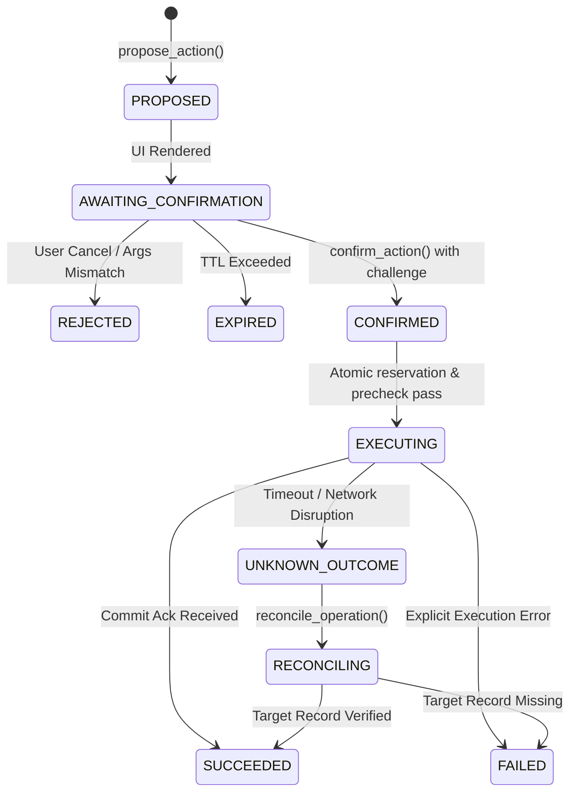

# P6 L4 ACTION CONTRACT: TYPED ALLOWLIST SPECIFICATION

**Contract Version**: `p6.l4.action.v1`  
**Repository**: `E:/lotus-fin`  

---

## 1. Registered Actions Catalog

### 1.1 Action: `lotus.task.create`
- **Target Entity**: `LotusTask`
- **Allowed Roles**: `Accounts User`, `Accounts Manager`, `System Manager`
- **Allowed Side Effects**: `AUDIT_LOG_ENTRY`, `LOTUS_TASK_INSERT`
- **Financial Authority**: `False` (Non-financial operational task)
- **Typed Arguments Schema**:
  ```json
  {
    "title": "string (1..140 chars)",
    "description": "string (1..2000 chars)",
    "due_date": "string (YYYY-MM-DD)",
    "priority": "LOW | MEDIUM | HIGH | URGENT (default: MEDIUM)"
  }
  ```

### 1.2 Action: `lotus.note.create`
- **Target Entity**: `LotusNote`
- **Allowed Roles**: `Accounts User`, `Accounts Manager`, `System Manager`
- **Allowed Side Effects**: `AUDIT_LOG_ENTRY`, `LOTUS_NOTE_INSERT`
- **Financial Authority**: `False` (Non-financial note)
- **Typed Arguments Schema**:
  ```json
  {
    "title": "string (1..140 chars)",
    "content": "string (1..5000 chars)",
    "category": "GENERAL | FOLLOWUP | AUDIT | MEETING (default: GENERAL)"
  }
  ```

### 1.3 Action: `lotus.draft_record.prepare`
- **Target Entity**: `LotusDraftRecord`
- **Allowed Roles**: `Accounts Manager`, `System Manager`
- **Allowed Side Effects**: `AUDIT_LOG_ENTRY`, `LOTUS_DRAFT_STAGE`
- **Financial Authority**: `False` (Staging draft only, no direct financial ledger write)
- **Typed Arguments Schema**:
  ```json
  {
    "record_type": "string (alphanumeric, dot, underscore, 1..64 chars)",
    "payload_summary": "string (1..500 chars)",
    "target_reference": "string | null (optional, max 128 chars)"
  }
  ```

---

## 2. Proposal Lifecycle & State Machine



---

## 3. Strict Prohibitions
- No dynamic tool invocation from raw LLM text.
- No direct ERPNext table/DocType references.
- No write execution triggered solely by text tokens ("yes", "OK", "confirm").
- Confirmation must occur via explicit HTTP POST with single-use challenge token and verified CSRF/session bindings.
