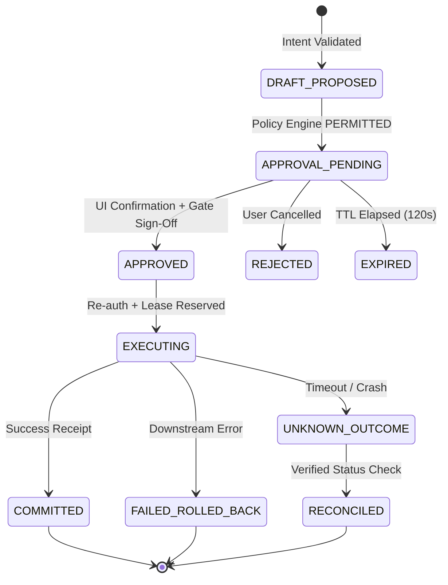

# LOTUS FIN P6-2: L5 TECHNICAL DOCUMENTATION

## 1. Overview and Scope

This technical document specifies the L5 High-Impact Action Workflows for Lotus Fin. Built independently of live ERP mutations and N0 data integrations, the L5 architecture strictly enforces:
- **No Arbitrary Execution**: Zero access to arbitrary SQL, CRUD or RPC endpoints.
- **Fail-Closed Policy Engine**: Deterministic server-evaluated rules before any proposal or execution.
- **Prepare -> Approve -> Execute Workflow**: Cryptographic review challenges, two-phase confirmation, dual-control/finance-officer approval gates, and durable operation ledger idempotency.
- **Deterministic Isolated Simulation**: Comprehensive simulation adapters for qualification and testing, while production side-effect adapters remain permanently blocked (`CAPABILITY_DISABLED`).
- **Resilient Reconciliation**: Detection of ambiguous outcomes (`UNKNOWN_OUTCOME`) without blind execution retries.

---

## 2. L5 Action Families and Invariants

| Action Family | Allowed Actions | Intended Semantics | Simulation Adapter | Production State |
| :--- | :--- | :--- | :--- | :--- |
| **DOCUMENT_SUBMIT** | `l5.doc.submit_sales_invoice.v1` | Transition draft docstatus `0 -> 1` | `SimulatedDocumentSubmitAdapter` | `CAPABILITY_DISABLED` |
| **DOCUMENT_CANCEL** | `l5.doc.cancel_sales_invoice.v1` | Transition submitted docstatus `1 -> 2` | `SimulatedDocumentCancelAdapter` | `CAPABILITY_DISABLED` |
| **EXTERNAL_EMAIL_SEND** | `l5.comm.send_statement_email.v1` | Dispatch statement to allowlisted domains | `SimulatedExternalEmailSendAdapter` | `CAPABILITY_DISABLED` |
| **PAYMENT_REQUEST** | `l5.pay.request_disbursement.v1` | Create typed Payment Request record (NOT fund transfer) | `SimulatedPaymentRequestAdapter` | `CAPABILITY_DISABLED` |
| **PAYMENT_EXECUTION** | `l5.pay.execute_wire_transfer.v1` | Direct bank disbursement | `ProductionBlockedAdapter` | **PERMANENTLY BLOCKED** |
| **SCHEDULED_AUTONOMOUS_ACTION** | `l5.sched.autonomous_reconciliation.v1` | Autonomous background task execution | `ProductionBlockedAdapter` | **PERMANENTLY BLOCKED** |

---

## 3. Workflow State Machine

