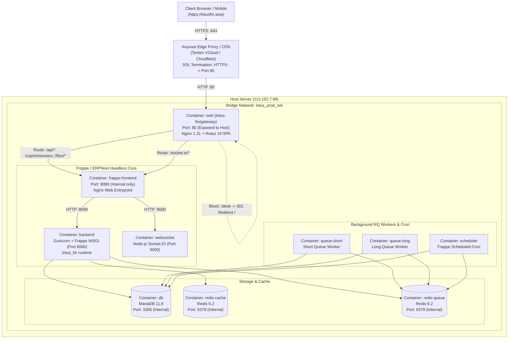

# 🏛️ System Architecture & Network Topology

Comprehensive technical documentation detailing the multi-container topology, ingress routing flow, and security boundaries of **Lotus Fin**.

---

## 1. High-Level Architectural Topology

---

## 2. Ingress URL Routing Matrix (Nginx Gateway)

| URL Pattern | Handling Target | Mechanism | Purpose |
| :--- | :--- | :--- | :--- |
| `/` | Gateway | Serves static `index.html` | Lotus Fin Home (Module Selector) |
| `/login` | Gateway | Serves static `index.html` | Custom Lotus Fin Login Screen |
| `/copilot`, `/ai` | Gateway | Serves static `index.html` | AI Financial Copilot & Conversational Studio |
| `/workspace/*` | Gateway | Serves static `index.html` | Universal Workspace View |
| `/report/*` | Gateway | Serves static `index.html` | Universal Financial Report View |
| `/app/*` | Gateway | Serves static `index.html` | Universal DocType List & Form View |
| `/assets/*.js`, `*.css` | Gateway | Serves local static files from `/usr/share/nginx/html/assets/` | Compiled React 19 SPA bundles |
| `/assets/frappe/*` | Internal Gateway | Fallback proxy to `@frappe_backend` | Frappe framework icons, SVGs, and fonts |
| `/desk` | Gateway | **Return 301 /** | **Permanently blocks native ERPNext Desk access** |
| `/api/*` | Internal Gateway | Reverse proxy -> `http://frappe-frontend:8080` | Authentication, CRUD, and ReAct AI Tool APIs |
| `/copilot/session` | Internal Gateway | Reverse proxy -> `http://frappe-frontend:8080` | Authenticated session bootstrap & CSRF verification |
| `/files/*` | Internal Gateway | Reverse proxy -> `http://frappe-frontend:8080` | Uploaded attachments & financial vouchers |
| `/socket.io/*` | Internal Gateway | Reverse proxy -> `http://frappe-frontend:8080` | Real-time WebSocket notifications & event push |

---

## 3. Defense-in-Depth & Security Boundaries

1. **Port Isolation & Perimeter Hardening**:
   - Only HTTP Port `80` is exposed to the public network interface.
   - MariaDB Port `3306`, Redis Port `6379`, and internal Frappe daemon ports (`8080`, `8000`, `9000`) reside strictly inside the isolated Docker bridge network `lotus_prod_net`.
2. **Dual-Control Governance (L5 Policy Gate)**:
   - High-risk ledger actions (e.g., cancelling posted general ledger vouchers or modifying submitted invoices) are intercepted by Lotus Fin's dual-control evaluation gate, requiring two distinct sign-offs or hard-blocking unauthorized execution.
3. **Opaque Session Epoch Tokens**:
   - The React client computes an irreversible, one-way SHA-256 session epoch from server-verified credentials (`user` + `csrfToken`). Raw cookies and secret tokens are never persisted in unencrypted browser storage.
