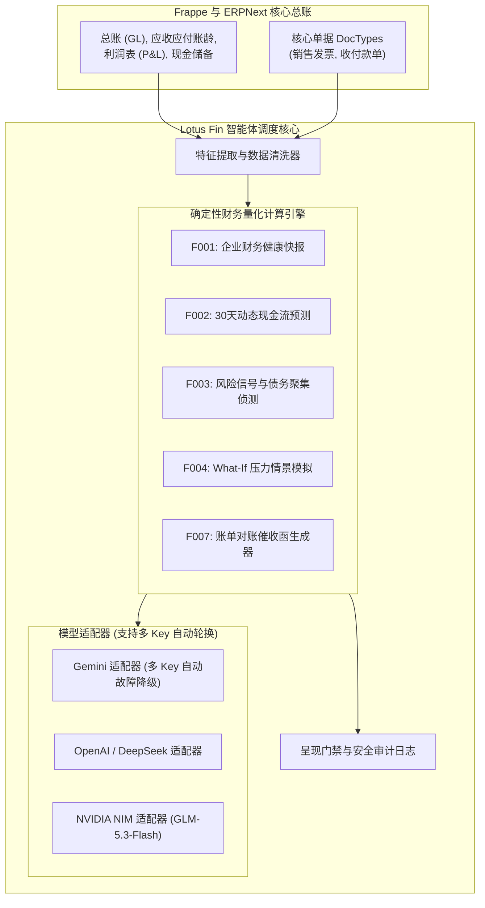

# 🧠 AI 模块架构设计规范与实现准则 — `lotus_fin`

本文档定义了将人工智能（AI）功能深度整合至 `lotus_fin` 财务生态系统中的软件架构、设计模式、目录规范与实施标准。

---

## 🏛️ 1. 核心设计哲学与原则

1. **解耦的大模型适配器模式 (Provider-Agnostic Adapter Pattern)**：支持在 Google Gemini、OpenAI、DeepSeek、NVIDIA NIM (`z-ai/glm-5.3-flash`) 以及本地离线推理运行时（Ollama / vLLM）之间无感灵活切换，无需修改任何核心财务与总账业务逻辑。
2. **与 ERP 核心松散耦合 (Loosely Coupled)**：外部大语言模型网络的波动或第三方 API 接口异常，**绝不允许影响或阻塞**企业的底层核心财务流程（如发票开具、记账过账、收付款）。
3. **确定性算子与零幻觉呈现门禁 (Presentation Gate)**：严禁 AI 自由生成或捏造财务数字。所有量化指标均由经过独立单元测试的 Python 财务引擎（F001 — F007）运算得出。呈现门禁负责过滤底层系统字段与布尔值标记，格式化为符合高管阅读规范的自然商务语言。
4. **人机协作与全流程审计 (Human-in-the-Loop & Auditability)**：通过 Copilot 生成的任何总账变动提案均默认置为 `草稿 (Draft)` 状态，在未获得特权人员通过 L5 双重控制安全门禁授权前，不得自动过账入账。

---

## 📐 2. 六边形架构示意图 (Hexagonal Architecture)



---

## 📂 3. 模块代码标准目录组织

AI 智能体子系统收敛于 `lotus_fin/lotus_fin/application/agent/` 和 `lotus_fin/infrastructure/llm/`：

```
lotus_fin/lotus_fin/
├── application/
│   ├── agent/
│   │   ├── agent_runner.py          # ReAct Agent 执行循环与呈现门禁
│   │   └── prompt_engine.py         # 扎根 Prompt 指令集与业务边界规则
│   └── port/
│       ├── i_llm_provider.py        # 抽象 LLM 提供商接口
│       └── i_tool_invoker.py        # 确定性工具调用者端口
├── domain/
│   └── constants/
│       └── executive_messages.py    # 集中化商务术语字典与安全裁决文案
├── infrastructure/
│   └── llm/
│       ├── adapter/
│       │   ├── gemini_llm_adapter.py # Google Gemini 多 Key 自动轮换适配器
│       │   ├── openai_llm_adapter.py # OpenAI / NVIDIA NIM 故障降级适配器
│       │   └── mock_llm_adapter.py   # 纯单测密闭适配器
│       └── llm_factory.py           # 动态模型工厂
└── modules/                         # 确定性量化业务逻辑模块
    ├── f001_health/
    ├── f002_cashflow/
    ├── f003_risk_signal/
    ├── f004_what_if/
    ├── f005_financing/
    ├── f006_repayment/
    └── f007_debt_reminder/
```
