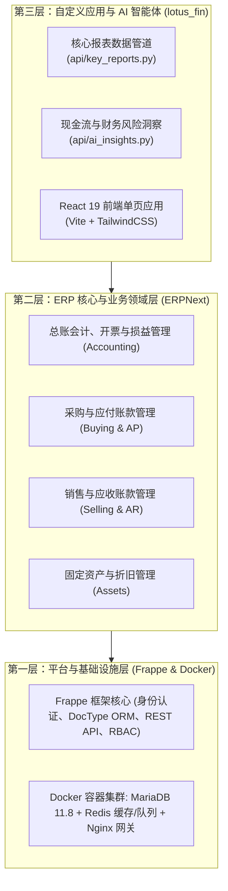

# 🚀 项目初始化与开发者/AI 智能体上手指南

本指南详细介绍了配置本地开发环境、启动 Docker 服务集群，以及在 Frappe 与 ERPNext 基础架构之上安装部署 **`lotus_fin`** 自定义模块的完整工作流程。

---

## 🏗️ 1. 多层架构全景

Lotus Fin 严格划分为三个清晰解耦的架构层级：



---

## 💻 2. 开发者与 AI 智能体上手指南

### 环境依赖前置要求：
- **操作系统：** Linux、macOS 或 Windows 10/11（配合 WSL2 或 PowerShell）。
- **Docker 与 Docker Compose：** 确保 Docker Engine 服务正常运行。
- **Node.js 18+ 及 npm：** 用于编译与构建前端资源。

---

### 第一步：克隆代码仓库并核验目录结构
```bash
git clone https://github.com/your-org/lotus-fin.git
cd lotus-fin
```

### 第二步：借助一键脚本自动化启动系统
Lotus Fin 在 `scripts/` 目录下提供了全自动化的运行与运维脚本：

#### 方案 A：极速本地开发调试（前端 + 后端）
- **Linux / macOS / WSL 环境：**
  ```bash
  ./run.sh dev
  ```
- **Windows（PowerShell 原生终端）：**
  ```powershell
  .\scripts\dev\run-dev.ps1
  ```
脚本会自动在后台拉起 MariaDB、Redis 与 Frappe 容器集群，完成 `lotus_fin` 模块同步与数据库迁移，载入演示凭证数据，并启动监听在 `http://localhost:5173` 的 Vite 前端热重载服务。

#### 方案 B：云服务器一键生产环境部署（80 端口）
```bash
./run.sh deploy
```
该脚本全自动检测服务器硬件规格（若内存不足自动扩容 2GB Swapfile），打包配置 Nginx 生产反向代理网关，自动解压导入初始金融全量账目数据包（`scripts/data/database/initial_db_seed.sql.gz`），并直接对外暴露 HTTP 80 端口。
