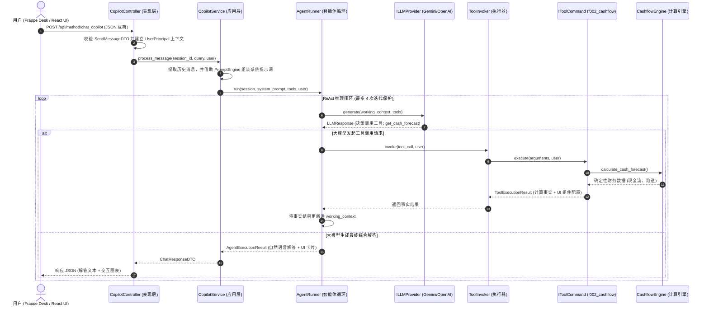

# 组件交互与设计模式实践 (SOLID 架构对齐)

---

## 1. 端到端组件时序交互图 (Sequence Flow)

以下展示当用户在 Frappe Desk 或 React UI 前端发起自然语言财务咨询时，各架构层次之间的协作执行生命周期：

---

## 2. 经典面向对象设计模式实践

Lotus Fin 严格践行 GoF (Gang of Four) 经典设计模式，确保系统高内聚、低耦合：

### 2.1. 命令模式 (Command Pattern — 金融工具解耦)
- **解决痛点**: 避免智能体循环中使用复杂的 `if-elif-else` 结构去硬编码分派 7 大金融计算引擎。
- **落地实践**:
  - 声明 `IToolCommand` 命令抽象接口，包含 `definition`、`is_authorized(user)` 与 `execute(args, user)`。
  - 每个金融引擎独立封装为一个命令类（如 `GetFinancialHealthTool`、`GetCashflowForecastTool`）。
  - 由 `ToolInvoker` 统一负责命令的动态调度与熔断保护。

### 2.2. 抽象工厂模式 (Abstract Factory — 大模型提供商抽象)
- **解决痛点**: 支持在 Google Gemini、OpenAI、DeepSeek、NVIDIA NIM 或本地 Mock 引擎之间无缝切换。
- **落地实践**:
  - `LLMProviderFactory` 依据环境变量动态创建并返回实现了 `ILLMProvider` 的具体适配器实例。

### 2.3. 适配器模式 (Adapter Pattern — 异构大模型协议归一化)
- **解决痛点**: 各大模型厂商的 API 报文结构、角色定义（`assistant` vs `model`）及 Function Calling 格式各不相同。
- **落地实践**:
  - `OpenAILLMAdapter` 与 `GeminiLLMAdapter` 分别封装厂商特定协议，将其双向转化为系统标准的内部 `LLMResponse` 与 `ToolDefinition`。

### 2.4. 门面模式 (Facade Pattern — 业务边界聚合)
- **解决痛点**: 上层业务调用底层复杂的鉴权与总账查询逻辑时，需要简化调用接口。
- **落地实践**:
  - `FrappeAccessGateway` 充当安全统一门面，屏蔽 ERPNext 复杂的底层权限细节。

### 2.5. 策略模式 (Strategy Pattern — 模块级权限隔离)
- **解决痛点**: 各业务模块对 DocType 与报表的访问权限判定逻辑存在差异。
- **落地实践**:
  - 各模块独立注册对应的 `ModuleSecurityPolicy`，支持未来扩展新模块而无需修改核心鉴权链路。

---

## 3. SOLID 软件设计原则落地审查

| SOLID 原则 | 在 Lotus Fin 中的具体落地实践 |
| :--- | :--- |
| **S — 单一职责原则 (Single Responsibility)** | 各类职责界限清晰： • `PromptEngine`: 仅负责组装提示词文本。 • `AgentRunner`: 仅管理 ReAct 循环状态跳转。 • `ToolInvoker`: 仅处理工具执行时的异常与熔断。 • `OpenAILLMAdapter`: 仅处理 OpenAI 协议通信。 |
| **O — 开闭原则 (Open/Closed)** | 扩展新金融工具时，只需实现新的 `IToolCommand` 并注册到 `ToolRegistry`，完全无需修改 `AgentRunner` 或 `CopilotService` 的核心代码。 |
| **L — 里氏替换原则 (Liskov Substitution)** | 所有实现 `ILLMProvider` 接口的适配器均可随时相互替换，不破坏智能体调用逻辑。 |
| **I — 接口隔离原则 (Interface Segregation)** | 避免庞大臃肿的接口。`ILLMProvider` 仅声明 `generate()`；`IToolCommand` 仅聚焦工具执行；`IPermissionPolicy` 仅聚焦安全校验。 |
| **D — 依赖倒置原则 (Dependency Inversion)** | 应用层与领域层完全不依赖具体的数据库驱动或网络客户端，所有外向调用均依赖抽象端口 (Ports)。 |
