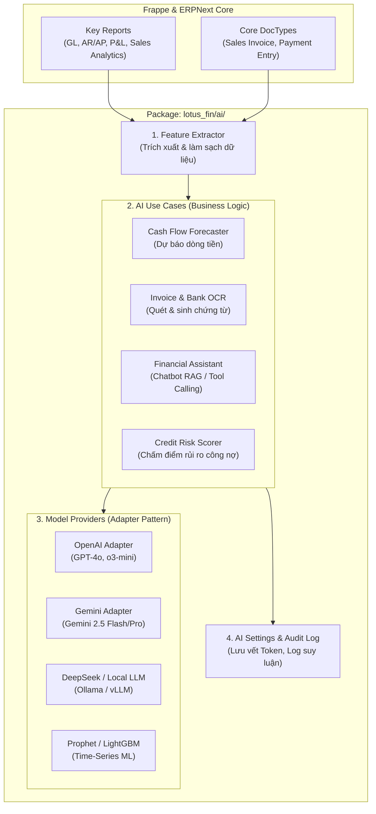

# 🧠 Đề Xuất Kiến Trúc & Thiết Kế Module AI Cho `lotus_fin`

Tài liệu này định nghĩa chi tiết kiến trúc phần mềm, nguyên lý thiết kế (Design Patterns), cấu trúc thư mục và quy chuẩn triển khai các tính năng Trí tuệ Nhân tạo (AI) tích hợp vào hệ thống Quản lý Tài chính `lotus_fin`.

---

## 🏛️ 1. Triết Lý Thiết Kế & Mục Tiêu Kiến Trúc

1. **Provider-Agnostic (Không phụ thuộc nhà cung cấp)**: Cho phép hoán đổi linh hoạt giữa OpenAI, Google Gemini, DeepSeek, Anthropic hoặc các mô hình mã nguồn mở chạy Local (Ollama / vLLM / HuggingFace) thông qua cơ chế Adapter mà không phải sửa logic nghiệp vụ.
2. **Loosely Coupled (Ghép nối lỏng với Lõi ERP)**: Lỗi mạng hoặc sự cố sập API của dịch vụ AI bên ngoài **không bao giờ được làm gián đoạn** các nghiệp vụ cốt lõi (xuất hóa đơn, thu chi, ghi sổ cái).
3. **Human-in-the-Loop & Auditability (Minh bạch & Kiểm soát)**: Mọi thao tác do AI tạo ra (nhập liệu hóa đơn tự động, hạch toán) chỉ được lưu ở trạng thái **Nháp (Draft)** để con người xét duyệt. Toàn bộ prompt, token, chi phí và căn cứ suy luận đều phải được ghi log vào bảng `AI Audit Log`.
4. **Key Reports Driven**: Tận dụng tối đa dữ liệu sạch từ các báo cáo trọng yếu (`General Ledger`, `Accounts Receivable`, `Profit and Loss`, `Stock Balance`) làm nguồn Feature Engineering.

---

## 📐 2. Sơ Đồ Kiến Trúc Hexagonal / Adapter Pattern



---

## 📂 3. Cấu Trúc Thư Mục Code Chuẩn Hóa

Toàn bộ module AI được tổ chức trong package `lotus_fin/lotus_fin/ai/`:

```
lotus_fin/lotus_fin/ai/
├── __init__.py
│
├── core/                              # Lõi trừu tượng (Interfaces & Contracts)
│   ├── __init__.py
│   ├── base_provider.py               # Abstract Base Class cho LLM/Vision Providers
│   ├── base_forecaster.py             # Interface cho các thuật toán Time-Series ML
│   ├── factory.py                     # Provider Factory (khởi tạo provider từ cấu hình DB)
│   └── exceptions.py                  # Custom AI Exceptions
│
├── providers/                         # Các Adapter kết nối mô hình (Dễ dàng hoán đổi)
│   ├── __init__.py
│   ├── openai_provider.py             # Adapter OpenAI
│   ├── gemini_provider.py             # Adapter Google Gemini
│   ├── deepseek_provider.py           # Adapter DeepSeek / Ollama
│   └── local_prophet.py               # Adapter thuật toán Facebook Prophet
│
├── features/                          # Các Use Case nghiệp vụ cụ thể
│   ├── __init__.py
│   │
│   ├── cashflow_forecast/             # [Use Case 1] Dự báo dòng tiền
│   │   ├── __init__.py
│   │   ├── extractor.py               # Lấy features từ General Ledger & AR/AP
│   │   ├── engine.py                  # Thuật toán dự báo & sinh nhận định
│   │   └── api.py                     # Whitelisted REST API cho Frontend
│   │
│   ├── invoice_ocr/                   # [Use Case 2] Quét Hóa đơn / Sao kê ngân hàng
│   │   ├── __init__.py
│   │   ├── parser.py                  # Vision Prompting & trích xuất JSON
│   │   ├── mapper.py                  # Map JSON -> Frappe "Purchase Invoice"
│   │   └── api.py                     # API nhận file upload
│   │
│   └── financial_assistant/           # [Use Case 3] Trợ lý tài chính (Text-to-Report)
│       ├── __init__.py
│       ├── tools.py                   # Function Calling Tools (query P&L, AR, Cash)
│       ├── agent.py                   # ReAct / Tool-use Agent Loop
│       └── api.py                     # Chat API endpoint
│
└── doctype/                           # Các bảng DocType quản lý trong Frappe
    ├── ai_settings/                   # Cấu hình API Key, Model mặc định, Temperature
    └── ai_audit_log/                  # Ghi log lịch sử gọi AI, token tiêu thụ, phản hồi
```

---

## 💻 4. Thiết Kế Chi Tiết & Mã Nguồn Mẫu (Code Blueprints)

### A. Core Provider Interface (`core/base_provider.py`)

```python
from abc import ABC, abstractmethod
from typing import Any, Dict, Optional

class BaseLLMProvider(ABC):
    """Giao diện hợp đồng (Contract) cho mọi nhà cung cấp LLM."""

    @abstractmethod
    def generate_completion(
        self,
        system_prompt: str,
        user_prompt: str,
        temperature: float = 0.2,
        **kwargs
    ) -> str:
        """Sinh phản hồi dạng text."""
        pass

    @abstractmethod
    def extract_structured_data(
        self,
        prompt: str,
        schema: Dict[str, Any],
        image_bytes: Optional[bytes] = None,
        mime_type: Optional[str] = None
    ) -> Dict[str, Any]:
        """Trích xuất JSON có cấu trúc (cho OCR hóa đơn, trích xuất thực thể)."""
        pass

    @abstractmethod
    def execute_tools(
        self,
        messages: list,
        tools: list,
        **kwargs
    ) -> Dict[str, Any]:
        """Xử lý Function Calling / Tool Calling cho AI Agent."""
        pass
```

---

### B. Use Case 1: Dự Báo Dòng Tiền (`features/cashflow_forecast/engine.py`)

```python
import frappe
import pandas as pd
from typing import Dict, Any
from lotus_fin.api.key_reports import extract_key_report_data
from lotus_fin.ai.core.factory import get_default_llm_provider

class CashFlowForecastEngine:
    """Động cơ tính toán dự báo dòng tiền kết hợp số liệu thống kê và nhận định LLM."""

    def __init__(self, company: str):
        self.company = company
        self.provider = get_default_llm_provider()

    def run_forecast(self, horizon_days: int = 30) -> Dict[str, Any]:
        # 1. Trích xuất dữ liệu sạch từ Key Reports
        ar_data = extract_key_report_data("accounts_receivable", company=self.company)
        ap_data = extract_key_report_data("accounts_payable", company=self.company)
        gl_data = extract_key_report_data("general_ledger", company=self.company)

        # 2. Tiền xử lý dữ liệu với Pandas
        df_ar = pd.DataFrame(ar_data.get("data", []))
        df_ap = pd.DataFrame(ap_report_data := ap_data.get("data", []))

        total_inflow = float(df_ar["outstanding"].sum()) if not df_ar.empty and "outstanding" in df_ar else 0.0
        total_outflow = float(df_ap["outstanding"].sum()) if not df_ap.empty and "outstanding" in df_ap else 0.0
        net_flow = total_inflow - total_outflow

        # 3. Sử dụng LLM để sinh nhận định tài chính chuyên sâu
        prompt = f"""
        Công ty: {self.company}
        Khoản phải thu dự kiến ({horizon_days} ngày): {total_inflow:,.0f} VND
        Khoản phải trả dự kiến ({horizon_days} ngày): {total_outflow:,.0f} VND
        Dòng tiền ròng: {net_flow:,.0f} VND
        Hãy đưa ra 3 lời khuyên tài chính ngắn gọn cho Giám đốc điều hành.
        """
        
        commentary = self.provider.generate_completion(
            system_prompt="Bạn là Giám đốc Tài chính (CFO) ảo giàu kinh nghiệm cho SME.",
            user_prompt=prompt
        )

        return {
            "company": self.company,
            "horizon_days": horizon_days,
            "predicted_inflow": total_inflow,
            "predicted_outflow": total_outflow,
            "net_flow": net_flow,
            "cfo_insights": commentary
        }
```

---

### C. Use Case 2: Quét Hóa Đơn Tự Động Tạo Chứng Từ (`features/invoice_ocr/`)

```python
# features/invoice_ocr/mapper.py
import frappe

def create_draft_purchase_invoice(extracted_data: dict) -> str:
    """
    Tự động tạo Hóa đơn mua hàng (Purchase Invoice) ở trạng thái DRAFT từ dữ liệu OCR.
    """
    # 1. Tìm hoặc tạo Nhà cung cấp
    supplier_name = extracted_data.get("supplier_name")
    if not frappe.db.exists("Supplier", supplier_name):
        supplier = frappe.get_doc({
            "doctype": "Supplier",
            "supplier_name": supplier_name,
            "supplier_group": "All Supplier Groups"
        }).insert(ignore_permissions=True)
    
    # 2. Tạo Purchase Invoice (Trạng thái Draft docstatus=0)
    doc = frappe.get_doc({
        "doctype": "Purchase Invoice",
        "supplier": supplier_name,
        "bill_no": extracted_data.get("invoice_number"),
        "posting_date": extracted_data.get("invoice_date", frappe.utils.today()),
        "items": [
            {
                "item_name": item.get("description"),
                "qty": item.get("quantity", 1),
                "rate": item.get("unit_price", 0),
                "amount": item.get("total_price", 0)
            } for item in extracted_data.get("items", [])
        ],
        "remarks": "Tự động trích xuất từ AI Invoice OCR"
    })
    
    doc.insert(ignore_permissions=True)
    return doc.name
```

---

## 🛠️ 5. Lộ Trình Triển Khai (Roadmap)

| Giai đoạn | Mục tiêu | Deliverables |
| :--- | :--- | :--- |
| **Pha 1: Nền tảng** *(Đã hoàn thành)* | Xây dựng Scaffolding, Key Reports Pipeline, Scope Module | `lotus_fin`, `key_reports.py`, `ai_insights.py` |
| **Pha 2: Providers & OCR** | Hoàn thiện Adapter Gemini/OpenAI & tính năng OCR hóa đơn | `core/base_provider.py`, `features/invoice_ocr/` |
| **Pha 3: Dự Báo Dòng Tiền** | Xây dựng thuật toán dự báo dòng tiền 30-90 ngày | `features/cashflow_forecast/` |
| **Pha 4: Trợ Lý Tài Chính** | Chatbot hỏi đáp số liệu báo cáo tự động (Text-to-Report) | `features/financial_assistant/` |
