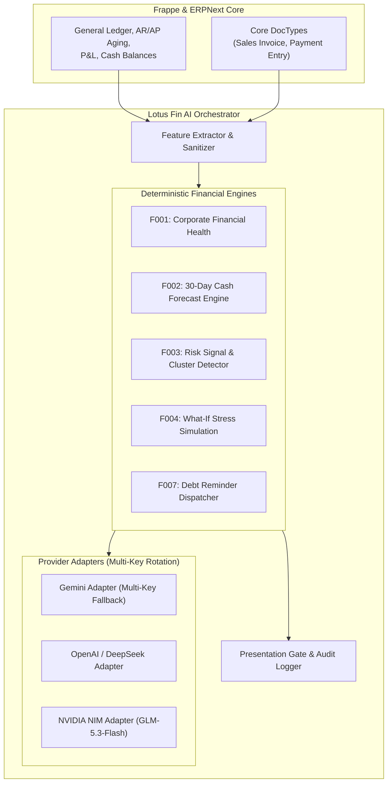

# 🧠 AI Module Architecture & Design Specification — `lotus_fin`

This specification defines the software architecture, design patterns, directory conventions, and implementation standards for integrating Artificial Intelligence (AI) capabilities into the `lotus_fin` financial ecosystem.

---

## 🏛️ 1. Design Philosophy & Core Principles

1. **Provider-Agnostic Adapter Pattern**: Enables seamless, zero-downtime switching across Google Gemini, OpenAI, DeepSeek, NVIDIA NIM (`z-ai/glm-5.3-flash`), or local inference runtimes (Ollama / vLLM) without modifying core domain accounting logic.
2. **Loosely Coupled with ERP Core**: External AI network latency or API provider degradation **must never interrupt** core accounting and transaction processing (invoicing, ledger postings, payments).
3. **Deterministic Output & Presentation Gate**: AI agents must never hallucinate financial numbers. All quantitative figures are derived from audited Python calculation engines (F001 - F007). An automated presentation gate cleanses raw database tokens and boolean flags before rendering responses to executives.
4. **Human-in-the-Loop & Auditability**: Any ledger-modifying proposals created via Copilot remain in `Draft` state until explicitly authorized by privileged users under L5 Dual-Control safety policies.

---

## 📐 2. Hexagonal Architecture Diagram



---

## 📂 3. Standardized Package Layout

The AI sub-ecosystem resides in `lotus_fin/lotus_fin/application/agent/` and `lotus_fin/infrastructure/llm/`:

```
lotus_fin/lotus_fin/
├── application/
│   ├── agent/
│   │   ├── agent_runner.py          # ReAct Agent loop & presentation gate
│   │   └── prompt_engine.py         # Grounded system instructions & boundary rules
│   └── port/
│       ├── i_llm_provider.py        # Abstract LLM provider interface
│       └── i_tool_invoker.py        # Deterministic tool invoker port
├── domain/
│   └── constants/
│       └── executive_messages.py    # Standardized business glossary & safety verdicts
├── infrastructure/
│   └── llm/
│       ├── adapter/
│       │   ├── gemini_llm_adapter.py # Google Gemini with multi-key rotation
│       │   ├── openai_llm_adapter.py # OpenAI / NVIDIA NIM with fallback
│       │   └── mock_llm_adapter.py   # Hermetic test adapter
│       └── llm_factory.py           # Provider instantiation factory
└── modules/                         # Deterministic business calculation modules
    ├── f001_health/
    ├── f002_cashflow/
    ├── f003_risk_signal/
    ├── f004_what_if/
    ├── f005_financing/
    ├── f006_repayment/
    └── f007_debt_reminder/
```
