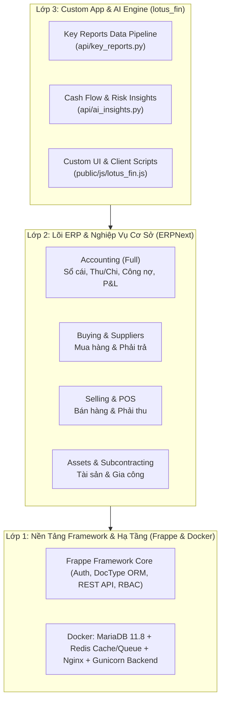

# 🚀 Hướng Dẫn Cài Đặt Dự Án & Onboarding Cho Lập Trình Viên & AI Agent

Tài liệu này cung cấp toàn bộ quy trình thiết lập môi trường, chạy cụm container Docker, cài đặt Custom App **`lotus_fin`** trên nền Frappe/ERPNext, và hướng dẫn chi tiết dành cho các **AI Coding Agent** để tương tác với hệ thống.

---

## 🏗️ 1. Tổng Quan Kiến Trúc Hệ Thống (Architecture Overview)

Dự án `lotus-fin` được cấu trúc theo mô hình **3 lớp (3-Tier)**:



---

## 💻 2. Hướng Dẫn Cài Đặt Cho Lập Trình Viên (Human Developer Guide)

### Yêu cầu tiên quyết:
- **Hệ điều hành**: Windows 10/11 (bật WSL2) hoặc macOS / Linux.
- **Docker Desktop**: Đã cài đặt và đang chạy.
- **Git** & **Node.js 18+** (nếu muốn dùng GitNexus / UI build).

---

### Bước 1: Clone Repository & Chuẩn bị Cấu trúc Thư mục

```bash
# Clone repo về máy
git clone https://github.com/trungkienit25/lotus-fin.git
cd lotus-fin

# Cấu trúc thư mục chính của dự án:
# lotus-fin/
# ├── frappe_docker/    # Cấu hình Docker Compose chính thức
# ├── lotus_fin/        # Mã nguồn Custom App Lotus Fin & AI Pipeline
# ├── legacy/           # Mã nguồn tham khảo ERPNext gốc
# └── docs/             # Tài liệu kiến trúc & hướng dẫn
```

---

### Bước 2: Khởi chạy Cụm Container Docker (1-Click)

1. Vào thư mục Docker:
   ```powershell
   cd frappe_docker
   ```

2. Khởi chạy toàn bộ hệ thống bằng file `pwd.yml` (Play-With-Docker / Standalone):
   ```powershell
   docker compose -f pwd.yml up -d
   ```

3. **Theo dõi quá trình tạo Site ban đầu** (chỉ mất ~2 phút trong lần chạy đầu tiên):
   ```powershell
   docker logs frappe_docker-create-site-1 -f
   ```
   *Khi thấy dòng `Current Site set to frontend` là hệ thống đã sẵn sàng.*

4. Mở trình duyệt truy cập:
   - **URL**: `http://localhost:8080`
   - **Tài khoản**: `Administrator`
   - **Mật khẩu**: `admin`

---

### Bước 3: Cài đặt Custom App `lotus_fin` vào Container

Để code của app `lotus_fin` trên máy bạn tự động đồng bộ vào container và chạy trên web:

1. **Mount thư mục `lotus_fin` vào backend container** (hoặc copy code vào container):
   ```powershell
   # Cài đặt package python của lotus_fin ở chế độ editable (-e)
   docker exec -w /home/frappe/frappe-bench frappe_docker-backend-1 ./env/bin/pip install -e /home/frappe/frappe-bench/apps/lotus_fin
   ```

2. **Cài app vào site `frontend`**:
   ```powershell
   docker exec frappe_docker-backend-1 bench --site frontend install-app lotus_fin
   ```

3. **Chạy Migration để đồng bộ cấu hình và assets**:
   ```powershell
   docker exec frappe_docker-backend-1 bench --site frontend migrate
   ```

---

### Bước 4: Nạp Dataset Mẫu (Demo Data) để Test Ngay

Để có sẵn Khách hàng, Hàng hóa, Đơn hàng, Hóa đơn và Báo cáo tài chính mẫu:
```powershell
docker exec frappe_docker-backend-1 bench --site frontend execute erpnext.setup.demo.setup_demo_data --kwargs "{'company_name': 'Lotus-fin'}"
```

---

## 🤖 3. Hướng Dẫn Dành Riêng Cho AI Coding Agents (AI Agent Protocol)

Khi các **AI Agent** (như Antigravity, Claude, Cursor, Devin) đọc và phát triển trong codebase này, AI Agent **PHẢI tuân thủ các quy tắc sau**:

### A. Quy tắc Giao tiếp Dữ liệu với ERP Core:
1. **Không can thiệp trực tiếp vào SQL thô** trừ khi thực sự cần thiết. Luôn ưu tiên dùng **Frappe ORM** hoặc **Whitelisted Python APIs**.
2. **Trích xuất dữ liệu qua Key Reports Pipeline**:
   - Khi cần số liệu tài chính, doanh số, tồn kho để huấn luyện model hoặc phân tích, gọi hàm:
     ```python
     from lotus_fin.api.key_reports import extract_key_report_data, get_ai_training_dataset
     
     # Lấy toàn bộ dataset hợp nhất từ các Key Reports
     data = get_ai_training_dataset(company="Lotus-fin")
     ```
3. **Mở rộng API mới**:
   - Mọi hàm backend phục vụ AI / Client mới phải đặt trong `lotus_fin/lotus_fin/api/` và có decorator `@frappe.whitelist()`.

---

### B. Bảng Ánh Xạ Key Reports Cốt Lõi cho AI:

| Mục tiêu phân tích của AI | Key Report Name tương ứng | Hàm gọi API |
| :--- | :--- | :--- |
| **Dòng tiền & Phát sinh thu chi** | `General Ledger` | `extract_key_report_data("general_ledger")` |
| **Dự báo nợ & Rủi ro tín dụng** | `Accounts Receivable` | `extract_key_report_data("accounts_receivable")` |
| **Nợ phải trả nhà cung cấp** | `Accounts Payable` | `extract_key_report_data("accounts_payable")` |
| **Doanh thu, Chi phí & P&L** | `Profit and Loss Statement` | `extract_key_report_data("profit_and_loss")` |
| **Xu hướng bán hàng** | `Sales Analytics` | `extract_key_report_data("sales_analytics")` |
| **Chi phí mua hàng** | `Purchase Analytics` | `extract_key_report_data("purchase_analytics")` |
| **Khấu hao tài sản cố định** | `Asset Depreciation Ledger` | `extract_key_report_data("asset_depreciation_ledger")` |

---

### C. Cheat-Sheet Lệnh CLI Thường Dùng (Dành cho Dev & AI Agent):

```powershell
# 1. Chạy 1 hàm Python bất kỳ trong site:
docker exec frappe_docker-backend-1 bench --site frontend execute lotus_fin.api.ai_insights.predict_cashflow

# 2. Xem logs của ứng dụng:
docker logs frappe_docker-backend-1 --tail 50 -f

# 3. Chạy unit tests cho lotus_fin:
docker exec frappe_docker-backend-1 bench --site frontend run-tests --app lotus_fin

# 4. Truy cập database MariaDB trực tiếp:
docker exec -it frappe_docker-db-1 mariadb -u root -padmin

# 5. Xóa dữ liệu demo khi chuyển sang dữ liệu thật:
docker exec frappe_docker-backend-1 bench --site frontend execute erpnext.setup.demo.clear_demo_data

# 6. Re-index đồ thị code với GitNexus:
node .gitnexus/run.cjs analyze --index-only
```

---

## 🎯 4. Danh Mục Module Hoạt Động (Scope Summary)

```
[BẬT / HIỂN THỊ]
├── 💰 Accounting      (Sổ cái, Thu/Chi, Công nợ, P&L, Dòng tiền)
├── 🛒 Buying          (Mua hàng, Nhà cung cấp, Bảng giá mua)
├── 📦 Selling         (Bán hàng, Khách hàng, Báo giá, POS)
├── 🏢 Assets          (Tài sản cố định & Lịch trích khấu hao)
├── 🔄 Subcontracting  (Gia công trong và ngoài)
├── ⚙️ Settings        (Cấu hình hệ thống, Tiền tệ VND, Năm tài chính)
└── 🤖 Lotus Fin AI    (Bộ công cụ phân tích & dự báo thông minh)

[ẨN / KHÔNG DÙNG]
└── 🚫 Manufacturing, Quality, Healthcare, Agriculture, Education...
```

---

## 🎨 5. AI Feature UI/Productization Lessons (Áp Dụng Cho AI001–AI007)

Trong quá trình phát triển sản phẩm Lotus Fin từ backend engine lên tầng trải nghiệm người dùng (UX), đội ngũ kỹ thuật và AI Agent bắt buộc phải tuân thủ 10 nguyên tắc sau cho toàn bộ các tính năng AI (từ AI001 Financial Health đến AI002–AI007):

1. **Không ẩn giấu trí tuệ nhân tạo đằng sau một nhãn duy nhất (Do not hide intelligence behind one label):**
   Tuyệt đối không thu hẹp toàn bộ phân tích phức tạp của hệ thống thành một nhãn đơn giản như `GOOD / BAD / HIGH / HEALTHY` kèm một câu nói chung chung. Giao diện phải phản ánh các tầng thông tin có giá trị nghiệp vụ.
2. **Phân rã trực quan: Dữ liệu thật, Nhận định, Giới hạn và Hành động tiếp theo (Separate Fact, Interpretation, Limitation, Next Action):**
   Một kết quả phân tích AI đáng tin cậy phải được phân tách rõ ràng thành: (1) Số liệu thực tế đã kiểm chứng (Facts), (2) Nhận định chẩn đoán tài chính (Interpretations), (3) Ranh giới & giới hạn dữ liệu (Limitations), (4) Bước kiểm tra tiếp theo (Next Actions). Không gộp tất cả thành một đoạn văn xuôi.
3. **Bằng chứng kiểm toán là một phần của trải nghiệm người dùng (Evidence is part of AI UX, not only backend audit):**
   Người dùng và ban giám khảo cần trả lời được câu hỏi: *"Số liệu này lấy từ đâu?"*. Giao diện phải cung cấp tính năng mở ngăn kéo bằng chứng (Evidence Drawer) hiển thị tên báo cáo ERPNext, phạm vi ngày, timestamp và checksum an toàn.
4. **Trạng thái thiếu dữ liệu một phần cần có giao diện chủ đích (Partial and unavailable states need intentional UI):**
   Trong thực tế SME, dữ liệu thường không hoàn hảo (thiếu kỳ trước, thiếu định nghĩa kỳ hạn...). Không được che giấu hoặc bịa số 0; phải thể hiện nhãn `Unavailable` kèm lý do cụ thể trên UI.
5. **Lỗi Model hoặc bên thứ ba phải bảo toàn giá trị số học xác định (Model failure must preserve deterministic value):**
   Khi LLM API gặp sự cố (timeout, 429, 500), giao diện tự động hạ cấp sạch: giữ nguyên toàn bộ thẻ KPI, bảng đối chiếu kỳ và bằng chứng kế toán, chỉ hiển thị thông báo diễn giải AI tạm thời vắng mặt.
6. **Không đánh tráo nhận diện tính năng trong kịch bản demo (Do not confuse feature identity in demo):**
   Mỗi tính năng AI có phạm vi nghiệp vụ riêng biệt. Tính năng phân tích sức khỏe tài chính toàn công ty (AI001) phải chạy trên Workspace cấp Company, không được dùng pop-up kiểm tra rủi ro hóa đơn khách hàng (AI Credit Check) để thay thế cho demo AI001.
7. **Demo phải bắt đầu từ bài toán/quyết định của người dùng (Demo should begin with the user decision/problem):**
   Không mở đầu demo bằng các thuật ngữ kỹ thuật (Prompt tokens, Embeddings, Docker). Hãy bắt đầu từ câu hỏi của chủ doanh nghiệp: *"Vì sao doanh thu tăng mà tiền trong tài khoản lại âm? Áp lực công nợ đang nằm ở đâu?"*.
8. **Không bịa biểu đồ hoặc điểm số để tỏ ra phức tạp (Do not fabricate charts/scores to make AI look complex):**
   Tránh vẽ biểu đồ chuỗi thời gian khi backend chỉ có dữ liệu 1-2 kỳ. Một bảng so sánh chuẩn xác và trung thực có giá trị cao hơn nhiều so với biểu đồ giả lập. Không tự tạo "Financial Health Score (1-100)" khi chưa có chuẩn kế toán định nghĩa.
9. **Giao diện sản phẩm phải tôn vinh trí tuệ tài chính, không phải hệ thống đường ống (Product UI should expose intelligence, not plumbing):**
   Không hiển thị raw JSON, SQL queries, traceback lỗi hoặc thông số server ra màn hình người dùng thông thường. Sử dụng cơ chế công bố thông tin tăng dần (progressive disclosure).
10. **Độ hoàn thiện backend và tác động trải nghiệm demo là hai thước đo chất lượng khác nhau (Backend maturity and demo impact are different quality dimensions):**
    Một backend đạt 60/60 test pass nhưng nếu chỉ hiển thị ra một pop-up modal đơn điệu thì sản phẩm vẫn thất bại trong mắt khách hàng và ban giám khảo. Đầu tư vào UI workspace chuẩn chỉnh là điều kiện tiên quyết để thương mại hóa tính năng AI.

