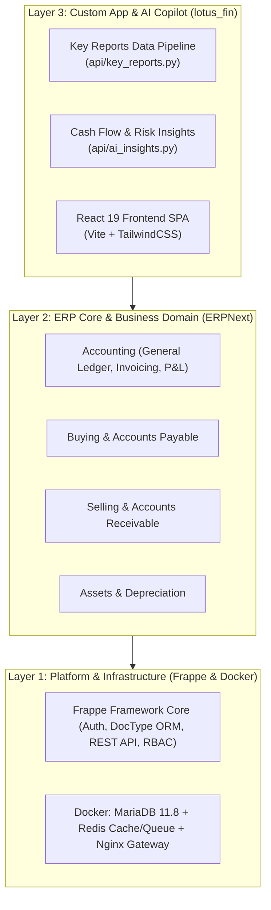

# 🚀 Project Setup & Developer/Agent Onboarding Guide

This guide describes the complete workflow for setting up the local environment, booting Docker service clusters, and installing the custom app **`lotus_fin`** atop Frappe and ERPNext.

---

## 🏗️ 1. Multi-Tier Architecture Overview

Lotus Fin is structured into three clear architectural layers:



---

## 💻 2. Setup Guide for Developers & AI Agents

### Prerequisites:
- **Operating System:** Linux, macOS, or Windows 10/11 (with WSL2 or PowerShell).
- **Docker & Docker Compose:** Docker Engine running.
- **Node.js 18+ & npm:** Required for building frontend assets.

---

### Step 1: Clone Repository & Verify Structure
```bash
git clone https://github.com/your-org/lotus-fin.git
cd lotus-fin
```

### Step 2: Automated Startup via Operational Scripts
Lotus Fin provides automated setup scripts under `scripts/`:

#### Option A: Quick Dev Launch (Frontend + Backend)
- **Linux / macOS / WSL:**
  ```bash
  ./run.sh dev
  ```
- **Windows (PowerShell):**
  ```powershell
  .\scripts\dev\run-dev.ps1
  ```
This starts MariaDB, Redis, and Frappe in the background, syncs `lotus_fin`, applies database migrations, seeds demo accounting records, and launches the Vite dev server at `http://localhost:5173`.

#### Option B: 1-Click Production Cloud Deployment (Port 80)
```bash
./run.sh deploy
```
This automatically allocates a 2GB Swapfile (if memory is low), packages the Nginx Gateway, hydrates database seed records (`scripts/data/database/initial_db_seed.sql.gz`), and exposes the app on HTTP Port 80.
