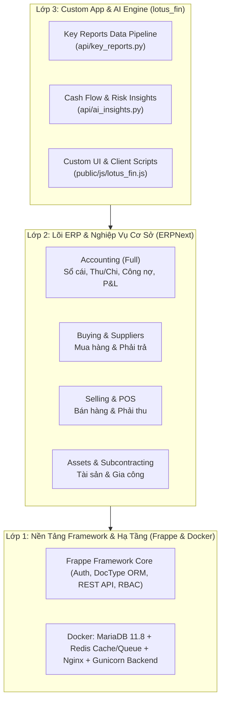

# 🚀 Hướng Dẫn Cài Đặt Dự Án & Onboarding Cho Lập Trình Viên & AI Agent

Tài liệu này cung cấp toàn bộ quy trình thiết lập môi trường, chạy cụm container Docker, cài đặt Custom App **`lotus_fin`** trên nền Frappe/ERPNext, và hướng dẫn chi tiết dành cho các **AI Coding Agent** để tương tác với hệ thống.

---

## 🏗️ 1. Tổng Quan Kiến Trúc Hệ Thống (Architecture Overview)

Dự án `lotus-fin` được cấu trúc theo mô hình **3 lớp (3-Tier)**:



---

## 💻 2. Hướng Dẫn Cài Đặt Cho Lập Trình Viên (Human Developer Guide)

### Yêu cầu tiên quyết:
- **Hệ điều hành**: Windows 10/11 (bật WSL2) hoặc macOS / Linux.
- **Docker Desktop**: Đã cài đặt và đang chạy.
- **Git** & **Node.js 18+** (nếu muốn dùng GitNexus / UI build).

---

### Bước 1: Clone Repository & Chuẩn bị Cấu trúc Thư mục

```bash
# Clone repo về máy
git clone https://github.com/trungkienit25/lotus-fin.git
cd lotus-fin

# Cấu trúc thư mục chính của dự án:
# lotus-fin/
# ├── frappe_docker/    # Cấu hình Docker Compose chính thức
# ├── lotus_fin/        # Mã nguồn Custom App Lotus Fin & AI Pipeline
# ├── legacy/           # Mã nguồn tham khảo ERPNext gốc
# └── docs/             # Tài liệu kiến trúc & hướng dẫn
```

---

### Bước 2: Khởi chạy Cụm Container Docker (1-Click)

1. Vào thư mục Docker:
   ```powershell
   cd frappe_docker
   ```

2. Khởi chạy toàn bộ hệ thống bằng file `pwd.yml` (Play-With-Docker / Standalone):
   ```powershell
   docker compose -f pwd.yml up -d
   ```

3. **Theo dõi quá trình tạo Site ban đầu** (chỉ mất ~2 phút trong lần chạy đầu tiên):
   ```powershell
   docker logs frappe_docker-create-site-1 -f
   ```
   *Khi thấy dòng `Current Site set to frontend` là hệ thống đã sẵn sàng.*

4. Mở trình duyệt truy cập:
   - **URL**: `http://localhost:8080`
   - **Tài khoản**: `Administrator`
   - **Mật khẩu**: `admin`

---

### Bước 3: Cài đặt Custom App `lotus_fin` vào Container

Để code của app `lotus_fin` trên máy bạn tự động đồng bộ vào container và chạy trên web:

1. **Mount thư mục `lotus_fin` vào backend container** (hoặc copy code vào container):
   ```powershell
   # Cài đặt package python của lotus_fin ở chế độ editable (-e)
   docker exec -w /home/frappe/frappe-bench frappe_docker-backend-1 ./env/bin/pip install -e /home/frappe/frappe-bench/apps/lotus_fin
   ```

2. **Cài app vào site `frontend`**:
   ```powershell
   docker exec frappe_docker-backend-1 bench --site frontend install-app lotus_fin
   ```

3. **Chạy Migration để đồng bộ cấu hình và assets**:
   ```powershell
   docker exec frappe_docker-backend-1 bench --site frontend migrate
   ```

---

### Bước 4: Nạp Dataset Mẫu (Demo Data) để Test Ngay

Để có sẵn Khách hàng, Hàng hóa, Đơn hàng, Hóa đơn và Báo cáo tài chính mẫu:
```powershell
docker exec frappe_docker-backend-1 bench --site frontend execute erpnext.setup.demo.setup_demo_data --kwargs "{'company_name': 'Lotus-fin'}"
```

---

## 🤖 3. Hướng Dẫn Dành Riêng Cho AI Coding Agents (AI Agent Protocol)

Khi các **AI Agent** (như Antigravity, Claude, Cursor, Devin) đọc và phát triển trong codebase này, AI Agent **PHẢI tuân thủ các quy tắc sau**:

### A. Quy tắc Giao tiếp Dữ liệu với ERP Core:
1. **Không can thiệp trực tiếp vào SQL thô** trừ khi thực sự cần thiết. Luôn ưu tiên dùng **Frappe ORM** hoặc **Whitelisted Python APIs**.
2. **Trích xuất dữ liệu qua Key Reports Pipeline**:
   - Khi cần số liệu tài chính, doanh số, tồn kho để huấn luyện model hoặc phân tích, gọi hàm:
     ```python
     from lotus_fin.api.key_reports import extract_key_report_data, get_ai_training_dataset
     
     # Lấy toàn bộ dataset hợp nhất từ các Key Reports
     data = get_ai_training_dataset(company="Lotus-fin")
     ```
3. **Mở rộng API mới**:
   - Mọi hàm backend phục vụ AI / Client mới phải đặt trong `lotus_fin/lotus_fin/api/` và có decorator `@frappe.whitelist()`.

---

### B. Bảng Ánh Xạ Key Reports Cốt Lõi cho AI:

| Mục tiêu phân tích của AI | Key Report Name tương ứng | Hàm gọi API |
| :--- | :--- | :--- |
| **Dòng tiền & Phát sinh thu chi** | `General Ledger` | `extract_key_report_data("general_ledger")` |
| **Dự báo nợ & Rủi ro tín dụng** | `Accounts Receivable` | `extract_key_report_data("accounts_receivable")` |
| **Nợ phải trả nhà cung cấp** | `Accounts Payable` | `extract_key_report_data("accounts_payable")` |
| **Doanh thu, Chi phí & P&L** | `Profit and Loss Statement` | `extract_key_report_data("profit_and_loss")` |
| **Xu hướng bán hàng** | `Sales Analytics` | `extract_key_report_data("sales_analytics")` |
| **Chi phí mua hàng** | `Purchase Analytics` | `extract_key_report_data("purchase_analytics")` |
| **Khấu hao tài sản cố định** | `Asset Depreciation Ledger` | `extract_key_report_data("asset_depreciation_ledger")` |

---

### C. Cheat-Sheet Lệnh CLI Thường Dùng (Dành cho Dev & AI Agent):

```powershell
# 1. Chạy 1 hàm Python bất kỳ trong site:
docker exec frappe_docker-backend-1 bench --site frontend execute lotus_fin.api.ai_insights.predict_cashflow

# 2. Xem logs của ứng dụng:
docker logs frappe_docker-backend-1 --tail 50 -f

# 3. Chạy unit tests cho lotus_fin:
docker exec frappe_docker-backend-1 bench --site frontend run-tests --app lotus_fin

# 4. Truy cập database MariaDB trực tiếp:
docker exec -it frappe_docker-db-1 mariadb -u root -padmin

# 5. Xóa dữ liệu demo khi chuyển sang dữ liệu thật:
docker exec frappe_docker-backend-1 bench --site frontend execute erpnext.setup.demo.clear_demo_data

# 6. Re-index đồ thị code với GitNexus:
node .gitnexus/run.cjs analyze --index-only
```

---

## 🎯 4. Danh Mục Module Hoạt Động (Scope Summary)

```
[BẬT / HIỂN THỊ]
├── 💰 Accounting      (Sổ cái, Thu/Chi, Công nợ, P&L, Dòng tiền)
├── 🛒 Buying          (Mua hàng, Nhà cung cấp, Bảng giá mua)
├── 📦 Selling         (Bán hàng, Khách hàng, Báo giá, POS)
├── 🏢 Assets          (Tài sản cố định & Lịch trích khấu hao)
├── 🔄 Subcontracting  (Gia công trong và ngoài)
├── ⚙️ Settings        (Cấu hình hệ thống, Tiền tệ VND, Năm tài chính)
└── 🤖 Lotus Fin AI    (Bộ công cụ phân tích & dự báo thông minh)

[ẨN / KHÔNG DÙNG]
└── 🚫 Manufacturing, Quality, Healthcare, Agriculture, Education...
```

