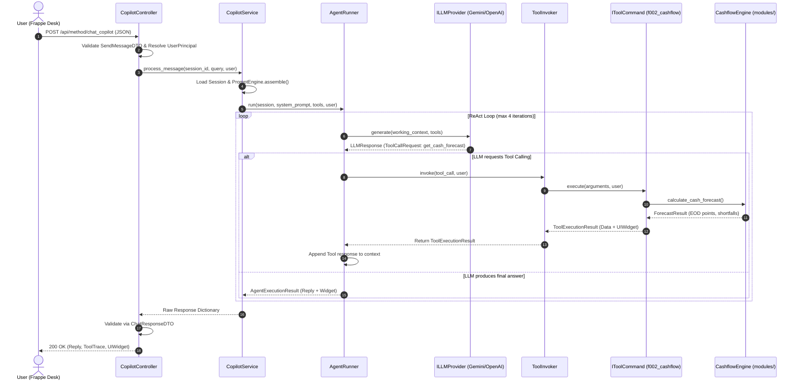

# 🔗 TƯƠNG TÁC GIỮA CÁC CLASS & CÁC NGUYÊN LÝ THIẾT KẾ (SOLID & DESIGN PATTERNS)

---

## 1. Sơ Đồ Tương Tác Giữa Các Lớp (Sequence Flow)

Sơ đồ dưới đây mô tả hành trình từ khi người dùng gửi một tin nhắn trên Frappe Desk cho đến khi nhận được kết quả phân tích tài chính kèm UI Widget:

---

## 2. Ứng Dụng Các Mẫu Thiết Kế (OOP Design Patterns)

Codebase Lotus Fin áp dụng các mẫu thiết kế kinh điển của Gang of Four (GoF) để giải quyết các bài toán kiến trúc đặc thù:

### 2.1. Command Pattern (Đóng Gói Công Cụ Tài Chính)
- **Vấn đề**: Các engine tài chính F001 - F006 có tham số và cách gọi khác nhau. Nếu `AgentRunner` trực tiếp gọi hàm của từng engine thì sẽ tạo ra một hàm `switch/case` khổng lồ và phụ thuộc cứng.
- **Giải pháp**:
  - Giao diện `IToolCommand` định nghĩa giao ước chuẩn: `definition`, `is_authorized(user)`, và `execute(args, user)`.
  - Mỗi engine tài chính được bọc trong một Concrete Command: `GetFinancialHealthTool`, `GetCashflowForecastTool`, `EvaluateRiskSignalTool`,...
  - `ToolInvoker` chỉ biết tới `IToolCommand`, không cần biết bên trong command thực hiện phép tính gì.

### 2.2. Abstract Factory & Factory Method Pattern (Khởi Tạo LLM Provider)
- **Vấn đề**: Người dùng có thể chạy offline (Mock), chạy Google Gemini, hoặc OpenAI/DeepSeek tùy theo biến môi trường mà không được sửa code.
- **Giải pháp**:
  - `LLMProviderFactory` chịu trách nhiệm đọc cấu hình `.env` và trả về đúng đối tượng hiện thực `ILLMProvider` (`OpenAILLMAdapter`, `GeminiLLMAdapter` hoặc `MockLLMAdapter`).

### 2.3. Adapter Pattern (Chuẩn Hóa Giao Tiếp Bên Thứ Ba)
- **Vấn đề**: API của OpenAI và Google Gemini có cấu trúc JSON, vai trò tin nhắn (`role: assistant` vs `role: model`) và cơ chế Function Calling hoàn toàn khác nhau.
- **Giải pháp**:
  - `OpenAILLMAdapter` và `GeminiLLMAdapter` đóng vai trò là Adapter: Chuyển đổi danh sách `ChatMessage` nội bộ của hệ thống thành định dạng payload riêng của từng hãng, và ngược lại chuyển kết quả trả về của hãng thành `LLMResponse` thống nhất.

### 2.4. Facade Pattern (Bảo Vệ Tương Thích Ngược)
- **Vấn đề**: Các module và bài test cũ nhập khẩu trực tiếp các hàm từ `lotus_fin.security.access` (`get_verified_company`, `check_report_permission`).
- **Giải pháp**:
  - Giữ lại `lotus_fin/security/access.py` như một Facade mỏng. Mọi lời gọi hàm vào file này đều được chuyển tiếp trơn tru tới `FrappeAccessGateway`, giúp bảo toàn 100% tương thích ngược mà không làm vỡ code cũ.

### 2.5. Strategy Pattern (Chính Sách Phân Quyền)
- **Vấn đề**: Mỗi module tài chính có danh sách báo cáo và DocType được phép truy cập khác nhau (ví dụ: F002 cần `GL Entry`, F003 cần `Accounts Payable`).
- **Giải pháp**:
  - Sử dụng `ModuleSecurityPolicy` kết hợp với `MODULE_SECURITY_REGISTRY` trong `FrappeAccessGateway`. Mỗi module là một Strategy khai báo chính sách riêng biệt.

---

## 3. Minh Chứng Tuân Thủ Các Nguyên Lý SOLID

| Nguyên lý | Hiện thực trong Codebase Lotus Fin |
| :--- | :--- |
| **S — Single Responsibility (Đơn trách nhiệm)** | Mỗi lớp chỉ có đúng một lý do để thay đổi:  • `PromptEngine`: Chỉ lắp ráp prompt. • `AgentRunner`: Chỉ điều phối vòng lặp ReAct Loop. • `ToolInvoker`: Chỉ lo thực thi an toàn bọc lỗi. • `OpenAILLMAdapter`: Chỉ lo giao tiếp HTTP với OpenAI. |
| **O — Open/Closed (Mở rộng đóng sửa đổi)** | • Muốn thêm công cụ tài chính mới (ví dụ F007): Chỉ cần tạo một class mới kế thừa `IToolCommand` và đăng ký vào `ToolRegistry`, không cần sửa một dòng code nào trong `AgentRunner` hay `CopilotService`. • Muốn hỗ trợ thêm Anthropic Claude: Chỉ cần tạo `ClaudeLLMAdapter(ILLMProvider)` mà không làm thay đổi các adapter khác. |
| **L — Liskov Substitution (Thay thế Liskov)** | Bất kỳ lớp nào hiện thực `ILLMProvider` (`MockLLMAdapter`, `OpenAILLMAdapter`, `GeminiLLMAdapter`) đều có thể hoán đổi cho nhau trong `CopilotService` lúc runtime mà hệ thống vẫn vận hành chính xác 100%. |
| **I — Interface Segregation (Phân tách giao diện)** | Không tạo ra một interface "vạn năng". Các interface được chia nhỏ theo đúng trách nhiệm: `ILLMProvider` chỉ có `generate()`; `IToolCommand` chỉ có `definition`, `is_authorized`, `execute()`; `IPermissionPolicy` chỉ quản lý thẩm quyền truy cập. |
| **D — Dependency Inversion (Đảo ngược phụ thuộc)** | Tầng Application (`CopilotService`, `AgentRunner`) không phụ thuộc trực tiếp vào các adapter cụ thể (`OpenAILLMAdapter`, `FrappeAccessGateway`), mà chỉ phụ thuộc vào các Interface trừu tượng (`ILLMProvider`, `IToolInvoker`, `ISessionRepository`). Việc khởi tạo đối tượng cụ thể được giao cho Factory tiêm vào (Dependency Injection). |
