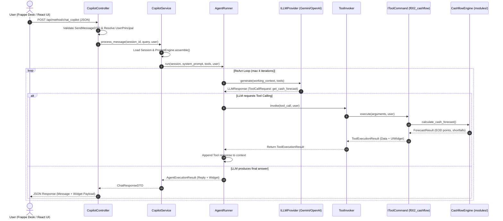

# CLASS INTERACTIONS AND DESIGN PATTERNS (SOLID & DESIGN PATTERNS)

---

## 1. Sequence Flow Between Layers

The sequence diagram below traces the end-to-end execution path from the moment a user submits a prompt in Frappe Desk / React UI until the platform delivers a grounded financial diagnosis paired with an interactive UI widget:

---

## 2. Design Patterns Applied

The Lotus Fin codebase incorporates classical Gang of Four (GoF) design patterns to resolve core architectural challenges:

### 2.1. Command Pattern (Financial Tool Encapsulation)
- **Problem**: Engines F001 through F007 expect distinct parameters and execution contracts. Allowing AgentRunner to directly invoke concrete calculation engines would result in unwieldy switch-case branches and tight coupling.
- **Solution**:
  - The IToolCommand interface standardizes the execution contract: definition, is_authorized(user), and execute(args, user).
  - Each financial engine is encapsulated within a concrete Command (GetFinancialHealthTool, GetCashflowForecastTool, EvaluateRiskSignalTool, etc.).
  - ToolInvoker interacts solely with IToolCommand abstractions without needing insight into inner mathematical procedures.

### 2.2. Abstract Factory & Factory Method Pattern (LLM Provider Selection)
- **Problem**: The system must run offline (Mock), with Google Gemini, or with OpenAI/DeepSeek strictly based on runtime .env variables without changing source code.
- **Solution**:
  - LLMProviderFactory inspects environment variables (LOTUS_AI_PROVIDER / LOTUS_LLM_PROVIDER) and instantiates the designated ILLMProvider implementation (OpenAILLMAdapter, GeminiLLMAdapter, or MockLLMAdapter).

### 2.3. Adapter Pattern (Third-Party API Normalization)
- **Problem**: OpenAI and Google Gemini have divergent payload schemas, message roles (assistant vs. model), and function-calling conventions.
- **Solution**:
  - OpenAILLMAdapter and GeminiLLMAdapter translate between internal domain models (ChatMessage) and provider-specific schemas, reconciling response structures back into a unified LLMResponse.

### 2.4. Facade Pattern (Backward Compatibility)
- **Problem**: Existing test suites and legacy modules imported utility functions directly from lotus_fin.security.access (get_verified_company, check_report_permission).
- **Solution**:
  - Preserved lotus_fin/security/access.py as a lightweight Facade forwarding calls to FrappeAccessGateway, maintaining 100% backward compatibility without breaking existing interfaces.

### 2.5. Strategy Pattern (Module Permission Policies)
- **Problem**: Each financial module requires different permissions on Frappe reports and DocTypes (e.g., F002 needs GL Entry, F003 needs Accounts Payable).
- **Solution**:
  - Encapsulated module access rules via ModuleSecurityPolicy registered in FrappeAccessGateway. Each module constitutes an interchangeable security policy strategy.

---

## 3. SOLID Principles Compliance

| Principle | Implementation in Lotus Fin Codebase |
| :--- | :--- |
| **S — Single Responsibility** | Every class has one single reason to change:  • PromptEngine: Prompt composition only. • AgentRunner: ReAct loop orchestration only. • ToolInvoker: Fault-tolerant execution wrapper only. • OpenAILLMAdapter: HTTP payload translation for OpenAI only. |
| **O — Open/Closed** | • Adding a new financial tool (e.g., F007 Debt Actions) requires creating a new class implementing IToolCommand and registering it in ToolRegistry—zero edits to AgentRunner or CopilotService. • Supporting a new model provider requires authoring a new adapter implementing ILLMProvider without touching existing adapters. |
| **L — Liskov Substitution** | Any implementation of ILLMProvider (MockLLMAdapter, OpenAILLMAdapter, GeminiLLMAdapter) can substitute another in CopilotService at runtime while maintaining 100% operational parity. |
| **I — Interface Segregation** | Fine-grained interfaces prevent bloat: ILLMProvider declares only generate(); IToolCommand declares only definition, is_authorized, execute(); IPermissionPolicy isolates access evaluation. |
| **D — Dependency Inversion** | Application services (CopilotService, AgentRunner) depend solely on abstract interfaces (ILLMProvider, IToolInvoker, ISessionRepository) rather than concrete database or HTTP client implementations. Concrete instances are injected via factories. |
