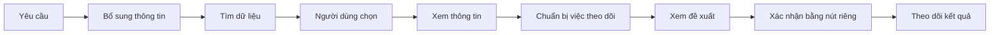

# Lotus Fin — Mô tả tính năng và chatbot cho UI mới

Ngày đối chiếu: **15/10/2026 · Asia/Saigon**. Căn cứ: mã nguồn đang có trong workspace `E:\lotus-fin`, gồm cả thay đổi chưa commit.

Tài liệu này dùng để thiết kế màn hình, luồng sử dụng và nội dung giao diện. Các phần ghi **“Đề xuất UI”** là hướng thiết kế mới; các phần ghi **“Hiện có”** mô tả khả năng quan sát được trong source. Đây không phải kết luận nghiệm thu runtime.

## 1. Mô tả sản phẩm

**Lotus Fin là không gian quản lý tài chính cho doanh nghiệp vừa và nhỏ, giúp người dùng theo dõi sức khỏe tài chính, dòng tiền, công nợ và nhu cầu vốn. Người dùng có thể làm việc trực tiếp trên các màn hình nghiệp vụ hoặc yêu cầu trợ lý hỗ trợ tìm dữ liệu, mở đúng chứng từ, chuẩn bị tác vụ và theo dõi kết quả thực hiện.**

UI cần trả lời được ba câu hỏi: **Tình hình đang thế nào? Khoản nào cần xem xét? Tôi có thể làm gì tiếp theo?**

Người dùng chính của bản thiết kế:

| Người dùng | Công việc cần hoàn thành |
| --- | --- |
| Chủ doanh nghiệp / người quản lý tài chính | Xem tình hình tài chính, nhận biết áp lực dòng tiền, so sánh phương án vốn |
| Kế toán / người theo dõi công nợ | Tìm chứng từ, xem khoản đến hạn, kiểm tra thông tin và chuẩn bị việc theo dõi |
| Người quản trị | Quản lý kết nối, tài khoản và quyền sử dụng nếu được cấp quyền |

Đây là nhóm nhu cầu để thiết kế; quyền thực tế phải lấy từ hệ thống, không suy ra từ tên vai trò trên UI.

### Phạm vi chatbot theo yêu cầu “no AI writing”

Chatbot được định vị là **trợ lý thao tác**: người dùng nói việc cần làm, hệ thống đưa họ đến dữ liệu và hành động phù hợp.

Không đưa các khả năng viết bài, viết lại văn bản, đổi giọng điệu, soạn nội dung sáng tạo hoặc viết báo cáo dài vào bộ tính năng của UI mới. Phản hồi chat nên ngắn, đi cùng bảng dữ liệu, biểu mẫu hoặc thẻ hành động. Kết quả chính là công việc được thực hiện đúng và có trạng thái rõ ràng.

Source hiện có một mẫu lời nhắc cục bộ cho người dùng sửa/copy. Có thể giữ như tiện ích phụ nếu cần; không dùng nó làm điểm nhấn hay lời hứa “AI viết email”.

## 2. Bản đồ tính năng hiện tại

| Nhóm | Giá trị cho người dùng | Hiện có và giới hạn cần biết khi thiết kế |
| --- | --- | --- |
| Sức khỏe tài chính — AI001 | Nhìn nhanh doanh thu, lợi nhuận, tiền và công nợ | Có màn hình, API và module tính toán; nguồn tài chính hiện vẫn gắn với ERPNext |
| Dòng tiền 30 ngày — AI002 | Theo dõi tiền đầu kỳ, diễn biến số dư và các khoản đến hạn | Có màn hình và module; phải phân biệt lịch nghĩa vụ với sự kiện thu/chi đã xác nhận |
| Tín hiệu rủi ro — AI003 | Nhận biết nợ phải thu quá hạn tăng và áp lực phải trả dồn kỳ | Có hai loại tín hiệu, hợp đồng dữ liệu và trạng thái không đủ cơ sở kết luận |
| Mô phỏng What‑If — AI004 | Thử thay đổi doanh thu, thời gian thu/chi và nguồn vốn | Có module mô phỏng; màn React hiện gọi mô phỏng 9 KPI ở F005 và có nhánh dùng số liệu mẫu khi lỗi |
| Phương án vốn — AI005 | So sánh phương án tài trợ theo nhu cầu vay | Có engine/catalog phía backend; màn React hiện hiển thị danh sách gói vay cố định, chưa nối engine matching |
| Lịch trả nợ — AI006 | Tính gốc, lãi và nghĩa vụ trả từng kỳ | Có engine backend; màn React hiện tự tính hai phương pháp trong trình duyệt |
| Không gian nghiệp vụ | Tra cứu danh sách, mở/sửa form, xem báo cáo | Có bộ màn hình sinh từ metadata Frappe/ERP; khả năng sử dụng phụ thuộc schema, ứng dụng và quyền của site |
| Chatbot hỗ trợ thao tác | Tìm/mở hóa đơn, chuẩn bị việc theo dõi, xem đề xuất và kết quả | Có trang riêng và cửa sổ nổi dùng chung panel; luồng đọc tích hợp hiện có DEMO, ghi tác vụ là mô phỏng |

**Lưu ý triển khai:** README và báo cáo độc lập hiện ghi `P6_SECURITY_BLOCKED`. Runtime Frappe-only chạy được shell/chatbot DEMO không có nghĩa các nghiệp vụ tài chính đã chạy độc lập ERPNext. Không mặc định gắn nhãn “dữ liệu thật”, “đã đối soát” hoặc “đã thực hiện” chỉ vì màn hình render thành công.

## 3. Cấu trúc điều hướng đề xuất

Đây là cách tổ chức UI mới, chưa phải menu đã triển khai:

| Mục chính | Nội dung |
| --- | --- |
| Tổng quan | Các chỉ số chính, tóm tắt dòng tiền và tín hiệu cần xem xét |
| Dòng tiền | Diễn biến 30 ngày, số dư theo tài khoản, lịch thu/chi và nghĩa vụ |
| Công nợ & chứng từ | Tìm hóa đơn, xem thông tin chứng từ; các khoản phải thu/phải trả khi nguồn hỗ trợ |
| Phân tích | Sức khỏe tài chính, tín hiệu rủi ro, mô phỏng What‑If |
| Vốn & trả nợ | Phương án tài trợ và công cụ tính lịch trả nợ |
| Trợ lý | Không gian yêu cầu thao tác, kết quả tìm kiếm và tác vụ đang xử lý |
| Cài đặt | Tài khoản, quyền và kết nối theo phạm vi được phép |

Trang **Tổng quan** là màn tổng hợp đề xuất, tái sử dụng kết quả các module. Không tự tạo thêm điểm sức khỏe, điểm tín dụng hoặc số dự báo ngoài hợp đồng dữ liệu.

Thông tin dùng chung ở đầu màn hình: công ty đang làm việc, kỳ/ngày quan sát, nguồn dữ liệu và tài khoản hiện tại. Các thông tin này phải có căn cứ từ server. Tên công ty cố định trong code hiện tại chỉ là nhãn trình bày.

## 4. Mô tả các màn hình tài chính

### 4.1. Sức khỏe tài chính

**Việc người dùng cần làm:** xem tình hình của một công ty trong một kỳ và biết số liệu nào có thể kiểm tra lại.

**Đầu vào:** công ty, kỳ báo cáo; tùy chọn so sánh kỳ trước khi dữ liệu đáp ứng.

**Nội dung chính:** tám chỉ số đang được màn hình sử dụng: doanh thu, giá vốn, biên lợi nhuận gộp, số dư tiền, công nợ phải thu, tỷ lệ phải thu quá hạn, công nợ phải trả và khoản phải trả sắp đến hạn.

**Đề xuất UI:** nhóm chỉ số thành Kết quả kinh doanh, Tiền và Công nợ. Mỗi chỉ số có giá trị, đơn vị, trạng thái dữ liệu và liên kết xem nguồn nếu hệ thống cung cấp. So sánh kỳ trước chỉ xuất hiện khi có kết quả hợp lệ.

**Hành động:** đổi kỳ, làm mới, xem nguồn; chuyển sang dòng tiền hoặc What‑If để tiếp tục phân tích. Hành động điều hướng mới phải được nối vào dữ liệu thực tế.

**Trạng thái cần thiết kế:** đang tải; đủ dữ liệu; chỉ có một phần chỉ số; không có quyền; nguồn lỗi. Chỉ số thiếu hiển thị “Chưa có dữ liệu”, không thay bằng `0`.

### 4.2. Dòng tiền 30 ngày

**Việc người dùng cần làm:** kiểm tra số tiền hiện có và các áp lực thu/chi trong 30 ngày tiếp theo.

**Đầu vào:** công ty và ngày quan sát.

**Nội dung chính:** số dư đầu kỳ, chi tiết tiền/ngân hàng theo tài khoản, diễn biến số dư cuối ngày và bảng nghĩa vụ phải thu/phải trả theo ngày đến hạn.

**Đề xuất UI:** biểu đồ số dư kèm bảng chi tiết; bảng riêng cho các nghĩa vụ đến hạn. Hiển thị rõ cơ sở tính của mỗi phần. Khoản phải thu đến hạn không tự trở thành một khoản tiền chắc chắn sẽ thu được.

**Hành động:** đổi ngày quan sát, làm mới, xem các khoản liên quan, mở nguồn nếu được hỗ trợ; chuyển sang mô phỏng để thử tình huống khác.

Nếu chưa có sự kiện thanh toán được xác nhận, hiển thị đúng lý do. Không vẽ đường dự báo giả để lấp chỗ trống.

### 4.3. Tín hiệu rủi ro

**Việc người dùng cần làm:** biết có tín hiệu cần xem xét hay chưa và căn cứ nào dẫn tới kết luận.

**Hai loại đang có:**

- **Nợ phải thu quá hạn tăng:** so sánh tỷ lệ quá hạn với mốc cơ sở tương ứng.
- **Khoản phải trả đến hạn tập trung:** xem áp lực các nghĩa vụ phải trả dồn trong một khoảng thời gian.

**Đầu vào:** công ty, loại tín hiệu, ngày chốt.

**Đề xuất UI:** thẻ kết luận, số quan sát, mốc so sánh/ngưỡng và nguồn liên quan. Dùng nhãn “Chưa phát hiện tín hiệu”, “Cần theo dõi”, “Mức cao” đúng theo kết quả trả về.

**Hành động:** xem căn cứ, xem các khoản liên quan khi có dữ liệu/quyền, mở trợ lý để bắt đầu việc tra cứu cụ thể.

“Không đủ dữ liệu để đánh giá” và “Chờ chính sách đánh giá” là trạng thái riêng. Không dùng màu xanh hoặc chữ “An toàn” cho hai trường hợp này. Kết luận chỉ áp dụng cho tín hiệu đã kiểm tra, không đánh giá toàn bộ doanh nghiệp.

### 4.4. Mô phỏng What‑If

**Việc người dùng cần làm:** thử một tình huống và so sánh tác động với số liệu cơ sở.

**Các nhóm tham số đang có trên màn hình:** doanh thu; số ngày chậm thu; dịch chuyển hạn trả nhà cung cấp; chi phí vận hành; lương; khoản chi một lần; số vốn vay, kỳ hạn và lãi suất.

**Kết quả màn hình hiện dùng:** chín KPI gồm doanh thu, lợi nhuận gộp, biên lợi nhuận gộp, phải thu, số ngày thu tiền, dòng tiền thuần, tiền cuối kỳ, chu kỳ chuyển đổi tiền và thiếu hụt tiền.

**Đề xuất UI:** form giả định bên cạnh kết quả so sánh Cơ sở / Mô phỏng / Chênh lệch. Có thể chọn tình huống mẫu rồi chỉnh tham số; nút chính là “Chạy mô phỏng”.

Luôn thể hiện kết quả là mô phỏng và công bố nguồn baseline. Các tham số đang hiển thị phải được xác nhận có tác động trong engine được tích hợp. Không dùng nhánh fallback số liệu mẫu như kết quả của công ty khi dịch vụ lỗi.

### 4.5. Phương án vốn

**Việc người dùng cần làm:** nhập nhu cầu vốn, so sánh các phương án phù hợp và kiểm tra chi phí dự kiến.

**Đầu vào màn hình hiện có:** số tiền, kỳ hạn, mục đích vay và giá trị tài sản bảo đảm. Engine backend có mô hình hồ sơ doanh nghiệp và quy tắc matching riêng.

**Đề xuất UI:** bảng so sánh số tiền/kỳ hạn áp dụng, lãi suất tham chiếu, yêu cầu bảo đảm, lý do phù hợp/không phù hợp, nguồn và ngày cập nhật nếu catalog đã được kiểm chứng.

**Hành động:** xem điều kiện; chuyển các thông số đã chọn sang công cụ lịch trả nợ. Luồng chuyển dữ liệu này là phần cần nối khi xây UI.

Danh sách và điểm phù hợp cố định trên màn React hiện tại chỉ dùng làm ví dụ bố cục. Không trình bày chúng như kết quả chấm của engine, báo giá ngân hàng hiện hành hay phê duyệt khoản vay. Brief này không xác minh các mức lãi suất trong catalog.

### 4.6. Lịch trả nợ

**Việc người dùng cần làm:** biết nghĩa vụ gốc/lãi từng kỳ và xem tác động khi lãi suất thay đổi.

**Đầu vào đang có trên React:** số tiền gốc, lãi suất năm, số tháng, phương pháp trả và mức tăng/giảm lãi suất.

**Hai phương pháp đang hiển thị:** trả đều tổng gốc+lãi; trả gốc đều, lãi theo dư nợ giảm dần.

**Đề xuất UI:** tóm tắt kỳ đầu phải trả, tổng lãi, tổng số tiền trả; bảng từng kỳ gồm dư nợ đầu kỳ, gốc, lãi, tổng phải trả, dư nợ cuối kỳ. Các giả định và phương pháp tính phải đọc được.

**Hành động:** đổi tham số và tính lại; so sánh mức lãi suất. Backend có phạm vi rộng hơn, nhưng UI chỉ mở lựa chọn khi đã nối đúng hợp đồng tính toán.

Đây là lịch tính theo tham số, không tạo khoản vay hoặc lệnh thanh toán.

## 5. Không gian chứng từ và báo cáo

Source hiện có bộ màn hình chung lấy định nghĩa dữ liệu từ Frappe/ERP:

| Màn hình | Khả năng có trong source | Yêu cầu khi thiết kế lại |
| --- | --- | --- |
| Trang chọn module / workspace | Nạp workspace và các liên kết từ hệ thống | Chỉ hiện module có dữ liệu và quyền; không mặc định tất cả phân hệ ERP đều tồn tại |
| Danh sách | Tìm kiếm, lọc, sắp xếp, phân trang, chọn dòng và xuất CSV | Phân biệt trang hiện tại với toàn bộ kết quả; xuất CSV hiện dùng dữ liệu đã nạp/chọn |
| Form | Nạp schema, xem, tạo/sửa, lưu và bỏ thay đổi | Phân biệt chỉ xem, đang sửa, chưa lưu, đang lưu, lưu lỗi; việc lưu phụ thuộc schema/quyền/site |
| Báo cáo | Nạp bộ lọc và kết quả báo cáo động | Có kỳ, công ty, đơn vị và trạng thái nguồn rõ ràng |

Bộ form chung và khả năng chatbot là hai luồng riêng. Có nút lưu ở form không có nghĩa chatbot đã được phép gọi hành động lưu. Không suy ra submit/cancel đã hoàn chỉnh từ việc một DocType có trạng thái chứng từ.

## 6. Chatbot hỗ trợ thao tác

### 6.1. Vai trò và cách trình bày

**Trợ lý giúp người dùng hoàn thành một việc cụ thể trong Lotus Fin bằng yêu cầu ngắn, sau đó hiển thị dữ liệu và các bước cần chọn/xác nhận.**

Ví dụ yêu cầu phù hợp cho thiết kế:

- “Tìm hóa đơn có mã bắt đầu bằng SINV.”
- “Cho tôi xem hóa đơn đã ghi nhận trong khoảng ngày này.”
- “Mở hóa đơn tôi vừa chọn.”
- “Tạo việc theo dõi, nội dung này, hạn ngày này.”
- “Kiểm tra trạng thái thao tác vừa xác nhận.”

Đây là câu mẫu cho luồng UI. Router hiện nhận diện bằng quy tắc/từ khóa trong phạm vi hẹp; một số câu chỉ mở panel thao tác. Chưa có khả năng tự hiểu và điền toàn bộ tham số từ mọi câu tiếng Việt. UI mới cần cho người dùng xem/sửa bộ lọc trước khi tìm và hỏi ngắn khi thiếu dữ liệu.

### 6.2. Hai cách mở

**Trang Trợ lý:** dùng cho công việc nhiều bước, danh sách kết quả và xem đề xuất chi tiết.

**Cửa sổ trợ lý trong ứng dụng:** dùng khi người dùng đang ở một màn hình nghiệp vụ và cần hỗ trợ nhanh.

Hiện có cả hai bề mặt dùng chung panel. **Đề xuất UI mới:** cửa sổ trợ lý có thể hiển thị ngữ cảnh chứng từ đang xem và chuyển sang trang rộng hơn. Việc lấy ngữ cảnh, chuyển tiếp phiên chat và giữ tiến trình phải được triển khai/xác minh; hiện không được giả định là đã có chỉ vì dùng chung component.

### 6.3. Các thao tác và mức sẵn sàng

Các mã L0–L5/V1 bên dưới chỉ phục vụ đối chiếu phát triển; trên giao diện dùng tên hành động thông thường.

| Nhóm | Người dùng nhìn thấy | Hiện có | Phạm vi cho UI mới |
| --- | --- | --- | --- |
| Hướng dẫn — L0 | Trả lời ngắn hoặc hỏi bổ sung | Có phản hồi giới hạn và định tuyến theo quy tắc | Hỏi đúng thông tin còn thiếu; đưa nút thực hiện bước tiếp theo |
| Tìm hóa đơn — L1 | Bộ lọc và danh sách kết quả | Có contract, controller và DEMO | Tìm theo đầu mã, khoảng ngày ghi nhận, trạng thái Nháp/Đã ghi nhận/Cả hai |
| Chọn và mở — L2 | Xem một chứng từ đã chọn | Có màn chỉ đọc tối thiểu | Người dùng bấm chọn; không tự mở kết quả đầu tiên |
| Chuẩn bị — L3 | Xem/sửa nội dung tạm | Hiện là mẫu lời nhắc cục bộ, chưa lưu/chưa gửi | Tiện ích phụ; điền form nghiệp vụ tổng quát là phần chưa có |
| Tạo tác vụ — L4 | Form thông tin → xem đề xuất → xác nhận → kết quả | Page/Drawer có luồng tạo Task mô phỏng | Gắn nhãn “Mô phỏng”; ghi Task thật chưa được bật |
| Ghi chú / hồ sơ nháp — L4 | Tạo ghi chú hoặc chuẩn bị record | Có định nghĩa trong action catalog | Chưa có luồng hoàn chỉnh trên panel tích hợp; không đánh dấu sẵn sàng |
| Hành động tác động lớn — L5 | Xem điều kiện và lý do chưa thể thực hiện | Có catalog/policy review; thực thi thật bị tắt | Không tạo nút gửi email, thanh toán, ghi nhận/hủy chứng từ hoặc chạy lịch như chức năng đã mở |
| Qua hạn cuối còn dư nợ — V1 | Bảng hóa đơn thỏa điều kiện | Có evaluator và dữ liệu DEMO cố định | Là luồng riêng; chưa có nguồn native được duyệt hoặc drilldown hợp lệ từ kết quả V1 |

Trong workspace hiện tại đã có thêm **prototype đọc ERPNext Sales Invoice** được nối vào endpoint qua cấu hình. Prototype mặc định tắt, chỉ trả projection tối thiểu và chưa được nghiệm thu trên ERPNext/MariaDB thật. Không coi phần này là native read đã sẵn sàng.

### 6.4. Luồng tìm và mở hóa đơn

1. Người dùng nhập yêu cầu hoặc chọn “Tìm hóa đơn”.
2. Trợ lý mở bộ lọc, yêu cầu bổ sung thông tin còn thiếu.
3. Người dùng kiểm tra bộ lọc và bấm “Tìm”.
4. Hiển thị kết quả cùng phạm vi đã kiểm tra và nguồn dữ liệu.
5. Người dùng bấm “Mở xem” tại đúng hóa đơn.
6. Hệ thống kiểm tra lại quyền/ngữ cảnh; chỉ hiển thị thông tin được phép đọc.

Kết quả tìm kiếm hiện chỉ có thông tin nhận diện. Màn xem tối thiểu có mã, loại hóa đơn, công ty, ngày ghi nhận, trạng thái và phiên bản. **Chưa có khách hàng, dòng hàng, thuế, tổng tiền hoặc dư nợ trong luồng L1/L2 này.** Không thiết kế các trường đó như dữ liệu đã có.

Nếu kết quả `PARTIAL`, khóa chọn/mở và đề nghị thu hẹp bộ lọc. Nếu còn trang tiếp theo nhưng trang hiện tại đầy đủ, phải diễn đạt đúng là “Còn kết quả khác”; không đồng nhất với lỗi dữ liệu không đầy đủ.

### 6.5. Luồng tạo việc theo dõi

**Hiện có trên panel:** tiêu đề, nội dung và ngày theo dõi; mức ưu tiên đang được gửi cố định là MEDIUM. Sau khi nhập, người dùng xem đề xuất, xác nhận bằng nút riêng rồi xem trạng thái thao tác mô phỏng.

**Đề xuất UI:** thẻ hành động có tên công việc, nội dung, hạn theo dõi, các dữ liệu sẽ được lưu và thời hạn xác nhận. Dùng nút “Xem đề xuất”, “Quay lại sửa”, “Hủy” và “Xác nhận tạo việc” theo trạng thái. Sửa dữ liệu cần tạo lại đề xuất trước khi xác nhận.

Tạo việc từ một hóa đơn trong tương lai phải có liên kết chứng từ được backend kiểm chứng. Biến tên hóa đơn ở giao diện hoặc lời nhắc do người dùng nhập chưa đủ để chứng minh Task đã được liên kết với hóa đơn đó. Người phụ trách, nhắc việc tự động và lặp lịch là mở rộng chưa có trong form tích hợp hiện tại.

Sơ đồ là luồng sản phẩm đề xuất. Hiện phần tìm/mở có DEMO và phần tạo Task chỉ tạo kết quả mô phỏng. Tin nhắn “đồng ý” hoặc “xác nhận” không thay thế nút xác nhận một đề xuất cụ thể.

### 6.6. Luồng xem hóa đơn qua hạn cuối

Người dùng chọn “Hóa đơn qua hạn cuối”. Hiển thị ngày quan sát, phạm vi, mã hóa đơn, hạn cuối, số ngày quá hạn, dư nợ và loại tiền.

Điều kiện đang được mô hình hóa là hóa đơn đã ghi nhận, đã qua hạn cuối và còn dư nợ dương. Không gọi đây là lịch sử thanh toán của khách hàng, khả năng dự đoán thu nợ hoặc đánh giá mọi kỳ trả góp.

DEMO hiện dùng mốc quan sát cố định ngày 13/10/2026. Ghi rõ thời điểm của dữ liệu mẫu; không làm nó trông như dữ liệu cập nhật hôm nay. Các dòng DEMO V1 chưa có tham chiếu để mở hóa đơn; nút mở phải ở trạng thái chưa hỗ trợ. Báo cáo độc lập còn ghi nhận lỗi kiểm tra dữ liệu V1, cần xử lý trước khi dùng số liệu thật.

## 7. Các trạng thái cần có trong thiết kế

| Trạng thái | Nội dung gợi ý trên UI | Hành động tiếp theo |
| --- | --- | --- |
| Chưa bắt đầu | “Bạn cần tìm chứng từ hay chuẩn bị việc theo dõi?” | Chọn tác vụ / nhập yêu cầu |
| Thiếu thông tin | “Bạn muốn tìm theo mã, khoảng ngày hay trạng thái?” | Nhập phần còn thiếu |
| Đang xử lý | “Đang tìm trong phạm vi đã chọn…” | Hiển thị tiến trình, tránh gửi lặp |
| Không có kết quả | “Không có hóa đơn phù hợp trong phạm vi vừa kiểm tra.” | Đổi bộ lọc |
| Dữ liệu chưa đầy đủ | “Kết quả chưa đầy đủ. Hãy thu hẹp điều kiện tìm.” | Tìm lại, khóa hành động cần kết quả đầy đủ |
| Chưa kết nối dữ liệu | “Nguồn dữ liệu cho thao tác này chưa sẵn sàng.” | Xem trạng thái kết nối; DEMO là lựa chọn riêng nếu được bật |
| Không có quyền / phiên không hợp lệ | “Không thể truy cập với phiên hiện tại.” | Xác minh phiên hoặc đăng nhập lại theo nguyên nhân |
| Chỉ đọc | “Bạn đang xem thông tin chứng từ.” | Không hiển thị thao tác sửa như đã được cấp quyền |
| Chờ xác nhận | “Kiểm tra thông tin trước khi tạo việc.” | Xác nhận hoặc hủy |
| Đề xuất hết hạn | “Đề xuất đã hết hạn. Vui lòng kiểm tra lại.” | Tạo đề xuất mới |
| Thành công mô phỏng | “Đã hoàn tất mô phỏng. Chưa tạo tác vụ thật.” | Xem biên nhận mô phỏng |
| Thất bại | Thông báo ngắn, có mã tra cứu chi tiết | Sửa dữ liệu hoặc thử lại khi an toàn |
| Chưa xác định kết quả | “Chưa xác định được kết quả. Cần kiểm tra trước khi thử lại.” | Kiểm tra trạng thái; không thực thi lại mù |
| Chức năng chưa mở | “Thao tác này chưa được kích hoạt.” | Giải thích điều kiện nếu có |

Đổi công ty, đổi tài khoản, đăng xuất hoặc bị thu hồi quyền phải vô hiệu hóa dữ liệu và đề xuất cũ. Đây là yêu cầu cho UI mới; báo cáo độc lập hiện còn lỗi về cập nhật phiên và phản hồi trả muộn, nên chưa coi hành vi này đã hoàn chỉnh.

## 8. Thành phần UI cần thiết kế

| Thành phần | Nội dung cần có |
| --- | --- |
| Thanh ngữ cảnh | Công ty, kỳ/ngày, nguồn và tài khoản đã xác minh |
| Thẻ chỉ số | Giá trị, đơn vị, thời điểm và trạng thái dữ liệu |
| Bộ lọc tìm hóa đơn | Đầu mã, ngày bắt đầu/kết thúc, trạng thái chứng từ |
| Danh sách kết quả | Dữ liệu nhận diện, phạm vi kết quả, nút chọn/mở hợp lệ |
| Khung xem chứng từ | Trường được phép đọc, nhãn chỉ xem, nguồn và thời điểm |
| Thẻ tác vụ | Dữ liệu cần nhập, phần còn thiếu, bước tiếp theo |
| Thẻ đề xuất | Hành động, dữ liệu sẽ lưu, tác động, thời hạn và nút xác nhận |
| Kết quả thực hiện | Trạng thái, thời điểm, mã thao tác, nhãn mô phỏng khi áp dụng |
| Chi tiết nguồn / lỗi | Nguồn, giới hạn, mã tra cứu; thông tin kỹ thuật nằm trong phần mở rộng |
| Khung trợ lý | Yêu cầu ngắn, câu hỏi bổ sung và kết quả có cấu trúc |

Trên desktop có thể dùng vùng làm việc chính và panel chi tiết/trợ lý bên cạnh. Trên mobile hiển thị tuần tự từng bước; thẻ xác nhận và trạng thái phải đọc trọn, không phụ thuộc cuộn ngang. Cửa sổ trợ lý cần vừa màn hình nhỏ và không che nút thao tác chính.

Tên hiển thị nên là “Tìm hóa đơn”, “Xem chứng từ”, “Tạo việc theo dõi”, “Xem đề xuất”, “Kiểm tra trạng thái”. Không đưa mã AI001/L4/V1, tên adapter hoặc các cổng nghiệm thu vào điều hướng sản phẩm.

## 9. Những phần không đưa thành cam kết tính năng

- Viết nội dung bằng AI hoặc giao diện tập trung vào tạo văn bản.
- Tự gửi email, chuyển tiền, submit/cancel chứng từ hoặc chạy thao tác định kỳ.
- Lệnh nhiều bước trên mọi phân hệ ERP hay thao tác hàng loạt chưa có hợp đồng.
- Tìm khách hàng theo tên và xử lý trùng tên: proposal có đề cập, luồng tích hợp hiện chưa hoàn chỉnh.
- Điền mọi form bằng chat: chưa có `form.prefill` tổng quát được tích hợp.
- Đọc PDF/Excel/ảnh, OCR hoặc nhập chứng từ tự động: panel hiện chỉ giữ metadata file; việc chọn file không chứng minh đã upload/đọc nội dung.
- Lịch sử hội thoại bền vững và đồng bộ giữa trang/cửa sổ: danh sách recent chat hiện là mẫu cố định; nút lịch sử chưa có luồng khôi phục chat.
- Hành vi thanh toán khách hàng F101 và xu hướng doanh thu F102: tài liệu hiện vẫn ở giai đoạn đề xuất/chưa build, không gộp vào bản hiện có.
- Coi điểm matching là xác suất ngân hàng duyệt vay, hoặc coi kết quả mô phỏng là cam kết tài chính.

## 10. Thứ tự thiết kế đề xuất

**Ưu tiên 1 — Luồng công việc cốt lõi:** khung ứng dụng, tìm/chọn/xem hóa đơn, chatbot hỏi bổ sung, tạo đề xuất Task mô phỏng và theo dõi trạng thái. Thiết kế đầy đủ trường hợp thiếu nguồn, thiếu quyền, dữ liệu một phần và kết quả chưa xác định.

**Ưu tiên 2 — Công cụ tài chính:** sáu màn hình theo mô tả ở trên, với dữ liệu có nguồn và trạng thái đúng. Tổng quan gom kết quả của các màn này; không dựng số liệu tổng hợp giả.

**Ưu tiên 3 — Sau khi backend đáp ứng:** đọc hóa đơn thật đã được duyệt, ghi Task/Note/Draft thật, chuyển ngữ cảnh chứng từ, lịch sử chat thật và điền form có phạm vi. Mỗi khả năng có điều kiện nghiệm thu riêng. Các hành động L5 chưa nằm trong phạm vi thực thi của bản UI hiện tại.

### Checklist bàn giao thiết kế

- Mỗi màn hình có mục tiêu, dữ liệu đầu vào, kết quả và hành động tiếp theo rõ ràng.
- Có bản thiết kế cho loading, empty, partial, unavailable, permission, expired, failure và unknown outcome khi liên quan.
- Dữ liệu mẫu và kết quả mô phỏng được nhận diện ngay tại nơi hiển thị.
- Không có lịch sử, tên công ty, trạng thái đối soát hoặc thông báo thành công được điền mẫu như dữ liệu thật.
- Người dùng luôn biết đối tượng nào đã chọn và thay đổi nào đang chờ xác nhận.
- Có bàn phím/focus rõ ràng, nhãn trạng thái bằng chữ và bố cục phù hợp mobile.
- Phần viết nội dung tự do không trở thành luồng chính của trợ lý.

## 11. Nguồn đối chiếu trong codebase

Phần này dành cho người triển khai; không đưa các chi tiết kỹ thuật vào màn hình người dùng.

| Nội dung đã đối chiếu | Nguồn |
| --- | --- |
| Route, workspace, list/form/report | [App.tsx](../../frontend/src/App.tsx), [dynamic views](../../frontend/src/pages/dynamic/) |
| Sáu công cụ, recent chat mẫu, nhãn công ty cố định | [LotusCopilotPage.tsx](../../frontend/src/pages/copilot/LotusCopilotPage.tsx) |
| Tám chỉ số tài chính | [FinancialHealthView.tsx](../../frontend/src/pages/copilot/components/FinancialHealthView.tsx) |
| Dòng tiền, nghĩa vụ và thông báo thiếu sự kiện | [CashForecastView.tsx](../../frontend/src/pages/copilot/components/CashForecastView.tsx) |
| UI và contract rủi ro | [RiskSignalView.tsx](../../frontend/src/pages/copilot/components/RiskSignalView.tsx), [risk contracts](../../lotus_fin/lotus_fin/modules/f003_risk_signal/contracts.py) |
| What‑If và fallback mẫu | [WhatIfStudioView.tsx](../../frontend/src/pages/copilot/components/WhatIfStudioView.tsx) |
| Gói vay cố định / engine backend | [FinancingCopilotView.tsx](../../frontend/src/pages/copilot/components/FinancingCopilotView.tsx), [F005 service](../../lotus_fin/lotus_fin/modules/f005_financing/service.py) |
| Lịch trả nợ tính tại client | [RepaymentScheduleView.tsx](../../frontend/src/pages/copilot/components/RepaymentScheduleView.tsx) |
| Hai bề mặt chat, metadata file, reset state | [VercelChatPanel.tsx](../../frontend/src/pages/copilot/components/VercelChatPanel.tsx), [LotusCopilotDrawer.tsx](../../frontend/src/components/copilot/LotusCopilotDrawer.tsx) |
| Nhận diện yêu cầu / mở panel | [copilotIntentRouter.ts](../../frontend/src/pages/copilot/actions/copilotIntentRouter.ts), [copilotMessageSender.ts](../../frontend/src/pages/copilot/components/copilotMessageSender.ts) |
| Bộ lọc và giới hạn dữ liệu hóa đơn | [invoiceActionCriteria.ts](../../frontend/src/pages/copilot/actions/invoiceActionCriteria.ts), [InvoiceSearchResults.tsx](../../frontend/src/pages/copilot/actions/InvoiceSearchResults.tsx), [InvoiceReadView.tsx](../../frontend/src/pages/copilot/actions/InvoiceReadView.tsx) |
| Mẫu nhắc cục bộ | [followupPreview.ts](../../frontend/src/pages/copilot/prepare/followupPreview.ts) |
| Task, L5 và V1 trên panel | [IntegratedCapabilities.tsx](../../frontend/src/pages/copilot/components/IntegratedCapabilities.tsx), [CopilotIntegrationService](../../lotus_fin/lotus_fin/application/service/copilot_integration.py) |
| Catalog Task/Note/Draft, xác nhận và trạng thái | [l4_action_catalog.py](../../lotus_fin/lotus_fin/domain/schema/l4_action_catalog.py), [L4MutationPanel.tsx](../../frontend/src/pages/copilot/actions/L4MutationPanel.tsx) |
| Prototype đọc ERPNext hiện tại | [composition](../../lotus_fin/lotus_fin/infrastructure/config/invoice_actions_composition.py), [báo cáo prototype](../../ERPNEXT_INVOICE_READ_ADAPTER.md) |
| Khả năng tích hợp và giới hạn nghiệm thu | [README](../../README.md), [capability matrix](../../P6_FULL_CAPABILITY_MATRIX.md), [tổng kết 14/10](../../CHATBOT_PROPOSAL_PROGRESS_AND_IMPROVEMENTS.md) |
| Các feature chưa build | [F101](F101/F101_MASTER_SSOT.md), [F102](F102/F102_MASTER_SSOT.md) |

**GitNexus:** repo được chọn là `lotus-fin`; index dùng khi khám phá được tạo ngày 14/10/2026 tại commit `bd10bcf`, khớp HEAD lúc đọc; 979 files, 12.623 symbols và 380 execution flows. Kiểm tra nội dung sau đó báo **stale** vì có tệp thay đổi/thêm sau lần index; đã khởi chạy cập nhật bằng `analyze --index-only`. Các query/context và impact bên dưới thuộc index ban đầu, không phải chứng nhận graph đã bao phủ toàn bộ workspace hiện tại. Những phần đọc hóa đơn mới được đối chiếu trực tiếp từ source và báo cáo prototype.

**Impact trước khi tạo tài liệu:** `LotusCopilotPage` có caller `App` và `UniversalPageView`, summary ghi 2 process groups, risk **LOW**. `CopilotIntegrationService` được `copilot_integration_api.py` import, graph không liệt kê process cho class này, risk **LOW**. Lượt này chỉ tạo tài liệu, không sửa hành vi sản phẩm và không commit. Không chạy lại kiểm thử runtime; các giới hạn nghiệm thu được dẫn theo báo cáo hiện có.
