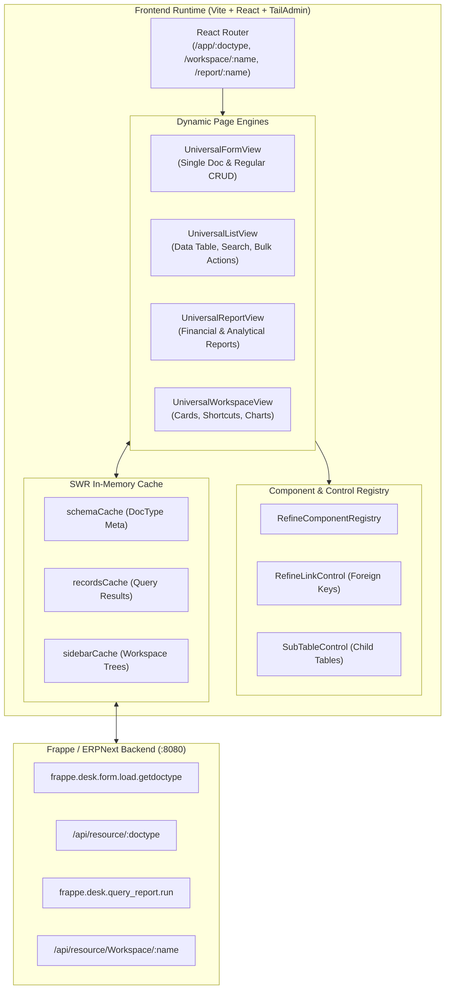

# 01 — Dynamic Runtime Engine & Architecture

Lotus Fin uses a **Metadata-Driven Runtime Engine** that dynamically interprets Frappe/ERPNext DocType schemas at runtime, constructing full CRUD interfaces without requiring individual handwritten views for hundreds of business documents.

---

## 🏛️ High-Level Architecture Diagram

---

## ⚙️ Core Dynamic Engines

### 1. `UniversalFormView.tsx`
- **Location**: `frontend/src/pages/dynamic/UniversalFormView.tsx`
- **Purpose**: Handles both Creation (`/app/:doctype/new`), Modification (`/app/:doctype/:id`), and Single DocType settings (`/app/:doctype/:doctype` or `/app/Buying Settings`).
- **Features**:
  - Automatically fetches metadata schema from `frappe.desk.form.load.getdoctype`.
  - Groups fields into **Sections** using Frappe `Section Break` definitions.
  - Automatically maps field types to pure Tailwind form controls via `REFINE_COMPONENT_REGISTRY`.
  - Full dirty-state tracking, allowing instant discard or save with server-side validation messages.

### 2. `UniversalListView.tsx`
- **Location**: `frontend/src/pages/dynamic/UniversalListView.tsx`
- **Purpose**: General data table view for any DocType (`Customer`, `Item`, `Sales Invoice`, etc.).
- **Features**:
  - Server-side pagination, multi-column sorting, and quick text search.
  - Filter bar with quick status filters and advanced multi-condition filter builder.
  - Bulk actions (Delete, Export, Status change).
  - Single DocType detection: Automatically redirects single DocTypes (like `Accounts Settings` or `Buying Settings`) directly to `UniversalFormView`.

### 3. `UniversalWorkspaceView.tsx`
- **Location**: `frontend/src/pages/dynamic/UniversalWorkspaceView.tsx`
- **Purpose**: Renders module dashboards (`/workspace/Invoicing`, `/workspace/Buying`, `/workspace/Stock`).
- **Features**:
  - Dynamically fetches workspace definition from `/api/resource/Workspace/:name`.
  - Renders shortcut chips, metric cards, and categorized link groups (Master data, Transactions, Reports, Settings).

### 4. `UniversalReportView.tsx`
- **Location**: `frontend/src/pages/dynamic/UniversalReportView.tsx`
- **Purpose**: Renders analytical and financial reports (`General Ledger`, `Trial Balance`, `Accounts Receivable`, etc.).
- **Features**:
  - Parses report script filters (`from_date`, `to_date`, `company`, etc.).
  - Executes `frappe.desk.query_report.run` and renders formatted financial tables with totals and export options.

---

## 🧩 Component Registry (`RefineComponentRegistry.tsx`)

All Frappe field types are mapped to responsive, dark-mode ready Tailwind CSS components:

| Frappe Field Type | React Component | Behavior |
| :--- | :--- | :--- |
| `Data`, `Password` | Styled `<input>` | Single line text with icons and validation. |
| `SmallText`, `Text`, `Long Text`, `Text Editor`, `Code` | Styled `<textarea>` | Multiline auto-sizing text and code editors. |
| `Currency`, `Int`, `Float`, `Percent` | Styled `<input type="number">` | Numeric input with formatting and suffix. |
| `Select` | Styled `<select>` | Dropdown populated from newline-delimited options. |
| `Check` | Styled Switch Toggle | iOS-style slider toggle for boolean flags. |
| `Date`, `Datetime` | Styled date/time inputs | Native picker with standard ISO formats. |
| `Link`, `Dynamic Link` | `RefineLinkControl` | Foreign Key search dropdown with autocomplete. |
| `Table` | `SubTableControl` | Child table grid supporting row add/remove and inline edits. |
| `Section Break`, `Column Break` | Section Divider | Form layout partitioning into responsive columns. |

