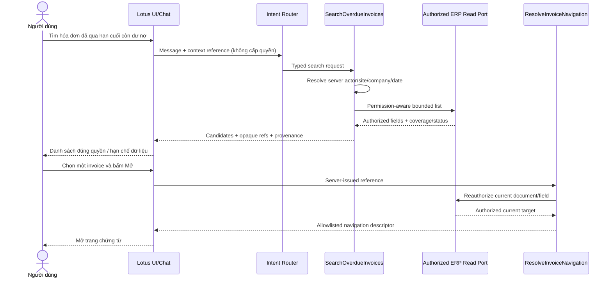
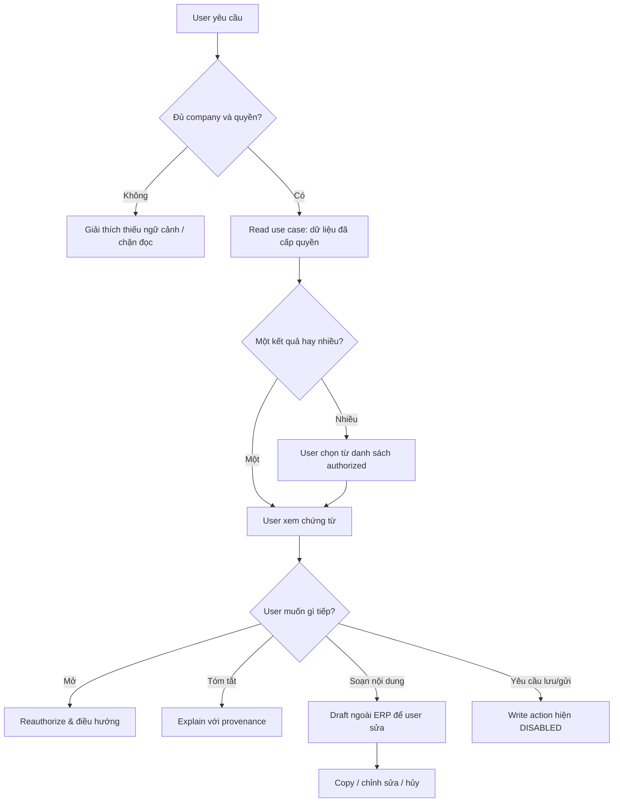
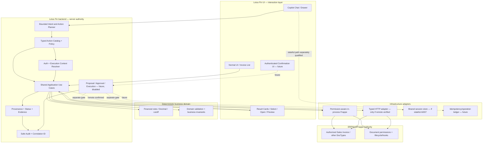
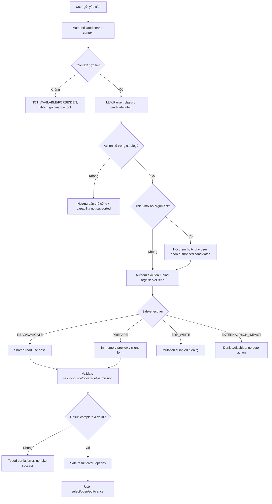
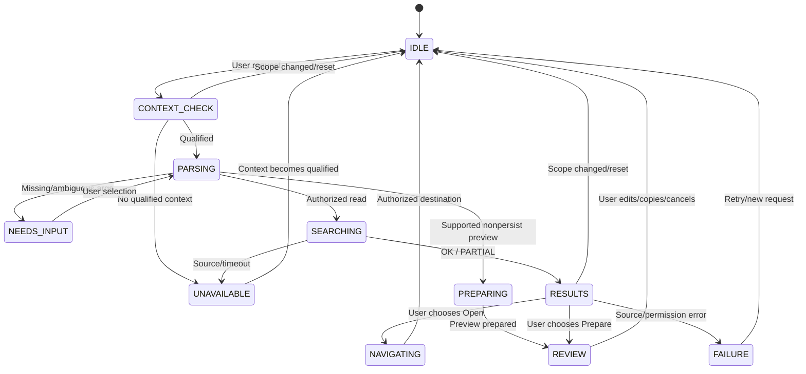
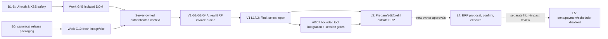
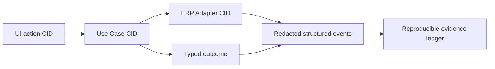
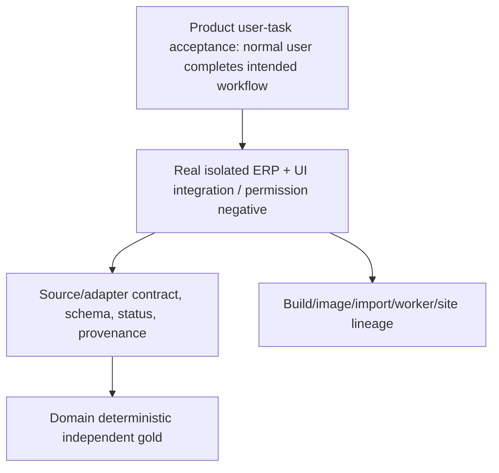

# LOTUS FIN — CHATBOT HỖ TRỢ THAO TÁC NGƯỜI DÙNG
## Solution Design · User Journeys · Luồng hệ thống · Expected Changes · Implementation Roadmap

> **Phiên bản tài liệu:** 1.0 — 10/10/2026  
> **Phạm vi:** Product / Solution Architecture cho chatbot hỗ trợ người dùng thao tác trên Lotus Fin kết nối ERPNext/Frappe.  
> **Trạng thái:** **PROPOSED SOLUTION DESIGN — KHÔNG PHẢI MÔ TẢ CHỨC NĂNG ĐÃ TRIỂN KHAI**.  
> **Nguồn:** Work Phase 0 Round 1–3; ưu tiên `B1S_PREIMPLEMENTATION_CLOSURE.md`, `JUDGE_RELEASE_RECONCILIATION_PLAN.md`, `PHASE0_WORK_TO_CHAT_PACKET(2).md`, `V1_OVERDUE_SOURCE_AND_CONTRACT_CLOSURE.md`.  
> **Đối tượng đọc:** Chủ sản phẩm, BA, kiến trúc sư, backend/frontend developers, AI engineers, QA, security, DevOps, BGK cuộc thi.

---

## 0. Đọc nhanh: Chúng ta thực sự muốn xây cái gì?

**Đích đến không phải một chatbot chỉ hỏi đáp.** Đích đến là **trợ lý thao tác trong Lotus Fin**: người dùng nói công việc muốn làm; hệ thống hiểu yêu cầu, tìm đúng chứng từ/dữ liệu theo quyền, hiển thị các lựa chọn, giúp chuẩn bị bước tiếp theo, rồi **thực hiện những thao tác được phép**. Với thao tác làm thay đổi dữ liệu ERP, người dùng phải xem bản xem trước và phê duyệt bằng một hành động xác thực riêng; chatbot không thể tự coi câu “đồng ý” trong văn bản là quyền thực thi.

### 0.1. Ví dụ theo cách người dùng nhìn thấy

| Người dùng nói | Trải nghiệm mong muốn | Phân loại | Trạng thái thực tế |
|---|---|---|---|
| “Tìm hóa đơn đã qua hạn cuối của công ty A” | Danh sách hóa đơn đúng quyền, số tiền/đơn vị/cutoff rõ ràng | Đọc dữ liệu | **V1 đề xuất; chưa triển khai, G2/G3 pending** |
| “Mở hóa đơn số INV-…” | Xác minh lại quyền rồi điều hướng đúng trang chi tiết | Điều hướng | **V1 đề xuất; chưa triển khai** |
| “Trong các hóa đơn đó, cái nào cần theo dõi trước?” | Tóm tắt, lọc, sắp xếp từ dữ liệu xác minh; giải thích tiêu chí | Phân tích/ưu tiên | Tương lai, tùy source/capability đã duyệt |
| “Soạn giúp tôi lời nhắc công nợ” | Bản nháp **ngoài ERP** để người dùng đọc/chỉnh/copy | Chuẩn bị không ghi ERP | Tương lai, read-only + in-memory preview |
| “Điền trước form tạo yêu cầu theo dõi” | Mở form và điền trường được phép, người dùng xem lại | Hỗ trợ UI, chưa persist | Tương lai, cần typed form/action contract |
| “Lưu yêu cầu theo dõi này vào ERP” | Preview chính xác trường/đối tượng; user duyệt qua UI; ghi bằng ERP business API | **ERP mutation** | **CHƯA CHO PHÉP**; cần phase/contract/gates riêng |
| “Gửi email nhắc tất cả khách hàng” | Chưa thực thi; hiện chỉ có thể hướng tới preview nội dung | External side effect | **DISABLED** |
| “Tự động chạy hằng ngày và gửi đi” | Không chạy trong scope hiện tại | Autonomous scheduled action | **DISABLED** |

> **Nguyên tắc quan trọng:** “Tự động hỗ trợ thao tác” **không đồng nghĩa** chatbot được tự ý ghi ERP, gửi email hay chuyển tiền. Hỗ trợ có thể tự động ở các bước tìm, lọc, gợi ý, chuẩn bị và điều hướng; thay đổi dữ liệu là ranh giới phải có quyền và xác nhận riêng.

### 0.2. Giải pháp cấp cao

1. **Một Action Catalog có giới hạn:** mỗi hành động là business capability được định nghĩa bằng typed contract, không phải generic tool “gọi tùy ý API/SQL/CRUD”.
2. **Một application use-case layer chung:** UI thường và chatbot dùng cùng nghiệp vụ, cùng quyền và nguồn dữ liệu.
3. **Một server-owned execution context:** actor, product, ERP connection, site, company, quyền, version, observation time; tuyệt đối không lấy từ lời LLM làm authority.
4. **Một interaction orchestration:** xác định intent → kiểm tra điều kiện → hỏi bổ sung khi cần → search/prepare → user chọn/xác nhận → (tương lai) execute → verify → audit.
5. **Một giới hạn rõ giữa READ/PREPARE và WRITE/SEND:** B1-S khắc phục UI ngay; V1 chứng minh read/navigation; write chỉ mở theo hợp đồng được duyệt riêng.
6. **Một release có thể tái lập:** source → image → worker → site → API/Desk/React; không dùng patch ẩn trong container làm bằng chứng release.

### 0.3. Kết luận kỹ thuật hiện hành (cập nhật Round 3)

| Track | Work verdict | Ý nghĩa đối với chatbot thao tác |
|---|---|---|
| **B1-S — React Copilot UI Safety** | `B1S_READY_FOR_CHAT_APPROVAL` | Có candidate batch sửa an toàn UI; chưa phê duyệt contract/ADR/implementation; **sẽ khóa các remote financial actions khi thiếu qualified context** |
| **B0 — Judge/Deployment** | `JUDGE_RELEASE_PLAN_READY`, G10 `BLOCKED` | Đã có kế hoạch đóng gói, chưa có clean immutable image + fresh worker + site/HTTP chứng minh được |
| **V1 — Invoice read/open** | `V1_G2_G3_PENDING` | Chọn hướng **“Hóa đơn đã qua hạn cuối còn dư nợ”**; chưa xác minh thực tế quyền/số dư/field/cutoff trên site sạch |
| **Existing AI007/Copilot** | Source paths xác định nhưng contracts/guest/legacy/session tồn tại rủi ro | **Không được kết luận đã có action execution an toàn** |
| **ERP write / send / autonomous** | Không nằm trong scope được duyệt | Đây là **kiến trúc tương lai**, không phải chức năng cho phép bật ngay |

---

## 1. Product vision, scope và mức độ tự động hóa

### 1.1. Vấn đề của người dùng

Hiện nhiều thao tác trong ERP phải qua nhiều màn hình: chọn đúng công ty, vào đúng module, tự lọc chứng từ, xem thông tin, tính/đối chiếu rồi nhập dữ liệu theo bước. Trong khi đó, chatbot có nguy cơ trả lời giống đã xử lý xong dù không lấy được nguồn hoặc không thực hiện thao tác thật. Mục tiêu là **rút ngắn số thao tác thủ công** mà không làm mất khả năng kiểm soát.

**Chỉ số giá trị sản phẩm đề xuất:** tỷ lệ user hoàn thành tác vụ hợp lệ, số bước/click giảm, thời gian hoàn thành công việc, tỷ lệ phải sửa lại, tỷ lệ thao tác thất bại được báo đúng, và đặc biệt **số sự cố truy cập sai quyền / số liệu giả phải bằng 0 trong acceptance**. Các chỉ số chưa được benchmark, không gán số liệu ROI tưởng tượng.

### 1.2. Phân loại thao tác L0–L5

| Level | Chatbot giúp gì? | Có tác động ERP? | Điều kiện đề xuất |
|---|---|---|---|
| **L0 — Explain** | Giải thích quy trình/hướng dẫn thao tác | Không | Trả lời an toàn, không nhận là đã đọc ERP |
| **L1 — Read & Find** | Tìm invoice, lọc, kiểm tra, giải thích dữ liệu đã xác minh | Chỉ đọc | User/site/company/field permissions, source, coverage |
| **L2 — Navigate & Select** | Đưa lựa chọn, user bấm mở chứng từ hoặc màn hình | Không ghi | Reauthorize detail; target allowlist; client không tự chế URL |
| **L3 — Prepare & Fill** | Chuẩn bị nội dung, điền form client-side, xuất preview cho user sửa | **Không persist** | Typed field allowlist; draft ngoài ERP; không tự gửi/submit |
| **L4 — Commit ERP change** | Tạo/lưu ERP draft, cập nhật document, thêm task/note | **Có ghi** | Immutable preview/proposal + authenticated one-use approval + reauth + audit + idempotency; **chưa bật** |
| **L5 — High-impact/external** | Submit/cancel, gửi email, bank/payment, scheduler autonomous | Có/khó đảo ngược | Policy/feature approval riêng; **DISABLED** hiện tại |

**Phân biệt quan trọng:** Form được điền tạm trong browser là L3; bấm **Save Draft** tạo record trong ERP đã là **L4 mutation**, kể cả chưa Submit.

### 1.3. Phạm vi hiện tại và tương lai

- **Ngay:** B1-S, B0; không mở financial remote actions khi nguồn/context chưa qualified.
- **Pilot sản phẩm tiếp theo:** V1 L1–L2 tìm/mở hóa đơn thuộc Option B đã kiểm chứng.
- **Sau V1:** L3 chuẩn bị follow-up hoặc typed form-fill; đo giảm thao tác thực tế, không viết ERP.
- **Tương lai, theo quyết định riêng:** L4 mutation có preview và UI confirmation; không ghép tự động vào V1.
- **Không nằm trong roadmap được phê duyệt:** external email auto-send, thao tác ngân hàng, FX, scheduled autonomous actions, ML tùy hứng, tự ý xây F101/F102.

### 1.4. Ranh giới sản phẩm và công nghệ

Lotus Fin là **sản phẩm độc lập**. Frappe/ERPNext là công nghệ nền trong topology cục bộ Work quan sát. Các sản phẩm khác dùng ERPNext **không được coi là dùng chung** custom doctypes, users, company mappings, permissions hoặc API compatibility. Một remote ERP target tương lai cần adapter và qualification riêng.

---

## 2. User journeys — nhìn từ phía người dùng

### 2.1. Journey A: tìm và mở chứng từ (pilot ưu tiên)

**Kịch bản:** User thuộc công ty A muốn tìm các hóa đơn đã qua hạn cuối mà còn số dư.

1. User chọn hoặc được hệ thống hiển thị company scope được phép. Chat **không tự chọn công ty từ text** để tăng quyền.
2. User gõ: “Tìm hóa đơn đã qua hạn cuối còn dư nợ của khách ABC”.
3. Chatbot xác định capability `PAST_FINAL_DUE_INVOICES`; giải thích rõ đây **không phải** toàn bộ installment-overdue invoices.
4. Backend lấy identity/context đã xác thực, ngày quan sát của site và phương thức đọc được cho phép.
5. Backend tìm theo các fields tối thiểu; kiểm tra document/field/company permissions và bound pages/rows.
6. Nếu có nhiều customer/invoices trùng tên, UI hiển thị **các lựa chọn đã được quyền xem**, user chọn một.
7. UI hiển thị danh sách kèm `due_date`, số dư hiện tại, **party-account currency**, observed_at, coverage và trạng thái.
8. User nhấn **Mở hóa đơn**; backend reauthorize document tại thời điểm mở, trả navigation descriptor allowlisted.
9. UI mở đúng route của **primary product UI** (Desk/React được chọn theo deployment decision), không dùng URL do LLM tạo.
10. Nếu quyền bị thu hồi/đổi công ty/phiên hết hạn: không mở, xóa dữ liệu cũ và hướng dẫn tìm lại.



**Failure UX minh họa:**

| Tình huống | Giao diện phải hiển thị | Không được làm |
|---|---|---|
| Không có kết quả, truy vấn đủ coverage | “Không tìm thấy hóa đơn phù hợp trong phạm vi được phép xem” | Không suy ra dữ liệu của company khác |
| Quét tới giới hạn trang trước khi hoàn tất | “Kết quả chưa đầy đủ; hãy thu hẹp bộ lọc” (`PARTIAL`) | Không hiển thị “không có hóa đơn” |
| ERP trả timeout/source error | Lỗi có thể thử lại và safe correlation ID nếu có | Không tự tạo hóa đơn hoặc số tiền mẫu |
| Không có quyền | Thông báo không đủ quyền, không tiết lộ sự tồn tại của chứng từ ẩn | Không đưa document ID/amount ẩn |
| Lựa chọn mơ hồ | Cho user chọn trong các kết quả đã được cấp quyền | Không tự chọn ngẫu nhiên |
| Đổi company sau khi gửi yêu cầu | Clear old results, abort/fence delayed response | Không hiển thị lại số tiền company cũ |

### 2.2. Journey B: hỏi — xem — chọn — lọc — soạn — sửa

**Mục đích:** user không chỉ đọc con số mà còn hoàn thành công việc có liên quan.

Ví dụ hội thoại mong muốn (**thiết kế UX tương lai, không phải khả năng hiện đã bật**):

> **User:** Tìm những hóa đơn đã qua hạn cuối và còn dư nợ của công ty đang làm việc.  
> **Assistant:** Tôi tìm thấy các kết quả được phép xem. Phạm vi này chỉ gồm hóa đơn đã qua hạn cuối còn dư nợ, không bao gồm kỳ thanh toán trễ trước hạn cuối. Bạn muốn mở chứng từ nào?  
> **User:** Chọn hóa đơn thứ hai.  
> **Assistant:** Đây là hóa đơn bạn vừa chọn. [Mở chứng từ] [Xem chi tiết] [Soạn nhắc công nợ]  
> **User:** Soạn giúp tôi lời nhắc công nợ bằng tiếng Việt.  
> **Assistant:** Tôi đã chuẩn bị **bản nháp ngoài ERP** từ những thông tin được phép sử dụng. Bạn có thể sửa, sao chép hoặc hủy. Tôi **chưa gửi email hay ghi gì vào ERP**.



**Các thao tác trực tiếp của user:** chọn company (theo quyền), nhập chat, chọn kết quả, thay bộ lọc, click mở, click preview, chỉnh sửa bản nháp, bấm Copy/Hủy; **tương lai** bấm Xác nhận một mutation tại giao diện được xác thực. Những thao tác này phải được mô tả và kiểm thử riêng với autonomous agent behavior.

### 2.3. Journey C: điền form trước nhưng chưa lưu ERP (L3)

Mục tiêu tương lai: “Tạo một mẫu yêu cầu theo dõi hóa đơn này và điền trước các trường giúp tôi.”

- Chatbot **không** tự gọi generic create/update.
- Backend cấp một form schema đã duyệt, định nghĩa field allowlist, types, validation, quyền và nguồn lấy dữ liệu.
- Chatbot chỉ đề xuất values cho trường hợp lệ; server kiểm tra từng field. Các giá trị suy đoán phải được đánh dấu `USER_REVIEW_REQUIRED`.
- UI mở form, điền tạm trong browser; hiện rõ nguồn field (`ERP_VERIFIED`, `USER_ENTERED`, `SUGGESTED`) và những trường còn thiếu.
- Người dùng được sửa hoặc hủy. Đến đây **chưa có record ERP mới**.
- Nút “Lưu ERP” nếu có ở tương lai phải đi qua write proposal/confirmation path riêng, không phải chỉ gọi submit của form tự động.

```mermaid
sequenceDiagram
    actor U as Người dùng
    participant CHAT as Chat
    participant PREP as PrepareFormUseCase (future)
    participant FORM as Client Form
    U->>CHAT: Điền trước form theo dõi chứng từ
    CHAT->>PREP: Typed form-intent + authorized record ref
    PREP->>PREP: Field allowlist + validated suggestions
    PREP-->>FORM: In-memory form preview; no ERP save
    FORM-->>U: Các trường được điền, nguồn và cảnh báo
    U->>FORM: Chỉnh sửa / hủy / tiếp tục
    Note over FORM,PREP: L3 kết thúc tại form, chưa ghi ERP
```

### 2.4. Journey D: thao tác thật trên ERP — **tương lai, hiện chưa cho phép**

Ví dụ: “Tạo một draft Task theo dõi khoản nợ này” (chỉ là use case minh họa, **chưa xác nhận installed ERP có đúng contract/DocType phù hợp**).

1. Chatbot nhận intent, **chỉ** chọn action ID nằm trong server-side catalog được cho phép.
2. Server kiểm tra actor/company/connection, quyền tạo target, valid fields, document state và business rules.
3. Server dựng một **immutable proposal** với chính xác operation/targets/args/document version/expiry. Không tạo draft ERP trước bước này.
4. UI hiển thị **diff hoặc toàn bộ thông tin sẽ ghi**, ghi rõ hậu quả và quyền của người dùng; cho phép sửa thì tạo proposal mới.
5. User bấm **Xác nhận thực hiện** trên authenticated UI. Lời nói “OK” trong chat, văn bản từ invoice hay đầu ra của LLM **không phải** confirmation event.
6. Server nhận one-use confirmation bound to proposal; **reauthorize** quyền và document version ngay trước khi gọi ERP.
7. Adapter gọi **business method allowlisted** có lifecycle validation/hooks; không cho LLM gọi tùy ý `frappe.client.insert`/SQL.
8. Server dùng idempotency/operation ledger để xử lý retry. Nếu timeout sau khi yêu cầu có thể đã commit, trả `UNKNOWN_OUTCOME` và **reconcile**, tuyệt đối không retry ghi mù.
9. UI hiển thị trạng thái thật, id/link target được xác minh hoặc đường xử lý sai hỏng. Audit đầy đủ correlation ID.

```mermaid
sequenceDiagram
    actor U as Người dùng
    participant C as Copilot UI
    participant A as Typed Action Service
    participant P as Immutable Proposal Store
    participant ERP as ERP Business Adapter
    participant L as Operation Ledger
    U->>C: Hãy tạo draft theo dõi
    C->>A: Propose allowed action (không write)
    A->>A: Authenticate, authorize, validate exact target
    A->>P: Create scoped proposal + version + expiry
    P-->>C: Preview + proposal reference
    C-->>U: Thông tin trước/sau, hậu quả, Xác nhận/Hủy
    U->>C: Bấm Xác nhận trên authenticated UI
    C->>A: One-use approval + proposal reference
    A->>P: Check bind/expiry/one-use
    A->>A: Reauthorize actor, target & document version
    A->>L: Reserve idempotency operation key
    A->>ERP: Explicit allowlisted ERP business method
    alt Kết quả đã xác định
        ERP-->>A: Target version / accepted or rejected
        A->>L: Commit final outcome + audit
        A-->>C: Result + current target
    else Timeout/ambiguous commit
        ERP--xA: Ambiguous outcome
        A->>L: UNKNOWN_OUTCOME
        A-->>C: Chưa xác định; reconcile, không retry mù
    end
    C-->>U: Kết quả thực tế / trạng thái cần kiểm tra
```

**Đây là design reference cho L4**, không cấp phép triển khai trong batch hiện hành. Bất kỳ ERP draft/comment/task save nào cũng là mutation. Email, submit/cancel, thanh toán hoặc batch external actions yêu cầu **scope và approval riêng**, hiện `DISABLED`.

### 2.5. Journey E: user đổi công ty, quyền bị thu hồi hoặc mất mạng

- UI hiển thị rõ company/product/site hoặc context hợp lệ; không để user hiểu nhầm một nhãn company là permission proof.
- Khi scope thay đổi, xóa selected documents/cursors/proposal previews/financial responses; hủy pending client request và dùng generation fencing để ngăn `finally/success` cũ.
- Backend phải tái xác thực quyền mỗi lần resolve target; signed reference chỉ chứng minh token không bị giả mạo, **không chứng minh quyền chưa bị thu hồi**.
- Nếu lỗi mạng, thông báo không thực thi thành công, không tự đổi sang legacy router hoặc mock finance values. Với write tương lai, hiển thị `UNKNOWN_OUTCOME` khi kết quả không xác định.
- Nếu user rời trang/đóng Drawer, request cũ không được repopulate state; không dựa vào client cleanup làm biện pháp security duy nhất.

---

## 3. Sơ đồ kiến trúc giải pháp toàn diện (TO-BE)

### 3.1. Logical architecture



**Ba authority không được đảo:**

- **ERP:** document truth, ownership, role/field permission và lifecycle; không tự bỏ qua hooks bằng raw SQL.
- **Lotus deterministic domain:** financial computation/approved policy/coverage; không suy ra dữ liệu thiếu thành zero.
- **LLM:** hiểu intent, hỏi lại khi thiếu điều kiện, chọn capability trong catalog, giải thích kết quả đã được chứng minh; không quyết định quyền hoặc tự tạo financial truth.

### 3.2. Component responsibilities (đủ để developer phân công)

| Component | Đầu vào | Nhiệm vụ | Không được làm |
|---|---|---|---|
| Conversation UX | User text, selected authorized scope ref | Hiển thị intent, choices, result cards, progress, preview | Tự tin rằng HTTP200 = business success |
| Intent Interpreter | Text và **allowed capability list** | Trả structured intent + candidate args + confidence/ambiguity | Chỉ định actor/site/company/SQL/URL hoặc thực thi tool tự do |
| Server Context Resolver | Cookie/session/tokens và authenticated transport | Bind actor/product/connection/site/company/observation/CID/version | Tin `company` do LLM gõ làm authorization |
| Action Catalog | Registered typed capabilities | Enforce per-action schema, required claims, side-effect tier, limits | Expose general `execute_method`, raw SQL, generic CRUD |
| Use Case | Qualified context + typed args | Orchestrate authorization/source/domain, typed result | Bỏ qua permissions vì kết quả đã cache |
| ERP Adapter | Approved query/business operation | In-process Frappe or qualified remote HTTP, normalize errors | Query builder ignore_permissions, direct unchecked `get_all` |
| Evidence/Status | Verified source + completeness/limits | Bound reference, provenance, partial/error semantics | Đổi source error thành NO_MATCH/zero |
| Presentation Mapper | Typed result | Decide what can be displayed; redact errors/HTML | Claim verified widget on model prose |
| Proposal/Approval (future) | Authenticated actor + exact mutation | Preview, confirmation, reauth, version, idempotency | Execute from plain chat “yes” |
| Operation Ledger (future) | Unique operation identity | Track pending/success/rejected/UNKNOWN_OUTCOME | Promise exactly-once without ERP atomic dedup evidence |

### 3.3. In-process vs remote ERP

| Tiêu chí | Giai đoạn Lotus local đã quan sát | ERP remote (chưa xác minh target) |
|---|---|---|
| Candidate adapter | In-process Frappe có permission-aware API | Narrow typed HTTP client/adapter |
| Authentication | Server Frappe authenticated user context | Target credentials/delegation và user-scope mapping bắt buộc |
| Network failure | Primarily local call + process/DB errors | Additional transport, timeout, auth/retry |
| SDK `frappe-client` | Không cần bổ sung vì symmetry | Chỉ cân nhắc khi có bằng chứng tương thích/timeout/delegation; wrapper không cấp quyền hộ user |
| Quyết định | **Preferred proposal** | Chỉ triển khai khi target thực tế cần và có approval |

### 3.4. Chỗ AI007/Copilot hiện tại không đạt TO-BE

Theo Work static review: React `VercelChatPanel` có fake financial fallback; tool statuses có thể bị flatten; source host API còn guest/legacy fallback; AI003 tool signature mismatch; RAM session và runtime patch có divergence. B1-S **chỉ vá presentation safety**, không tự đóng permission/auth/session/tool schema/runtime gates. Mọi API, DTO, runner, adapter trong TO-BE chưa thể mặc định là đã tồn tại.

---

## 4. Conversation-to-action engine: chi tiết luồng quyết định

### 4.1. End-to-end decision tree



### 4.2. State machine cho UI/task



**L4 future extension (không active):** `REVIEW → PROPOSAL_ISSUED → AWAITING_AUTH_UI_APPROVAL → REVALIDATING → EXECUTING → SUCCEEDED/FAILED/UNKNOWN_OUTCOME → RECONCILING`. Trạng thái này phải nằm phía server, không phụ thuộc chỉ vào React state hoặc LLM text.

### 4.3. User selections là actions có định nghĩa, không phải chat text ngẫu nhiên

Các nút **Chọn**, **Mở**, **Xem chi tiết**, **Soạn nhắc**, **Điền form**, **Hủy** cần command IDs/typed payload và server-issued target references phù hợp; không xây nút từ plain model URL. Nút nào chỉ cần client-side action phải được định nghĩa rõ không chạm ERP; nút nào gọi server phải xác thực/phân quyền như một request độc lập.

Ví dụ message card (**UI illustration, không phải server schema hiện hữu**):

```text
Tìm thấy 2 hóa đơn phù hợp trong phạm vi đã kiểm tra
Capability: Hóa đơn đã qua hạn cuối còn dư nợ
Company: [đã xác thực]
Quan sát tại: [site-local timestamp]
Currency: party-account currency của từng chứng từ
Coverage: COMPLETE / PARTIAL (nêu giới hạn)

[ Xem danh sách ] [ Mở hóa đơn đã chọn ] [ Soạn nhắc công nợ ]
* Hệ thống chưa lưu hoặc gửi bất cứ thứ gì vào ERP.
```

---

## 5. Contracts đề xuất để chatbot thao tác có kiểm soát

**LƯU Ý:** tất cả type/capability IDs dưới đây là **proposed contracts**, không phải symbols đã được Work xác minh là tồn tại. Không thay thế các SSOT/contracts AI001–AI007 đã freeze.

### 5.1. Authenticated ExecutionContext — SERVER ONLY

```ts
interface ExecutionContext {
  actorId: string;              // từ authenticated session
  productId: string;            // server-bound Lotus product
  erpConnectionId: string;      // resolved, never LLM-selected authority
  siteId: string;
  companyId: string;            // authorized effective company
  effectiveErpPrincipal: string;
  contractVersion: string;
  capabilityVersion: string;
  observedAt: string;           // server issued ISO instant
  observationDate: string;      // site-local business date
  siteTimezone: string;
  correlationId: string;        // server-generated safe ID
  deadlineAt: string;
}
```

*Context từ UI (company label/contextKey) chỉ phục vụ presentation; backend phải tự xác minh. Nếu dùng service account remote thì account không mặc định đại diện hợp lệ cho end user.*

### 5.2. Action Catalog

```ts
type SideEffectTier =
  | 'READ' | 'NAVIGATE' | 'PREPARE_ONLY'
  | 'ERP_WRITE_DISABLED' | 'EXTERNAL_DISABLED';

type CapabilityDescriptor = {
  id: string;                     // allowlisted stable action ID
  version: string;
  tier: SideEffectTier;
  inputSchemaId: string;          // validated server-side
  serverPolicyId: string;
  requiredSourceContract?: string;
  requiresObjectSelection: boolean;
  requiresExplicitConfirmation: boolean;
  maxCalls: number;
  maxOutputBytes: number;
};
```

**Candidate action registry**:

| ID proposed | Tác vụ | Tier | Mở trong phase nào? |
|---|---|---|---|
| `invoice.search_past_final_due` | Tìm hóa đơn quá hạn cuối còn số dư | READ | V1 sau G2/G3/G4A |
| `invoice.open_authorized` | Mở chứng từ đã được xác minh | NAVIGATE | V1 sau G2/G3/G4A |
| `invoice.summarize_authorized` | Giải thích dữ liệu đã cấp quyền | READ | Sau khi kết quả được qualified |
| `followup.prepare_text` | Soạn nội dung nhắc cho user sửa | PREPARE_ONLY | Phase L3 riêng |
| `form.prefill` | Chuẩn bị giá trị form phía client | PREPARE_ONLY | Phase L3 riêng |
| `erp.save_draft` | Lưu bản nháp ERP | ERP_WRITE_DISABLED | Future contract và authenticated confirmation |
| `erp.submit_document` | Submit ERP document | ERP_WRITE_DISABLED | Future high-impact review, không gộp V1 |
| `notification.send_email` | Gửi email | EXTERNAL_DISABLED | Ngoài scope hiện tại |
| `agent.schedule_autonomous` | Tự động hẹn giờ và thực thi | EXTERNAL_DISABLED | Ngoài scope hiện tại |

Các action ID có thể đổi khi chốt domain; không được dùng chúng để đánh lừa code hiện tại rằng đã hỗ trợ những operations này.

### 5.3. Typed result status, availability, provenance

```ts
type ActionOutcomeStatus =
  | 'OK' | 'NO_MATCH' | 'AMBIGUOUS' | 'PARTIAL'
  | 'FORBIDDEN' | 'VALIDATION_ERROR' | 'SOURCE_ERROR'
  | 'TIMEOUT' | 'NOT_AVAILABLE' | 'STALE_REFERENCE';

type Provenance = 'ERP_VERIFIED' | 'USER_ENTERED' | 'DEMO_ONLY' | 'UNKNOWN';

type ActionResult = {
  capabilityId: string;
  status: ActionOutcomeStatus;
  provenance: Provenance;
  correlationId?: string;
  sourceVersion?: string;
  observedAt?: string;
  availableFields?: string[];
  unavailableFields?: string[];
  coverage?: { complete: boolean; reason?: string; scanned?: number; returned?: number };
  choices?: unknown[];       // actual per-capability DTO, not generic trust surface
  actionAvailability?: string[];
  safeMessage?: string;
};
```

**Priority rules:** client generation mismatch → ignore; auth/forbidden → no financial disclosure; timeout/source error → typed failure; nested business failure wins over wrapper success; partial stays partial; missing critical fields → unavailable; never convert missing to zero. HTTP 200, ERP docstatus=1, tool success flag và LLM prose là các trục riêng, không thay cho verified financial source.

### 5.4. V1 invoice search contract — restricted source

```ts
type SearchPastFinalDueInvoicesRequest = {
  customerQuery?: string; // candidate filter; no raw SQL/filter expression
  invoiceQuery?: string;
  cursor?: string;        // opaque, scope/query bound
  pageSize?: number;      // server caps
};

type InvoiceCandidate = {
  reference: string;       // server-issued opaque reference
  invoiceLabel: string;
  finalDueDate: string;
  currentOutstanding: string; // finite Decimal-as-string
  outstandingCurrency: string; // party_account_currency, not assumed invoice currency
  sourceModified?: string;
};
```

Eligibility **PROPOSED**, cần site oracle trước freeze: submitted, non-return, final_due_date trước site-local observation_date, positive current outstanding, company của effective authenticated scope; mọi return/credit/writeoff/POS/missing field/unsettled reversal case phải theo approved coverage policy. Multi-payment-term invoice chưa đến final due **không** được tự gọi là covered installment overdue. Do not use historical `as_of` from current outstanding.

**Bounds đề xuất chưa benchmark:** internal page 50, ≤5 pages/250 parent rows, ≤50 return items, zero child-term reads for Option B, 5s request deadline, ≤256 KiB returned payload, bounded fetched bytes; gặp cap → `PARTIAL`, không phải `NO_MATCH`. Reference/cursor ký/bind theo actor/product/site/company/connection/version/expiry và reauthorize mỗi lookup.

### 5.5. Proposal/approval/write contract — future only

```ts
interface MutationProposal {
  proposalId: string;
  contractVersion: string;
  actionId: string;
  exactArgumentsDigest: string; // digest phụ trợ, không thay server-side immutable payload
  actorId: string;
  productId: string;
  erpConnectionId: string;
  siteId: string;
  companyId: string;
  targetIds: string[];
  targetVersions: string[];
  expiresAt: string;
  previewRef: string;
  riskSummary: string;
}

type OperationOutcome =
  | 'ACCEPTED' | 'REJECTED' | 'FAILED' | 'UNKNOWN_OUTCOME';
```

**Server** phải lưu immutable exact arguments/recipient/target, expiry, proposal version và approval binding; client digest không thể là source of authority. UI confirmation cần signed authenticated event một lần, chống CSRF/replay, reauthorization, version precondition và idempotency key. Nếu target không có atomic dedup, không cam kết exactly-once. Trạng thái UNKNOWN_OUTCOME phải reconciled trước khi người dùng retry.

### 5.6. Tool budget và cancellation

Agent phải giới hạn allowlisted tool calls, vòng lặp, data bytes, pagination và deadline **trên toàn request**, không chỉ mỗi tool. Không truyền full invoice set vào LLM. UI abort giúp UX nhưng không chứng minh cancel DB/in-process work; server có deadline/cap riêng. Budget cụ thể phải được benchmark/approved theo capability; con số V1 ở §5.4 chưa phải release SLO.

---

## 6. AS-IS hiện tại vs TO-BE theo sản phẩm

| Khía cạnh | AS-IS — Work source-observed | TO-BE — dự kiến |
|---|---|---|
| Chat message | React UI gọi `copilot_api.chat_copilot`; Desk có alias/implementation riêng | Selected entrypoints gọi bounded action contracts |
| Quyền | Host guest/legacy fallback và company binding chưa qualified | Server-bound principal/site/company, fail closed |
| Tài chính khi lỗi | React hardcoded fake metrics/verified badges | Explicit SOURCE_ERROR/TIMEOUT/NOT_AVAILABLE, no fake widget |
| Output rendering | Unsafe HTML insertion, raw tool JSON | React safe text nodes, allowlisted verified widgets |
| Context | Fixed cutoff ở UI và backend; drawer hardcoded Demo | Server-owned observed_at/site-local date; no hidden fallback |
| User interactions | Chủ yếu chat/prose/widget, chưa qualified action workflow | Select/open/preview/form-fill commands có typed state |
| Tool registry | Feature/plugin routes không đồng nhất, schema/status gaps | Curated typed catalog, shared use cases, status/provenance |
| Write | Không có approved safe mutation protocol | Separate immutable proposal/approval/execute protocol **future disabled** |
| Deploy | Host/runtime/image khác nhau, judge Desk vs React khác nhau | Immutable source/image + worker/site/route lineage |
| Test | Synthetic browser smoke 3 assertions; app DOM tests not run | G4B true DOM/authorization/new-worker E2E under isolated target |

**Quan trọng:** TO-BE không ám chỉ UI thường, DTO, Proposal Store hay backend adapter đã tồn tại ở hiện tại. Cần thực hiện theo batches/gates dưới đây.

---

## 7. Expected Changes — đầy đủ theo workstream

Đây là **danh sách thay đổi dự kiến**. Phân loại:

- `EVIDENCED EXACT`: Work đã truy vết file/callers/manifest hiện tại.
- `PROPOSED NEW`: thành phần/giao diện mới, **chưa xác nhận file cụ thể** nếu chưa được contract freeze.
- `READ-ONLY DEPENDENCY`: chỉ được inspect/test, không tự ý sửa trong batch.
- `FUTURE DISABLED`: kiến trúc định hướng, chưa triển khai.

### 7.1. B1-S — React Copilot UI Safety (batch đầu tiên có thể phê duyệt)

**Contract candidate:** `B1S_UI_SAFETY_V1` — Work `READY_FOR_CHAT_APPROVAL`, chưa formal approved. Phạm vi: loại kết quả giả, unsafe HTML, stale response, unauthorized demo claims; tạm chặn remote financial requests khi context chưa qualified. G4B NOT_RUN, G10 release BLOCKED riêng.

| File | Loại | Changes dự kiến | Không được vượt scope |
|---|---|---|---|
| `frontend/src/pages/copilot/components/VercelChatPanel.tsx` | **EVIDENCED EXACT — edit** | Bỏ hardcoded numbers/verified badges, unsafe HTML, raw tool JSON; render safe outcomes; clear/fence scope; gate remote actions | Không refactor toàn AI007/financial engines |
| `frontend/src/components/copilot/LotusCopilotDrawer.tsx` | **EVIDENCED EXACT — edit** | Bỏ hardcoded `Lotus-fin (Demo)` làm fake authority; unavailable state khi chưa có scope | Không tự tạo fake demo session |
| `frontend/src/pages/copilot/components/copilotPresentation.ts` | **PROPOSED NEW** | Normalize transport/business/nested errors, safe CID, status/provenance model | Không nâng unknown status thành verified |
| `frontend/src/pages/copilot/components/CopilotMessageBody.tsx` | **PROPOSED NEW** | Render text bằng React text nodes, allowlisted formatting/status | Không `dangerouslySetInnerHTML` từ untrusted inputs |
| `frontend/src/pages/copilot/components/useCopilotRequest.ts` | **PROPOSED NEW** | Abort/generation/reset, deadline UI, stale request fencing | `contextKey` không phải auth proof |
| `tests_e2e/test_copilot_failclosed.py` | **PROPOSED NEW** | Playwright negative/positive DOM assertions | Không test shared ERP/8080 |
| `tests_e2e/copilot_fixture/index.html` | **PROPOSED NEW** | Isolated fixture HTML | Không production entrypoint |
| `tests_e2e/copilot_fixture/main.tsx` | **PROPOSED NEW** | Mount real rendering/request hook/caller in fixtures | Không fake production permission mode |
| `tests_e2e/copilot_fixture/vite.config.ts` | **PROPOSED NEW** | Strict local 127.0.0.1:5188, no proxy/network | Không fallback về shared Vite/ERP |

**Chỉ regression/read:** `LotusCopilotPage.tsx`, `AppLayout.tsx`, `App.tsx`/route wrapper, backend Copilot API/controller/DTO và legacy cutoff paths. Hệ thống hiện có panel 738 lines, ADR001 <200 lines/file; Work đề nghị one-time narrow safety variance nếu chủ sản phẩm/Chat duyệt, hoặc full decomposition theo ADR trước build. **Không có variance nào được cấp tự động bởi tài liệu này.**

**Điều kiện chấp nhận B1-S:** current production caller khi thiếu qualified context gửi **0 POST Copilot**, không tự chế số/verified, không render executable HTML, không giữ stale facts sau switch/unmount, không leak secret marker/CID giả, build/typecheck và independent DOM regression PASS trên isolated runner sau implementation.

### 7.2. B0 — Canonical packaging & judge release

**Work verdict:** `JUDGE_RELEASE_PLAN_READY`, G10 còn BLOCKED. Work ưu tiên Desk `/app/lotus-copilot` làm candidate nhỏ nhất do hiện có hooks/Page; **đây chưa phải quyết định bắt buộc của chủ sản phẩm**. Desk controller/chat path **khác React**, nên B1-S không tự động sửa Desk.

| File | Loại | Expected change |
|---|---|---|
| `docker/ai003-local/Dockerfile` | EVIDENCED EXACT — proposed edit | Pin base by approved digest, COPY approved judge scripts/config, record source/input lineage |
| `docker/ai003-local/Dockerfile.dockerignore` | EVIDENCED EXACT — proposed edit | Chỉ admit reviewed inputs; exclude agent plans/caches/untracked unintended source |
| `docker/compose.judge.yml` | EVIDENCED EXACT — proposed edit, untracked | Isolated project/site/volumes/network, immutable image ID, disabled schedulers/outbound during qualification |
| `docker/judge/init.sh` | EVIDENCED EXACT — proposed edit, untracked | Bootstrap/migrate **chỉ** site mới đã được phê duyệt; guard against shared sites |
| `docker/judge/smoke.py` | EVIDENCED EXACT — proposed edit, untracked | Capture actual imports/module source hash/site/image evidence and safe exits |
| `run.ps1` | EVIDENCED EXACT — proposed edit | Tách judge setup/smoke/status/stop/down khỏi shared Frappe modes; validate exact arguments |
| `run.sh` | EVIDENCED EXACT — proposed edit | POSIX parity, không thao tác shared frontend mặc định |
| `README.md` | EVIDENCED EXACT — proposed edit, untracked | Ghi đúng lệnh thật/entrypoint/capability limitations/evidence/cleanup |
| `.env.example` | EVIDENCED EXACT — proposed edit | Only placeholders/site/project/ports; không chứa credentials |
| `docker/judge/gunicorn.conf.py` | PROPOSED NEW | Worker-init structured import/hash/PID lineage; review side effects before import |

**Release source:** đề xuất lấy reviewed host `develop` HEAD + manifest được phê duyệt, **không** copy runtime-only patches hoặc dùng old judge image làm canonical. Work đã đối chiếu 15 sampled files chỉ 4 byte-match host. Local judge image thiếu nhiều selected Copilot files/React build; package root import PASS không chứng minh controller import/HTTP. Không có new worker/site acceptance. Từng source conflict (copilot API/controller/service/session/tool) cần decision & separate reconciliation, không coi B0 là batch sửa nghiệp vụ.

**B0 done:** manifest chính xác, reproducible build pinned, clean isolated site, worker loaded imports/versions verified, chosen Desk/React route reachable, ordinary-user permissions/negative HTTP smoke, logs/audit redacted, rollback/cleanup safe, G10 PASS. Nếu chọn Desk, cần **Desk-safe-presentation/source-context gate riêng**, React B1-S PASS không đại diện cho Desk.

### 7.3. V1 — Read & Open Invoice Action (chỉ sau source qualification)

**Work verdict:** `V1_G2_G3_PENDING`. Exact file names cho new use case **chưa được phê duyệt**; dưới đây là kiến trúc/module responsibility, **không phải existing symbols**.

| Layer/module candidate | Change dự kiến | Preconditions |
|---|---|---|
| Domain policy `PastFinalDueEligibility` | Finite Decimal, site-local cutoff, approved invoice predicate, coverage | Business rule + site oracle/credit/return/POS review |
| Application `SearchOverdueInvoices` | Typed bounded search, authorized scope, incomplete-query semantics | G2 source/contract approval |
| Application `ResolveInvoiceNavigation` | Opaque ref → reauthorize → allowlisted target | G1/G4A scope/navigation proof |
| Port `AuthorizedInvoiceReadPort` | `search`/`read` typed methods, masks/errors/coverage | Field/permission contract |
| Infrastructure `FrappeAuthorizedInvoiceAdapter` | Permission-aware `get_list`/`get` with explicit fields, no bypass SQL | Installed source + per-site qualification |
| Presentation DTO/Controller/API | Public use case callable by ordinary UI; later safe Copilot tool | Status/provenance/CID schema |
| React/Desk result cards | User choose/open, currency/source/partial, disabled write | Primary entrypoint decided |
| Independent gold/tests | Revoke/forbid/pagination/currency/credits/cutoff/source error | Isolated ordinary-user fixture |

**Important installed-source distinction:** Work saw active `frappe.client.get_list` → `qb_query` with permission flags. Direct QB/get_query defaults may bypass permission; `get_doc` alone does not prove field-level filtered results. The ERP Accounts Receivable report has payment-term logic but an inferred FIFO-like allocation, not automatically verified exact installment payment history. For V1 Option B choose parent fields only; no child-term reads/financial inference.

### 7.4. L3 — Prepare & Prefill (tương lai, không ghi ERP)

| Component proposed | Changes tương lai | Acceptance |
|---|---|---|
| `PreparationUseCase` | Bounded prepare with minimum authorized invoice facts | No ERP create/update; no recipient/send authority |
| Template/LLM explanation boundary | Generate user-editable reminder, label AI-generated suggestions | Injection-safe, no fabricated settlement or demands |
| `FormPrefillPolicy` | Per-form allowlisted fields + validation | Missing/unknown fields require review, no automatic submit |
| Frontend preview/edit/copy | Draft outside ERP, direct user edits, unsaved state | Clear “Chưa lưu ERP”, discard on scope change |
| Preview provenance | Label ERP_VERIFIED fields vs USER_ENTERED/SUGGESTED text | A suggested value does not inherit financial verification |

**Business decision chưa xác lập:** mẫu nào, form nào, fields nào, nơi lưu tạm, retention policy và có dùng LLM provider nào. Không viết new files trước khi chốt capability cụ thể.

### 7.5. L4 — ERP Write Workflow (FUTURE DISABLED)

| Component proposed | Changes cần có để mở writes | Điểm kiểm soát |
|---|---|---|
| `WritableActionPolicy` | Small catalog exact business operations | No generic CRUD/RPC/SQL; per-DocType permission |
| `MutationProposalService` | Immutable server proposal and safe diff preview | Bound actor/product/site/company/connection/args/version/expiry |
| `AuthenticatedApproval` | One-use UI event; anti-replay/CSRF protection | Chat text, model response, invoice text cannot approve |
| `MutationExecutionService` | Revalidate rights/version; call allowlisted ERP business method | Preserve ERP validations/hooks/lifecycle |
| `OperationLedger` | Durable idempotency/reservation/completion | UNKNOWN_OUTCOME reconciliation after ambiguity |
| `Audit & Reconciliation` | Actor/action/target/change/outcome/trace | Redacted, retention/ownership policy |
| Write E2E fixtures | Unauthorized, stale, expired, double-click, timeout-after-commit | No duplicate mutation or blind retry |

**Không** xây các component L4 trong B1-S/B0/V1. Không áp dụng approval flow giả (ví dụ checkbox client-side mà server không verify). Với ERP lacking atomic dedup, guarantee là *at-most-once-attempt with reconciliation where feasible*, không tuyên bố exactly-once.

### 7.6. Selected AI007 integration (sau V1)

- Map action intent → **one approved public use case**, not direct invocation of arbitrary feature services.
- Fix wrong AI003 tool signature via approved feature contract if/when selected; unrelated to V1 invoice search first slice.
- Fix authorization/guest/legacy fallback/schema/status/budgets on the **actual selected** AI007 entrypoint. Host/runtime implementations differ; choose canonical source first.
- Nếu dùng persistent session, **G01 ownership, G02 shared storage/lifecycle, G03 CAS/lease/concurrency** cần verified. Stateless V1 itself có thể không cần session, nhưng gọi qua stateful AI007 không miễn các gates.
- Tool response không nâng `DEMO_ONLY`/`USER_ENTERED` thành `ERP_VERIFIED`; no raw tool JSON.
- Judge Desk nếu được chọn có riêng `ai_insights.chat_copilot` + UI; phải review source/permissions/context khác React. Không đồng nhất hai paths.

---

## 8. Dev workflow, roadmap, phụ thuộc và owner

### 8.1. Roadmap theo giá trị người dùng (không phải thêm features bằng mọi giá)



**Lưu ý cạnh B0 và B1:** hai nhánh có thể tiến hành song song về planning/implementation sau khi **từng batch** được Chat duyệt; không tự kết hợp source allowlist. Một B0 Desk release có thể tồn tại mà chưa cung cấp financial chatbot an toàn; phải ghi capability disabled rõ ràng.

### 8.2. Milestones rõ nghĩa

| Milestone | Outcome cho người dùng | Code scope | Chặn bởi |
|---|---|---|---|
| M0 — B1-S local safety | Không thấy finance giả hay HTML injection; financial remote action có thể bị vô hiệu hóa | 2 existing + 7 proposed test/typed files | Chat contract/ADR/provisioning approval |
| M1 — B0 reproducible product | Người chấm có thể khởi chạy đúng artifact/entrypoint đã chọn | 9 existing + 1 new judge config (proposed) | Source reconciliation, isolated lifecycle, G10 |
| M2 — V1 qualified read | Tìm/mở hóa đơn thuộc phạm vi đúng, đúng quyền | New typed use case/port/adapter/UI, exact allowlist TBD | G2/G3/G4A real site |
| M3 — Copilot real action read | Chatbot gọi bounded search/open, user chọn và mở | Selected AI007 tool + UI | Backend context/tool status, G01–G03 if stateful |
| M4 — User-assisted preparation | Chatbot soạn nhắc/điền trước form để user sửa | Preview/form policy/UI | Approved templates/fields/retention |
| M5 — Approved ERP write | User preview → authenticated approve → safe write → audited result | New proposal/approval/ledger/ERP write adapter | Separate mutation ADR, security, ERP lifecycle, idempotency, full E2E |

### 8.3. Gate matrix không trộn track

| Gate | B1-S Round 3 | B0 release | V1 read/open | L4 writes |
|---|---|---|---|---|
| G1 source/runtime/capabilities | Narrow scope readiness PASS | Build identity chưa PASS | Clean site/source BLOCKED | NOT_APPLICABLE_YET |
| G2 typed contract | Proposed, chờ Chat approve | Delivery plan proposed | Partial, Option B direction | NOT_STARTED |
| G3 data/source method | Narrow render safety only, không chứng minh finance source | Không tự qualify accounting truth | BLOCKED site oracle | NOT_STARTED |
| G4A security/evaluation design | Partial/design ready | Isolated release plan | Partial/offline design | NOT_STARTED |
| G4B post-implementation | NOT_RUN | Post-build NOT_RUN | NOT_RUN | NOT_RUN |
| G10 immutable delivery | BLOCKED riêng | BLOCKED | Chờ real delivery | NOT_STARTED |
| G01–G03 sessions | Không được B1-S đóng | Không tự đóng | N/A stateless, cần khi đi qua AI007 stateful | Cần nếu selected chat/session path |

### 8.4. Ownership (3 công cụ)

| Vai trò | Quyền ra quyết định / nhiệm vụ | Không được tự làm |
|---|---|---|
| **ChatGPT Chat / Product arbiter** | Chốt scope, contract, gates, approved file allowlist, user-impact decisions | Claim đã chạy code hoặc site thực |
| **ChatGPT Work** | Inspect current repo/runtime, independent evidence, security analysis, run qualified tests, review G4B/G10 | Tự freeze/auto implement không qua approval |
| **Google Antigravity** | Sửa đúng approved batch/file/contract; báo diff/tests/evidence | Mở rộng scope, sửa finance method/ERP permissions tùy ý |
| **Owner/Deployment admin** | Chọn judge primary UI, approve isolated site, secrets, provisioning/build, mutation policy | Dùng shared site như fixture sạch |

### 8.5. Recommended next approval

**Batch kế tiếp nên là B1-S** sau khi Chat/owner duyệt: `B1S_UI_SAFETY_V1`, exact **2 edits + 7 new paths**, one-time ADR001 variance hoặc decomposition thay thế, isolated lockfile provisioning. Sau Antigravity, Work thực thi DOM/build G4B, rồi Chat đóng. **B0 packaging** planning/approval riêng. **Không phê duyệt V1/L4 build** trước oracle/contract tương ứng.

---

## 9. Bảo mật end-to-end: thao tác người dùng có nghĩa là có authority

### 9.1. Threat → mitigation

| Threat | Failure mode | Mitigation / acceptance |
|---|---|---|
| Prompt injection trong invoice/customer text | Nội dung ERP ra lệnh cho agent gọi tool/send | Treat as untrusted data, no capability escalation, schema/side-effect allowlist |
| LLM tự chọn company | Đọc khác công ty user được phép | Server-owned binding/authorization trước ERP; forbid cross-company |
| Broken field-level permission | Masked outstanding/customer data lộ qua adapter | Require read/field checks; missing required fields → unavailable |
| Generic ERP tool | LLM gọi SQL/CRUD/method bất kỳ | Only explicit typed business use cases; no generic executor |
| Demo/synthetic source | Kết quả mẫu được gọi ERP Live | Server-verified provenance policy, no UI fallback numbers |
| Source error → zero/NO_MATCH | Báo sai rằng không có nợ | Distinguish error, incomplete, verified zero; negative tests |
| UI XSS | Model/customer text trở thành executable HTML | React text nodes, no dangerous raw HTML/linkification |
| Company switch race | Fact của A xuất hiện trong B | Clear state + abort + generation fence + backend scope reauth |
| Forged/stolen ref/cursor | Mở đối tượng khác quyền | Signed/bound/expiry + reauthorize on read/open |
| Consent spoofing | LLM ghi “user confirmed” | Server-issued immutable proposal + authenticated one-use UI approval |
| Double-click/retry write | Tạo record hai lần | Durable idempotency ledger, version checks, ERP atomic dedup if available |
| Timeout after write | Không biết đã ghi chưa | UNKNOWN_OUTCOME and reconciliation, never blind retry |
| Sensitive logs | Lộ invoice/nội dung cuộc hội thoại/tokens | Redacted structured log/CID, bounded retention; no raw full payload |
| Stale build/judge mismatch | Một source chạy host, một source chạy image | Reproducible build manifest/image/worker/import/site/HTTP chain |

### 9.2. Special treatment: authenticated context và permission

1. Client `company` hoặc `contextKey` **không** là quyền truy cập.
2. User logged in không đương nhiên có Sales Invoice read hay report read trên mọi company.
3. Source connector phải có effective actor; service-account impersonation không được giả định.
4. Permissions cần được kiểm tại source query, field projection, open detail, old cache reuse và trước future write.
5. Không đưa raw denied target identifier vào chat error, để tránh leak existence.
6. Read scope và write scope tách riêng; có quyền xem không suy ra được phép create/submit.

### 9.3. Financial correctness

- ERP `outstanding_amount` được Work xác định theo `party_account_currency`, không được tự gắn invoice `currency`.
- Invoice `due_date` có thể là hạn cuối của schedule; Option B chỉ xét **qua hạn cuối**, không phải tất cả kỳ trả chậm.
- Report term allocation không đồng nghĩa chứng cứ lịch sử thanh toán cho kỳ cụ thể.
- Chỉ số Decimal phải finite, đúng scale và source precision; thiếu số liệu ≠ zero; không cộng tiền khác currency khi không có FX policy.
- Reference đến dữ liệu không thể tồn tại vĩnh viễn như bằng chứng quyền; snapshot/observation/modified version phải được biểu thị.

### 9.4. Logging, observability, audit



Suggested fields: `timestamp`, `actor`, `product`, `site`, `company`, `connection`, `capability`, `action`, `target_ref`, `contract_version`, `source_version`, `status`, `duration_ms`, `correlation_id`, `coverage`, `error_class`. **Không log** password/token, raw provider exceptions, full invoice payload, LLM chain-of-thought, proposal sensitive args hoặc browser HTML source chứa PII. Audit retention/access policy là open decision cần duyệt.

---

## 10. Test strategy — user task phải chạy đúng, không chỉ model trả lời hay

### 10.1. Pyramid of independent evidence



**Không dùng model answer alone làm oracle.** Assertion cần kiểm tra source records, field permissions, UI state, ERP write count và audit events độc lập.

### 10.2. B1-S G4B — mandatory cases

- Two callers: full page + Drawer (Drawer không dùng company Demo làm quyền).
- HTTP 401/403, timeout, network failure, empty HTTP200, nested `SOURCE_ERROR`, `PARTIAL`.
- Current `CURRENT_UNQUALIFIED` policy **0 Copilot POST** khi thiếu context; safe local responses có neutral label.
- No financial constants, verified badge, fake widget, model-prose certificate hoặc raw tool JSON.
- Injection strings `<script>`, ``, unsafe URL chỉ xuất hiện như text; không thêm script/image/link/action/network.
- Delayed response/catch/finally không repopulate company cũ; drawer close/unmount clear state.
- Malformed/forged CID suppressed, safe CID preserved once; no secret marker in DOM/log.
- Locked frontend build/typecheck và Playwright DOM tests thực sự PASS trong isolated harness.

Round 3 mới chỉ chứng minh synthetic browser harness **3 assertions PASS**; **chưa chạy app-specific DOM cases** và chưa `npm ci/build`. Do đó không gọi B1-S DONE.

### 10.3. V1 G2/G3/G4A/B — mandatory cases

| Fixture độc lập | Expected outcome |
|---|---|
| 2 authorized past-final-due invoices | Đúng hai records, đúng Decimal/currency, authorized open |
| Company B invoice inaccessible | Không hiện trong list/count/error/existence |
| Permission revoked between list and open | Open denied; old reference invalid |
| Multiple payment terms, term overdue nhưng final date chưa qua | Option B **không** bao phủ, nhãn hạn chế đúng |
| Partial vs full settlement | Số dư hiện tại đúng oracle; fully settled excluded |
| Returns/credits/writeoffs/POS/discount | Policy coverage đúng hoặc báo unavailable; không tự 0 |
| Missing/masked due or amount | PARTIAL/NOT_AVAILABLE, không phải NO_MATCH |
| Same invoice vs party-account currency mismatch | Dùng đúng outstanding currency/unit, không cộng sai |
| Site-local midnight/due today | `due_date < current_local_date`; due today chưa past-final |
| Page 250/251, many nonmatches | Cap → PARTIAL; `NO_MATCH` chỉ khi complete search |
| Source timeout/DB errors | Safe status/CID, no stale finance facts |
| Forged/expired reference/query scope | Deny trước navigation, reauthorize valid refs |
| Prompt injection in invoice text | Không thay đổi tools/target/recipient/permission |
| Mutation absence | No invoice/status/payment/ledger writes; declared metadata/cache side effects reviewed |

### 10.4. L3/L4 user-action acceptance (future)

- **L3:** form preview fields come only from allowlist, human edits preserved, abandon discards, no network write. Wrong-company source reference cannot prefill fields.
- **L4:** proposal matches exact actor/target/version/args; user must click authenticated confirmation; expiry/revocation/CSRF/duplicate click fail correctly; `UNKNOWN_OUTCOME` reconciled; audit; no unauthorized write; consistent ERP hooks/lifecycle.
- **L5:** no action executed when disabled, even when prompted aggressively or by malicious ERP content.

### 10.5. Release/competition evidence

For each delivered batch: exact Git revision+source SHA, clean inputs, build lockfile/dependency versions, immutable image ID, site/config/capability snapshot, worker loaded module identity, test command/exit, negative cases and audit correlation. Competition materials (after code): Technical Documentation (architecture, algorithm, security), Security Self-Assessment (permission tiers, known risks), README reproducibility, source/evidence, presentation ≤10 minutes, optional demo ≤5 minutes. **Không claim production-ready nếu chỉ demo fixtures.**

---

## 11. UX & visual components dự kiến

### 11.1. Chat message card types

| Card | Nội dung | User controls |
|---|---|---|
| `Message` | Văn bản thường, neutral provenance nếu không có source | Copy |
| `DataResult` | Verified source, timestamp, limits, company scope | Select, Details |
| `SelectionRequired` | Authorized candidates; explain ambiguity | Pick one, Cancel |
| `Navigation` | Server-validated target | Open |
| `PreparationPreview` | Draft outside ERP + field provenance | Edit, Copy, Discard |
| `SourceUnavailable` | Typed error, request-safe CID | Retry after context repair |
| `MutationPreview` (future) | Exact changed fields, target, consequences | Confirm via authenticated UI, Cancel |
| `UnknownOutcome` (future) | Execution uncertain, reconciliation status | Check status, not blind Retry |

### 11.2. Wireframe dạng text — không phải UI hiện hữu

```text
┌────────────────────── Lotus Fin Copilot ─────────────────────────────┐
│ Company: [Authorized Company ▼]   Source: ERP / Unknown / Demo      │
│ Observation: [server-issued datetime]  [Change company]             │
├──────────────────────────────────────────────────────────────────────┤
│ User: Tìm hóa đơn đã qua hạn cuối còn dư nợ của ABC                  │
│                                                                      │
│ Assistant: 2 kết quả trong phạm vi có thể kiểm tra                  │
│  • Invoice 1 — due date — balance — party currency                   │
│  • Invoice 2 — due date — balance — party currency                   │
│  [Chọn 1] [Chọn 2] [Mở đã chọn]                                      │
│                                                                      │
│ Đã chọn Invoice 2                                                    │
│  [Mở chi tiết] [Soạn lời nhắc]                                        │
│                                                                      │
│ Bản nháp lời nhắc (chưa lưu ERP / chưa gửi):                         │
│ ┌───────────────────────────────────────────────────────────────┐    │
│ │ Nội dung có thể sửa...                                        │    │
│ └───────────────────────────────────────────────────────────────┘    │
│ [Chỉnh sửa] [Copy] [Hủy]                                           │
├──────────────────────────────────────────────────────────────────────┤
│ Nhập yêu cầu...                                    [Gửi]             │
└──────────────────────────────────────────────────────────────────────┘
```

### 11.3. UX guardrails

- Nhãn `ERP_VERIFIED` chỉ dựa vào server-qualified provenance, không dựa vào spinner, badge hay chính lời mô hình.
- `DEMO_ONLY` cần server policy explicit; “Demo” trong company name không tạo quyền demo.
- User luôn biết thao tác là **tìm**, **chuẩn bị**, **đã mở**, **đã lưu** hay **chưa thể thực hiện**; không dùng “đã hoàn tất” chung chung.
- `PARTIAL` phải có dấu hiệu giới hạn rõ; user có thể thu hẹp bộ lọc.
- Hành động có side effect chỉ hiện khi capability enabled và actor được phép; không cho LLM tự render CTA thực thi.
- L4 UI preview phải cho thấy **trước/sau**, đâu là server facts, đâu là user input, và hậu quả có thể không đảo ngược.

---

## 12. Rủi ro, quyết định mở và chính sách đóng scope

### 12.1. Decision log cần chốt

| ID | Decision | Đề xuất | Owner / condition |
|---|---|---|---|
| DEC-01 | Product vision | **Chatbot trợ lý thao tác user**, không phải FAQ-only | Owner/Chat approve |
| DEC-02 | Action execution boundary | L0–L3 có thể tiến theo gates; L4/L5 DISABLED | Owner/security decision |
| DEC-03 | First batch | B1-S đúng Work Round3; duyệt contract/ADR/allowlist/provisioning | Chat/Owner |
| DEC-04 | Existing 738-line component | One-time narrow safety variance **hoặc** full decomposition | ADR approver |
| DEC-05 | Judge primary UI | Work recommends **Desk** for minimal reproducibility; React needs separate packaging | Owner |
| DEC-06 | B0 source | Approved host manifest, không copy runtime patch tự động | Owner/Deployment |
| DEC-07 | V1 business meaning | Option B `PAST_FINAL_DUE_INVOICES` | Chat chose direction, G2/G3 still pending |
| DEC-08 | Context/observation | Server-issued actor/product/site/connection/company/date/timezone | Required before live financial tools |
| DEC-09 | First L3 preparation | Choose one concrete form/template after V1 | BA/Owner |
| DEC-10 | First L4 ERP mutation | **Not decided / disabled** | Independent business/security approval |
| DEC-11 | Stateful AI007 | Require G01–G03 on selected path | Work/Chat |
| DEC-12 | External sending/scheduling | Disabled until separate governance | Owner/security |

### 12.2. Things we do NOT know yet

- Real judge deployment/site, actual enabled user/company/field permissions, installed customizations and connection mapping on a clean target.
- Whether the final demo must use Desk or React; Desk financial chat currently needs independent safe-presentation/context review.
- Which typed ERP write business method and DocType should be first (if any); durable dedup support of target is unverified.
- Exact front-to-back observation/context envelope and production DTOs for authoritative finance; current DTO does not provide them.
- Live ERP numeric/permission oracle and performance SLO for V1; no actual G4B/G10 PASS.
- How much time/clicks user workflows would save in production; this requires measured UX tests.

### 12.3. Constraints to prevent scope creep

- Do not reopen F101/F102 or rewrite F004/F005 merely to support V1.
- Do not represent Option A installment overdue as covered by Option B.
- Do not add `frappe-client`, Redis design patterns, new orchestrator framework or separate backend without evidence of need.
- Do not rewrite every AI feature to a global status enum: use explicit compatibility mapping at selected boundaries.
- ADR001 and SOLID/DRY/KISS/YAGNI: source file below 200 lines in newly introduced responsibilities; avoid broad refactors; any exception needs documented approval.
- Avoid any generic SQL/CRUD/tool runner being exposed to LLM.

---

## 13. Definition of Done: thế nào mới gọi chatbot giúp user thao tác được?

### 13.1. “B1-S DONE” — safety patch, **không phải full chatbot DONE**

- Approved `B1S_UI_SAFETY_V1` + exact files + ADR handling.
- No financial fallback/verified badge/unsafe HTML/stale company data; both React callers tested.
- App-specific independent DOM tests and build/typecheck PASS, negative results preserved.
- G4B reviewed by Work; Chat closes B1-S.
- Under current unqualified context, financial remote actions remain disabled and UX explains reason.

### 13.2. “B0 DONE” — reproducible judge baseline

- Immutable approved host-based source manifest and build input list.
- Pinned image and reproducible build; cold API/controller/dependency imports.
- Worker-loaded hashes and ordinary-user HTTP/UI acceptance in isolated site.
- Clear Desk-vs-React primary entrypoint, scripts actually run as documented, no shared-site side effects.
- G10 PASS; enabled capabilities precisely documented (not assumed).

### 13.3. “V1 DONE” — first user task complete

- `PAST_FINAL_DUE_INVOICES` G2/G3/G4A approved with independent site/currency/permission oracle.
- Ordinary user can search authorized current invoices, select one, open exact document; list/detail reauthorization.
- Partial coverage, no match, error, forbidden, stale reference and company switch all correct.
- No write side effects, source/fields/time/Decimal verified; UI reports true status.
- Work independently verifies G4B; then AI007 integration may proceed under its own gates.

### 13.4. “CHATBOT ASSISTED ACTIONS DONE” — end-to-end product milestone (future)

- User can complete at least one **actual, measured** multi-step workflow from natural-language request → authorized data → user selection → navigation/prepare/edit, with typed steps and auditable results.
- User does not need to trust model prose to know whether an action really occurred; system supplies a verifiable completion outcome.
- If ERP writes are enabled later, each mutation meets proposal/approval/execution/idempotency/reconciliation/ERP lifecycle acceptance.
- No cross-company leak, unauthorized writes, fabricated verified numeric result, prompt-injection action escalation or untracked production artifact.

---

## 14. Handoff cho người mới / coding agent

### 14.1. Đọc những tài liệu nào, theo thứ tự?

1. **Tài liệu này:** hiểu sản phẩm, user interactions, TO-BE và staged changes.
2. `PHASE0_WORK_TO_CHAT_PACKET(2).md`: Round3 actual verdict và gates.
3. `B1S_PREIMPLEMENTATION_CLOSURE.md`: exact 2 edits + 7 new proposed files, DOM oracle, safe presentation compatibility.
4. `JUDGE_RELEASE_RECONCILIATION_PLAN.md`: exact B0 9+1 packaging changes, Desk route decision candidate.
5. `V1_OVERDUE_SOURCE_AND_CONTRACT_CLOSURE.md`: ERP installed source/permission/Option B semantics.
6. Workflow v3.1, ADR001, Security Code V3, feature-specific frozen SSOT nếu selected path phụ thuộc.

### 14.2. Nếu là engineer implement B1-S

Không dùng tài liệu tổng quan này như authorization to edit. Yêu cầu explicit **approved B1-S implementation packet**, source fingerprints, file allowlist và ADR variance trước. Không đụng backend controller/tool/ERP. Test both callers/unsafe HTML/late scope/financial disabling. Nếu source hash lệch → stop, targeted reconciliation, không copy runtime blindly.

### 14.3. Nếu là engineer làm ERP action

Không mở L4 vì ở trên có sơ đồ future. Trước tiên làm V1 L1/L2 với ordinary user, explicit source/masking/coverage/currency oracle. Sau đó một typed L3 preparation flow, không persist. Một L4 cần **new owner-authorized business operation contract** với DocType/method/version/roles/lifecycle/approval/idempotency/E2E, không thể gom vào PR V1.

### 14.4. Evidence discipline

Mỗi phát hiện được ghi `FACT_OWNER / VERIFIED / PROPOSED / NOT_VERIFIED`, source revision/path/hash, actual command/exits/test scope. Static source inspection không được nâng thành live permission proof; synthetic test PASS không được nâng thành application G4B; root import PASS không được nâng thành judge-worker delivery PASS. Khi capability bị DISABLED, UI và demo script phải nói đúng điều đó.

---

## 15. Phụ lục: Source traceability và phân biệt fact/proposal

| Nguồn tài liệu do Work cung cấp | Được sử dụng cho điều gì | Không chứng minh được gì |
|---|---|---|
| `B1S_PREIMPLEMENTATION_CLOSURE.md` (Round 3) | 2+7 exact/proposed file packet, React panel/Drawer, compatibility, isolated fixture/DOM cases, one-time ADR variance proposed | B1-S đã code/chạy frontend/app DOM tests, backend permissions qualified |
| `JUDGE_RELEASE_RECONCILIATION_PLAN.md` (Round 3) | Host/runtime/image mismatch; B0 9+1 packaging plan; Desk primary candidate; isolated site and fresh-worker lineage | Judge đang chạy đúng release, Desk chatbot đã secure hoặc React artifact đã phục vụ |
| `PHASE0_WORK_TO_CHAT_PACKET(2).md` | B1S_READY_FOR_CHAT_APPROVAL, G10 blocked, V1 G2/G3 pending, current work priorities | Contract đã freeze, implementation dispatched, test production passed |
| `RESULTS(1).json` | Browser synthetic 3 assertions PASS, protected hashes/registry and NOT_RUN categories | Real React app/XSS exploit/G4B PASS hoặc site ERP verification |
| `V1_OVERDUE_SOURCE_AND_CONTRACT_CLOSURE.md` (Round 2) | Installed permission-aware source, report limitations, Option B predicate, DTO/status/cursor candidate | Per-site effective user/credit/source gold verified, ready for build |
| `CHATBOT_ERP_READ_PILOT_CONTRACT_PROPOSED.md` | Initial read/navigation use-case architecture and scope | Implemented API or authorized ERP source |
| Phase0 architecture/current audit / workflow/ADR/security | Authority separation and method/gate constraints | All current runtime variants accepted as canonical |

**Thông tin được thêm ngoài Work evidence:** các journeys C/D, action-tier L0–L5, Action Catalog, typed mutation proposal, UI wireframe, future workstream L3/L4 là **solution proposals** để làm rõ yêu cầu của chủ sản phẩm về “chatbot hỗ trợ thao tác người dùng”. Đây không phải nguồn chứng minh đã có code và cũng không tạo quyền bật ERP writes. Nếu product owner chọn một workflow cụ thể, phải freeze contract riêng trước implementation.

---

## 16. Summary — giải pháp từ góc độ end-user, kỹ thuật và delivery

**Đối với người dùng:** Một câu yêu cầu → chatbot tìm đúng phạm vi → trả kết quả có thể xác minh → user chọn và mở → chatbot chuẩn bị bước tiếp theo cho user kiểm tra/chỉnh → chỉ thực thi ERP changes nếu sau này có approval workflow được cấp phép.

**Đối với developer:** Không xây “AI có thể làm mọi thao tác”. Xây **small, typed, authorized action catalog** và shared application use cases, mỗi action có source contract/permission/status/error/coverage/side-effect tier và independent tests.

**Đối với competition:** Đưa ra demo **một workflow thật, đúng quyền, đúng dữ liệu, có bằng chứng**, hơn là hiển thị nhiều KPI/model answers nhưng không có verified source. Canonical image/entrypoint/worker/site và clear capability limitations là tiêu chuẩn giao sản phẩm.

**Next decision:** Chốt và giao **B1-S** sau khi approved contract/ADR/provisioning; triển khai **B0** như release track riêng; xác minh **V1 Option B** trên isolated site; sau đó kết nối read/navigation vào AI007 và chọn một tác vụ L3 để minh chứng chatbot hỗ trợ người dùng hoàn thành công việc. **Không tự bật L4/L5.**
