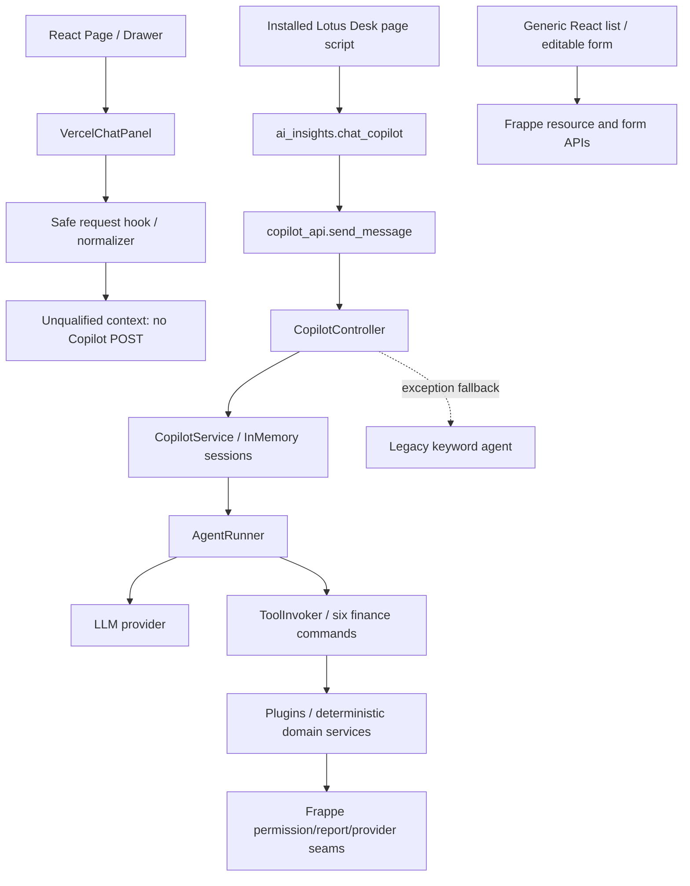

# Chatbot Assisted Actions — current codebase inspection và đối chiếu proposal

11/10/2026 · Lotus Fin · FinTechathon Shenzhen 2026 · Independent architecture/security review.

**`ACTION_ARCHITECTURE_READY_FOR_CHAT_DECISION` — source/integration discovery hoàn tất trong scope; không phải feature PASS hoặc quyền triển khai.** Backend Python hiện có đủ vị trí để bổ sung typed use cases và adapter. ToolInvoker là dispatcher công cụ tài chính, chưa là executor có đầy đủ authorization/outcome/approval cho thao tác ERP. Đề xuất pilot đọc, chọn và mở Sales Invoice qua backend Lotus hiện có; quyết định chi tiết ở [architecture decision](E:/lotus-fin/docs/reviews/phase0-chatbot-2026-10-10/CHATBOT_ERP_SDK_ACTION_ARCHITECTURE_DECISION.md).

## 1. Scope, authority và identity

Request hiện tại là inspect kiến trúc SDK/action executor **và đối chiếu proposal**. Chỉ tạo ba Markdown mới. Những chỉ dẫn triển khai trong [proposal v1.0 Round 3](<E:/lotus-fin/docs/reviews/LOTUS_FIN_CHATBOT_ASSISTED_ACTIONS_SOLUTION_DESIGN_VI (1).md>) là nội dung đề xuất lịch sử, không là lệnh sửa code trong lượt này. File suffixed `(1)` hiện có; finding trước đây về tên canonical chưa tìm thấy không được rewrite thành đã có từ trước.

Authority: [AGENTS](E:/lotus-fin/AGENTS.md), [ADR001](E:/lotus-fin/docs/adr/001-clean-architecture-core-first-adr.md), [Security Code V3](E:/lotus-fin/docs/security/LotusFin_Security_SSOT_Code_V3_Codebase_Aligned.md), [workflow §31–34](E:/lotus-fin/docs/features/LOTUS_FIN_AI_FEATURE_BUILD_WORKFLOW_3_TOOLS_V3_VI.md), [P1 MASTER SSOT](E:/lotus-fin/docs/reviews/phase0-chatbot-2026-10-10/CHATBOT_P1_AUTHORIZED_ACTIONS_MASTER_SSOT.md), [architecture audit](E:/lotus-fin/docs/reviews/phase0-chatbot-2026-10-10/CHATBOT_ARCHITECTURE_SCALE_DEBUG_AUDIT.md), [R7 independent review](E:/lotus-fin/docs/reviews/phase0-chatbot-2026-10-10/B1S_CORRECTION_R7_INDEPENDENT_RECHECK.md). P1 remains **PROPOSED / NOT_FROZEN**. Không sửa SSOT tài chính/F102 hoặc mở financial automation.

|Identity / loại evidence|Quan sát hiện tại|
|---|---|
|SOURCE_CONFIRMED|`develop@07f7251d3a0744356bf96fb2fea55ec6df9a0ce2`; staged empty. Tracked dirty chỉ Panel/Drawer, 74 insertions/267 deletions có trước lượt review. 9,730 untracked files, gồm evidence/cache/skills/source có trước; không quy chúng cho Antigravity hoặc review này.|
|SOURCE_CONFIRMED|67/67 P1 selected fingerprints không đổi; proposal là fingerprint bổ sung thứ68. 13/13 R7 application/harness/package/report fingerprints byte-identical. Vì vậy kết quả R7 vẫn định danh cùng artifact; không claim chạy lại suite.|
|RUNTIME_CONFIRMED — metadata/file only|Docker client/server29.1.3, actual connectivity exit0. Backend `a857658a101b`, frontend `1752490a1ae5`, image `lotus-fin:ai003-local`, ID `sha256:ed6e02f587eb450a0882ecb4b6fbb259d1a1f27f549e1cc4bbe21a660b3017b7`. Backend mounts sites/logs, không bind host application source. Frontend nginx/sites/logs, shared8080 không được request.|
|RUNTIME_CONFIRMED — process metadata|Read-only `docker top` exit0: backend Gunicorn parent PID1476, children1774/1775; configured command `["start.sh"]`. Đây là container/host PID observation, không imported application identity hoặc capacity test. Không terminate processes.|
|RUNTIME_CONFIRMED — installed files|Frappe16.34.0 / ERPNext16.35.0 / Lotus0.0.1. Container distributions requests2.33.1, Pydantic2.12.5. Không thấy frappeclient/httpx trong dist-info inventory. Host Python3.13.7, Node22.19.0; frontend installed React19.3.0, TypeScript6.0.3, Vite8.3.3, Axios1.20.0.|
|SOURCE_CONFIRMED + RUNTIME_CONFIRMED files|Controller/DTO host ≠ container kể cả normalize LF; gateway byte-equal. Bảng SHA bên dưới. Không được suy ra working tree đang phục vụ HTTP.|
|UNKNOWN / NOT_RUN|Resident imports, site apps/custom hooks, ordinary-user effective permissions, auth/connection mapping, canonical judge artifact, business requests, SDK interoperability, SQL/latency/RSS. Không đọc credentials/site configs, init site hoặc query business records.|

Lotus Fin và ERPNext là hai sản phẩm riêng. Deployment quan sát được đang đặt Lotus Python application trên Frappe cùng installed ERPNext; đây là topology, không đổi product identity. ERPNext giữ business truth của integration này; source frontend/backend không chứng minh mọi target bên ngoài có cùng apps/version/principal.

GitNexus exploring được áp dụng: cached CLI query `action executor sdk invoice search permission` exit0; context `ToolInvoker` notfound/exit1; graph behind61 commits. Graph-first không giải quyết current callers; bounded static import/call tracing dùng fallback được request cho phép. **UNKNOWN**, không graph-safe/dead-symbol verdict; không download index tools. Batch code sau phải impact trước edit, warn HIGH/UNKNOWN và graph change check trước commit nếu commit được authorize.

## 2. AS-IS — caller source, không claim HTTP đã chạy

Không nối mũi tên React hiện tại tới live Copilot API: hook explicitly unqualified. Desk caller có source, **active served page/session chưa được runtime verify**. Registry legacy không bị kết luận dead vì grep không thấy gọi từ React.

|Boundary và exact source|Chức năng thật / giới hạn reuse|
|---|---|
|[Panel:48](E:/lotus-fin/frontend/src/pages/copilot/components/VercelChatPanel.tsx:48), [handleSend:108](E:/lotus-fin/frontend/src/pages/copilot/components/VercelChatPanel.tsx:108), [hook:20](E:/lotus-fin/frontend/src/pages/copilot/components/useCopilotRequest.ts:20)|Text input → safe hook → text/source/CID display. `hasQualifiedContext:false`; no real POST. Hook fences generation/cancellation/reset/late responses; chưa có invoice intent schema, selectable results, bound selection hoặc mutation preview.|
|[normalizer:64](E:/lotus-fin/frontend/src/pages/copilot/components/copilotPresentation.ts:64), [renderer](E:/lotus-fin/frontend/src/pages/copilot/components/CopilotMessageBody.tsx), [Drawer:28](E:/lotus-fin/frontend/src/components/copilot/LotusCopilotDrawer.tsx:28)|Safe text/CID and deny precedence, finance widgets disabled. Drawer không cung cấp demo company. Reuse policy/lifecycle sau type-contract adaptation; không bật legacy transport bằng cách đổi qualified flag tùy ý.|
|[Desk page:100](E:/lotus-fin/lotus_fin/lotus_fin/lotus_fin_ai/page/lotus_copilot/lotus_copilot.js:100), [API:24](E:/lotus-fin/lotus_fin/lotus_fin/api/copilot_api.py:24), [controller:52](E:/lotus-fin/lotus_fin/lotus_fin/presentation/controller/copilot_controller.py:52)|Desk alias → API → controller/service; `allow_guest=True`, company verification, legacy fallback. Thiếu strict assisted-action endpoint/context. Không claim Guest exploit hoặc Desk current acceptance.|
|[service:40](E:/lotus-fin/lotus_fin/lotus_fin/application/service/copilot_service.py:40), [runner:62](E:/lotus-fin/lotus_fin/lotus_fin/application/agent/agent_runner.py:62)|Existing session orchestration + LLM tool loop. Existing-session owner check absent; shared mutable repository. Pilot stateless không gọi session hoặc runner. Auth-session vẫn bắt buộc, khác chat session.|
|[default registry:10](E:/lotus-fin/lotus_fin/lotus_fin/infrastructure/tool/registry/default_tools.py:10), [invoker:15](E:/lotus-fin/lotus_fin/lotus_fin/infrastructure/tool/invoker/tool_invoker.py:15)|Six registered financial commands; lookup → `is_authorized` → `execute(arguments,user)`. Có thể gọi trực tiếp không LLM, nhưng raw dict không được validate bởi invoker. JSON schema published cho planner không bằng runtime validation.|
|[registry:15](E:/lotus-fin/lotus_fin/lotus_fin/infrastructure/tool/registry/tool_registry.py:15), [DTO:11](E:/lotus-fin/lotus_fin/lotus_fin/presentation/dto/chat_response.py:11)|Duplicate tool name overwrite có warning; result DTO chỉ reply/tool/widget/session fields, thiếu P1 typed terminal status/source/context/CID. Không dùng registry này như universal ERP CRUD/RPC catalog.|
|[access facade:20](E:/lotus-fin/lotus_fin/lotus_fin/security/access.py:20), [gateway:89](E:/lotus-fin/lotus_fin/lotus_fin/infrastructure/security/frappe_access_gateway.py:89)|Existing company/report/evidence policy seams đáng reuse về separation/contract. Nonframework fallback/mock permissive không là authorization adapter cho pilot. Chưa có authorized invoice list/field projection port.|
|[generic data:31](E:/lotus-fin/frontend/src/providers/dataProvider.ts:31), [router:65](E:/lotus-fin/frontend/src/App.tsx:65), [form:97](E:/lotus-fin/frontend/src/pages/dynamic/UniversalFormView.tsx:97)|Generic resource list/CRUD/edit form đã có cho manual UI. Không là chatbot action hoặc strict read-only open. Generic full-document/Desk getdoc fallback không đáp ứng minimum reader contract; field filtering ở frontend không đủ.|

### Six commands và AI001–AI003 integration seams

`get_financial_snapshot`, `get_cash_forecast`, `evaluate_risk_signal`, `simulate_what_if_scenario`, `match_financing_products`, `calculate_repayment_schedule` tồn tại trong default registry. Chưa có invoice.search/read/open/create_draft. Names không chứng minh live authorization hoặc business acceptance.

- AI001 [tool:23](E:/lotus-fin/lotus_fin/lotus_fin/infrastructure/tool/impl/f001_health_tool.py:23) chỉ kiểm bool(company), truyền as_of_date; [plugin:53](E:/lotus-fin/lotus_fin/lotus_fin/modules/f001_health/plugin.py:53) yêu cầu period_start/end. Wrapper contract drift có source, không reuse wrapper. [report gateway:23](E:/lotus-fin/lotus_fin/lotus_fin/infrastructure/erpnext/erpnext_gateway.py:23) → extract_key_report_data là report seam, không invoice list adapter; currency fallback VND không là source proof.
- AI002 [get_trade_obligations:655](E:/lotus-fin/lotus_fin/lotus_fin/modules/f002_cashflow/adapters.py:655) đọc AR/AP point-in-time, checked-user report permission, typed source failure; không biến DB-unavailable thành []. Đây là pattern tốt cho failure/evidence separation. Report/voucher checks không chứng minh mọi invoice doc/field được phép và không thay search generic. Không copy financial logic vào chatbot.
- AI003 [evaluate_signal:97](E:/lotus-fin/lotus_fin/lotus_fin/modules/f003_risk_signal/service.py:97), [default_deps:642](E:/lotus-fin/lotus_fin/lotus_fin/modules/f003_risk_signal/service.py:642) tách authentication/company/source authorization/semantic checks; reuse nguyên tắc và typed ports. [_ap_evidence:525](E:/lotus-fin/lotus_fin/lotus_fin/modules/f003_risk_signal/service.py:525) gọi evidence storage: không tuyên bố tất cả financial services là side-effect-free hoặc reuse evidence writer trong no-business-write pilot.
- F004 what-if là financial simulation, F005 là product matching, F006 [execute:30](E:/lotus-fin/lotus_fin/lotus_fin/infrastructure/tool/impl/f006_repayment_tool.py:30) tính lịch trả nợ deterministic. Không tool nào ở sáu commands là create/submit/cancel/send ERP action. Scope không audit mọi transitive financial side effect hoặc bật các wrapper này.

## 3. Đối chiếu proposal: đã làm gì, còn gì

Không dùng tỷ lệ hoàn thành suy đoán. “Code có sẵn”, “contract draft”, “đã qualify” là ba mức khác nhau.

|Proposal milestone / section|Current evidence|Đã làm / còn thiếu|
|---|---|---|
|B1-S, §7.1; §8.3/§10.2 cũ chỉ synthetic3|R7 ledger +13/13 current hashes unchanged|**IMPLEMENTED + QUALIFIED tại R7:** 52/52 application gold, native4/4, Q1–Q8, exact asset query/lifecycle containment. Không cộng overlap thành tổng mới. Lượt này không rerun.|
|AS-IS §3.4/§6 còn React fake fallback, API call, HTML risk; §7.1 next batch B1|Current Panel/hook/normalizer/renderer|Các claim React đó **superseded** bởi B1-S. Current React không có qualified Copilot POST/finance widget. Backend legacy fallback và old DTO/session risks vẫn có source.|
|L0/L1–L2 orchestration, §1.2/§4|Existing input + finance tools; typed read components không tìm thấy|Input/status safety đã có; chưa có supported invoice intent/clarification, document result selection hoặc exact authorized open. Không coi tool schema/expand-chat button là assisted action.|
|B0 canonical environment, §7.2|Docker works; controller/DTO divergence, site/imports unknown|**NOT_QUALIFIED**: deployment exists không đồng nghĩa B0 done hoặc G10 PASS. Không init site/build image trong lượt này.|
|V1 invoice.search_past_final_due, §5.2/§7.3|P1 generic Sales Invoice contract draft; no search use case/API source|**NOT_IMPLEMENTED**. Generic search P1 không thay overdue/PastFinalDue; due-date/residual/party-account/currency/calendar/coverage/source oracle cần milestone riêng. AI002 report helper không chứng minh V1 done.|
|Server context/action registry/outcomes, §5|P1 SSOT §3–9 drafted; current DTO lacks fields|**DESIGNED ONLY**: six P1 statuses, strict schema, context/ref/CID/budgets/allowlists; no corresponding new endpoints/use cases/UI.|
|L3 prepare reminder/form prefill, §2B/C/§7.4|Generic editable form exists|**NOT_IMPLEMENTED as assisted action**. Local preview ≠ saved ERP Draft; no approved customer lookup/prefill source/UI contract.|
|L4 save draft and submit/send levels, §2D/§5.5/§7.5|No proposal-bound mutation executor/ledger/delegation evidence|**NOT_IMPLEMENTED / DISABLED**. Generic CRUD khả năng thủ công không là chatbot confirmed write; no exact-args approval/idempotency/unknown-outcome qualification.|
|SDK route / future HTTP diagram, §3.2|Installed dependencies and official/maintainer sources inspected|Adapter seam feasible, **SDK NOT_INSTALLED / compatibility NOT_VERIFIED**. Có current in-process Frappe integration, không có SDK-based Action Executor.|
|UI wireframes/click saving, §11/§13|No complete invoice task UI or comparative usability workload|**PROPOSED / NOT_RUN**. Không claim thao tác nhanh hơn hoặc hackathon judge demo ready từ Mermaid/buttons.|

Các khác biệt cần Chat quyết định, không âm thầm sửa proposal/P1:

1. Proposal outcome §5.3 có10 statuses/CID optional và `ERP_VERIFIED`; P1 dùng **sáu statuses +reason codes, server CID required, AUTHORIZED_READ**. Empty/selection/validation/stale là reason/data conditions theo P1, không thêm duplicate enum hoặc biến allowed read thành financial verification.
2. Proposal V1 PastFinalDue +financial fields khác pilot generic/read projection P1. D1 scope cần chốt; không map “cần xử lý” thành overdue mặc định.
3. Desk-first/full form candidate cũ khác P1 React minimum read view. D2/D3 cần approve; native form onload/seen/view có conditional side effects, chưa đủ no-write acceptance.
4. Proposal L0–L5 và P1 risk tiers không cùng naming. Không dùng level number như permission grant. Save ERP Draft là mutation dù chưa submit; submit/cancel/send/payment vẫn disabled.
5. Proposal row/byte budgets và implementation line counts là historical/design. P1 §7 mới là proposed budget set đang chờ D5; không benchmark PASS hoặc âm thầm chọn giá trị khác.

## 4. Findings có source và blocking boundary

|ID / severity / classification|Evidence và implication|Smallest safe response cho pilot|
|---|---|---|
|A01 HIGH / PROVEN_DEFECT — existing pure reproduction, same source; no new HTTP exploit|[runner:70,92,107](E:/lotus-fin/lotus_fin/lotus_fin/application/agent/agent_runner.py:70): old positive data có thể giữ khi later tool denied; broad legacy fallback controller79/API41; old reproduction linked in P1 C01.|Bypass runner/fallback; new P1 outcome/CID. Không broad runner rewrite để đạt pilot.|
|A02 HIGH / PROVEN_DEFECT — existing pure reproduction, same source|CopilotService40–49 không verify existing session owner; repository shared mutable reference/controller singleton.|Stateless read path; no chat-history/session use. Stateful reuse phải có owner/site/company/version/CAS/outage qualification riêng.|
|A03 HIGH / STATIC_RISK|Invoker36 raw args; tool is_authorized bool(company); controller56–61 Administrator fallback; field/doc/read port absent.|P1-B strict trusted context + allowlisted typed use case, P2-C actual ordinary-user permissions. Không service-account Admin + UI filter.|
|A04 MEDIUM / SOURCE_CONFIRMED contract gap|Current ChatResponseDTO11–18 lacks P1 outcome/source/CID/context; wrappers unconditional is_success; AI001 parameter drift.|Separate versioned endpoint/serializer, no old DTO or fake-success normalization. Higher-risk finance integrations deferred.|
|A05 HIGH deployment / NOT_VERIFIED serving identity|Controller/DTO container hashes differ working tree. File/version reads không chứng minh resident imports/apps/config/rights.|Canonical target/image + import/site/browser lineage before enabling; ordinary-user isolated acceptance. G10 separate.|

Prompt-injection/forged refs/revocation/field masking/cross-company/site/product/races/unknown write outcome là **STATIC_RISK + DESIGNED_CONTROL**, actual adversarial ERP tests NOT_RUN. Không gán mọi design threat là reproduced vulnerability. API/report calls ≠ SQL count; source max_iterations4 không cap toàn bộ tool calls; hiện không có qualified p95/throughput/RSS/operating-cost evidence.

## 5. Reproduction và evidence ledger của lượt này

|Check / safe method|Actual result|Interpretation|
|---|---|---|
|Git branch/HEAD/status/diff; SHA256 protected files and proposal|exit0; source fingerprint match|PASS identity/integrity check, không application PASS. Baselines/final aggregate ở appendix.|
|Cached GitNexus query/context trước caller source|0 /1, graph stale61 commits|UNKNOWN caller graph; bounded static inspection, no download/reindex/all-clear.|
|Bounded source discovery: `rg --files` và search invoice.search/open/SearchInvoices/SearchOverdueInvoices/ActionExecutor/AuthorizedInvoiceReadPort/MutationProposal/selection_ref/invoice_actions_api in relevant application/frontend source|files query0; capability symbol search1/no matches|SOURCE_CONFIRMED absence of selected implementation seams; không evidence mọi historical registry unused.|
|Docker version/inspect + `docker exec … python -c` đọc installed version/auth/API/app/source files bằng pathlib/hashlib, không import frappe|exit0|RUNTIME_CONFIRMED file/metadata only. Collector đầu có path typo, corrected read completed; không app failure.|
|Frontend package/lock + Python requirements/pyproject + installed distributions|exit0; SDK names absent|SOURCE_CONFIRMED dependency inventory; candidate SDK không install/run.|
|Primary public Frappe docs/SDK maintained source pages|Retrieved; GitHub API metadata retrieval unavailable|SDK source characteristics reviewed; immutable SDK commit/latest release/v16 interoperability NOT_VERIFIED. Không gửi source/business data ra ngoài.|
|Application/native gold, new invoice/ERP/SDK/proposal write/performance tests|**NOT_RUN** in this review|R7 counts historical independent execution, source unchanged. New feature absent; no safe qualified site baseline. No false feature PASS.|

Installed v16 API findings: resource list calls frappe.client.get_list; read_doc checks document read + field-level permissions; optional run_method is a separate behavior, not permitted adapter input. Auth key/token resolves the key owner's user, không automatically Lotus end user. Frappe `sync_database` commits unsafe HTTP methods or commit flag; **typed read POST không tự chứng minh no mutation**. New adapter must avoid business writes/onload/hooks and qualify before/after state, not assume GET/read naming đủ an toàn.

## 6. SHA256 và current preservation appendix

Host full67 fingerprints ở [P1 discovery manifest](E:/lotus-fin/docs/reviews/phase0-chatbot-2026-10-10/CHATBOT_P1_SOURCE_DISCOVERY_AND_GAP_REPORT.md); R7 full13 ở [R7 machine ledger](E:/lotus-fin/docs/reviews/phase0-chatbot-2026-10-10/B1S_CORRECTION_R7_TEST_RESULTS.json). Đã independently rehash current files, không chỉ đọc report.

|Current file / source|SHA256|
|---|---|
|Proposal `(1).md`, full1052 lines|`598AB92E5A240C3857A5A670AFBE041805220FBBC1547537BCC149A8204DBB6D`|
|Host controller|`4CDA41678815F6598A115E39A81749DAD84F6C51B56416A2EF7F0C217EFCB9ED`|
|Container controller|`330a2d7f91a54a561939cb31ef8c75be02926c8caca647741efa3d23bc519c69`|
|Host DTO|`262F3F8ECD9B7470AA06738BEAB232506DBC2B777C37EF4778A22D6C7EED06CF`|
|Container DTO|`aff5a4ffa38552612b1816befcdc66f17f2a658fa50172842833dba47556970a`|
|Host/container access gateway|`821B6254CF1BCB458F054B80C890E07A64F3688C766A0EF045790E67B5538AB7`|
|Host ToolInvoker|`95C37739EDA13E8C7921545838FE87B3E36B064F746AF372366A70215F6A9DED`|
|Host AgentRunner|`89C7E5F7742736F075B9694737D151BB1C28C68A0F76B1904DCE4D7601C68F3E`|
|Host report gateway|`9402FD0D25864A38AF1DE869F4D75EF03B547C324C0DF41FCF265E0BF61FC3DB`|
|Host AI002 adapters|`625FCF49DAAD5B92964E70FDC212E998F1798C2FFCD0DD95533F2429F134AE8A`|
|Host AI001 plugin|`9449E49A9CBACF801A6D63C451463170C818278F762985DF60E50B7194DAD64E`|
|Container Frappe auth.py|`69e0a665d37a7ffe7b014db3d85de5443179491eea1a8e8262c8b8d6e818695b`|
|Container Frappe api/v1.py|`93996b93c3aa647df279cf0f14641262bacdf3d28aa84d4cdd03f1f409827abc`|
|Container Frappe app.py|`1e910e76bcbf596dc708dbd4d8f682f6a6e37368971afcca5f4512efeaa845f9`|

Protected aggregates use sorted relative paths + file SHA256 as JSON rows `{path,sha256}` (lowercase digest, UTF-8, ensure_ascii=False, compact separators), then SHA256. Scope641 tracked +2,594 pre-existing review files; exact three new deliverable paths excluded at final comparison. This new scope/serialization differs historical P1 aggregate, not evidence of changed files.

|Protected baseline|Aggregate SHA256|
|---|---|
|641 tracked files|`c751a0b4a1b1f8e48cf47aae91dfe1afb76022b08ad2258bc21c9b3a537a8d84`|
|2,594 pre-existing review files|`94e4152288899889a4e2411203123fba781f7d9ebeaa2062a672deb867938ac5`|
|Exact unstaged binary diff|`09344d31c5b694e62eb399cc6461a6388ea77c330fbf1943b127b4f3c56fd3eb`|
|Staged empty diff|`e3b0c44298fc1c149afbf4c8996fb92427ae41e4649b934ca495991b7852b855`|

**Final preservation PASS:** rehash84 selected checks covering80 unique files (overlap between manifests, not84 tests), no changed fingerprint; all641 tracked and2,594 pre-existing review-file aggregates match baseline above. HEAD/branch/staged/unstaged binary diff unchanged. All local document links resolve; three new docs have balanced code fences, packet647 words. Only these three new review Markdown were written. This is integrity/document validation, not application execution PASS.

No code/permission/shared-data/dependency/commit/push/deploy change; no shared8080 request, ERP/LLM/business access, fixtures, Redis flush or unrelated process termination.
