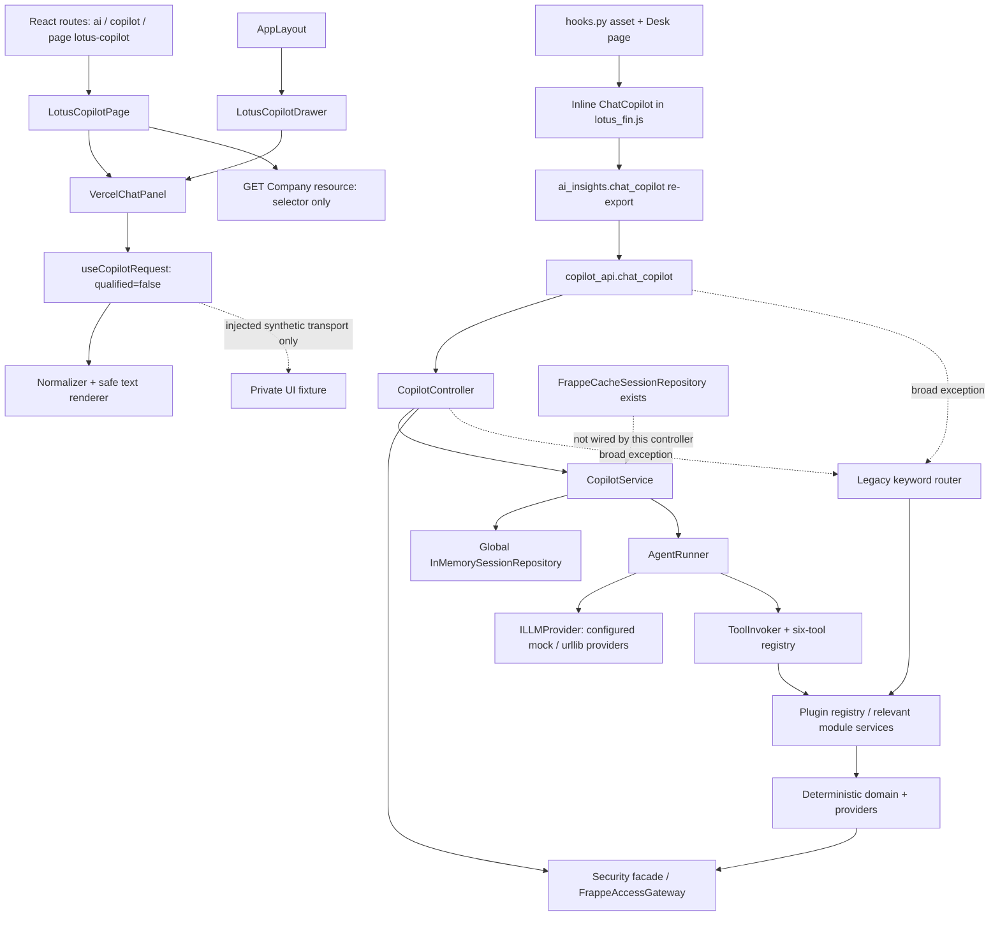
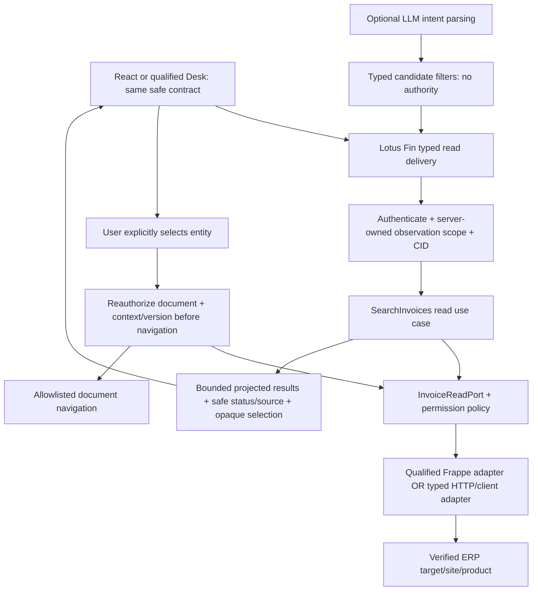

# Chatbot — architecture, scale và debug audit độc lập

**11/10/2026 · FinTechathon Shenzhen · READ-ONLY · Track B.** Revision `develop@07f7251d3a0744356bf96fb2fea55ec6df9a0ce2` **cộng dirty working tree**, không phải clean HEAD. Không sửa application/tests, không ERP/LLM/Docker/Redis, không commit/deploy. Track A: **B1S_G4B_CHANGES_REQUIRED** do native F07; các đề xuất dưới đây không tự trở thành blocker B1-S.

## 1. Kết luận và identity

React hiện có safety boundary rõ và đang khóa remote financial calls. Backend có seams tốt để phát triển, nhưng đường Desk/agent chưa giữ được error, authorization context và provenance xuyên lớp. **Chưa sẵn sàng bật chatbot đọc invoice thật.** Không cần dựng microservice, framework hoặc “ERPNext SDK” mới để bắt đầu thiết kế contract.

Lotus Fin là sản phẩm riêng; Frappe/ERPNext là công nghệ/đích tích hợp. Source chứng minh một Lotus Fin Frappe app và React client; **không chứng minh** production cùng process/DB, target product/version/custom apps, site/company mapping, principal delegation hay image đang triển khai. Docker/connectivity không dùng trong lượt này theo scope mới. Judge acceptance G10 vẫn riêng.

Evidence: [identity và diff](../evidence/chatbot-quality-audit-2026-10-11/GIT_BEFORE.txt), [12 fingerprint B1-S](../evidence/chatbot-quality-audit-2026-10-11/SOURCE_BEFORE.json), [60 source/authority fingerprints](../evidence/chatbot-quality-audit-2026-10-11/ARCHITECTURE_SOURCE_BEFORE.json), snapshots tại `architecture-source/`, [kết quả](../evidence/chatbot-quality-audit-2026-10-11/RESULT_SUMMARY.json). Toàn bộ source được so lại trước kết thúc. Installed identity: React/ReactDOM19.3.0, TS6.0.3, Vite8.3.3, Axios1.20.0, Oxlint1.87.0; Python3.13.7/Pydantic2.12.5/pytest9.0.2/Playwright1.58.0, Chromium1208. Package manifest/lock và artifact hashes được lưu riêng, không suy diễn version installed từ range manifest.

Áp dụng AGENTS/GitNexus exploring, ADR001, Security Code V3 INV01–09 và Workflow v3.1 §31–34. Graph-first: query `copilot` timeout10s; context `chat_copilot` not-found. Index tại commit316c5bd, 02/10, khác current HEAD; bounded static trace tiếp theo. **UNKNOWN không là safe/dead/low risk**; không refresh/download, không có graph-impact PASS. Fixer phase sau phải làm impact trước sửa symbol. Design `LOTUS_FIN_CHATBOT_ASSISTED_ACTIONS_SOLUTION_DESIGN_VI.md` không tìm thấy trong inventory; không dùng nội dung giả định.

## 2. AS-IS được trace từ source

Mũi tên liền là caller/source binding, **không là deployed HTTP acceptance**. React Panel không nối tới production chatbot API trong current path. Company GET là request thật trong caller source, được mock trong isolated UI; không cấp quyền/qualified observation. Runtime ERP/provider/image lineage UNKNOWN/NOT_RUN.

| Boundary | Source caller và interface thực | Ý nghĩa |
|---|---|---|
| React entry | `frontend/src/App.tsx:50`; `pages/dynamic/UniversalPageView.tsx:21`; `components/layout/AppLayout.tsx:253` | Page và Drawer reuse cùng Panel. |
| React safety | `VercelChatPanel.tsx:48–51`; `useCopilotRequest.ts:54,75,83`; `copilotPresentation.ts:70`; `CopilotMessageBody.tsx` | qualified=false, không production transport; 15s deadline, abort/generation/reset/unmount; safe status/CID/text, widget luôn false. Hardcoded cutoff2026-09-26 chỉ ở path injected; không là current financial request. |
| Desk entry | `lotus_fin/lotus_fin/hooks.py:14,41`; `lotus_fin_ai/page/lotus_copilot/lotus_copilot.js:100` | Asset cấu hình là `public/js/lotus_fin.js`; Page instantiates `lotus_fin.components.ChatCopilot`. |
| Desk → API | `public/js/lotus_fin.js:422,454`; `api/ai_insights.py:25` | `frappe.call` alias → re-export cùng `copilot_api.chat_copilot`, query/company/date; backend không nhận session_id qua API signature này. |
| API/controller | `api/copilot_api.py:25–46`; `presentation/controller/copilot_controller.py:26,51–100` | DTO → company gateway → principal → session key user_company → service; broad fallback hai lớp. API allow_guest=True, nhưng chưa chứng minh Guest đọc được financial data. |
| Application/domain | `application/service/copilot_service.py:35–76`; `application/agent/agent_runner.py:45–126`; `domain/model/chat_session.py:14–39` | Injected ports tốt; outcome/scope/session retention còn thiếu. |
| Tools/reuse | `infrastructure/tool/registry/default_tools.py`; `infrastructure/tool/invoker/tool_invoker.py:16–61`; `core/plugin/registry.py:71–82` | Six named read/manual-simulation commands; không có invoice search/select/open, CRUD hoặc approval executor. Registry khác nhau ở agent và plugin, cùng tool names nhưng input contracts lệch. |
| Providers/security | `infrastructure/llm/adapter/*_llm_adapter.py`; `security/access.py:43`; `infrastructure/security/frappe_access_gateway.py:89,121,159` | urllib synchronous providers; existing company/report/evidence checks là seam reuse sau qualification, không field-level/ERP acceptance. |

Standalone `public/js/components/chat_copilot.js` còn định nghĩa cùng global class; `public/js/widgets/chat_copilot_widget.js` là namespace khác. Không thấy load binding từ hooks/Page cho hai file này trong slice; deployed load order UNKNOWN. Không tuyên bố chúng dead hoặc xóa. Legacy provider stack không được coi active chỉ vì tồn tại/imports.

`__init__.py` đăng ký meta-path resolver; mapping được đọc thêm trong `core/compat/legacy_module_resolver.py`. Nó bridge legacy prefixes (`ai004`, `AI005`, `AI006`, `AI007`, `cashflow`, `risk_signal`), không override canonical application/domain/presentation modules được pure probes dùng. Reviewer bỏ package initialization và không gọi controller/factory trong pure tests; vẫn chưa phải runtime Frappe delivery acceptance.

## 3. React so với Desk

| Concern | React current | Desk source-configured |
|---|---|---|
| Calls | Zero chatbot POST dưới unqualified context; Company selector có GET riêng | `frappe.call` public alias, default company và today |
| Truth/status | Typed normalizer + safe fixed errors, unverified label, financial widgets disabled | Raw reply/tool fields; badge real-time/verified/zero-hallucinations không dựa source outcome |
| Scope/races | Abort + generation fences, reset khi scope đổi; gold52PASS | Company change chỉ đổi current_company; callback không bound generation/company, reset chỉ DOM |
| Rendering | React text, CID64 chars; benign prose vẫn unverified | Prose escape trước markdown là điểm tốt; widget template có field unescaped |
| Reuse | Page/Drawer cùng Panel/hook/renderer | Duplicate global renderer + separate status rules; không consume React safety contract |
| Acceptance | Isolated DOM synthetic, không live ERP | Static trace + hai pure renderer probes; full Desk E2E NOT_RUN |

## 4. Findings: root cause và correction nhỏ

Severity là tác động khi path được sử dụng; **C01–C09 không chặn riêng B1-S React UI scope**. C04 cần remediation riêng nếu chọn Desk làm demo; không quảng bá Desk đã được B1-S kiểm chứng.

| ID / severity / loại | Evidence và hậu quả | Root cause → smallest correction | Priority / owner / regression |
|---|---|---|---|
| **C01 HIGH · VERIFIED DEFECT** | Runner91–110: sau success rồi denied, trả `tool_called=second_denied` nhưng data của first_success. Tool denied + empty model trả “Analysis completed.” [2 pure failing cases](../evidence/chatbot-quality-audit-2026-10-11/BACKEND_HERMETIC_RESULTS.json). API/controller fallback có thể đổi intent/error thành legacy result; legacy294/319 không giữ failure/provenance. | Loose last-tool fields + ignore is_success + catch routing. Typed per-tool outcome; bind output to same successful call; preserve FORBIDDEN/TIMEOUT/SOURCE_ERROR, no success prose on empty/error; loại fallback sau typed terminal failure theo approved contract. | P1, backend/QA; impact runner/controller/DTO/Desk, compatibility contract change. Test failure as returned data lẫn thrown exception. |
| **C02 HIGH · STATIC VERIFIED CONTRACT DRIFT** | F001 tool31 gửi company/as_of_date; HealthPlugin60 đòi period_start/end → KeyError trước service. F002 tool32 gửi as_of_date, plugin78 đọc financial_as_of → cutoff bị default today-1; horizon_days không forwarded. F003 tool35 gọi old keywords, service97 đòi payload + checked_user/deps → bind failure. [AST evidence](../evidence/chatbot-quality-audit-2026-10-11/TOOL_CONTRACT_STATIC.json). | Two schema/adapter layers thiếu bridge contracts. Reuse đúng public use case/typed DTO, inject checked dependencies, explicit date window; không tự chọn accounting period hoặc sửa domain formula. | P1 chỉ capability sẽ enable, backend feature owners + QA; financial cutoff/permission risk HIGH. Không fix toàn AI001–07 trong batch invoice. |
| **C03 HIGH · VERIFIED DEFECT + STATIC RISK** | Service41 không verify existing owner/company; pure probe ghép hai principals vào một ID; failed run vẫn mutate stored object trước save. Controller26 chọn global in-memory, key thiếu site/product; ChatSession messages/traces append không TTL/cap. | Mutable references + thiếu ownership/version/retention. Pilot read dùng stateless request trước. Stateful scope riêng: server session IDs + scope binding, bounded retention, immutable/copy-on-write, atomic owner/version check, outage taxonomy và multiworker qualification. | P1 dependency choice / P3 stateful remediation, backend/security; không tuyên bố public session-ID hijack: API hiện không expose ID. Không blind swap Redis adapter. |
| **C04 HIGH · VERIFIED RENDERER DEFECT + STATIC RISK** | Configured inline class `lotus_fin.js:589` interpolates severity/status; synthetic img giữ nguyên trong returned HTML; sink520 `.append(msgHtml)`. Prose645 escape PASS. [two probes](../evidence/chatbot-quality-audit-2026-10-11/DESK_HERMETIC_RESULTS.json). Desk422/454 callback không scope/generation-bound; Page change48 chỉ đổi company. | Template trust + duplicated UI contracts. Escape/validate all widget fields, typed status/provenance, reject stale callback/clear protected data; select one qualified demo UI. | P1 nếu Desk exposed, UI/security; public payload exploit NOT_VERIFIED, no full Desk/browser ERP call. Backend reachability của synthetic severity chưa chứng minh. |
| **C05 MEDIUM · VERIFIED DTO DEFECT / STATIC OBSERVABILITY GAP** | `ChatResponseDTO:12–21` bỏ status/reason/CID extras trong actual Pydantic probe. Logs có tool name/call ID/iteration, nhưng không request CID chain; raw exception str đi log/error/LLM context (`ToolInvoker:52–61`, providers HTTPError). | Public DTO thiếu taxonomy, trace không xuyên lớp. Extend approved typed outcome + server CID/middleware propagation + redacted stage logs; UI consume safe code/CID. | P1, backend/observability + UI; versioned API compatibility risk. Không log text/financial rows để chữa debug. |
| **C06 HIGH · STATIC RISK** | ToolInvoker37 execute arguments trực tiếp; Args models chỉ export schema. Company tools bool(company), arguments company có thể override principal; gateway downstream có company/report/doc checks nhưng không đủ để chứng minh same observation/field permission. Principal thiếu site/connection/product/context version; standalone controller/gateway fallback Admin/True. | Schema declaration bị nhầm validation; authority phân tán. Require authenticated server principal; typed args validation + bind company/context at use case; infrastructure fail closed ngoài approved test injection. | P1, security/backend; auth/report compatibility HIGH. Runtime cross-company/Guest leak NOT_VERIFIED. Không dùng broad service Admin làm delegation. |
| **C07 MEDIUM · STATIC RISK** | Runner max4 iterations + last8 history tốt nhưng mỗi response có unbounded tool_calls; synchronous providers timeout45s/read full body, không total deadline/token/bytes budget/cancel chain. | Local iteration bound thiếu resource contract. Enforce request-wide tool/page/byte/deadline/cancel budgets theo selected read capability; permit at most one selected detail navigation. | P1 limits contract / P3 profiling, backend; chưa đo production throughput/p95/RSS/N+1. Không thêm queue/batch engine khi chưa cần. |
| **C08 MEDIUM · STATIC RISK / DX GAP** | Controller mỗi request factory; `_ensure_env_loaded` đọc .env/mutate environment; unknown provider silently mock. pyproject dependencies=[] dù modules import Pydantic; requirements có pandas/numpy/pydantic. Cache adapter/test top-level imports StorageUnavailable/SessionConflictError mà `domain/repository/i_session_repository.py` không định nghĩa; tests expect max_total_tools/max_history mà current signatures thiếu. | Hidden composition/config + reproducibility/test identity drift. Typed composition config once, explicit mode/config errors; reconcile existing dependency/test invocation for clean judge environment. | P1 before live provider / P3 packaging, platform/QA; factory/cache import không executed, không đọc credentials. Alternative cache adapter không thể được coi qualified vì tên class/TTL/lock comments. Mock không là source-authority evidence. |
| **C09 LOW · STATIC MAINTAINABILITY RISK** | Panel545/Page427, inline asset nhiều components; responsibilities layout/composer/attachments/export/navigation. Existing new hook173/normalizer149/renderer57 đáp ứng separation; Panel B1 variance và test300≤320 giữ nguyên. | Legacy UI accumulation. Extract cohesive module khi pilot thực sự cần sửa; giữ approved variance hiện tại, không line-count wrapper/code-golf. | P3, UI; full panel/Page split làm tăng state/layout regression, không B1 blocker. |

Chỉ **A-F07** là must-fix now cho G4B. C01–C08 là must-fix **trước capability phụ thuộc được enable**, scope phải approved; C09 là later refactor. Không đổi tên legacy/dead symbols, domain financial formula, permissions hay public endpoints trong discovery.

## 5. Debug: chưa tái dựng đáng tin một request lỗi xuyên lớp

Hiện có React header CID sanitation/display, stale suppression và safe messages; backend dùng Python logger/tool-call IDs. Thiếu chain event → authenticated scope → use case → provider → public outcome. Broad fallback hai lớp làm mất original stage; final tool/data có thể lệch; DTO làm mất status/CID. Raw upstream body/error trong exception/log/context cũng cần policy sanitation. Không có evidence actual structured telemetry hay deployed log collection.

**Proposed minimal contract:** server-generated `correlation_id`, `request_id`, `capability`, `stage`, `outcome`, safe `reason_code`, `duration_ms`, `tool_call_id`/parent when relevant, opaque site/connection/product/actor/company/context-version IDs, selected target version only when needed, aggregate calls/rows/bytes/cancelled. Client CID không cấp authority. Log auth-denied, scope rejected, provider error, deadline, stale/drop và terminal outcome; map response header/DTO tới UI. Không mặc định log query/user prose, invoices, financial values, tokens, provider error bodies hoặc prompt. Reproduction dựa sanitized input class + source/config/artifact hash, không copy record nhạy cảm.

Acceptance **designed, NOT_RUN**: induced error ở từng stage phải cho một CID chain, exact safe response/DOM; no raw sentinel/secret ở logs/payload/model context; cancelled old generation không cập nhật UI. Không biến debug logs thành approval/action ledger.

## 6. Scale/reliability và budgets

| Concern | Phân loại hiện tại | Proposed qualification/limit |
|---|---|---|
| React zero remote financial POST; bounded UI timeout | ACCEPTABLE_CURRENT_DESIGN, gold PASS | Giữ fence khi gắn future transport; không lấy synthetic timings làm ERP latency. |
| Histories/traces tăng vô hạn, by-reference mutation | VERIFIED DEFECT ở contract; multiworker/site effect STATIC RISK | Stateless invoice read; nếu session cần, cap messages **và bytes/traces**, TTL, owner/CAS tests thật. |
| Repeated tool/report calls, synchronous provider | STATIC RISK | Call budget per request, total deadline, bounded provider result, cancellation policy; four iterations không giới hạn tool count. |
| Query N+1 / SQL count / permission cache | NOT_MEASURED | Instrument selected adapter; số report/API calls riêng SQL query count; page limits và projected fields; cache key có scope/source/version, reauthorize before reuse. Không khẳng định N+1 defect khi chưa trace query adapter cho pilot. |
| Invoice data volume/pagination | Missing proposed capability | Contract bắt buộc server cap rows/page/search window/query chars/response bytes, stable bounded cursor; không gửi toàn rows vào LLM. Values cần workload/product approval trước acceptance. |
| Retry/outage | Source shows no application retry in modern urllib path; runtime NOT_VERIFIED | Read retries bounded by total deadline + permission recheck; no automatic write retry; preserve unavailable/timeout. |
| Bundle | BUILD PASS, JS757.04kB minified /216.81kB gzip, >500kB warning | Artifact size là measurement của private build, không FPS/latency/scale PASS. Profile route load trước scoped lazy split; không tăng warning threshold để gọi optimized. |
| Lint | Exit0, five warnings across targeted files | Refs/effect warnings là review items, gold currently passes; không biến warning thành gate defect. |

**Qualification workload đề xuất:** freeze small/typical/max authorized data cardinalities và denied-user canaries; warm/cold caches; concurrent same-scope và switched-scope requests; multiworker chỉ nếu dùng session; provider timeout/error và permission revocation. Record environment/artifact/dataset hashes, calls by class, SQL count, payload bytes, total latency distribution/p95, concurrency/throughput, peak RSS và bounded cleanup. Chưa có numeric acceptance cho p95/RSS/throughput; không đoán hoặc gọi PASS từ một request/mock. Owner phải chốt budget configuration và gold workload trước benchmark.

## 7. Test architecture và developer experience

Lượt này: **52 unique independent application cases PASS**, 32 exact-message assertions trên cùng records PASS; four supplied assertions PASS native và PASS wrapped (không cộng thành eight unique); **20 native qualification records:19P/1F**, gồm17 original Q1–Q6 records PASS + method probe2P/1F. Five negative pytest executions: ALIAS/OUTBOUND/WS/API fail đúng kỳ vọng; METHOD pytest0 sai kỳ vọng. Setup/foreign listener là fixture probes, không pytest cases. **Track B tám pure probes:2 controls PASS/6 expected-behavior FAIL**, fake dependencies; ba static contract comparisons không tính runtime tests. [Reproduction](../evidence/chatbot-quality-audit-2026-10-11/REPRODUCTION.md).

Existing `tests/test_clean_architecture.py` có pure domain/registry/manual-repayment happy paths và broad controller imports. `tests/test_architecture_remediation.py` có desired ownership/budget/error tests, nhưng top-level imports feature services/factory/cache; test fixture viết session cache và expects signatures current source không có. **Không chạy nguyên suite này vào shared Frappe**, không coi test tồn tại = coverage PASS. Split/tag pure setup vs infrastructure qualification theo dependencies thật, không weaken existing gold để đạt xanh.

Pyramid dùng công cụ hiện có:

1. Pure domain oracles: date/window, finite/Decimal, missing≠zero, simulation invariants; không provider/Frappe import.
2. Typed contract tests: DTO status/CID retention, tool argument binding/validation, invoker failure, correct tool-output pairing, scope identity, cancellation; fake I/O only.
3. Provider/permission integration: fresh isolated approved site/snapshot, allowed/denied actors, revoked permissions, document/field projection, pagination, provider unavailable. Baseline/lifecycle/cleanup phải reviewed trước; NOT_RUN hiện tại.
4. Isolated UI: retain52gold + native network/lifecycle negative suite; same locked private dependency inventory on CI/judge. Reviewer wrapper giúp inspect, không thay native fixture acceptance.
5. Bounded selected-flow E2E: invoice search→select→reauthorize→open, real typed delivery + isolated ERP; separate judge new-artifact worker smoke G10.

Native fixture300lines trong cap320 nhưng guard/finalization/readiness/case sync chưa đầy đủ; không thêm nhiều ad-hoc probes vào production để chữa test complexity. Existingpytest/Playwright/TS/Oxlint đủ để qualification; không cần test framework/SDK mới. Graph stale limitation làm regression-impact chưa đủ; independent static inventory không thay impact trước implementation.

## 8. First user-assisted action: PROPOSED, chưa available

**Invoice search → bounded authorized list → user selection → detail reauthorization → open** là pilot hợp lý cho Shenzhen, trước financial mutation/autonomy. Không suy ra payment history từ outstanding hay due date. Nếu chọn overdue-only, chỉ past final due và submitted/non-cancelled theo target contract; incomplete/missing data trả unavailable, không bịa values.

Reuse seams: existing Lotus Fin controller/application boundaries, domain permission port, FrappeAccessGateway company/doc check pattern và React safe presentation/generation fence. Cần **public typed invoice read port/use case**; không import internal financial services/API module vào domain, không frontend database query, không generic tool SQL/CRUD executor. Agent/provider chỉ intent + proposed filters; application bind authority và deterministic query. Không cần ReAct/session cho một search/select/open thao tác hữu hạn.

TO-BE là **designed acceptance, không code đã có**. Connection/site/product/company/currency/cutoff/source/context-version lấy từ server-approved mapping; client Company selector không cấp observation authority. Unknown/ambiguous entity yêu cầu chọn candidate, no match khác denied/unavailable; switch context clear results; forged/replayed/stale/revoked selection deny/refresh. Project fields theo actor quyền, recheck before detail/open; prompt injection từ record text không thay filters/tool allowlist/authority.

SDK/topology decision pending target facts. Current slice dùng `frappe.call` (Desk), Axios (React resource), Frappe Python security/data adapters và stdlib HTTP cho LLM; không có evidence một deployed “ERPNext SDK” orchestrator. Nếu cùng approved Frappe runtime, reuse gateway sau qualification; nếu remote target, đặt typed HTTP adapter/client wrapper dưới infrastructure. Chỉ chọn client khi verify installed/primary source compatibility, auth/lifecycle/error/pagination/deadline/retry/upgrade coverage của **target thực**; chưa mua/cài dependency và chưa claim official compatibility. SDK không thay ERP permissions/business lifecycle.

Future writes cần batch riêng: server preview/approval bound exact args/actor/site/company/connection/target version/expiry; durable operation evidence/idempotency; duplicate/revocation/stale/forgery deny. Timeout-after-commit = UNKNOWN_OUTCOME, reconcile trước retry. Không dùng chatbot history làm approval ledger; create/update/submit/cancel/send/payment/email đều ngoài scope và NOT_RUN.

## 9. Roadmap nhỏ, chưa dispatch/freeze

| Stage | Exact goal / prerequisites / likely components | Evidence và exit criteria / scope |
|---|---|---|
| **P0 — F07 targeted closure** | Test-only approved file/fixture paths. Strict origin+method+decoded path+query/assets/WS declarations, verified post-spawn listener/readiness, final ledger assertion after settled close, case-bound response sync. | Preserve52UIgold/17original records; current GET blocker và eight R4 failing scenarios qualify correctly; cleanup/foreign refusal; typecheck/build/lint. Four previously demonstrated root causes còn open, không chuyển lỗi architecture thành B1 scope. Nếu vượt320/allowlist: one concrete helper proposal → Chat approval, không tự implement. |
| **P1 — Reliable read foundation** | Chat approves typed public outcome + server observation/permission/CID/budget contract; choose React qualified delivery. Backend DTO/use case/security adapter + shared presentation. Inventory target connection/product/site/version/roles và dependency identity. | Pure contract tests C01/C05/C06; denied/ambiguous/empty/source failure rendered safely; auth/projection real isolated qualification; no live-enabled pilot before gates. Không fix tất cả financial adapters/session nếu pilot stateless không dùng. |
| **P2 — Useful invoice search/select/open** | P1 qualified target/read contract; add cohesive application read use case + infrastructure invoice port, typed candidate/tool registration only if needed. | Independent bounded gold for allowed/denied/same-name/empty/pagination/revoked/stale/scope-switch; response+DOM+reauthorized navigation on isolated real target. No payment history inference, what-if integration/write/email in this batch. |
| **P3 — Evidence-backed maintainability/scale** | Profile selected path; decide if conversational state/Desk compatibility needed. Extract cohesive UI modules, one supported adapter/status path; session storage only after ownership/CAS/retention qualification. | Impact/dependency regressions + artifact/benchmark lineage. Rename/delete legacy only with graph+caller/runtime evidence; route lazy split only with measured need. No universal engine/session rewrite or new microservice. |

Top three improvements after P0: (1) typed failure/source outcome + CID across actual backend→UI, vì hiện lỗi bị chuyển thành success; (2) server-owned **stateless authorized read** boundary, vì invoice pilot không cần session/agent state; (3) capability-specific adapter/permission/UI contracts và tests, vì metadata tool names/schema hiện chưa bảo đảm thực thi đúng.

Quick wins phải thành approved small batches: protect outcome pairing/error/CID, bind validated arguments/context và one read pilot seam. Delay full Panel/Page decomposition, broad SDK migration, universal agent abstraction, Redis replacement, dead-symbol deletion, all-AI-feature clean-up và performance promises. Không đổi pure domain/model code chỉ để đẹp pattern; current ports/DI và React fail-closed boundary đáng giữ.

## 10. Gates và unresolved qualification

| Gate | Actual verdict tại revision này | Cần gì để mở |
|---|---|---|
| B1-S application safety G2 | Narrow PASS,52gold | Giữ current contract; không suy ra ERP truth. |
| Native harness G4A / independent G4B | FAIL / CHANGES_REQUIRED | P0 + independent qualification; method exact-match đang fail. |
| G3 deterministic financial/source capability | PARTIAL/NOT_RUN trong scope này | Selected financial use case mới cần source oracle/permission/finite/calendar/evidence; không mở F102 hoặc tạo SSOT cạnh tranh. |
| G10 judge/deployment | Separately BLOCKED/NOT_RUN | Immutable artifact → fresh worker/site → authentic user/denied smoke + lifecycle; private Vite build không chứng minh deployment. |
| Auth/site/company/field/session/caching | Static/pure evidence only; live NOT_VERIFIED | Fresh reviewed baseline, actual Frappe/target version/runtime; session concurrency thật nếu dependency được chọn. |
| p95/throughput/RSS/SQL | NOT_MEASURED | Approved enforceable budgets/workload + recorded benchmark environment. |
| Mutation/idempotency/UNKNOWN_OUTCOME | Designed only, NOT_RUN | Separate explicit write contract approval + target qualification; không action authorization trong audit. |

Unresolved architecture inputs: actual demo hosting/image lineage; target product/version/custom apps and public APIs; user delegation/service scopes/site-company mapping; qualified frontend selection; source/field projection; desired stateless vs conversation behavior. Chưa cần hỏi lại product identity hoặc xin quyền ERP để hoàn tất review này. F102/F101 và financial-source SSOT không bị sửa vì không discovery thêm facts trong focused audit.
