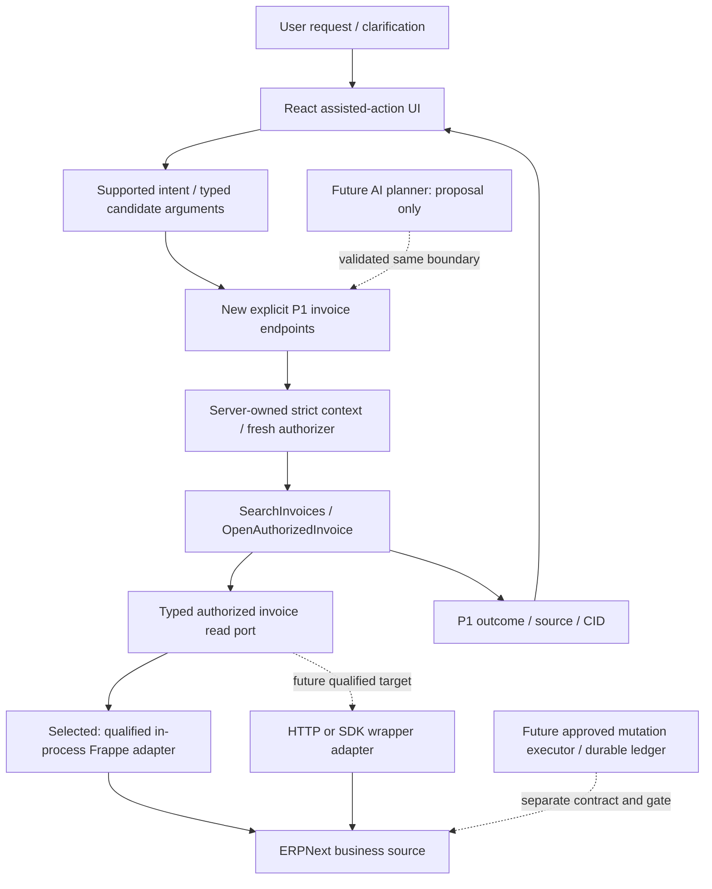

# Chatbot Assisted Actions — ERP SDK/API và execution boundary

11/10/2026 · Lotus Fin · FinTechathon Shenzhen 2026.

**PROPOSED / NOT_FROZEN · `ACTION_ARCHITECTURE_READY_FOR_CHAT_DECISION`.** Recommendation: Option A cho read pilot, typed application ports giữ nguyên để thay adapter khi target thay đổi. SDK-backed executor khả thi về kiến trúc; chưa có evidence để chọn SDK/new backend ngay. Không feature PASS, freeze SSOT, install dependency hoặc dispatch implementation.

[Current inspection/proposal comparison](E:/lotus-fin/docs/reviews/phase0-chatbot-2026-10-10/CHATBOT_ACTION_EXECUTOR_CODEBASE_INSPECTION.md) là evidence; [P1 MASTER SSOT](E:/lotus-fin/docs/reviews/phase0-chatbot-2026-10-10/CHATBOT_P1_AUTHORIZED_ACTIONS_MASTER_SSOT.md) vẫn là contract chính. Tài liệu này đánh giá executor/adapter và bổ sung hướng tương lai, không tạo outcome/security/financial SSOT cạnh tranh.

## 1. Decision và giá trị pilot

Current Python Lotus application chạy trên Frappe có installed ERPNext, React có safe lifecycle/renderer. Hai sản phẩm riêng dù topology hiện cùng framework. Pilot: người dùng yêu cầu tìm Sales Invoice theo company/criteria rõ ràng → bounded authorized results → explicit select → fresh document/field authorization → minimum Lotus read-only reader. Không amounts/overdue/full editable form hoặc ERP mutation. Source label **AUTHORIZED_READ**, không ERP financial VERIFIED.

“Backend Action Executor” nên là một **trách nhiệm**, không mặc định một service/class/framework mới. P1 controller + strict authorizer + SearchInvoices/OpenAuthorizedInvoice use cases thực hiện trách nhiệm đó. Với hai reads không thêm AgentRunner thứ hai, generic execute_action/RPC endpoint hoặc competing registry. Future writes có lifecycle khác nên cần executor/operation ledger riêng khi contract/target đã approve; không trộn vào read handler.

Deterministic intent mapping/structured clarification đủ cho pilot: only recognized supported request + typed criteria; unknown/ambiguous company, identifier, “cần xử lý” phải hỏi rõ. Có một kết quả vẫn yêu cầu select, không silent auto-open. Future AI chỉ đề xuất catalog capability/args; backend validates/authorizes lại. No financial rows/prompt payload ra LLM trong pilot; model confidence không là permission hoặc source proof.

## 2. Bốn phương án

|Dimension|A: current Frappe + typed use cases + in-process adapter|B: current Python BE + typed REST adapter|C: current BE + SDK-backed adapter|D: separate action service + API/SDK|
|---|---|---|---|---|
|Principal/permission|Qualified request actor; actual doc/field/company checks phải được adapter thực hiện, không raw get_all|Remote effective ERP user phải explicit map/delegate; standard REST checks không thay business scope|Quyền theo client credentials; SDK không inherit Lotus actor hoặc check company automatically|Cả Lotus↔service và service↔ERP cần identity/delegation; additional trust boundary|
|Current fit/reuse|Python/Frappe phù hợp source; reuse separation/policy patterns, new strict invoice adapter|Python requests already installed; port reusable; explicit transport/client lifecycle|JS/TS SDK không chạy trực tiếp trong Python; Python client không installed và archived|Chưa có target/runtime/ownership evidence justify service mới|
|Development/deployment|Ít moving parts; coupling to qualified Frappe/site artifact|URL allowlist/TLS/session/token/CSRF/cookie lifecycle + deadline/error adapter|Client ergonomics/types; thêm dependency, version lock, wrapper normalization/qualification|Deploy/rollout/observability/network/secrets/ops ownership thêm; không automatically NestJS|
|Errors/deadline|Typed outcomes at API; cooperative/hard DB deadline thực tế phải qualify|Network errors/timeouts plus ERP error envelope; bounded requests/bytes/retries|Không mặc định SDK handles response-absent failures/retries/idempotency; wrap exact pinned revision|Distributed failure/duplicate/timeout-after-commit; durable workflow cần thiết cho writes|
|Tests/debug|Pure ports + isolated real target; one CID chain; host/container drift phải giải quyết|Transport contract tests + remote permission oracle + outage/delegation tests|Same port tests + exact client/upgrade suite; TS types không runtime evidence|Contract + trust/delegation + multiworker/ledger/reconciliation integration tests|
|Multi-site/company|Server immutable context/site/connection/version; no global set_user/context|Fixed configured site-origin/connection map, per-request effective principal; no arbitrary URL|SDK instance/cache/cookie/token isolation by actor/site/config; no privileged shared client|Service-owned connection map, no caller-selected upstream; strongest lifecycle complexity|
|Read/write future|Both possible; future writes separately approved|Both possible; generic CRUD not safe chatbot execution|CRUD methods enable transport, not approval/audit/financial semantics|Justified for independent remote products/runtimes/ops/SLO, not tool-fashion|
|Performance/cost|Avoids added HTTP hop; numerical benefit NOT_MEASURED|HTTP latency/calls/retry cost need workload|SDK overhead/perf/cost NOT_MEASURED; wrapper can reduce integration boilerplate|Extra hop/service operations; capacity/cost advantage NOT_VERIFIED|

**A recommended now. B preferred remote fallback to assess when a distinct ERP target is confirmed. C eligible behind the same typed port after qualification; D deferred.** A is not permanently tied to product identity or topology. A future independently hosted ERP may justify B/C; adding a separate action service is a separate decision with runtime/operator/delegation/rollout evidence.

## 3. Exact SDK/API candidates và evidence

### Existing APIs / installed v16 source

Official Frappe REST provides resource/RPC access, token user authentication and pagination; these are transport interfaces, not a Lotus action catalog. [Frappe official REST API](https://docs.frappe.io/framework/user/en/api/rest).

Current installed Frappe16 source independently read without importing site/application: `api/v1.py:12–32` delegates list to permission-aware client; `:74–88` document read checks read permission and field-level projection; optional `run_method` must be prohibited by narrow read adapter. `auth.py:695–744` Basic/token resolves credentials to their ERP user. `app.py:458–468` unsafe HTTP/commit-flag transaction completion: read-style POST alone is no proof of zero writes. Current SHA256/lineage in inspection appendix; custom hooks/site rights still NOT_VERIFIED.

In-process adapter may use qualified Frappe list/doc permission primitives with approved projection and **no getdoc/onload/write or permission bypass**. Need actual field/mask/list-vs-doc behavior qualification. B/C remote adapter may require a narrow server-owned ERP read endpoint if standard REST cannot enforce projection/budgets/no-side-effects; do not silently hydrate a full invoice then frontend-filter or invent an endpoint as already installed.

### JavaScript/TypeScript: `frappe-js-sdk`

Concrete candidate is **The Commit Company `frappe-js-sdk`**, third-party, not an official universal “ERPNext SDK”. Maintainer README describes auth, typed document/list, CRUD, RPC and files. No such dependency found in current manifests/lock. [Maintainer repository](https://github.com/The-Commit-Company/frappe-js-sdk).

Retrieved mutable-main package snapshot reports version1.13.0, runtime Axios ^1.16.0, emitted JavaScript/types; **not a verified latest release or immutable pin**. Requires JS runtime for backend use; current Python process cannot execute TS/JS library natively. Frontend/Node use does not inherently require a new NestJS service; choosing a JS backend adapter here would require a JS execution boundary and owner. [Package source](https://raw.githubusercontent.com/The-Commit-Company/frappe-js-sdk/main/package.json).

Axios factory uses credentials/token headers and browser CSRF where window provides it; no default total deadline/retry policy shown. Public Axios instance can be configured by a wrapper, so timeout/cancellation are not intrinsically impossible. Node cookie/delegation lifecycle is not proven by `withCredentials`. [Axios factory](https://raw.githubusercontent.com/The-Commit-Company/frappe-js-sdk/main/src/utils/axios.ts), [FrappeApp source](https://raw.githubusercontent.com/The-Commit-Company/frappe-js-sdk/main/src/frappe_app/index.ts).

DB source exposes explicit limit/offset pagination and Promise requests, not durable idempotency or automatic bounded all-page search. Catch paths dereference `error.response.data/status`; response-absent network errors may mask the cause (**STATIC_RISK**, not executed defect qualification). Generic getDoc/full DTO still needs projection. [DB source](https://raw.githubusercontent.com/The-Commit-Company/frappe-js-sdk/main/src/db/index.ts). Async client calls are not async business workflows, atomic batch or exactly-once delivery. Auth/login helpers likewise are not automatic end-user delegation. [Auth source](https://raw.githubusercontent.com/The-Commit-Company/frappe-js-sdk/main/src/auth/index.ts).

Current target-v16 interoperability, maintained upgrade compatibility, published version pin and package integrity **NOT_VERIFIED**; GitHub metadata API retrieval unavailable, no dependency installed/SDK run. Adoption would require exact revision/lock, deadline/error/cookie/projection/revocation tests and upgrade owner. Useful when an independently justified JS service already needs many Frappe endpoints, not enough value to add one solely for two reads.

### Python: `frappe/frappe-client` / `frappeclient`

Official Frappe-owned repository is **archived/read-only since31/03/2026**, so not a verified actively maintained v16 client. Not installed in observed target distributions. [Repository archive notice](https://github.com/frappe/frappe-client).

Reviewed Python source uses requests.Session, password/token auth, explicit list offsets/limits, document CRUD/RPC; generic list default fields `*`, no explicit per-call timeout in inspected methods, raw response/error handling. Could run in Python if installed, but permissions still follow credentials and it needs narrow wrapper/maintenance ownership. [Client source](https://raw.githubusercontent.com/frappe/frappe-client/master/frappeclient/frappeclient.py). No demonstrated write idempotency, bounded batch, v16 compatibility or async throughput guarantee. Current installed requests is sufficient building material for a small typed HTTP adapter if remote need is approved; archived-client adoption adds qualification/upgrade cost without solving authorization.

No install/paid provider/client PoC performed. None of these facts imply all SDKs are unsuitable: evaluate a concrete maintained/pinned candidate when remote target/runtime/auth need is established.

## 4. Authority and adapter responsibility

|Owner|Must own|Must not own|
|---|---|---|
|Intent planner|Supported intent/candidate args, clarification and user-visible proposal|Permission, source truth, arbitrary methods/SQL/URLs, automatic writes|
|Typed boundary/controller|Strict schema/contract version, immutable server context, request/CID mapping, route/method/CSRF/admission|Client-supplied actor/site/product as authority; fallback success|
|Authorizer|Fresh authentication, allowed site/product/connection/company/capability, doc/field/mask checks|Admin/mock fallback, cached permission grants, globally changing current user|
|Application use case|Business scope/validation/order/selection/version policy, total budget, deterministic result|SDK/framework globals, duplicating ERP accounting rules, exposing raw provider DTO|
|Integration adapter|One allowed typed operation, exact configured target/effective actor, minimum permitted fields, observed source/build/version, safe typed failure/call metrics|Universal RPC/SQL/client object exposed to AI; credentials/client-token custody in browser; business approval|
|UI|Clarify/show/select/preview/explicit confirm as applicable; request/generation/context fences and safe text|Authorization from visible buttons/filtering; retaining denied/stale data|

Service-account token = that account's effective ERP identity. For remote access, prefer a qualified delegated/current end-user principal supported by the actual target. Alternative scoped service account needs explicit backend authorization for the initiating Lotus actor + constrained ERP-side methods/companies/fields + audit of both identities; not transparent inheritance. Never unrestricted Administrator with frontend filtering. No evidence remote delegation mechanism exists today; contract approval/target qualification is prerequisite.

Read port remains P1 `IAuthorizedInvoiceRead`: receives server-owned immutable authorized context + strict filters or selected reference + remaining budget, returns projected source observation or typed failure. Adapter implementations in-process/HTTP/SDK preserve semantics; schema-compatible output alone cannot prove permission fidelity or financial truth. No arbitrary `doctype`, field list, method, run_method, URL, credentials or company override from planner. Custom permission query/onload hooks require target-specific review; no unsupported framework monkeypatch.

## 5. Capability catalog — proposed, not implemented

Catalog below names responsibilities; P1 retains explicit endpoints, no new generic registry framework. Risk descriptions rather than historical L-number equivalence. **Current status all NOT_IMPLEMENTED for chatbot workflow**, notwithstanding existing generic manual UI/resources.

|Capability / tier|Input and validation|Authority / owner / dependencies|Result and user interaction|
|---|---|---|---|
|`invoice.search` / READ|P1 context_ref/request_id, approved Sales Invoice filters, prefix/date/docstatus/page/cursor; no amounts/overdue/arbitrary SQL|Fresh actor/site/product/connection/company + capability + list/doc/field/mask; SearchInvoices → read port|Existing P1 envelope, approved items/source/CID/bound references; clarify first, explicit selection after results|
|`invoice.read` / READ internal responsibility|Exact verified selection_ref + current context/version; no freely chosen identifier|OpenAuthorizedInvoice authorizes actual selected document and projection|Approved minimum read DTO; not an extra public endpoint or duplicate open use case|
|`invoice.open` / READ/navigation|Same P1 open_request; verify MAC/purpose/actor/company/site/product/expiry/version; deny wins|Existing proposed open endpoint/use case + minimum Lotus reader; new target-side qualification|OK/DOCUMENT_READY fixed LOTUS_READ_VIEW descriptor; explicit select; no arbitrary URL/editable form fallback|
|`customer.lookup` / future READ|Typed company + bounded name/identifier criteria; ambiguity resolves explicit selected ref|Separate qualified customer/doc/field/company policy and source port; not Company access alone|Approved minimal customer identity data/source; user selects; no invented customer from model|
|`invoice.prepare_draft` / future PREPARE|Approved selected customer ref, separately approved item/currency/tax/date fields; source freshness; unsupported fields rejected|Local Lotus preview owner; fresh reads for dependencies; ERP tax/item/company semantic contracts still pending|Local editable/discardable preview, explicitly UNSAVED. No insert/save/submit; customer-only prefill cannot constitute valid complete invoice|
|`invoice.create_draft` / future WRITE|Immutable exact proposal/args/version/target refs/config/expiry + explicit one-use user approval; docstatus0 only|Future mutation executor + real create/field/company permissions and ERP validation/hooks + durable operation/idempotency/reconciliation|Approved read-result projection + separate operation evidence; timeout may remain UNKNOWN_OUTCOME, no blind retry. No enabling in P1/P2|

Proposal `invoice.search_past_final_due`, followup text, submit/cancel/payment/send/scheduler are distinct **DEFERRED** capabilities. No alias generic search to overdue, no model-generated mutation/task queue behind a read name. Fields/semantics of PREPARE/WRITE are incomplete intentionally until a separately approved contract; do not dispatch those implementations from this table.

## 6. Outcomes, audit và execution levels

Use P1 §3–6 **single six-status outcome**/reason definitions and required fields including contract_version/CID/source/context_version. Do not copy proposal's old10 statuses or current ChatResponseDTO. Header/body delivery/CID consistency, nested denial precedence, terminal null data, unknown/source-invalid fail-closed, safe text and source classification remain authoritative. Read observation proves authorized projected data, not overdue/financial verification. Unknown write state belongs future durable operation protocol; do not insert UNKNOWN_OUTCOME into the read enum now.

CID chains API→authorization→usecase→adapter→terminal event/UI. Client request_id fences response; it is not approval token, identity or idempotency key. Ordinary logs must omit credentials/session/ref/proposal tokens, raw prompts/errors/ERP rows/customer labels/financial values. Approved bounded numeric call/byte/timing counters and pseudonymous scope refs are sufficient. Real action audit for future writes additionally records immutable approved operation digest, actor/effective ERP actor, authorization/config/source version, execution/durable reconciliation outcome with access/retention policy; it is not an unrestricted debug dump. Audit sink failure requires designed disable/fail behavior; no hidden ERP Error Log insert in read path.

**READ, first pilot:** unknown intent/company asks clarification before query; authoritative context comes from server. Sign stateless refs with purpose/actor/auth-session/site/product/company/connection/version/expiry; verify and fresh authorize each search/open. Signed reference is not permission grant/encryption or durable operation record. Clear protected UI on denial/company switch/logout; late callbacks discarded. Approved page/row/byte/call/deadline bounds from P1 §7, no alternate guessed values. No report/LLM calls or automatic retries.

**PREPARE, future:** authorized customer/item/price/tax reads feed local preview; deterministic application/ERP validations define allowed fields/defaults; model cannot invent values as source truth. Editing invalidates previously prepared digest/approval. Discard is local, saving only Lotus UI state is not ERP Draft creation. Different lifecycle/source/cache contract must be approved; no persistence guarantee implied by current generic form.

**WRITE, future only:** server stores immutable approved proposal bound to actor/auth-session/site/product/company/connection/capability/target-or-new-record specification/target-and-dependency versions/exact normalized args/config/expiry. UI displays exact material fields and confirms this proposal, not a free-text “yes” or client-forged signed payload. On execute, fresh authorization + versions/schema/ERP rules checked before mutation; changed scope/args/version/expired approval rejects. Separate durable one-use approval and idempotency ledger across workers; concurrent duplicates resolve to one operation, not process-local memory lock. ERP-side operation identity/commit evidence or qualified atomic boundary required to reconcile response loss. Commit uncertain → UNKNOWN_OUTCOME durable state + safe user message, reconciliation by exact authorized operation; **no replay insert/submit to discover success**. Unsupported reconciliation = capability stays blocked. Create draft alone must satisfy these controls; submit/cancel/payment/send/autonomous mutation excluded.

## 7. Minimal TO-BE and workflow



```mermaid
sequenceDiagram
  actor U as User
  participant UI as React action UI
  participant BE as Lotus typed API/use cases
  participant AUTH as Fresh authorizer
  participant ERP as Qualified ERP adapter
  U->>UI: Find Sales Invoices, clarify criteria/company
  UI->>BE: get_context then typed search (request_id)
  BE->>AUTH: Current actor/site/product/company/capability/fields
  AUTH-->>BE: Immutable authorized read context
  BE->>ERP: Bounded permitted page, remaining deadline
  ERP-->>BE: Minimal source observation or typed denial/error
  BE-->>UI: P1 outcome + source/CID/current bound refs
  U->>UI: Select one current result
  UI->>BE: open(context_ref, selection_ref, new request_id)
  BE->>AUTH: Fresh rights + binding + target version
  BE->>ERP: Exact projected permitted read
  ERP-->>BE: Current DTO/source
  BE-->>UI: Authorized minimum reader descriptor
  UI->>UI: Match generation/context/request, render safe text
  Note over U,ERP: No business write/onload/provider; all new-feature runtime tests NOT_RUN
```

## 8. Threat qualification và code quality

|Threat / current classification|Required designed control / actual tests before enable|
|---|---|
|Legacy false-success/raw exception; PROVEN_DEFECT or STATIC_RISK per inspection|New terminal outcomes/denial/source precedence/redacted errors; no old fallback/DTO. Pure delivery sentinels then actual transport classification.|
|Prompt injection, hallucinated invoice ID, arbitrary SDK/RPC; STATIC_RISK|Catalog allowlist/schema rejects outside capabilities; no caller-controlled URL/method; selected signed reference; XSS safe text. Pure + isolated UI/HTTP probes.|
|Cross user/session/company/site/product, privileged credentials; STATIC_RISK; actual rights NOT_VERIFIED|Strict current principal/map/projection + real denied/allowed ordinary users/custom hooks/masked fields; no Admin fallback.|
|Revocation/search→open TOCTOU/company switch/cached permission; STATIC_RISK|Fresh doc/field authorization each read; bound version/expiry; deny clearing/request fences; actual isolated revocation/multiworker tests. Seen bytes cannot be retroactively revoked; refresh must recheck.|
|Forged approval/replay/changed target; future risk, DESIGNED_CONTROL only|Immutable server proposal + exact binding/explicit one-use confirmation + reauthorization/version guard; independently tested before writes.|
|Duplicate create/submit/timeout-after-commit/retry/partial execution; future risk, DESIGNED_CONTROL only|Durable idempotency/outcome ledger and exact ERP reconciliation; failure/outage/crash/multiworker qualification. UNKNOWN_OUTCOME never silent success/retry.|
|Session races/outage/sensitive logs; existing session defect + future risk|Stateless no chat session in pilot; auth-session still tested. Redacted CID stages; future chat-session ownership/CAS/TTL/outage gates separately.|

One outcome contract, explicit routes/usecases, one read port, small infrastructure adapter: SOLID/DRY/KISS without universal orchestrator or duplicated ERP calculations. Source files cohesive <200 lines as ADR/workflow constrain; existing545-line Panel only tiny explicitly approved binding variance. Avoid artificial splitting to satisfy line caps. No dead-code removal/registry purge/new queue needed. Reuse B1 safe presentation/lifecycle; preserve52 gold/harness assertions. Financial/legacy runner remediation stays scoped separately unless a future capability chooses that path.

Scale/debug claim limits: current max_iterations4 does not cap every tool call; in-memory sessions are not distributed locks. New read budgets counts/list/doc/auth/bytes/deadline distinct from SQL. P1 §7 workload covers background10k/100k invoices, permissions/masking, cap boundaries, actual worker concurrency/cold-warm cache/outage/cancellation. Freeze resource limits, baseline and SLO before qualification; no p95/RSS/throughput PASS from mock/single call or numeric cost estimate in this review. Remote HTTP/SDK upgrades require pinned target/client API compatibility matrix and transport/version regression suite; in-process upgrades require exact framework/site hooks/permissions regression.

## 9. Proposed engineering batches — no dispatch

All application paths below under `lotus_fin/lotus_fin/`; **NEW** means absent implementation today. Existing P1 §9 exact paths remain proposed allowlist authority; this table mirrors scope, not approval. Antigravity builder → independent Work evidence → Chat closure. Fresh GitNexus impact and source identity required before any edit. No package/permission/global gateway/source changes or migrations allowed implicitly.

|Batch / dependency / owner|Exact proposed allowlist|Acceptance / gate / rollback / deferred|
|---|---|---|
|P1-A / Chat D1–D4 / Antigravity BE + Work|NEW `domain/schema/action_outcome.py`, `presentation/dto/action_outcome.py`, `presentation/response/action_response.py`, `application/port/i_action_events.py`, `infrastructure/observability/action_events.py`; tests `test_action_outcome.py`, `test_action_delivery.py` in existing tests dir|P1 U01/S01 strict six-outcome/CID/source/denial/redaction delivery; module caps/import guards. Actual HTTP qualification continues P1-B. Rollback new entry disabled; old DTO/runner/session unchanged.|
|P1-B / P1-A + target/key/projection decisions / Antigravity security/BE + Work|NEW `domain/model/authorized_read_context.py`, `application/port/i_read_authorizer.py`, `application/service/resolve_read_context.py`, `infrastructure/security/frappe_invoice_authorizer.py`, `infrastructure/security/action_reference_codec.py`, `infrastructure/config/invoice_actions_config.py`, `presentation/dto/invoice_action_request.py`, `presentation/controller/invoice_actions_controller.py`, `api/invoice_actions_api.py`; tests `test_invoice_context.py`, `test_action_references.py`, `test_invoice_auth_delivery.py`|U02/U03/S01 auth/schema/company/site/ref/CSRF/denied-before-read. Search/open CAPABILITY_DISABLED. No invoice queries/permission changes. Rollback flag off/key retirement/new binding disabled. Actual I01/I02 still target gate.|
|P1-C / P1-A/B / Chat+Work design checkpoint|**No additional source files / no competing Executor registry.** Confirm catalog maps explicit search/open use cases and same P1 DTO/port|Approve read scope/identity/selection/error contract; resolve D1–D6 and executor framing. Rollback decision only. General planner/stateful/write architecture deferred.|
|P2-A / P1-B/C + qualified target baseline / Antigravity BE + Work|NEW `application/port/i_authorized_invoice_read.py`, `application/service/search_invoices.py`, `application/service/open_authorized_invoice.py`, `domain/schema/invoice_read.py`, `infrastructure/erpnext/authorized_invoice_read_adapter.py`, `presentation/dto/invoice_action_response.py`; optional NEW `infrastructure/erpnext/invoice_read_query.py` only genuine cohesive responsibility. Wire P1-B-created API/controller. Tests `test_invoice_read.py`, `test_invoice_read_integration.py`|U04/I01–I04 bounded projected read/doc permission/refs/caps/error/no-write; target source/date oracle independent. Rollback capability off. No overdue/amounts/full hydration or mock performance acceptance.|
|P2-B / P2-A contract + approved mount variance / Antigravity UI + Work|NEW `frontend/src/pages/copilot/actions/{invoiceActionClient.ts,invoiceActionPresentation.ts,useInvoiceActions.ts,InvoiceSearchResults.tsx,InvoiceReadView.tsx,InvoiceActionPanel.tsx}`; existing Panel only tiny approved mount, OR one approved adjacent Page mount. NEW `tests_e2e/invoice_actions_fixture/main.tsx`, `tests_e2e/test_invoice_actions.py`; fixture config/lifecycle filenames must be frozen before dispatch|UI01/02 recognized intent/clarify/select/read/context/late cancellation/safe text;52 existing gold+native qualification preserved, relevant type/build/lint after edits. Rollback mount flag off; no generic form/authProvider rewrite/B1 harness edits.|
|P2-C / canonical image/isolated site + frozen workload / Work; Chat closes|Test/oracle/evidence only with separately reviewed exact fixture/evidence allowlist/lifecycle; **no implementation changes**|I01–04/D01/P01 actual users/fields/company/site/version/revocation/no business writes/outage/performance and process cleanup. Unknown/no clean baseline → NOT_RUN/BLOCKED, not synthetic PASS. Failed gate disables capability. G10 separate.|
|P3 / separately approved PREPARE then WRITE contract / Chat+Work design; builder later|**Design only NEW** review paths proposed `CHATBOT_P3_PREPARE_CONTRACT.md`, `CHATBOT_P3_WRITE_PROTOCOL.md`, `CHATBOT_P3_QUALIFICATION_PLAN.md` in current review directory. No application/helper/dependency allowlist yet|Freeze customer/item/ERP semantics, local preview policy then exact proposal/approval/durable operation/reconciliation security tests. Runtime writes remain disabled. Rollback draft proposals; implementation paths/owners approved in later task. Submit/cancel/send/payment/autonomous actions excluded.|

## 10. Chat decisions và exact P1 amendment boundary

Approve or revise P1 D1–D6: React generic Sales Invoice read scope; minimum Lotus reader; current backend/in-process current-user target and canonical isolated qualification owner; six-status/source/ref projection; budgets/CSRF/key/log lifecycle/workload; exact batch allowlists/owners/tiny Panel variance. These remain approvals pending, not questions that block this read-only architecture review.

Additional design decision: accept **executor as typed use-case responsibility**, P1-C checkpoint with no second registry/framework; adapter implementation remains private. Existing P1 already permits this interpretation, so naming clarification alone needs no outcome/API change. If Chat adopts this decision, append a reviewed link/decision note to P1, never rewrite history.

Explicit amendments required before changed scope: remote target/B/C/D changes P1 §2/4/5/8/9/10 connection/delegation/adapter lifecycle/target/qualification; full/native form changes §5 open descriptor/side-effects/tests/D2; overdue or financial fields change query/source/semantic oracle/projection/budgets/D1/D4; new LLM/chat session changes privacy/provider/session/ownership/concurrency gates; PREPARE/WRITE needs separately approved protocol and capability lifecycle, not merely a new read status/SDK method. No such amendment made here.

Open implementation unknowns: exact canonical serving build/imports/site/apps/custom permission/onload hooks, user/company/connection mapping and field projection; enforceable hard deadline/audit/admission/key storage; target-side reconciliation for future writes; precise SDK revision/v16 compatibility if selected. They prevent enablement but do not require another broad architecture audit to make the A/read-pilot decision.

**Gates:** B1-S remains prior independent PASS on unchanged fingerprints; new feature tests all NOT_RUN. P1 design readiness does not close G3 financial context, G01–G03 backend/session or **G10 BLOCKED** judge deployment. Next product milestone is an approved, separately qualified read action demo, not ERP financial automation.
