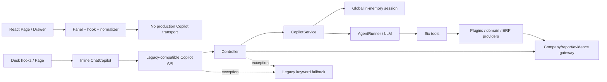
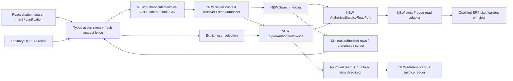

# Chatbot Assisted Actions P1 — Authorized Actions MASTER SSOT

11/10/2026 · Lotus Fin · FinTechathon Shenzhen 2026.

**Status: PROPOSED / NOT_FROZEN. Verdict: `P1_READY_FOR_CHAT_APPROVAL`.** Đây là contract để Chat duyệt trước implementation, không phải xác nhận P1 đã build hoặc ERP permissions đã qualified. [Discovery/current hashes](CHATBOT_P1_SOURCE_DISCOVERY_AND_GAP_REPORT.md) và [decision packet](CHATBOT_P1_WORK_TO_CHAT_DECISION_PACKET.md) là evidence/handoff, không SSOT cạnh tranh. Security Code V3, ADR001 và workflow §31–34 tiếp tục chi phối; financial feature SSOT/B1-S history không bị sửa.

Trong tài liệu: **VERIFIED** = source/metadata đã đọc hiện tại; **DESIGN** = contract đề xuất; **DECISION_PENDING** = Chat phải duyệt. Tất cả acceptance của feature mới là **DESIGNED / NOT_RUN**. P1-G PASS chỉ trong scope contract. Giá trị cấu hình là proposal, chưa release SLO.

## 1. Goal, capability levels và scope

Giúp người dùng tìm đúng hóa đơn bán hàng được phép đọc, tự chọn một kết quả, server kiểm quyền lại và mở **bản đọc tối thiểu** trong Lotus Fin. Pilot không ghi hóa đơn, không thay accounting values/status, không submit/cancel/send hoặc gọi LLM trả phí. “Đang cần xử lý” là intent chưa đủ nghĩa, phải hỏi/chọn tiêu chí; không tự dịch thành overdue/unpaid/risk.

|Level|Scope P1/P2 đầu tiên|
|---|---|
|L0 explain/guide|Hướng dẫn thao tác, hỏi rõ tiêu chí; không tự nhận biết quyền/số liệu.|
|L1 authorized lookup|First target: bounded Sales Invoice search, server-owned scope, minimal approved projection.|
|L2 select/open|First target: explicit user choice → exact-document reauthorization → dedicated read-only Lotus reader.|
|L3 draft/prefill|Future; preview content từ authorized facts cần contract riêng; ERP draft save là mutation.|
|L4 confirmed backend mutation|Future design only; exact args/target version/actor/site/company/expiry-bound approval, durable dedup/reconciliation. Không endpoint ở pilot.|
|L5 autonomous financial/payment|OUT OF SCOPE; không tools, workers, credentials hoặc write egress.|

Không build AI007/session migration, all-feature adapter repair, F101/F102/COGS, B0/G10, invoice overdue engine, arbitrary CRUD/SQL/RPC/URL executor, external SDK/microservice. Generic invoice read không phải verified financial analysis. B1-S finance shortcuts/widgets/unqualified Copilot POST vẫn disabled.

Security R0–R5 là taxonomy khác: pilot L1/L2 nằm trong authorized read/view R0; không đổi nghĩa hoặc quyền R1–R5 của Security SSOT.

## 2. VERIFIED AS-IS và selected architecture



React has safe rendering/reset/fencing source and closed B1-S tests, nhưng không typed invoice transport. DTO hiện không giữ outcome/reason/CID. Gateway có company/report/evidence seam, nhưng no-framework fallback/mock và thiếu invoice projection/strict context khiến không reuse nguyên trạng như proof. Agent/session/tool bridge defects không dependency bắt buộc của pilot. Installed local backend Frappe16.34.0/ERPNext16.35.0/Lotus0.0.1; controller/DTO container khác host, không verified serving artifact.

### Architecture alternatives

|Option|Security/reuse|Complexity, testing/debug, time/scale|React/Desk/regression|
|---|---|---|---|
|**A stateless typed API + authorized read port**|Fresh principal/scope/doc/field authority; reuse Frappe APIs and safe React patterns; avoids old session/runner|Small vertical slice, deterministic tests/CID and explicit budgets; request-local state, no agent loop; expected smallest scope, not an estimated delivery date|Both can call same typed API later; React only now, old paths untouched.|
|B extend AgentRunner registry|Requires fixing C01/C03/C05/C06 and selected composition/budgets, possibly finance bridges before trust|Larger dependency/race/outcome test surface, extra provider/session lifecycle; harder debug/resource guarantees|Requires independent Desk safety too if used; highest legacy regression surface.|
|C hybrid authoritative read + LLM intent/UI orchestration|Authority still A; LLM only proposes validated intent/filter; no records/permission decisions from model|Adds provider availability, injection/cost/deadline/data minimization tests before value proven|Possible later, same port reusable; not needed for initial search/select/open.|

**DESIGN: choose A as primary.** Pilot chat UI provides a bounded action intent/structured clarification; deterministic recognition of supported invoice-search phrasing and explicit filters is sufficient initially. Unsupported natural language returns clarification, not agent dispatch. No paid/provider call or model-derived scope. C is a future optional enhancement after A works, not a second implementation track.

Application boundary stays inside **Lotus backend**; infrastructure uses installed Frappe permission-aware APIs in the authenticated request. Product Lotus Fin remains distinct from ERPNext. Current co-deployment does not require a separate service; remote target only changes the qualified infrastructure adapter after delegation/site mapping approval. No SDK installation justified. In-process adapter is proposed, not current invoice implementation.

### TO-BE — all NEW boxes are proposed



Typed use cases are reusable by ordinary UI/chat; business/permissions/pagination live server-side once. Frontend dataProvider fields=* / create/update/delete are **not** a chatbot contract. No reuse of old fallback/AgentRunner/LLM factory/global chat session. No externally supplied ERP origin or arbitrary DocType.

## 3. P1.1 terminal outcome contract

```typescript
type Status = 'OK' | 'PARTIAL' | 'FORBIDDEN' | 'SOURCE_ERROR'
            | 'TIMEOUT' | 'NOT_AVAILABLE';
type Capability = 'invoice.search' | 'invoice.open' | 'invoice.context';
type Outcome<T> = {
  contract_version: 'p1.invoice.v1';
  status: Status;
  reason_code: ReasonCode;             // closed enum below
  correlation_id: string;              // server UUID v4
  request_id: string;                  // validated echoed client UUID v4
  capability: Capability;
  source: SourceEvidence | null;
  context_version: string | null;
  data: T | null;
  user_message: string;                // fixed safe template, never raw error
};
type SourceEvidence = {
  mode: 'ERP_READ' | 'DEMO_ISOLATED';
  verification: 'AUTHORIZED_READ';     // not financial verification
  product_ref: string; site_ref: string; connection_ref: string;
  connection_version: string; projection_version: 'invoice.min.v1';
  observed_at: string; timezone: string;
  coverage: 'PAGE_COMPLETE' | 'INCOMPLETE';
  consistency: 'LIVE_KEYSET';
};
```

No finite financial values/amounts in this first DTO. Date/identity metadata come from permitted ERP fields, not model/default demos. DEMO_ISOLATED requires explicit isolated server policy and visible demo label; not selected default. No `ERP_VERIFIED` financial claim. `USER_ENTERED` input cannot become SourceEvidence. Invalid DTO/provider source never repaired using synthetic numbers.

### Fields, ownership and exposure

|Field|Required/type|Ownership/validation|Exposure/compatibility|
|---|---|---|---|
|contract_version|Always literal version|Server serializer; exact version validation|New endpoint only; unknown version rejected, no best-effort old DTO casting.|
|status|Always six-value enum|Use case produces; controller preserves; UI revalidates transport/body|Legacy `success/SUCCESS/NO_MATCH/STALE_REFERENCE` not added to enum. Mapping only explicit compatibility adapters outside enabled v1.|
|reason_code|Always closed enum, compatible with status|Server deterministic classifier; never raw exception name/string or LLM label|Safe UI messages are keyed by code; old detailed/nested errors not public.|
|correlation_id|Always server UUID v4, ≤64 ASCII chars|Generated at trusted delivery entry before auth; one per request, one terminal event|Response `X-Correlation-ID` must equal body; UI validates. Client value ignored/replaced, never authority.|
|request_id|Always UUID v4|Client per attempt; server validates, echoes. For malformed/missing ID server emits replacement with INVALID_REQUEST|Client never renders replacement as success for its pending attempt. Not idempotency key; no log arbitrary string.|
|capability|Always enum|Fixed endpoint constant; client cannot select dispatcher/method|Small explicit methods, no universal capability invocation.|
|source|Always property; null or typed object|Server adapter supplies only after authenticated read; source/config/projection verified|Null mandatory for pre-read auth/validation/errors; OK/PARTIAL require full evidence. No endpoint/secret/raw actor label.|
|context_version|Always property; null or opaque ASCII fingerprint≤128|Resolver derives actor/auth-session/site/product/connection/company/projection/contract binding; not frontend selected string|Null on unresolved context; not permission snapshot/approval. No raw sid/user email.|
|data|Always property; success type or null|Validated discriminated capability DTO; extra fields forbidden at delivery|FORBIDDEN/SOURCE_ERROR/TIMEOUT/NOT_AVAILABLE always null. OK/PARTIAL only approved projected data.|
|user_message|Always bounded text≤256 chars|Server closed safe template; UI localized fixed template/code|No HTML/raw query/exception/upstream body/financial fabrication; unknown code → safe NOT_AVAILABLE.|

JSON strictness: reject unknown fields, unexpected nested objects/enums, booleans as integer page limits/docstatus, invalid dates/UUIDs/types, nonfinite values, duplicate JSON keys, oversized body. Use existing Pydantic v2 strict/extra-forbid and standard parser controls, no custom general schema language. Validation tests must include actual Frappe HTTP request decoding, not DTO-only claims.

### Exact semantics, reason enum and HTTP mapping

|Status|Meaning / reason_code allowlist|HTTP|Data/actions|
|---|---|---|---|
|OK|Completed contracted authorized page/read: RESULTS_FOUND, EMPTY_RESULT, DOCUMENT_READY, CONTEXT_READY|200|Empty is valid only complete bounded page/scope. More than one result requires user choice; has_more is ordinary pagination, not partial failure.|
|PARTIAL|Verified subset but unexpected source/coverage limitation: COVERAGE_INCOMPLETE|200|Explicit incomplete coverage; no total/no-empty success claim; search shows only independently authorized rows; **no selection_ref, no open** until successful refresh.|
|FORBIDDEN|AUTH_REQUIRED, CSRF_OR_ORIGIN_DENIED, COMPANY_DENIED, CAPABILITY_DENIED, ACCESS_DENIED|401 auth /403 others|Null data; clear protected results. ACCESS_DENIED may apply revoked/wrong-scope/forged reference without leaking target existence.|
|SOURCE_ERROR|SOURCE_FAILURE, INVALID_PROVIDER_RESPONSE|502 /503 source outage|Null data; no fallback route/model/empty rows; CID safe.|
|TIMEOUT|DEADLINE_EXCEEDED|504|Null data; terminal exactly once; old late responses cannot succeed.|
|NOT_AVAILABLE|INVALID_REQUEST, CONTEXT_REQUIRED, CONTEXT_CHANGED, STALE_SELECTION, STALE_CURSOR, DOCUMENT_UNAVAILABLE, PROJECTION_UNAVAILABLE, TARGET_UNQUALIFIED, CAPABILITY_DISABLED, UNSUPPORTED_INTENT, INVALID_OUTCOME|422 validation /409 stale-context /404 unavailable doc /503 unqualified-disabled|Null data; reason-specific safe re-search/clarification. Unknown target IDs never lookup outside signed reference/allowlist.|

Admission-only nonbusiness events: rate limit HTTP429 with NOT_AVAILABLE/CAPABILITY_DISABLED safe template plus Retry-After policy; rate limiter is not proof of permissions. P2 target HTTP test must verify envelope/header delivery for 401/403/404/422/429/5xx; framework-generated pre-handler errors may lack typed body and are treated by UI as transport failure, never success.

**Precedence:** trusted transport401/403 or recognized denial at declared v1 wrapper/outcome layer wins over every success/widget/data. Denial is distinct from no match. Validate source/schema before allowing successful actions. Nested provider business failure must be normalized in adapter into typed error, even when outer transport200/`is_success=true`; never forward raw nested payload to UI/model. Any aggregate involving recognized denial yields FORBIDDEN/null, not PARTIAL with prior data. Missing provenance on supposed success → SOURCE_ERROR/INVALID_PROVIDER_RESPONSE. Unknown outcome/version/code → NOT_AVAILABLE/INVALID_OUTCOME, clear data.

For mixed source error/timeouts: adapter returns one typed terminal cause according to first failing stage; controller cannot replace it with success. PARTIAL is explicit verified non-denied subset with incomplete coverage, not a catch-all exception fallback. Benign unverified prose permitted in existing B1 chat **does not** qualify invoice success. Invoice docstatus integer is document lifecycle metadata, not this outcome status.

Cancellation is a **local lifecycle state**, not a seventh business terminal status. UI abort/scope switch/unmount increments generation and discards callbacks; server logs cancelled/timeout when known, does not claim hard DB cancellation from browser AbortController. No displaying TIMEOUT for a cancelled old request in the new scope.

### Transport and rollout compatibility

DESIGN three explicit **NEW** methods, same-origin Frappe `/api/method/lotus_fin.api.invoice_actions_api.{get_context,search_invoices,open_invoice}`. Authenticated, allow_guest=False, **POST only**, CSRF/origin enforced, read-only business semantics. Same-origin session of the actual target principal; no implicit remote cookie reuse. Fixed capability per method; POST here is transport, not permission to mutate.

Frappe method results normally live under `message`; accept exactly `{message: Outcome}` or a typed Outcome according to approved transport decoder, never recursively guess envelopes. Server sets HTTP status/header and Cache-Control:no-store; private responses not browser/CDN/service-worker cached. Proxy/framework stripped headers/malformed bodies fail closed and produce safe local status. Cross-origin remote delivery needs explicit cookie/token/CORS/CSRF delegation approval, not auto changeOrigin reliance.

New `ActionOutcomeDTO` bypasses `ChatResponseDTO`; no endpoint alias to old Copilot controller/fallback. Do not edit old DTO/API to silently enable new reads. Versioned methods introduced disabled by server config + separate UI action flag; flags are enablement gates, not authorization. Existing52 gold and current qualified=false remain required unchanged behavior after future UI binding.

## 4. P1.2 server-owned context and authorization

```text
AuthorizedReadContext (internal, immutable, per request):
 actor_id, auth_session_binding, site_id, product_id, connection_id,
 connection_version, company_id, context_version, capability,
 projection_version, observed_at_utc, timezone, deadline_at,
 correlation_id, request_id, adapter_mode
```

|Authority component|Resolver source/check|Failure and invalidation|
|---|---|---|
|Actor/auth-session|Trusted Frappe authenticated request session, non-Guest/nonempty; actual active user, no implicit Administrator/System Manager injection|401; missing real framework/session fails closed. Test doubles injectable only in explicitly test-only composition.|
|Site|Trusted request routing/server-approved site identity, not body/Header Host alone from client|Reject unapproved routing; site ref opaque. Proxy routing/Host mapping independently qualified.|
|Product/connection|Server configured Lotus product→approved ERP adapter/site/origin/version map|Unknown/mismatched connection/config → TARGET_UNQUALIFIED. No client URL/token; topology facts separate.|
|Company|Client selection is candidate only. Resolver confirms exact company in approved connection plus current actor Company read and invoice permission scope|No default/global company authority; unauthorized candidates denied; ambiguity → CONTEXT_REQUIRED before query.|
|Capability|Explicit allowlist invoice.context/search/open under enabled policy + actor's read permissions|Role name/nonempty company/LLM intent cannot alone grant capability. No write/submit permission needed or exercised.|
|Document|Permission-aware list with exact company filter; each candidate final current read/document-company check before exposure; fresh exact doc check again on open|No get_all/ignore_permissions; list query permissions alone not proof custom per-document hook permits open. Hidden candidates never leaked.|
|Fields|Explicit projection allowlist ∩ effective readable/unmasked fields; required predicate/identity fields independently validated before filter/query|Cannot filter by denied field to infer it. Required denied/masked field → PROJECTION_UNAVAILABLE; optional field omitted, not replaced with raw/masked pseudo-value.|
|Version/time|Context fingerprint binds auth-session/principal/site/product/connection config/company/contract; server UTC read instant + approved site timezone|Version not evidence permissions unchanged. Re-read current permissions on every request; record version compared at open.|

**Stateless-first:** no chat session/history, server conversation cache, Redis or session ownership dependency. Frappe authentication session remains required: stateless application does not mean anonymous or absence of auth session. No signed handle lookup treated as permission; fresh authorization always. Application no result/permission cache initially, only framework metadata caches with **revocation coherence qualified** before enable. Connection switch invalidates local results/cursor/ref; current request context must match new signed binding.

Resolver returns opaque context_ref and context_version from get_context, bound to authenticated actor/session/product/site/company/config/projection/version/expiry. Public input company name comes from UI authorized choices but is still untrusted candidate; get_context independently verifies. Subsequent read carries context_ref + expected context_version; re-resolve fresh principal and policy, compare signed scope. No token grants access. User can legitimately hold two authorized-company contexts in separate tabs; no claimed global company-switch invalidation across tabs without server state. Within one UI instance, current generation/scope fencing is mandatory.

Missing/unavailable framework/import cannot instantiate `security/access.py` MagicMock as production adapter; use explicit strict composition validation before any shared gateway call. Existing IPermissionPolicy/company-check pattern may be reused behind this guard, but new invoice-authorizer semantics (strict equality/read/fields) are separate. Do not modify global gateway to change unrelated financial consumers without approved impact/scope.

In-process active user stays the authenticated request user. No temporary global set_user/Admin, no blanket service-account impersonation. Remote mode disabled until effective principal delegation, server-authoritative scope enforcement and target rights/revocation are proven. Principal scopes must be enforced at ERP/read adapter, not only UI filtering.

## 5. Typed invoice contracts

### D1. Context and Search requests

```typescript
type ContextRequest = { request_id: string; company_candidate: string };
type ContextData = {
  context_ref: string; context_version: string; company_label: string;
  allowed_filters: ['invoice_name_prefix', 'posting_date', 'docstatus'];
  default_posting_from: string; default_posting_to: string;
  expires_at: string;
};
type SearchRequest = {
  request_id: string; context_ref: string; expected_context_version: string;
  invoice_type: 'SALES';
  filters: {
    invoice_name_prefix?: string;
    posting_from?: string; posting_to?: string;
    docstatus?: 'DRAFT' | 'SUBMITTED' | 'BOTH';
  };
  page_size?: number;
  cursor?: string;
};
```

Strict filters only. No `user/site/product/company-authority/doctype/SQL/order_by/fields/source_mode/session_id/financial_as_of` in search body. invoice_type SALES maps server constant `Sales Invoice`; other types unavailable. No natural language/raw prompt forwarded to ERP query. Optional NL recognition in UI only produces candidate filters shown for user confirmation; server never trusts parser authority. Initial supported intent is “tìm hóa đơn bán hàng”; insufficient company/criteria → clarification. “Cần xử lý”, overdue/unpaid/customer ambiguous phrases are not silently mapped to financial semantics.

Missing date pair → approved server site-local last90 calendar days including today; invalid/reversed/future/over-wide dates → INVALID_REQUEST, no clamp silently changing query. If cursor supplied, same normalized filters/page size required; fingerprint differs → STALE_CURSOR. Client may request lower page size within bound, not change permissions/window/defaults via hidden arguments. `invoice_name_prefix` NFC text, max128 chars, reject NUL/control; literal prefix escaping `%`, `_`, SQL special chars through framework parameterization. No arbitrary query-language/URL; exact ID from LLM not navigation authority.

Default docstatus BOTH(0,1), excludes Cancelled(2), explicit badge “Nháp/Đã ghi sổ”; this is lifecycle filter, not “cần thu tiền”. No stored business `status=Overdue` filter. Customer search/amount/overdue/Purchase Invoice extensions need new approved filter/projection/source contracts; not hidden P2 scope. Returns/credit notes are not silently excluded or interpreted financially; generic label reflects doc identity/lifecycle only.

### D2. Search response and read port

```typescript
type InvoiceRow = {
  invoice_type: 'SALES'; invoice_id: string;
  posting_date: string; docstatus: 0 | 1;
  customer_label?: string;             // only if separately readable/unmasked
  record_version: string;
  selection_ref: string | null;
};
type SearchData = {
  items: InvoiceRow[]; returned_count: number;
  total_count: null;                    // deliberately not inferred
  page_complete: boolean; has_more: boolean | null; next_cursor: string | null;
  selection_required: boolean;          // true when any row, even one
  limitations: Array<'COVERAGE_INCOMPLETE' | 'LIVE_WINDOW'>;
};
interface AuthorizedInvoiceReadPort {   // NEW proposed, not existing interface
  search(context, typedQuery, remainingBudget): AuthorizedPage;
  read_authorized(context, selectedIdentity, remainingBudget): AuthorizedRead;
}
```

Projection internal minimum `name,company,posting_date,docstatus,modified`; optional `customer_name` only permitted/unmasked, no Customer linked record expansion. Backend may read extra owner/permission-hook metadata only within separately counted authorizer budget, never output it. No items/children/tax/payment schedule/attachments/full records/financial amount/currency required or sent to LLM. `name` exact approved invoice identity; `record_version` opaque deterministic binding to exact current modification version; source timestamp remains observation, not historical-cutoff accounting.

In-process candidate API: `frappe.get_list` under current user with explicit projection/company/typed filters and bounded limit; installed v16 uses qb_query, not permission-ignoring get_all/direct QB defaults. Explicit doctype **read** gate: select-only permission is insufficient. Per-document custom hooks/read permission must still authorize candidates before exposure; do not hydrate unbounded child records to perform checks. Adapter implementation must qualify supported lazy/projected doc permission pattern against installed target; unsupported custom hook/full-load budget → fail closed, not bypass.

Result count is authorized **returned_count**, equals items.length. No global match/hidden count. Reject duplicate names and invalid/missing required fields; invalid provider DTO → SOURCE_ERROR. Ordinary optional-field omission is permitted projection, not invented empty value. Revoked candidates removed before response, without existence disclosure; if filtering overhead reaches scan cap → PARTIAL/COVERAGE_INCOMPLETE, no false EMPTY_RESULT. Final source evidence covers only returned page, not entire company or snapshot.

Pagination: fixed binary-compatible `name ASC` keyset cursor and an authenticated upper-name bound captured in first permission-aware search; no client sort. Exact database collation/ordering must be qualified; no mixed Python-vs-DB ordering assumptions. Capture upper bound and lookahead count against budget. New inserts/changes/revocation can change LIVE_KEYSET windows; cursor not transaction snapshot. Pages never promise aggregate completeness/history; refresh starts a new window. Prevent duplicate client IDs, no offset-based fake total. has_more true only from an additional **authorized** row under budget; if undetermined return PARTIAL with null has_more/no cursor rather than invent false. Page-complete empty last page is not proof entire changing company has no invoices.

### D3. Selection/reference integrity

Server-authenticated context_ref/selection_ref/cursor are opaque **to clients**, versioned and purpose-bound. Standard HMAC-SHA256 over canonical claims with a dedicated server-controlled key/key-id and constant-time verification is proposed; no hand-written crypto algorithm or new library. Signed is **not encrypted**: claims may expose only opaque actor/session/site/product/company refs and already authorized invoice identity/version, never raw credentials/user emails/other hidden records. Tokens never logged or sent to LLM. Representation/maximum length/canonical JSON/duplicate key/type validation/key rotation/expiry tests are part of P1-B; missing key/config → TARGET_UNQUALIFIED.

Selection binds exact `purpose=invoice.open`, actor/auth-session/product/site/connection/config/company/context_version/contract/projection, document type/name/record version, search/query fingerprint, issued_at/expires_at/key-id. Cursor has separate purpose and binds query/window/order/page size/last-name/page-index and same scope; cannot substitute selection or context token. Accept current unexpired server key only; retired key or wrong purpose/context fails closed. Reference default TTL5min proposal, no database session/retention store.

Signing prevents forged claims, **not** revoked permission or record changes. Valid references from wrong principal/context denied; user must select actual returned result, even one. UI holds references in request-local memory; company/logout/connection/context switch, unmount or stale generation clears them. Replaying a same-user read is harmless but still reauthorizes; selection token is not L4 approval/idempotency or general API bearer access.

### D4/D5. Reauthorization and Open

```typescript
type OpenRequest = {
  request_id: string; context_ref: string; expected_context_version: string;
  selection_ref: string;
};
type OpenData = {
  document: Omit<InvoiceRow, 'selection_ref'>;
  company_label: string;                // authorized Company display metadata
  navigation: { kind: 'LOTUS_READ_VIEW'; view: 'sales-invoice-minimal-v1' };
};
```

No direct `invoice_id/doctype/url/open_method` in OpenRequest. Verify token shape/MAC/purpose/expiry/context **before** document lookup; fresh authenticate/resolve company/capability; read exact selected record under current document/field permissions, require document company exactly authorized company; compare current record version; serialize approved read DTO/source. Document version changed → STALE_SELECTION; no silently open updated result under old selection. Permission denied wins stale/version checks when current access absent. Missing/deleted/inaccessible target gives safe denied/unavailable response without disclosing another user's existence; authorized stale reference may return DOCUMENT_UNAVAILABLE, never global existence lookup.

**Selected open target: NEW dedicated read-only React reader** (drawer/overlay, no extra router necessary), instantiated only after matching OK/DOCUMENT_READY. It displays allowed invoice identifier/date/docstatus/customer/company/source observation/CID. It is a minimum document read view, **not a complete invoice form**. No amount/line-item inference, edit/save/submit/download/send/autonomous follow-up buttons. Refresh/read calls the same open use case again and reauthorizes; session expiry/scope switch/unmount clears reader. Back/search does not persist ERP state.

Current `/app/:doctype/:id` React route is editable and its fallback Desk loader can run onload; **not selected**. Installed native Frappe navigation can use `frappe.set_route('Form','Sales Invoice',name)` or version-specific `/desk/sales-invoice/{encoded-name}`, but getdoc may write seen/view tracking/run custom onload. No native route/browser test was run. **DECISION_PENDING:** approve minimum Lotus reader; if product requires full ERP form, stop and amend navigation/side-effects/delegated identity acceptance before implementation, not silently broaden API. No server-returned arbitrary URL or deep link from LLM.

Reader is point-in-time authorized read, not perpetual grant. Permission revoked after response cannot retroactively retract seen bytes; next read/refresh rechecks permission and clears data on denial. No TTL-independent cached authority. If a native document target is approved later, target final GET must independently reauthorize to close navigation TOCTOU; open authorization never bypasses that.

### D6. Failure behavior

|Case|Response / UI|
|---|---|
|No permitted rows in complete page|OK/EMPTY_RESULT, items[],returned_count0; explicit bounded date/filter scope, no hidden count or claimed global absence.|
|Ambiguous criteria/company or unsupported “cần xử lý”|NOT_AVAILABLE/CONTEXT_REQUIRED or UNSUPPORTED_INTENT; show clarification before invoice query. Multiple valid results use OK + selection_required, never automatic open.|
|Forbidden company/capability|FORBIDDEN/COMPANY_DENIED or CAPABILITY_DENIED; null data, no target query, clear reader/results.|
|Forged/wrong-user/company/site/product/purpose ref|FORBIDDEN/ACCESS_DENIED, null data; no requested identity lookup.|
|Revoked doc after search|Fresh open denied; generic ACCESS_DENIED, clear local protected data; original token not authority.|
|Deleted/changed authorized result|NOT_AVAILABLE/DOCUMENT_UNAVAILABLE or STALE_SELECTION; re-search, no raw DB error/existence side channel.|
|Invalid identifier/request/schema|NOT_AVAILABLE/INVALID_REQUEST; no arbitrary query/path; UI safe text.|
|Timeout/source outage|TIMEOUT/DEADLINE_EXCEEDED or SOURCE_ERROR/SOURCE_FAILURE; no fallback success/empty rows/financial zero.|
|Masked/missing required projection|NOT_AVAILABLE/PROJECTION_UNAVAILABLE; no filter inference or output identifier lacking authorized source.|
|Incomplete scan or provider subset|PARTIAL/COVERAGE_INCOMPLETE; verified subset only, references null, open disabled, no-empty success/count.|
|Context/company switch mid-flight|Abort + generation/request-id/context match required; old callback discarded, results/ref/reader cleared. Old authorized request may finish server-side; no global context-switch claim.|
|Expired cursor/reference/context|NOT_AVAILABLE/STALE_CURSOR, STALE_SELECTION or CONTEXT_CHANGED; new context/search, no retry with broader scope.|
|Unexpected outcome/nested denial|Denial precedence; otherwise safe INVALID_OUTCOME/INVALID_PROVIDER_RESPONSE. No general JSON rendering or external URL navigation.|

### Intended sequence — DESIGN, NOT_RUN

```mermaid
sequenceDiagram
  actor User
  participant UI as React chatbot action UI
  participant API as NEW typed API
  participant Auth as NEW context/read authorizer
  participant UC as NEW invoice use cases
  participant ERP as Qualified Frappe adapter
  User->>UI: Search invoices / clarify company and criteria
  UI->>API: get_context(request_id, company candidate)
  API->>Auth: Authenticate / approved site-product-connection / company read
  Auth-->>UI: Typed context_ref/version and date defaults
  UI->>API: search_invoices(context_ref, typed filters, request_id)
  API->>Auth: Fresh principal / capability / company / projection
  API->>UC: Immutable authorized context + query + total budget
  UC->>ERP: Permission-aware bounded list / candidate doc checks
  ERP-->>UC: Minimal authorized page + source observation
  UC-->>UI: Typed outcome / selections / cursor / CID
  User->>UI: Explicit selection from current results
  UI->>API: open_invoice(current context_ref, selection_ref, new request_id)
  API->>Auth: Fresh authentication + verify binding / current permissions
  API->>UC: Reauthorize exact document / version / projection
  UC->>ERP: Exact permitted read, no onload/write/full-form fetch
  ERP-->>UC: Approved fields / current version / source
  UC-->>UI: OK DOCUMENT_READY + fixed LOTUS_READ_VIEW descriptor
  UI->>UI: Match request/generation/context; show read-only reader
  Note over UI,ERP: Any denial/error/stale response clears or fences data; no ERP mutation
```

## 6. Observability and privacy

Minimal existing logger/HTTP header plumbing only; no general telemetry framework. Generate server CID at boundary, propagate as immutable request context through authorizer/use case/adapter/result; client request_id is tracing/fencing only, never authority. API stage terminal logs exactly once, child events sameCID + fixed stage; UI gets same header/bodyCID or fails closed. Framework pre-handler auth/CSRF failures must still be safely classified at transport; missing CID is log-delivery qualification gap, not permission bypass.

|Stage|Safe event fields|Error handling|
|---|---|---|
|UI request/discard|validated request_id, client generation, capability, local elapsed_ms, event code|No raw query/rows/tokens; server CID added only from validated response.|
|API received/result|server CID, request_id, capability, contract/source-build refs, fixed status/reason, duration_ms|One terminal record; no body dump/exception string; absent context fields null.|
|Authorization|sameCID, opaque actor/session/site/product/connection/company/context refs, stage/reason/duration|Auth/company/doc deny redacted; no invoice name, roles dump or sid.|
|Use case|sameCID, capability, stage/reason, duration, bounded numeric returned/scanned/pages/call counts|No invoice/customer/financial values/query text. No hidden count exposed in public outcome.|
|Provider/read|sameCID, adapter name/version, code,duration, calls, fetched_bytes; SQL metrics separate|Sanitized type/code, not traceback with raw provider response/args; approved restricted diagnostic sinks only.|
|Result/UI|sameCID/request_id/context_version, final status/code,duration/local discard marker|No stale data render; result DTO safe and logs redacted.|

Opaque IDs derived with server secret keyed hashing/pseudonymization; not predictable unkeyed email hashes. Do not log selection/cursor/context tokens, cookies, credentials, raw prompts, document rows/IDs/customer labels, financial values/model chain-of-thought or upstream error bodies. No LLM record feed. Audit logs have restricted reader/admin access and explicitly declared storage/TTL; no shared ERP Error Log insert as hidden business side effect. Logging outage cannot fabricate success: qualification must define reliable security events; default disable capability if required auth/result audit sink unavailable, without creating new durable financial ledger.

## 7. Proposed enforceable limits, not measured acceptance

Values below **DECISION_PENDING** and must be configuration-tested/frozen before performance qualification. Fail closed at limit rather than silently broadening filters. No p95/throughput/RSS PASS from one request, mock or build time.

|Config|Proposal|Enforcement|
|---|---|---|
|page_size_default/max|20 /50|Integer strict; returned rows≤requested cap.|
|scan_rows_max_per_request / pages_per_window_max|100 /5|Counts candidate fetches including upper-bound/lookahead within each request; signed cursor page index; max250 returned rows/window at page50. Replays/new searches are new bounded requests, not globally deduplicated work. Beyond cap explicit incomplete/window restart, not global total.|
|date_window_default/max|90 /365 days including today|Server site-local date; explicit start/end validation; no hidden historical/current-outstanding inference.|
|text_prefix_max / body_max|128 chars /16KiB|Before processing; no user-controlled fields/order/SQL.|
|total_deadline_ms|5000|One end-to-end deadline across auth/list/doc checks/serialization; adapter receives remaining budget; actual DB hard timeout/cooperative cancellation must qualify.|
|source_list_calls_max|2 per request|Initial upper bound + bounded page/lookahead; counted, not free.|
|document_permission_checks_max|51 per search;1 open|No uncapped N+1; count source/SQL overhead independently; extra scan exhausts cap → PARTIAL.|
|auth/metadata_calls_max|10 per request|Separate budget instrumented; framework cache hits/misses/DB SQL recorded. Never skip required checks to meet budget.|
|invoice_detail_reads_max|1 per open|Minimal projected exact read; child/term/report reads0.|
|response_bytes_max / provider_fetched_bytes_max|64KiB /256KiB|UTF-8 serialized bytes; no truncating corrupt JSON or full hydrated children; invalid/unbounded response fails safe.|
|LLM calls / report calls|0 /0|Pilot no provider/explanation dependency. Adapter/API calls ≠ SQL query count.|
|automatic retries|0|User retry is fresh request/auth; future transient-safe read retry requires same budget/context and explicit approval. No future mutation retries from this contract.|
|context/ref/cursor TTL|5min|Scope/auth/key/version binding; expiry not permission cache TTL.|
|max_parallel_per_UI / actor admission|1 current generation per UI / proposed2 concurrent per actor+site|UI fence plus qualified server limiter if approved; distributed-worker enforcement needs actual test, no in-memory claim.|
|structured log TTL|7days candidate|Restricted storage, rotation/purge/disposal tests and privacy approval; no financial record retention implied.|

Requested workload before runtime PASS: canonical new image/hardware/worker/DB versions, independent isolated fixture lifecycle, 0/20/21/50/51/100/101 rows plus large unauthorized/nonmatching/long-ID/masked fields,10k/100k background invoices, cold/warm metadata cache, user concurrency1/5/20 across actual workers, repeated cancellation/scope switches/revocation/outage. Record methodology/sample sizes/elapsed windows/errors and cleanup; Chat approves SLO/SQL/RSS thresholds after representative baseline, before acceptance decision. Report p50/p95, throughput/errors, peak RSS, fetched/scanned/returned bytes/rows, auth/list/doc/API/report calls **separately from SQL statements**. Existing2×4workers observation is not scalability evidence. ADR benchmark obligation remains; none run in P1.

## 8. Threats and acceptance matrix

All below DESIGNED/NOT_RUN; independent oracle must not call tested implementation to generate expected permission/data. Synthetic UI cannot close actual ERP integration. Fresh private site/snapshot/image only after reviewed baseline/lifecycle/cleanup; no ai003-verify/shared frontend, ERPNext test helper imports or shared Redis flush.

|ID / level|Required test and evidence|Enablement requirement|
|---|---|---|
|U01 pure|Six outcomes/reason combinations, root/nested denial/data precedence, empty vs error, unknown version/status, missing source, serializer extras/redaction sentinels|P1-A; response/log/model context contains no raw error sentinel; old DTO never used.|
|U02 pure|Strict requests/date/prefix/enum/cap/UUID/duplicate keys; forged/wrong-purpose/expired/retired-key/signature tampering refs/cursors; exact args binding|P1-B; unknown fields/SQL/URL/actor arguments rejected before read.|
|U03 pure|Immutable context + cross actor/session/site/product/connection/company/version, no framework/Admin/mock fallback, revoked-policy fake|P1-B; proves contracts only, not ERP rights.|
|U04 pure|Page/count/keyset/window/lookahead/call/byte/deadline cap, invalid source rows/duplicates, optional masked projection, stale version|P2-A; no false EMPTY_RESULT/PARTIAL open handles.|
|S01 synthetic HTTP|Actual endpoint path/method/auth/CSRF/transport wrapper/status/headerCID, safe framework errors, no generic dispatcher/legacy fallback; unknown method/query blocked|P1-A/B then P2; exact HTTP evidence, mocks labeled.|
|UI01 isolated DOM|Recognized intent/clarification; search/empty/page/select(single too)/open reader/back/refresh; disabled amounts/finance/mutations; no arbitrary links|P2-B; exact requests and safe DOM assertions, no public/ERP/LLM access.|
|UI02 isolated DOM|Company/context switch, overlapping IDs/generations, late success/failure, cancellation/unmount, forged response/context/source/CID, XSS text|P2-B; old bytes/results/references/reader cannot render; reused B1 behavior regression52 required after implementation.|
|I01 actual permissions|Named allowed + denied users, two companies/site/connection mismatch, Company/doctyperead/select-only distinction, owner/share/query hooks and field/mask permission|P2-C blocker; no Admin-only proof; only projected permitted identifiers, no hidden counts or unauthorized filter inference.|
|I02 revocation/races|Search permitted then revoke before open, field permission/masking change, delete/modify source, auth/logout/key/config change, two tabs/companies, multiworker cache coherence|P2-C; fresh rights every request; exact current context vs selection, denied data cleared. Record TOCTOU observation limits.|
|I03 no mutation|Instrument allowed business read path, request methods, DB writes/queues/send/provider calls; before/after invoices/ledgers/permissions unchanged; no onload/ViewLog/_seen writes|P2-C; declared external audit logger separate. Show no full-form fallback or generic CRUD calls.|
|I04 resource/outage|Actual DB/transport failure/slow reads/oversize/caps/cancel/log sink outage; real call-vs-SQL metrics; no bypass/fallback/stale cache|P2-C; hard deadline claims only if actual target mechanism verified; no shared outage injection.|
|D01 deployment|Fresh canonical image containing exact source, new workers/import identity, selected isolated site/apps/custom hooks/auth/cookie/CSRF/API/CID/UI delivery|Separate actual live acceptance, artifact/site/browser evidence +cleanup; does not automatically close G10.|
|P01 qualification|Approved representative workload and benchmark thresholds, positive and denied users, actual concurrent workers|Before performance acceptance; report actual workload/percentiles/SQL/RSS, not mock PASS.|

Prompt injection in user/invoice/customer text is untrusted data: no extra methods/scopes/routes, field allowlist and text rendering, explanation cannot authorize open. Fake/forged selection or future proposal cannot become permission/approval. Duplicate read request is independently reauthorized with new request_id, no cached permission response; no auto write action. ERP timeout-after-commit/UNKNOWN_OUTCOME belongs **future L4 only** and requires durable reconciliation, never retry-to-success or applied-to-read status fiction. Session races/outage of legacy AI007 are bypassed; auth-session expiry/failure still tested. If a future batch reintroduces chat session/LLM, C03/C08 and G01–G03/concurrency/outage gates become required before enablement.

## 9. Minimal batch handoff — proposed allowlists, not dispatch

Paths below relative to workspace `E:/lotus-fin`; **NEW** explicitly means not existing source. Exact edits/tests need Chat approval and fresh GitNexus impact/source identity before implementation. Each new source cohesive **<200 lines including blank lines**, no ad-hoc scripts or artificial wrappers. Existing Panel545 variance is not approval for expansion; Chat must approve tiny binding-only delta with unchanged legacy behavior, or choose adjacent composition entry after impact. Gateway233/UniversalForm454 not allowlisted.

### P1-A — safe outcome/CID foundation (Antigravity backend + independent Work)

NEW: `domain/schema/action_outcome.py`, `presentation/dto/action_outcome.py`, `presentation/response/action_response.py`, `application/port/i_action_events.py`, `infrastructure/observability/action_events.py`; all under `lotus_fin/lotus_fin/`. NEW tests: `lotus_fin/lotus_fin/tests/test_action_outcome.py`, `test_action_delivery.py` (existing tests directory). No general platform/framework.

Goal closed taxonomy/strict DTO/redacted event chain + transport serializer. Dependency Chat D1–D4 below. Excludes old ChatResponseDTO/AgentRunner/controller/session/provider fixes. Acceptance U01/S01 serializer/header/redaction +no import fallback, source line caps. Rollback remove/disable new entry/composition only; no migration/data restore. Evidence exact source hashes/diff, commands/exits/unit-vs-delivery scopes, redacted sentinel results. API entry wired in P1-B, actual HTTP auth wrapping qualification continues there.

### P1-B — strict context/ref/auth boundary (Antigravity security/backend + Work)

NEW: `domain/model/authorized_read_context.py`, `application/port/i_read_authorizer.py`, `application/service/resolve_read_context.py`, `infrastructure/security/frappe_invoice_authorizer.py`, `infrastructure/security/action_reference_codec.py`, `infrastructure/config/invoice_actions_config.py`, `presentation/dto/invoice_action_request.py`, `presentation/controller/invoice_actions_controller.py`, `api/invoice_actions_api.py`. NEW tests `test_invoice_context.py`, `test_action_references.py`, `test_invoice_auth_delivery.py`. Existing APIs/security facade/gateway not edited; any proven reuse uses explicit dependencies/strict guards.

Goal fresh principal/site/product/company/capability/field context + MAC/purpose/version refs/cursors +method/CSRF/rate admission +strict config. Depends P1-A, approved connection/projection/key policy. Search/open endpoints remain CAPABILITY_DISABLED until P2-A; no invoice read or signing arbitrary names. U02/U03/S01 and existing security regression; actual I01/I02 remain NOT_RUN until isolated target ready. No Redis swap/global set_user/dependencies/permissions/migrations. Rollback flags off/remove new adapter binding; signing key retired, refs rejected. Evidence auth/context threat matrix, safe logs, source/config hashes with secrets redacted, denied-before-read counters.

### P2-A — bounded search/open backend (Antigravity backend + Work)

NEW: `application/port/i_authorized_invoice_read.py`, `application/service/search_invoices.py`, `application/service/open_authorized_invoice.py`, `domain/schema/invoice_read.py`, `infrastructure/erpnext/authorized_invoice_read_adapter.py`, `presentation/dto/invoice_action_response.py`; proposed NEW supporting `infrastructure/erpnext/invoice_read_query.py` only if query responsibility needs separation, not line splitting. Existing NEW-created P1-B controller/API may be wired. NEW tests `test_invoice_read.py`, `test_invoice_read_integration.py` with reviewed isolated fixtures in cohesive test modules.

Depends P1-B, exact qualified installed permissions/list/doc/projection/ordering/source API behavior and target qualification baseline. U04/I01–I04; actual no-ERP-write property, bounded API/query/SQL/bytes/deadline and reference purposes. No amounts/overdue/financial tools, AgentRunner/session or generic API. Rollback capability off, new route disabled; no data/schema rollback. Evidence real denied/allowed users, source/build/site identity, oracle independent of output, actual calls/SQL/caps, before/after/cleanup. If adapter needs unbounded hydration or site custom hooks cannot satisfy contract, BLOCKED and return to Chat, not bypass checks.

### P2-B — React action/search/select/read UI (Antigravity frontend + Work)

NEW modules proposed under `frontend/src/pages/copilot/actions/`: `invoiceActionClient.ts`, `invoiceActionPresentation.ts`, `useInvoiceActions.ts`, `InvoiceSearchResults.tsx`, `InvoiceReadView.tsx`, `InvoiceActionPanel.tsx`. Existing `VercelChatPanel.tsx` only explicitly approved tiny opt-in action mount; no legacy remote transport enable. Alternative adjacent mount in Page if approved impact selects it; not two mounts. Existing safe renderer/hook/CID algorithms reuse by import where exact types permit, otherwise shared policy-tested new adapter; no duplicated financial logic. NEW isolated fixture/test modules under `tests_e2e/` with exact proposed filenames `invoice_actions_fixture/main.tsx`, `test_invoice_actions.py` and reviewed lifecycle/containment; additions/fixture config allowlist frozen before dispatch, no B1 harness edits.

Depends P2-A contract tests, backend disabled-by-default policy and approved minimal reader UX/variance. UI01/02 + existing52gold and B1 negative behavior preserved; run relevant typecheck/build/target lint after real edits once. No authProvider/dataProvider/UniversalForm rewrite, Desk or arbitrary link. Rollback UI action flag/mount only; backend still own auth/flags. Evidence exact DOM/HTTP payloads/cancellation/select/reauth/read-only requests, private process/net containment/cleanup, no synthetic-as-ERP acceptance.

### P2-C — independent qualification (Work; Chat closure owner)

No feature implementation changes. Proposed approved test/oracle/evidence paths only, permission fixtures isolated with reviewed creation/baseline/cleanup and no ERPNext helper imports. Depends fresh canonical P2 artifact, per-site apps/custom hooks/roles/projection, independent permission/date/source oracle and frozen workload/SLO. Execute I01–I04/D01/P01 plus nonoverlapping pure/UI regressions, exact source/runtime/image/module lineage and every actual PASS/FAIL/NOT_RUN/cleanup. Synthetic gold cannot close real ERP gates. G10 separate judged delivery scope/owner. Failure disables capability/returns exact demonstrated fix to builder, no broad refactor dispatch or secret export.

## 10. Approval decisions, gates và rollout

|Decision pending|Proposed choice|Consequence if changed|
|---|---|---|
|D1 pilot scope/UI|React, Sales Invoice generic read only; structured clarification for “cần xử lý”; no amounts/overdue/Purchase/customer-search|Broader financial filters require new source/semantic oracle/V1 gate; Desk requires C04 remediation/qualification.|
|D2 navigation UX|Minimum dedicated Lotus read-only reader with approved fields; full native ERP form deferred|Native/full form requires side-effect/delegation/route/permission acceptance amendment, not same strict no-write guarantee.|
|D3 target/auth ownership|Existing Lotus backend + in-process current-user Frappe adapter; Work/platform own canonical isolated target/connection map/artifact qualification|Remote target needs explicit principal delegation/service-account scope and typed transport/client qualification before adapter enable.|
|D4 taxonomy/projection/version|Six statuses/reason enum, new versioned endpoint/DTO, identity/date/docstatus and optional readable customer label; signed stateless tokens, no records to LLM|Global Copilot DTO/session/tool migration is separate scope; source_mode financial verification not inferred.|
|D5 bounds/security/logs|Approve §7 numbers or replace with explicit configured values; strict same-origin CSRF + audit policy/key rotation/TTL; frozen qualification workload/SLO later|No guessed p95/release thresholds; enforce DB/byte/call/cancel limitations before runtime acceptance.|
|D6 allowlists/owners|Approve P1-A then P1-B, P2-A then P2-B then independent P2-C; tiny Panel variance/exact fixtures explicitly|No implementation dispatch from this document; builder cannot expand source paths/deps/financial scope.|

|P1 gate|Verdict|Evidence / limitation|
|---|---|---|
|P1-G0 source/as-is|PASS|Current dirty hashes +caller source+installed metadata; graph stale/serving artifact/site rights explicitly unknown.|
|P1-G1 outcome/CID|PASS — design|Strict six statuses/reasons/types/HTTP/data/source/header/event/migration contract; runtime NOT_RUN.|
|P1-G2 authorized context|PASS — design|Fresh server principal/site/product/company/read/projection/revocation/token/context isolation; actual target permissions NOT_RUN.|
|P1-G3 workflow|PASS — design|Search/filter/cursor/select/reauth/minimum read view/failure/sequence contract. D2 product acceptance pending; native form not qualified.|
|P1-G4 tests/security/evidence|PASS — design|Threat/level-specific oracle/call-vs-SQL/no-mutation/performance/cleanup qualification defined; no tests of new feature yet.|
|P1-G5 scope/deps/owner|PARTIAL|Concrete proposed paths/order/rollback; Chat D1–D6 and target qualification ownership pending.|

**Overall `P1_READY_FOR_CHAT_APPROVAL`.** Blocking implementation unknowns: canonical fresh target/image/imported source/site apps/effective rights, strict adapter/field/query/mask/custom-hook behavior, signed config/key management, delivery/CSRF/audit/hard deadline/resource enforcement. These do not mean a contract failed or B1-S must reopen. They prevent enabling a feature without P2-C evidence.

B1-S remains closed. G3 financial context unqualified; G01–G03 legacy backend/session not closed by P1 design; stateless pilot has no chat session dependency, but auth-session tests required. G10 **BLOCKED separately / NOT_RUN in P1**. No invoice feature enabled, no financial automation authorized, no SSOT freeze or implementation dispatch. Chat approves selected contract first; Antigravity builds approved small batch; Work independently qualifies; Chat makes feature closure decision from actual evidence.
