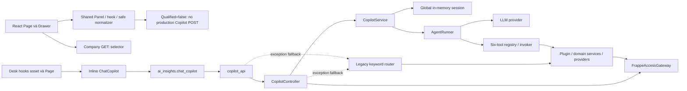

# Chatbot Assisted Actions P1 — Source discovery và gaps

11/10/2026 · Lotus Fin · FinTechathon Shenzhen 2026 · Independent Work review.

**Verdict: `P1_READY_FOR_CHAT_APPROVAL` — contract readiness, không implementation acceptance.** Đề xuất React làm pilot, API đọc typed/stateless trong backend Lotus hiện hữu, adapter Frappe ở infrastructure. Chưa có invoice search/select/open được kiểm chứng. Không cần SDK mới, microservice hoặc sửa toàn AgentRunner/session để làm pilot này.

Ba tài liệu P1 là proposal `NOT_FROZEN`; [MASTER_SSOT](CHATBOT_P1_AUTHORIZED_ACTIONS_MASTER_SSOT.md) là contract chính, [decision packet](CHATBOT_P1_WORK_TO_CHAT_DECISION_PACKET.md) dành cho Chat. Không thay authority của security, feature tài chính hoặc lịch sử B1-S. B1-S đã đóng `B1S_G4B_PASS` theo [R7 independent review](B1S_CORRECTION_R7_INDEPENDENT_RECHECK.md); 52/52 gold và native4/4 là execution của R7, **không là test chạy lại trong P1**. G10 vẫn BLOCKED riêng.

## 1. Identity, phương pháp và authority

Actual `develop@07f7251d3a0744356bf96fb2fea55ec6df9a0ce2`. Staged empty. Unstaged tracked changes chỉ Panel và Drawer: 74 insertions/267 deletions tổng cộng, đã có từ B1-S; không quy cho lượt P1. Nhiều untracked docs/evidence/tests/cache-session/my-skills có trước review; không xóa hoặc sửa. HEAD không định danh đầy đủ artifact; SHA256 appendix bên dưới định danh current source.

Đối chiếu **60/60 architecture source/authority fingerprints** với [previous source manifest](../evidence/chatbot-quality-audit-2026-10-11/ARCHITECTURE_SOURCE_BEFORE.json): **không đổi**. Đọc lại source liên quan và trace thêm navigation/provider/version; không blanket inherit old runtime facts. Các pure probes cũ minh chứng defect trên source không đổi, không được đổi thành current HTTP exploit hoặc current execution PASS.

Authority đã đọc: [AGENTS](E:/lotus-fin/AGENTS.md), [ADR001](../../adr/001-clean-architecture-core-first-adr.md), [Security Code V3](../../security/LotusFin_Security_SSOT_Code_V3_Codebase_Aligned.md), [workflow §31–34](../../features/LOTUS_FIN_AI_FEATURE_BUILD_WORKFLOW_3_TOOLS_V3_VI.md), [architecture audit](CHATBOT_ARCHITECTURE_SCALE_DEBUG_AUDIT.md), [quality packet](CHATBOT_QUALITY_WORK_TO_CHAT_2026-10-11.md), R7 review/packet, report Round7, Phase0 decision/read contract và [V1 source closure](V1_OVERDUE_SOURCE_AND_CONTRACT_CLOSURE.md). Old quality packet Track A CHANGES_REQUIRED đã được R7 supersede; architecture findings vẫn phải kiểm source. Financial feature/F102 SSOT không đổi.

Đã áp dụng GitNexus exploring/CLI skills. Cached CLI1.6.12: query copilot/controller/tool/permission, query invoice/navigation/get_list và context CopilotController/FrappeAccessGateway/UniversalFormView **trước static caller inspection**. Queries exit0 nhưng graph **behind61 commits**; named contexts notfound/exit1. Index không đủ trả current caller/risk; dùng bounded source/import tracing theo fallback được request cho phép. Không download/reindex tự động, không coi empty/UNKNOWN là safe hoặc symbol dead. P1 chỉ viết Markdown, không sửa function; batch implementation sau phải impact/confirm callers và cảnh báo HIGH/UNKNOWN đúng AGENTS trước edit, detect_changes trước commit nếu được phép commit.

`LOTUS_FIN_CHATBOT_ASSISTED_ACTIONS_SOLUTION_DESIGN_VI.md`: **REFERENCE_NOT_FOUND**. Bounded filename search workspace và accessible project references `E:/lotus-fin/docs`, `E:/frappe_docker` không tìm được. Không whole-machine search, không dựng lại nội dung. L0–L5 của P1 lấy từ **yêu cầu hiện tại**, không gán cho reference mất.

## 2. AS-IS: source binding, không deployed acceptance

|Boundary thực|Current source / symbol|Kết luận|
|---|---|---|
|React entry/reuse|`frontend/src/App.tsx:50–53`; Layout253; Page296; Drawer → Panel|Page/Drawer dùng chung safety; không nối current production chat API.|
|React gate|`VercelChatPanel.tsx:48–51`; `useCopilotRequest.ts:20,35–55,83`; `copilotPresentation.ts:69–149`|Qualified=false, injected transport chỉ ở test; abort/reset/generation, text/CID safety có thể reuse theo contract. Không biến boolean client thành server authority.|
|Desk configured load|`lotus_fin/lotus_fin/hooks.py:13`; `lotus_fin_ai/page/lotus_copilot/lotus_copilot.js:100`|Inline class trong `public/js/lotus_fin.js` được cấu hình và instantiate. Actual browser load order chưa chạy.|
|Desk API caller|`public/js/lotus_fin.js:422–480`; `api/ai_insights.py:25`|`frappe.call` public alias → re-export `copilot_api.chat_copilot`; không chỉ suy từ import Frappe.|
|Current API/composition|`api/copilot_api.py:24–46`; `presentation/controller/copilot_controller.py:26–40,53–99`|allow_guest=True, company gateway, fallback Admin khi framework thiếu, shared session, two exception fallbacks. Không chứng minh Guest exploit.|
|Application/tool boundary|`application/service/copilot_service.py:39–71`; `application/agent/agent_runner.py:62–115`; `infrastructure/tool/registry/default_tools.py:10–18`|Six finance/simulation tools; không có typed invoice search/reauthorize/open. Session/outcome route chưa phù hợp pilot.|
|Permission seams|`security/access.py:20–44`; `infrastructure/security/frappe_access_gateway.py:89,121,159`; `domain/policy/permission_policy.py:19–50`|Company/report/evidence methods có thật; chưa có invoice list/projection port. Missing-framework mock/True fallbacks không được reuse như production authorization.|
|General React data/navigation|`frontend/src/providers/dataProvider.ts:31–100`; `App.tsx:65–67`; `UniversalFormView.tsx:23–26,97–114,202–215,338`|Generic list fields=* và generic CRUD; `/app/:doctype/:id` mở editable form. Không làm chatbot tool hoặc read-only guarantee.|

Các path đứng riêng `public/js/components/chat_copilot.js`/widgets và cache-session repository **không có verified load/composition binding trong slice này**. Không kết luận dead; không xóa. Source hook scheduler/on_submit tồn tại không phải capability chatbot được phép gọi.

## 3. React, Desk và navigation decision

**Chọn React cho pilot**, reuse B1 safety patterns, thêm module invoice độc lập. Không sửa `hasQualifiedContext=false` để mở chatbot tài chính cũ. Desk chatbot hiện còn renderer/scope divergence; triển khai hai UI ngay làm tăng bề mặt qualification.

Actual React route mở `UniversalFormView` có save/create/update và fallback `frappe.desk.form.load.getdoc`; không có qualified read-only invoice viewer. Actual installed Frappe16 router `public/js/frappe/router.js:417–471` đổi `Form/Sales Invoice/name` thành **`/desk/sales-invoice/{encoded-name}`**, không được hardcode old `/app/...` làm current native route. `frappe.set_route('Form','Sales Invoice',name)` là Desk mechanism thực; hooks vẫn chứa old `/app/lotus-copilot`, chưa qualification alias/routing delivery.

**Material navigation fact:** installed `desk/form/load.py:22–53` gọi `onload`, `add_viewed`, `add_seen`; `model/document.py:1766–1807` có conditional `_seen` update/View Log insert. Không gọi các methods này. Không claim mọi lần open đều ghi; phụ thuộc effective metadata/hooks. Vì P1 yêu cầu không create/update ERP records, đề xuất **mở bản đọc tối thiểu của hóa đơn trong dedicated React reader sau server reauthorization**, không generic editable form/native Desk loader. Reader là **NEW/proposed**, không tồn tại hiện tại. Muốn mở form ERP gốc cần Chat chọn phạm vi khác và qualification side effects/identity/native route riêng; không âm thầm miễn trừ tracking writes.

## 4. Integration / runtime identity — kiểm hiện tại

Chỉ Docker metadata, process metadata và đọc file installed source; không site initialization, bench import/DB, shared8080 HTTP, credentials/config secrets, ERP records, permissions hay LLM.

|Evidence hiện tại|Actual observation|Giới hạn|
|---|---|---|
|Docker connection|Client/server29.1.3, version/ps/inspect exit0|Connectivity PASS, không ERP business acceptance.|
|Local backend/frontend|Backend `a857658a101b`; nginx `1752490a1ae5`; image/tag `lotus-fin:ai003-local`, digest `sha256:ed6e02f587eb450a0882ecb4b6fbb259d1a1f27f549e1cc4bbe21a660b3017b7`|Local current topology, không canonical judge deployment.|
|Process|Gunicorn preload,2 gthread workers×4threads,bind8000; nginx exposes8080|Linux process PIDs1476/1774/1775 là observation trong container; không host PIDs hoặc request throughput.|
|Ownership/deployment mounts|Backend chỉ sites/logs volumes; no host application bind. Compose `E:/frappe_docker/pwd.yml` + Lotus ai003 override; nginx readonly Lotus config bind|Lotus code ownership và shared Frappe runtime là facts riêng. Có separate product không đòi separate microservice.|
|Installed source packages|Frappe16.34.0 / ERPNext16.35.0 / Lotus0.0.1, từ version source + dist-info|Bench presence không chứng minh per-site installed/custom apps/effective roles. Git metadata trong image absent, rev-parse128.|
|Host/container drift|Controller host `4CDA…` ≠ container `330a…`; response DTO host `262F…` ≠ container `aff5…`; normalized LF vẫn khác. Gateway byte-equal `821B…`|Không claim host current controller/DTO đang served. Imported resident modules NOT_VERIFIED; preload làm file hash chưa đủ.|
|Auth code|React axios withCredentials, login/logout/get_logged_user; Vite dev proxy `/api`→localhost8080|Cookie design có source; actual caller/target identity, CSRF/origin/cookie delivery chưa qualification.|
|Target/API primary source|Installed `frappe.client.get_list`, REST read_doc/read checks; `frappe.get_list` → **qb_query.DatabaseQuery** → database/query permission engine|Không nhầm legacy db_query với actual v16 default. get_all bật ignore_permissions=True, cấm pilot. Engine có select/read và field/mask rules; phải explicit read gate và real permission tests.|

**UNKNOWN cần qualification trước enable:** canonical isolated target/site/product/connection/company map; actual site custom apps/permission hooks/field masking; effective authenticated users và denied users; target connection revision/source artifact; production API/cookie/CSRF delivery; native route/display side effects; hard DB deadline/cancellation; logging deployment/retention. Không chọn ai003-verify.localhost/shared `frontend` làm clean acceptance baseline.

### Installed dependencies và client choice

Current host frontend install: React19.3.0, axios1.20.0, router7.18.4, TS6.0.3, Vite8.3.3. Host Python Pydantic2.12.5, requests2.32.5/httpx0.28.1; **container** requests2.33.1/Pydantic2.12.5, không có frappe-client/httpx dist-info trong env inventory. Không trộn host và target versions. requirements chỉ pandas/numpy/pydantic ranges; pyproject dependencies=[]/Frappe commented — clean target dependency reproducibility vẫn cần acceptance.

|Approach|Permission/lifecycle/error|Pagination/retry/async/upgrade|P1 choice|
|---|---|---|---|
|In-process Frappe adapter|Current authenticated target request; explicit company/doc/read/field checks; safe typed exception mapping; không implicit set_user/Admin|Explicit bounded get_list/keyset; no blind retry; sync/hard timeout phải qualify; installed API source verified, site acceptance chưa|**Primary proposed** trong backend Lotus.|
|Typed HTTP adapter|Remote effective principal phải được chứng minh, server allowlisted origin/site; own safe error/deadline mapping|Existing requests sync; pagination/cancel/deadline chủ động; future timeout-after-commit/UNKNOWN_OUTCOME không được retry như read|Chỉ khi confirmed remote target; chưa cần dependency mới.|
|SDK/client wrapper|Không client cài/qualified; không invent “ERPNext SDK”. Wrapper không tự cấp delegation/field permission/approval|Maintained v16/custom-app compatibility, error semantics, async/batch/timeouts/retries **NOT_VERIFIED**; thêm wrapper qualification/upgrade cost|Không chọn/cài. Existing official API source đủ thiết kế port; wrapper phải kiểm primary installed/source khi thực sự cần.|

Remote service account token đại diện **token owner**, không tự đại diện Lotus end user. Không privileged proxy rồi filter frontend. Approved delegated identity/per-user auth và target-side enforcement là precondition của remote adapter, không capability của SDK. P1 không mở lifecycle submit/cancel/send; future mutation cần exact args/version/expiry/actor-bound approval + durable idempotency/reconciliation riêng.

## 5. C01–C09 reconciliation tại actual working tree

Line anchors dưới đây lấy current source, một số khác old audit line labels. `BLOCKS_FIRST_INVOICE_PILOT` nghĩa selected new boundary phải sửa/implement trước **enable**, không bắt sửa old general route. **Không còn `BLOCKS_P1_CONTRACT` chưa được thiết kế xử lý**; runtime unknowns giữ gate riêng.

|ID / severity|Current exact evidence|Classification / minimum action / tests / touching risk / order|
|---|---|---|
|C01 HIGH|`AgentRunner.run:70,92–97,107` giữ first data khi last tool denied; broad fallback API41/controller79; old pure probe same SHA|`BLOCKS_ONLY_SPECIFIC_FUTURE_CAPABILITY`: general-agent outcomes phải sửa trước reuse. Pilot bypass runner/fallback, new typed terminal outcome P1-A. Returned failure/nested denial regression; touching old runner HIGH compatibility, không allowlisted.|
|C02 HIGH|F001 tool31→`modules/f001_health/plugin.py:55–58` thiếu period; F002 tool32→plugin75–82 cutoff/horizon drift; F003 tool33→service97 signature mismatch|`BLOCKS_ONLY_SPECIFIC_FUTURE_CAPABILITY`: chỉ finance tools liên quan. Không invoice dependence; future exact DTO bridge + cutoff/permission tests; domain/financial risk HIGH, deferred.|
|C03 HIGH|`CopilotService.process_message:40–49` không check existing owner; InMemory13/16 giữ mutable ref; controller26/70 thiếu site/product key|`DEFER_SAFE` **chỉ vì** stateless pilot không gọi/store session/history. No session access test bắt buộc. Stateful capability ownership/TTL/CAS/outage gate riêng, HIGH risk, không Redis swap.|
|C04 HIGH|`public/js/lotus_fin.js:589` severity/status raw→append520; callback454 không generation/company bind; DeskPage48 switch chỉ đổi company|`BLOCKS_ONLY_SPECIFIC_FUTURE_CAPABILITY`: Desk chatbot pilot. React selected, không declare Desk safe/public exploit. Nếu expose Desk: escape/status/provenance/race E2E before enable; HIGH UI caller/load-order risk, deferred.|
|C05 MEDIUM|`ChatResponseDTO:11–18` không status/reason/CID; service64 mất fields; invoker42/47 raw error|`BLOCKS_FIRST_INVOICE_PILOT`: **new versioned action envelope/CID serializer**, không pass through old DTO. P1-A exact service→DTO→HTTP/UI/log tests; MED transport compatibility risk, opt-in endpoint rollback.|
|C06 HIGH|Invoker36 execute raw args; principal5–12 thiếu site/product; controller56–61 Admin defaults; gateway89/159 nonframework fallback; facade23–27 MagicMock/True|`BLOCKS_FIRST_INVOICE_PILOT`: explicit auth context + typed arguments + strict real adapter (P1-B), no import fallback. Real read/doc/field/cross-scope/revocation tests P2-C. HIGH auth risk; minimize by separate authorizer, no global gateway change.|
|C07 MEDIUM|Runner87 unbounded calls, providers own45s not total deadline; no invoice-specific cap/cursor|`BLOCKS_FIRST_INVOICE_PILOT`: approve/enforce per-read limits P1-B/P2-A; cap lookahead/doc permission overhead, deadline/bytes tests. Old runner budget fix deferred; no mock p95 claims. MED resource risk.|
|C08 MEDIUM|LLMFactory15–35/79 implicit env/mock; pyproject14–16 no deps; actual container/controller/DTO mismatch|Split: selected target/config/artifact reproducibility `BLOCKS_FIRST_INVOICE_PILOT`; unknown per-site/delegation `NOT_VERIFIED`. Old provider/cache composition `DEFER_SAFE` under zero LLM/session calls. P2-C canonical isolated artifact test; no full factory/packaging refactor. HIGH deployment identity risk, exact chosen install only.|
|C09 LOW|Panel545, Page427, gateway233; new hook173/normalizer149/body57|`DEFER_SAFE`: cohesive invoice modules <200 lines/file; preserve legacy UI variance. P2-B tiny binding change needs explicitly approved variance; no panel rewrite. Tests existing52 + new UI; broad refactor MED regression risk.|

**New narrow source discovery:** current navigation mechanisms lack strict no-ERP-write reader guarantee. Resolve by proposed dedicated readonly React reader (P2-B), not by broad form refactor. Native side effects are source-confirmed conditional behavior, not a tested production mutation.

## 6. Minimal dependencies, actual execution và gates

Selected boundary needs new outcome DTO, safe response/CID delivery, context resolver/authorizer, invoice read port/search/open use cases, stateless authenticated reference/cursor codec, strict Frappe adapter and React result/reader modules. These are **proposed**, not implemented symbols. Ordinary UI và chatbot gọi **cùng typed use cases**, không copy invoice rules vào frontend/LLM hoặc wrap generic CRUD.

Generic pilot chỉ identifiers/approved dates/docstatus/customer label; không amounts, payments, overdue/risk classification. “Đang cần xử lý” cần user chọn tiêu chí, không tự gọi overdue. V1 `PAST_FINAL_DUE_INVOICES` còn source-blocked; stored status `Overdue` không chứng minh term-aware debt. F102/COGS/CAGR/concentration không dependency của pilot này.

|Check thực sự chạy trong P1|Result|
|---|---|
|Git identity/staged/diff/current hashes|PASS — dirty source identity recorded;60 unchanged architecture fingerprints|
|Graph-first queries/context|PARTIAL — stale61/notfound; bounded static caller confirmation, no all-clear|
|Docker metadata connectivity/image/process + installed source reads|PASS narrow discovery; không application/site acceptance|
|Source contract/line/navigation/version inspection|PASS discovery; existing gaps mapped, no feature PASS|
|P1 backend/unit/UI/permission/ERP tests, benchmarks, build/gold rerun|NOT_RUN — no P1 implementation; unnecessary B1 reruns avoided|
|Runtime permissions/site/customizations / hard cancellation / judge|NOT_RUN; canonical baseline unresolved, G10 remains BLOCKED|

No source/test edits, dependency install, site/API/LLM request, permissions/data change, Redis flush, process kill, commit or deploy. Docker exec chỉ đọc file, không import application or fixture helper. Source/image/module lineage tách riêng; reading files không chứng minh serving bytecode. Exactly three P1 Markdown outputs; prior audit/report/evidence preserved.

P1-G0/G1/G2/G3/G4 **PASS (contract/discovery scope)**; P1-G5 **PARTIAL** pending Chat decisions/allowlist/budget/target qualification owner. Overall READY_FOR_CHAT_APPROVAL, chưa dispatch. See master for approval dependencies and P1-A→P1-B→P2-A→P2-B→P2-C gates.

## 7. Reproduction và source fingerprints

Reproduce read-only: `git branch --show-current`, `git rev-parse HEAD`, `git status --short`, `git diff --stat`, `git diff --cached`; SHA256 actual files including untracked. Cached GitNexus CLI query/context commands ở §1; record stale/error instead of upgrading/download. `docker version`, `docker ps`, safe selected inspect fields, `docker top ... -eo pid,ppid,args`; `docker exec frappe_docker-backend-1 cat`/`sha256sum` installed source paths listed below; `find .../env/lib -maxdepth 3 -type d -name '*.dist-info'`. Không dump environment/site configs, không HTTP to shared frontend. Findings use file text/AST/contracts; không runtime business script.

|Installed source file under `/home/frappe/frappe-bench/apps/`|SHA256 đọc hiện tại|
|---|---|
|`frappe/frappe/__init__.py`|`9a58ad46b7320b21499d60137ecb949e46d8dfe9df71c6692f7c7d414f14a547`|
|`frappe/frappe/client.py`|`642a8b465d1fde2ccb5b4483a73965ffbeba7439619060732ff413fc7ab00a80`|
|`frappe/frappe/api/v1.py`|`93996b93c3aa647df279cf0f14641262bacdf3d28aa84d4cdd03f1f409827abc`|
|`frappe/frappe/model/qb_query.py`|`e42f930ceb1f6277a5435c9ef8123715f9499221fe8be75d8de264ba080cdf0f`|
|`frappe/frappe/database/query.py`|`ea7f6e9815d5b91e3e93a48cecf5c65f472a0fe1a29a6e0387b3ae9afb3a320c`|
|`frappe/frappe/model/document.py`|`902e8330128a8d541069355e9c66689c548fca749a9d05ccc69cdd952ac44937`|
|`frappe/frappe/desk/form/load.py`|`0d52bde180933e2a1bb4b8a24db290944887d8ac82bf0de2275797185e7efcba`|
|`frappe/frappe/public/js/frappe/router.js`|`3f179991cc28062642f3a1ff9139279698a69a95fe3c0113d473795a93678172`|
|`erpnext/erpnext/__init__.py`|`751b01fca8c0acaa0d0304b69c714c8996a6bebf07f51f04c93e354ac4a984ba`|
|`erpnext/erpnext/accounts/doctype/sales_invoice/sales_invoice.json`|`5324469b2c5933f3bc71b268e3caf0754e8fb29d9923aef5b6e119cfea767470`|
|`erpnext/erpnext/accounts/doctype/sales_invoice/sales_invoice.py`|`2ed51dbffe1853dad84e0369c6149d836e9fac8a65a0a99fcb6cbee9ac5b210f`|
|`lotus_fin/lotus_fin/__init__.py`|`2935d14af6aae7f2e113262218fecb4c7f5d349cb8af94ba346fb39cef53f44a`|
|`lotus_fin/lotus_fin/presentation/controller/copilot_controller.py`|`330a2d7f91a54a561939cb31ef8c75be02926c8caca647741efa3d23bc519c69`|
|`lotus_fin/lotus_fin/presentation/dto/chat_response.py`|`aff5a4ffa38552612b1816befcdc66f17f2a658fa50172842833dba47556970a`|
|`lotus_fin/lotus_fin/infrastructure/security/frappe_access_gateway.py`|`821b6254cf1bcb458f054b80c890e07a64f3688c766a0ef045790e67b5538ab7`|

Installed hashes are raw UTF-8 content/sha256sum observations; no `.git` metadata in app packages, no new immutable image/new-worker acceptance. Failed optional git metadata/lazy-document filename lookup are discovery limitations, not app defects. Public SDK maintained compatibility NOT_VERIFIED. Host SHA table and final integrity appended below; no extra raw evidence file created in P1.
### Final integrity — actual P1 verification

**PASS**: 67 selected source/authority hashes unchanged; 641 tracked-file hashes unchanged; 2,573 historical review/evidence file hashes unchanged (three new P1 outputs excluded). Staged empty and exact pre-existing unstaged binary diff unchanged. These are integrity counts, not application test counts. Baseline and final SHA256 of deterministic sorted path/hash ledgers:

|Ledger|Before = after SHA256|
|---|---|
|641 tracked files|`7a0c594908133d9c119d1507e4adccab5c0d951bf51014f9fa336e51362ef3ea`|
|2,573 historical evidence/review files|`5e803a42d84989fdeeef0721a8f22b81dd7640aa57f922090962ae28554aa9dd`|
|Unstaged binary diff|`09344d31c5b694e62eb399cc6461a6388ea77c330fbf1943b127b4f3c56fd3eb`|
|Staged binary diff (empty)|`e3b0c44298fc1c149afbf4c8996fb92427ae41e4649b934ca495991b7852b855`|

Reproduction ledger hashing: sorted `(relative_posix_path, lower-case sha256)` pairs, Python `json.dumps(..., separators=(',', ':'))` UTF-8, SHA256. Tracked set from `git ls-files`; historical set all files recursively under `docs/reviews/evidence` and `docs/reviews/phase0-chatbot-2026-10-10`, excluding exactly the three P1 basenames. Selected table uses uppercase hashes. Final local link check PASS, balanced fenced code blocks; machine/source validity is documentation checking, not execution of proposed DTO/API. Fifteen installed-source hashes verified against raw `sha256sum`; Lotus package init raw CRLF hash used, not its normalized text-read hash. Source/runtime/image facts kept separate.

### Host current SHA256 manifest (67 selected files)

Paths relative to `E:/lotus-fin`; fingerprints include untracked current artifacts. The first60 architecture files byte-match previous audit source, not an inherited runtime acceptance.

|Host source / authority|SHA256|
|---|---|
|[AGENTS.md](E:/lotus-fin/AGENTS.md)|`F481948EA6B51D00BCC95B9E8D2220588538B3A891C3E9F68FB005FA48688BAA`|
|[B1S_IMPLEMENTATION_REPORT.md](E:/lotus-fin/B1S_IMPLEMENTATION_REPORT.md)|`74C777F29641DC7BA1C8471C0170B128B840B3B89D2B0632142E47D742D6419C`|
|[docs/adr/001-clean-architecture-core-first-adr.md](E:/lotus-fin/docs/adr/001-clean-architecture-core-first-adr.md)|`443545201A8DEA9F8261E6148ED8605C1892B8A82FF7E8F327C2823C43CF79DC`|
|[docs/features/LOTUS_FIN_AI_FEATURE_BUILD_WORKFLOW_3_TOOLS_V3_VI.md](E:/lotus-fin/docs/features/LOTUS_FIN_AI_FEATURE_BUILD_WORKFLOW_3_TOOLS_V3_VI.md)|`F89BBE38B392C4204B649C9FCE2DBDBE729DA5EF4BA38776E32EB6FECA057B49`|
|[docs/security/LotusFin_Security_SSOT_Code_V3_Codebase_Aligned.md](E:/lotus-fin/docs/security/LotusFin_Security_SSOT_Code_V3_Codebase_Aligned.md)|`16BB860A6EB0573875D1CCDC42BA6D8494DDB27B7BFE4CB9977E2EE9566AB614`|
|[frontend/package-lock.json](E:/lotus-fin/frontend/package-lock.json)|`4530FD8C3E9496A684A8569EE6A47DD0F3EB8D010B3DEF7A6D4222DB67F23DD9`|
|[frontend/package.json](E:/lotus-fin/frontend/package.json)|`35386677A8EC903A6FD9C75B09E5732603A2A4626EABCB4E528386F7E81DA50C`|
|[frontend/src/App.tsx](E:/lotus-fin/frontend/src/App.tsx)|`D97B68AB9574CACA541613A96F1862FF1B6F97DABCE3CF54E6EE2A9A6E4216A1`|
|[frontend/src/components/layout/AppLayout.tsx](E:/lotus-fin/frontend/src/components/layout/AppLayout.tsx)|`017DB86C292CD21DAE85462FDE93B2B0E2C3E2234D67759688194A04683C84E5`|
|[frontend/src/pages/copilot/LotusCopilotPage.tsx](E:/lotus-fin/frontend/src/pages/copilot/LotusCopilotPage.tsx)|`3B728165954CCC04B684AA0AC6879E781C6AD57259BFB24B20D89AC8A8CEA149`|
|[frontend/src/pages/dynamic/UniversalPageView.tsx](E:/lotus-fin/frontend/src/pages/dynamic/UniversalPageView.tsx)|`C18E8CECC89FF8EF82E8A1CFA1F19A373BBB640AFB300020E65B86266EB98C86`|
|[frontend/src/providers/authProvider.ts](E:/lotus-fin/frontend/src/providers/authProvider.ts)|`9024EB868A3D1D015242944B6D249161C708558369D39A23B26AE7A63416CBC4`|
|[frontend/src/providers/dataProvider.ts](E:/lotus-fin/frontend/src/providers/dataProvider.ts)|`B57059E1C5B2ECF3D35D6368B6C0BA47C93CBD89E203E7969BECDFD278903AE5`|
|[frontend/vite.config.ts](E:/lotus-fin/frontend/vite.config.ts)|`891F5A759089020E62CFCCEB221765F49CA97885B853E43CEB6CD67CCE6C69D9`|
|[lotus_fin/lotus_fin/__init__.py](E:/lotus-fin/lotus_fin/lotus_fin/__init__.py)|`2935D14AF6AAE7F2E113262218FECB4C7F5D349CB8AF94BA346FB39CEF53F44A`|
|[lotus_fin/lotus_fin/api/ai_insights.py](E:/lotus-fin/lotus_fin/lotus_fin/api/ai_insights.py)|`CADC25F865DDBEBF866204D059262EEBF6C66297A0B11390F505EAB25F2F09E9`|
|[lotus_fin/lotus_fin/api/copilot_api.py](E:/lotus-fin/lotus_fin/lotus_fin/api/copilot_api.py)|`511141A47618C3A8C3A5EDA58BDBC15733C5213D405F1A6890E71EA3F1FC83C2`|
|[lotus_fin/lotus_fin/application/agent/agent_runner.py](E:/lotus-fin/lotus_fin/lotus_fin/application/agent/agent_runner.py)|`89C7E5F7742736F075B9694737D151BB1C28C68A0F76B1904DCE4D7601C68F3E`|
|[lotus_fin/lotus_fin/application/agent/prompt_engine.py](E:/lotus-fin/lotus_fin/lotus_fin/application/agent/prompt_engine.py)|`633274579D5A123DD693AF15FB7F0364995AC93A42705511AF26EE4DF51A3FBE`|
|[lotus_fin/lotus_fin/application/port/i_llm_provider.py](E:/lotus-fin/lotus_fin/lotus_fin/application/port/i_llm_provider.py)|`9379F61E024AAA5E353043F734139B3B4FA92F8A3F1DAB795B695363A980FD5F`|
|[lotus_fin/lotus_fin/application/port/i_tool_invoker.py](E:/lotus-fin/lotus_fin/lotus_fin/application/port/i_tool_invoker.py)|`FDA172FFBCA99A07C81613856121F9BC77C08B3B8A17E71005DD91F13DBE1528`|
|[lotus_fin/lotus_fin/application/port/i_tool_registry.py](E:/lotus-fin/lotus_fin/lotus_fin/application/port/i_tool_registry.py)|`576902131BF66AFE35EF56BC2213A64AF441C483C6FA801B5C558033B92FF40E`|
|[lotus_fin/lotus_fin/application/service/copilot_service.py](E:/lotus-fin/lotus_fin/lotus_fin/application/service/copilot_service.py)|`EE4160AE290EA49086760F1AA0198383EA9310FA452334979DB03CBC5A7E411F`|
|[lotus_fin/lotus_fin/core/ai/agent_copilot.py](E:/lotus-fin/lotus_fin/lotus_fin/core/ai/agent_copilot.py)|`343506AEED0347D378EA357D36F678E2DC18E722448B410E3AD0D2A8BC6907C4`|
|[lotus_fin/lotus_fin/core/compat/legacy_module_resolver.py](E:/lotus-fin/lotus_fin/lotus_fin/core/compat/legacy_module_resolver.py)|`6CBE56A01B9B3E2956FFF9EBF731D580B14E58557A69EC36AD70CEED18AE58E2`|
|[lotus_fin/lotus_fin/core/plugin/registry.py](E:/lotus-fin/lotus_fin/lotus_fin/core/plugin/registry.py)|`EDAE089AB54C72E987030693739FEB73217AF0925B16A9B58D7526918A2CBCEE`|
|[lotus_fin/lotus_fin/domain/model/chat_message.py](E:/lotus-fin/lotus_fin/lotus_fin/domain/model/chat_message.py)|`F2012C9A472F8BC358DCDEBBD87814C4132B8EF0B1B5F5AFE1F16C56C6486410`|
|[lotus_fin/lotus_fin/domain/model/chat_session.py](E:/lotus-fin/lotus_fin/lotus_fin/domain/model/chat_session.py)|`A03E4083CDBB3B973E7A40B2170B6D5B97EEE5C05FDB6B8BD4A529432E8F50A9`|
|[lotus_fin/lotus_fin/domain/model/user_context.py](E:/lotus-fin/lotus_fin/lotus_fin/domain/model/user_context.py)|`CB2A352A1D5ABA9F6805B0564F3C0115DB3813C6C68D9093E6BDB1CF6F80D971`|
|[lotus_fin/lotus_fin/domain/policy/permission_policy.py](E:/lotus-fin/lotus_fin/lotus_fin/domain/policy/permission_policy.py)|`A55DBD54052C8B68F177D9E120AA187F85FE64639BAC79587B67DD5C6062C326`|
|[lotus_fin/lotus_fin/domain/repository/i_session_repository.py](E:/lotus-fin/lotus_fin/lotus_fin/domain/repository/i_session_repository.py)|`9C979394960A1852AC389E4142348EE0012732C2BA784C0BED01DDA3ED91BAFB`|
|[lotus_fin/lotus_fin/domain/schema/tool_call_request.py](E:/lotus-fin/lotus_fin/lotus_fin/domain/schema/tool_call_request.py)|`1465D339DD2C809C40960B5325DCDF6BBCD9755CE57546B0F72D836143D29F10`|
|[lotus_fin/lotus_fin/domain/schema/tool_definition.py](E:/lotus-fin/lotus_fin/lotus_fin/domain/schema/tool_definition.py)|`05C7C1DE1877B77530736501168146DD3F78B108C2F8B230FDA1C5D41BAF4699`|
|[lotus_fin/lotus_fin/domain/schema/tool_execution_result.py](E:/lotus-fin/lotus_fin/lotus_fin/domain/schema/tool_execution_result.py)|`89CE39CF3EFDD8C0604B0CDF685432DC31889E4AF436D4570437D29977D3FFD2`|
|[lotus_fin/lotus_fin/hooks.py](E:/lotus-fin/lotus_fin/lotus_fin/hooks.py)|`8CF19213CFEA71A16F40317D514FE0F1D1BD81142AD5851FE2826C20CA773EC7`|
|[lotus_fin/lotus_fin/infrastructure/llm/adapter/gemini_llm_adapter.py](E:/lotus-fin/lotus_fin/lotus_fin/infrastructure/llm/adapter/gemini_llm_adapter.py)|`79E1D08302704C2C5E86A09A3DED30ECC39EB1C8B8EE0EBAE5F31105A189D53D`|
|[lotus_fin/lotus_fin/infrastructure/llm/adapter/mock_llm_adapter.py](E:/lotus-fin/lotus_fin/lotus_fin/infrastructure/llm/adapter/mock_llm_adapter.py)|`7F57542394866D07EBAAD02519431D2FB62A37C532E62449E0517373C83B802E`|
|[lotus_fin/lotus_fin/infrastructure/llm/adapter/openai_llm_adapter.py](E:/lotus-fin/lotus_fin/lotus_fin/infrastructure/llm/adapter/openai_llm_adapter.py)|`9D4562E298D361574EFDA24E6800E9847977BDAED22C2107A848E3DF6AAC3EB6`|
|[lotus_fin/lotus_fin/infrastructure/llm/llm_factory.py](E:/lotus-fin/lotus_fin/lotus_fin/infrastructure/llm/llm_factory.py)|`CE36DBD4F3F0B89ACB388847DF7367E0CBFA32D811856E31DB2F10902DB8416E`|
|[lotus_fin/lotus_fin/infrastructure/persistence/frappe_cache_session_repository.py](E:/lotus-fin/lotus_fin/lotus_fin/infrastructure/persistence/frappe_cache_session_repository.py)|`C0365A5096DAA24A7E5888F54E2CABE3D67ABC48C9CDBF571C832DE644F345A0`|
|[lotus_fin/lotus_fin/infrastructure/persistence/in_memory_session_repository.py](E:/lotus-fin/lotus_fin/lotus_fin/infrastructure/persistence/in_memory_session_repository.py)|`FB389D14EC5145951F5FDA16399FAF4C17E711B8DE0BA2ECD4B69B77B6B1AF44`|
|[lotus_fin/lotus_fin/infrastructure/security/frappe_access_gateway.py](E:/lotus-fin/lotus_fin/lotus_fin/infrastructure/security/frappe_access_gateway.py)|`821B6254CF1BCB458F054B80C890E07A64F3688C766A0EF045790E67B5538AB7`|
|[lotus_fin/lotus_fin/infrastructure/tool/impl/f001_health_tool.py](E:/lotus-fin/lotus_fin/lotus_fin/infrastructure/tool/impl/f001_health_tool.py)|`8DE162CFFADCB28776CF994CC003C2FA29C316367B8F3009301280ABA957A0F3`|
|[lotus_fin/lotus_fin/infrastructure/tool/impl/f002_cashflow_tool.py](E:/lotus-fin/lotus_fin/lotus_fin/infrastructure/tool/impl/f002_cashflow_tool.py)|`B7BCD75113B71CE8D665F22F54B734E7B1139D47ECE1651B6DDAD05F0E29F5B7`|
|[lotus_fin/lotus_fin/infrastructure/tool/impl/f003_risk_tool.py](E:/lotus-fin/lotus_fin/lotus_fin/infrastructure/tool/impl/f003_risk_tool.py)|`BAE368C03F07C6CFB315051EFB1842876162E85AC98003B44DDA9A3323BD9325`|
|[lotus_fin/lotus_fin/infrastructure/tool/impl/f004_whatif_tool.py](E:/lotus-fin/lotus_fin/lotus_fin/infrastructure/tool/impl/f004_whatif_tool.py)|`A1E423FD73AC3362FCD40C500C4AA59AB0B1D3E9A36F1AA4BD2B120FB30B4826`|
|[lotus_fin/lotus_fin/infrastructure/tool/impl/f005_financing_tool.py](E:/lotus-fin/lotus_fin/lotus_fin/infrastructure/tool/impl/f005_financing_tool.py)|`BAE5EECA72F30466FEF7A48FEC6F84B66CD85EFA6171E59F1F521DF050D45CBF`|
|[lotus_fin/lotus_fin/infrastructure/tool/impl/f006_repayment_tool.py](E:/lotus-fin/lotus_fin/lotus_fin/infrastructure/tool/impl/f006_repayment_tool.py)|`0ED72094AE53EAD1AED5E478972EE5507D4D327AE7386DB0AC259EB4DCDDB3CB`|
|[lotus_fin/lotus_fin/infrastructure/tool/invoker/tool_invoker.py](E:/lotus-fin/lotus_fin/lotus_fin/infrastructure/tool/invoker/tool_invoker.py)|`95C37739EDA13E8C7921545838FE87B3E36B064F746AF372366A70215F6A9DED`|
|[lotus_fin/lotus_fin/infrastructure/tool/registry/default_tools.py](E:/lotus-fin/lotus_fin/lotus_fin/infrastructure/tool/registry/default_tools.py)|`A49642818B00F7A6DB5120E2710F0C6C166D78E3CC864227C57636301D9C03E0`|
|[lotus_fin/lotus_fin/infrastructure/tool/registry/tool_registry.py](E:/lotus-fin/lotus_fin/lotus_fin/infrastructure/tool/registry/tool_registry.py)|`6329EC3CB504BB398A8112427CEB572F9D527008DE759E41B6A07C96082F4809`|
|[lotus_fin/lotus_fin/lotus_fin_ai/page/lotus_copilot/lotus_copilot.js](E:/lotus-fin/lotus_fin/lotus_fin/lotus_fin_ai/page/lotus_copilot/lotus_copilot.js)|`A18C31BE739E750CE524F2D0073E00478C064CE0E6D716883D5C1A756316A065`|
|[lotus_fin/lotus_fin/modules/f001_health/plugin.py](E:/lotus-fin/lotus_fin/lotus_fin/modules/f001_health/plugin.py)|`9449E49A9CBACF801A6D63C451463170C818278F762985DF60E50B7194DAD64E`|
|[lotus_fin/lotus_fin/modules/f002_cashflow/plugin.py](E:/lotus-fin/lotus_fin/lotus_fin/modules/f002_cashflow/plugin.py)|`7F10F88F6A0BF8A213CB2388C6670AEBFC8DEB298E3D1C6232A0A6CE9D983735`|
|[lotus_fin/lotus_fin/modules/f003_risk_signal/service.py](E:/lotus-fin/lotus_fin/lotus_fin/modules/f003_risk_signal/service.py)|`4FA68B8CCBD1A05AD265DA40214455AE51289F1CC1DD08A00D710E5DDB071E0A`|
|[lotus_fin/lotus_fin/presentation/controller/copilot_controller.py](E:/lotus-fin/lotus_fin/lotus_fin/presentation/controller/copilot_controller.py)|`4CDA41678815F6598A115E39A81749DAD84F6C51B56416A2EF7F0C217EFCB9ED`|
|[lotus_fin/lotus_fin/presentation/dto/chat_request.py](E:/lotus-fin/lotus_fin/lotus_fin/presentation/dto/chat_request.py)|`1608E3A04EE2766568FF41E35141830C03DF7F339CAC32B0D8ABFA4A6101EEE7`|
|[lotus_fin/lotus_fin/presentation/dto/chat_response.py](E:/lotus-fin/lotus_fin/lotus_fin/presentation/dto/chat_response.py)|`262F3F8ECD9B7470AA06738BEAB232506DBC2B777C37EF4778A22D6C7EED06CF`|
|[lotus_fin/lotus_fin/public/js/components/chat_copilot.js](E:/lotus-fin/lotus_fin/lotus_fin/public/js/components/chat_copilot.js)|`C1D73DE892724FD19951C61EE385CBA254E4A1463C768D4053CB0E37819F2609`|
|[lotus_fin/lotus_fin/public/js/lotus_fin.js](E:/lotus-fin/lotus_fin/lotus_fin/public/js/lotus_fin.js)|`8FC48A95BC89CC287966EEB32471EA47F72B32FB3FB11E8C4439380318E980C7`|
|[lotus_fin/lotus_fin/public/js/widgets/chat_copilot_widget.js](E:/lotus-fin/lotus_fin/lotus_fin/public/js/widgets/chat_copilot_widget.js)|`580177C42EE1E28D28EFB9C52459E2C47BCCA206D738123D68D6905B0DDDF45A`|
|[lotus_fin/lotus_fin/security/access.py](E:/lotus-fin/lotus_fin/lotus_fin/security/access.py)|`39323D28B3E07BDC768A84A931DA3FAED31238E56D21514DFBF778E288FB8DAB`|
|[lotus_fin/lotus_fin/tests/test_architecture_remediation.py](E:/lotus-fin/lotus_fin/lotus_fin/tests/test_architecture_remediation.py)|`F4560A114EA0601BBBBB6059E314247ED472C154D2710E3E6AD8229AB82A38AA`|
|[lotus_fin/lotus_fin/tests/test_clean_architecture.py](E:/lotus-fin/lotus_fin/lotus_fin/tests/test_clean_architecture.py)|`749F07B5A037F48CBAFCFDFB59759E107567E1EFB35B1A452D5F2A1C69BC2D13`|
|[lotus_fin/pyproject.toml](E:/lotus-fin/lotus_fin/pyproject.toml)|`68172E8EA1D45298ED4065611A9DB7E9BE602F5FBE17568D2DB37E4154839533`|
|[lotus_fin/requirements.txt](E:/lotus-fin/lotus_fin/requirements.txt)|`3BE20EB0A14A84838756F9CFD94EF15AFFA550C59805922E28E37BB41CC26659`|
|[frontend/src/pages/dynamic/UniversalFormView.tsx](E:/lotus-fin/frontend/src/pages/dynamic/UniversalFormView.tsx)|`8808CF640305009F40CA91524CD37D40E252C7A590AEF9007CE29A2A1DFE9D81`|
