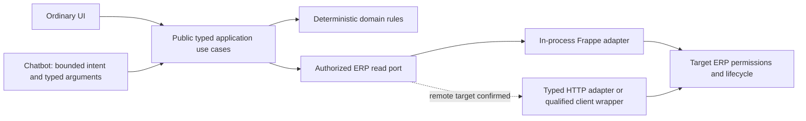

# Phase 0 — Architecture decision review

10/10/2026 · Lotus Fin · FinTechathon Shenzhen · **CHANGES_REQUIRED**. Independent Work review; decisions below are proposals for Chat, not an accepted ADR or frozen feature contract. Antigravity has no implementation dispatch from this record.

## Authority and identity

**FACT_OWNER:** Lotus Fin is its own product; ERPNext/Frappe is underlying technology. The requested solution helps a user perform work through chatbot requests. Autonomous scheduling, ERP writes, email sending, bank operations and new F101/F102 builds remain outside this discovery.

Authority: [workflow v3.1 §31–34](../../features/LOTUS_FIN_AI_FEATURE_BUILD_WORKFLOW_3_TOOLS_V3_VI.md), [direction/handoff](../../features/LOTUS_FIN_EXISTING_FEATURES_AND_ERP_AUTOMATION_HANDOFF_PROMPTS_2026-10-09.md), [ADR001](../../adr/001-clean-architecture-core-first-adr.md), [Security Code V3](../../security/LotusFin_Security_SSOT_Code_V3_Codebase_Aligned.md). Existing feature contracts remain intact. Security document architecture/TO_BUILD statements describe its older reviewed revision; its invariants remain normative, but are not current runtime evidence. Workflow §34 supersedes historical F102-first priority. F102 authority remains [MASTER_SSOT §7](../../features/F102/F102_MASTER_SSOT.md); no parallel F102 contract is created here.

The supplied Phase 0 attachment was read. Its F102 pre-freeze basename resolves to `docs/features/F102/evidence/F102_PRE_FREEZE_CLOSURE_2026-10-09.md`, not the feature root. `AI004_MASTER_SSOT.md` is MISSING; existing authority is [AI004_SPECIFICATION_AND_DESIGN](../../features/AI004/AI004_SPECIFICATION_AND_DESIGN.md). Separate `docs/features/AI005`, AI006 and AI007 directories are MISSING; the combined [codebase-aligned v2 specification](../../features/LotusFin_AI_Features_Codebase_Aligned_v2.md) provides those feature sections, with older runtime claims treated as historical. Missing files are not reconstructed.

## Current facts, with boundaries

| Classification | Observation | Evidence / limitation |
|---|---|---|
| VERIFIED | `develop`, HEAD `07f7251d3a0744356bf96fb2fea55ec6df9a0ce2`; tracked/staged diff empty before review, many untracked files | [current manifest](../evidence/phase0-chatbot-2026-10-10/REPRODUCTION.md); commit alone is insufficient identity |
| VERIFIED | All 333 sampled host fingerprints equal previous final snapshot | [fingerprints](../evidence/phase0-chatbot-2026-10-10/CURRENT_HOST_FINGERPRINTS.json); no automatic historical test PASS inheritance |
| VERIFIED | Docker server 29.1.3 connected; backend image digest `sha256:ed6e02f587eb450a0882ecb4b6fbb259d1a1f27f549e1cc4bbe21a660b3017b7` | Current connectivity/image inventory; no deployment readiness implied |
| VERIFIED | Local Lotus app co-installed with Frappe16.34.0/ERPNext16.35.0, Lotus0.0.1; Gunicorn preload, two gthread workers, four threads each; nginx8080, queues/scheduler/websocket, MariaDB11.8/Redis6.2 | Current package/process/mount/routing evidence; app uses in-process Frappe source APIs |
| VERIFIED | Backend mounts sites/logs, no host app source mount; nginx Host mapping defaults to shared `frontend`; ai003 Host maps contaminated verification site | No site acceptance used either target |
| VERIFIED | 15 runtime files unchanged from previous runtime snapshot; only4 byte-match host; previous normalized comparison identifies10 implementation differences and1 line-ending difference | Current runtime hashes + prior normalized/source excerpts; resident imported module identity NOT_VERIFIED |
| VERIFIED | Offline exact image lacks new Copilot API/service/cache-session files; image reader cleanup PASS | Current isolated file read, not new-worker/site smoke |
| VERIFIED | React source uses cookie login and axios; list/detail routes use Frappe APIs; source Vite proxy points to8080 | Browser execution NOT_RUN; published judge UI/target NOT_VERIFIED |
| NOT_VERIFIED | Per-site installed apps/customizations, effective roles/companies, product↔site↔company↔connection mapping, production/judge endpoint, delegated identity/service-account scopes | Bench package registry is not per-site installation/permission evidence |
| NOT_VERIFIED | Resident application module identity, fresh image acceptance, live session/error/UI behavior | No clean reviewed isolated baseline; no instrumentation/imports against shared workers |

`thesis_backend`/Uvicorn and its PostgreSQL belong to a separate mounted project; no verified Lotus API caller makes it the Lotus backend. Product independence does not require a separate process or database.

GitNexus remains61 commits behind at `316c5bd`; bounded refresh failed. Cached CLI invoice query resolves historical fixture flows, controller context is not found, and documentation impact is UNKNOWN. Source/caller confirmation follows these graph limitations. No registry/legacy symbol is declared dead or removed. See reproduction for the runner package-download incident and corrective offline-cache invocation.

## Proposed solution and transport choice

**PROPOSED:** build the action-support application boundary inside the existing Lotus backend first. Expose a narrow read/navigation use case to both UI and chat. The LLM selects intent and candidate arguments; the server binds principal/connection/company, checks permissions and computes financial facts. An ERP client belongs only to infrastructure. Neither the existing generic CRUD frontend provider nor arbitrary SDK method execution becomes a chatbot tool.

If the chosen ERP is remote, retain the same ports and evaluate a typed HTTP adapter using existing dependencies. A separate backend adds identity delegation, token isolation, transport failures and operations; choose it only for a verified remote/deployment need. No second writable ledger or new dependency is justified by architectural symmetry.

## Client comparison

Installed runtime has requests2.33.1/pydantic2.12.5, no frappe-client or httpx; host requirements are ranges and pyproject does not pin Frappe. Existing frontend uses axios. Official [Frappe REST docs](https://docs.frappe.io/framework/user/en/api/rest) document resource/RPC APIs and offset pagination. Official [Frappe Client](https://github.com/frappe/frappe-client) is a Python REST wrapper; calling it a universally compatible “ERPNext SDK” would exceed evidence.

| Axis | In-process candidate | Typed HTTP candidate | FrappeClient wrapper candidate |
|---|---|---|---|
| Permission/lifecycle | Current user request context; use permission-aware list/doc/report APIs | Target authenticates effective principal; bind endpoint/site/company in adapter | Same target authority; wrapper does not provide end-user delegation |
| Errors | Map permission/data/availability exceptions to safe application outcomes | Classify auth/validation/outage/timeout; redact nested errors | Reviewed source `post_process` can expose raw exception; wrapper mapping still needed |
| Deadline/retry | Bound use case and queries; hard cancellation still needs qualification | Explicit connect/read timeout within total deadline; bounded safe reads | Reviewed helpers have no explicit request timeout; qualify or wrap |
| Idempotency | Future business writes still need ERP atomic deduplication/outcome ledger | Timeout-after-commit requires reconciliation | Generic submit/cancel helpers do not establish exactly-once |
| Async/batch/pages | Synchronous current request; bounded pages explicitly designed | Existing requests is sync; async only if measured need; explicit page contract | requests.Session sync; no proof of automatic safe pagination/batch/async |
| Compatibility/upgrades | Current installed source inspected; per-site runtime untested | Narrow methods reduce qualification surface; own target contract tests | Additional dependency + wrapper + target-version/custom-app tests; maintained v16 compatibility NOT_VERIFIED |

Public source snapshot is linked in the evidence manifest; external docs corroborate API shape, not installed target acceptance. No SDK installed. API token authority is the token owner, not automatic impersonation of the chat caller. Service-account use is NOT_VERIFIED; if selected, Chat must approve enforceable end-user scope/delegation before G1/G4A closure.

## Vertical slice selection

| Candidate | User/demo value and reuse | Prerequisites and risk | Verdict |
|---|---|---|---|
| V1 find/open overdue invoices | Concrete user action; existing Sales Invoice API/navigation surface; deterministic, no LLM numeric truth required | Overdue/payment-term/currency semantics, target/per-site permissions, safe list/detail/evidence/races; new narrow use case missing | **First candidate**; feasible design, not build-ready |
| V2 existing what-if | High visual demo value; existing pure engines/tests | F004 events engine and F0059-KPI are distinct contracts; SQL guards/error defaults and verified baseline unresolved | Later; do not merge engines or promise verified baseline |
| V3 follow-up preview | Useful user-editable output from invoice facts | Requires V1-authorized minimal data, injection controls/templates; no recipient authority or send | Later; preview only, ERP draft save remains mutation |

Installed invoice `outstanding_amount` uses `party_account_currency`; invoice `due_date` is set to the latest payment-schedule date. ERP daily overdue updater considers due installments, so naive last-date filtering is not equivalent. The updater writes statuses and was **read only, never invoked**. Stored status freshness and custom target policy remain NOT_VERIFIED. V1 needs Chat to choose term-aware semantics or explicitly limited final-due semantics; Work must qualify that choice.

No dependency on full AI001/F102 Income aggregation is necessary for a standalone invoice read/open slice. F102 Income/zero/finite/error/calendar/evidence obligations remain at the SSOT and apply only if reused; missing COGS can yield unavailable margin. No CAGR/concentration or F101 build.

**Implementation eligibility: NO_IMPLEMENTATION_BATCH_READY.** Next is bounded B0 verification + Chat business/target decisions, then a scoped packet. Work verifies, Antigravity implements only approved scope, Chat closes gates.
