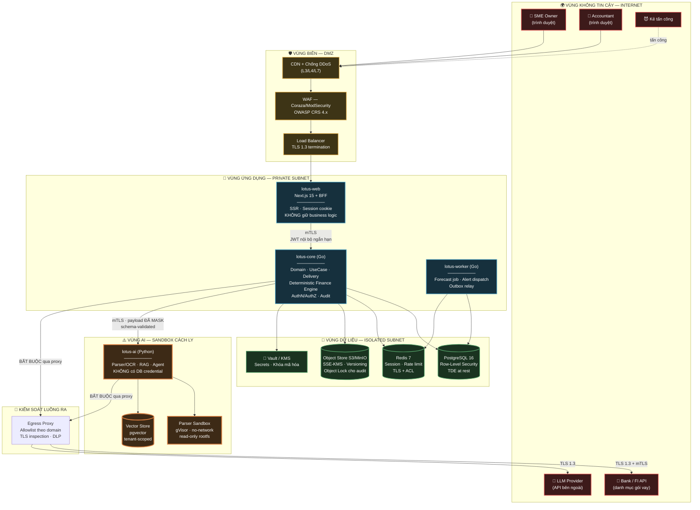
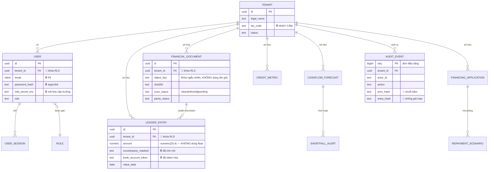
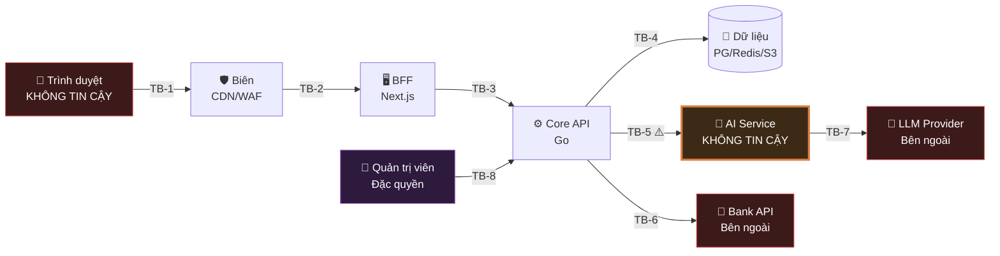
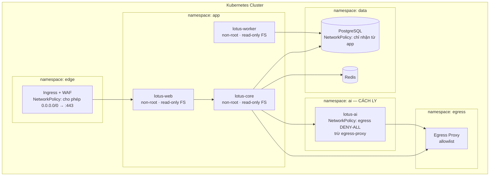

# 01 — Kiến Trúc Hệ Thống & Phân Vùng Tin Cậy

> **Tài liệu:** Lotus Fin Security Documentation Set · **Phiên bản:** 1.0 · **Ngày:** 2026-09-18
> **Phân loại:** `INTERNAL`
> **Tài liệu này là nền tảng của toàn bộ bộ tài liệu bảo mật.** Mọi mối đe dọa trong `03` và mọi kiểm soát trong `04`–`11` đều neo vào các thành phần và ranh giới được định nghĩa ở đây.

---

## 1. Tổng quan kiến trúc

Lotus Fin được thiết kế theo mô hình **modular monolith có tách biệt tiến trình theo miền tin cậy** (trust-domain-separated modular monolith), thay vì microservices phân mảnh. Lựa chọn này xuất phát từ hai ràng buộc đồng thời:

* **Ràng buộc nghiệp vụ (ADR-001):** Clean Architecture core-first, cấm script ad-hoc, file < 200 dòng. Kiến trúc phải giữ logic nghiệp vụ tập trung ở tầng Core.
* **Ràng buộc bảo mật:** Lõi AI có bề mặt tấn công *khác hẳn về bản chất* so với lõi giao dịch — nó xử lý nội dung không tin cậy do người dùng tải lên và tương tác với mô hình ngôn ngữ phi tất định. Vì vậy nó **bắt buộc** phải nằm trong một tiến trình riêng, một container riêng, một network policy riêng.

Kết quả là **4 tiến trình có thể triển khai độc lập**, mỗi tiến trình là một miền tin cậy riêng:

| # | Thành phần | Công nghệ | Miền tin cậy | Chủ sở hữu bảo mật |
| :--- | :--- | :--- | :--- | :--- |
| 1 | **`lotus-web`** — Frontend + BFF | Next.js 15 (App Router), TypeScript | Bán tin cậy (chạy trên hạ tầng ta, phục vụ trình duyệt không tin cậy) | Tài liệu này |
| 2 | **`lotus-core`** — Backend API | Go 1.23, Clean Architecture | **Tin cậy cao** — nguồn chân lý về tài chính | Tài liệu này |
| 3 | **`lotus-worker`** — Xử lý bất đồng bộ | Go 1.23 | Tin cậy cao | Tài liệu này |
| 4 | **`lotus-ai`** — Parser/OCR + RAG + LLM Orchestrator | Python 3.12, FastAPI | **KHÔNG TIN CẬY** — xử lý nội dung thù địch | Nhóm AI Security |

> **🎯 Quyết định kiến trúc mang tính bảo mật quan trọng nhất của hệ thống:**
> `lotus-ai` được đối xử như một **dịch vụ bên ngoài không tin cậy**, dù nó chạy trong hạ tầng của chúng ta. Nó không có credential cơ sở dữ liệu, không có quyền ghi vào bất kỳ bảng nghiệp vụ nào, không có đường ra Internet trực tiếp, và mọi thứ nó trả về đều bị `lotus-core` kiểm tra lại schema trước khi sử dụng. Nếu toàn bộ `lotus-ai` bị chiếm quyền điều khiển, kẻ tấn công **vẫn không** đọc được cơ sở dữ liệu tài chính, **vẫn không** sửa được hạn mức tín dụng, và **vẫn không** gọi được ra Bank API.

---

## 2. Sơ đồ kiến trúc tổng thể



---

## 3. Đặc tả từng thành phần

### 3.1. `lotus-web` — Frontend + Backend-for-Frontend

| Thuộc tính | Giá trị |
| :--- | :--- |
| Công nghệ | Next.js 15 App Router · TypeScript strict · React Server Components |
| UI | shadcn/ui (Radix primitives) · Tailwind CSS · Recharts cho biểu đồ dòng tiền |
| Quản lý trạng thái | TanStack Query (server state) · nuqs (URL state) — **không** dùng global client store cho dữ liệu tài chính |
| Kiểu triển khai | Node.js runtime server (**không** static export — BFF cần tiến trình server) |
| Vai trò bảo mật | Giữ phiên người dùng · Là **điểm duy nhất** trình duyệt được phép gọi · Không chứa business logic |

**Vì sao bắt buộc phải có lớp BFF (đây là quyết định bảo mật, không phải quyết định tiện lợi):**

Nếu để trình duyệt gọi thẳng `lotus-core`, ta buộc phải đưa access token vào JavaScript context. Mọi token nằm trong `localStorage` hay biến JS đều **đọc được bởi bất kỳ script nào chạy trên trang** — nghĩa là chỉ cần một lỗ hổng XSS ở bất kỳ đâu (kể cả trong một thư viện bên thứ ba) là toàn bộ token tài chính bị đánh cắp và dùng lại từ máy kẻ tấn công.

Với BFF:

* Trình duyệt chỉ giữ **cookie phiên mờ (opaque session cookie)** — `HttpOnly`, `Secure`, `SameSite=Strict`, `__Host-` prefix. JavaScript **không thể đọc** cookie này.
* Token thật (JWT nội bộ, TTL 5 phút) chỉ tồn tại **trong bộ nhớ tiến trình server của BFF**, không bao giờ rời khỏi hạ tầng.
* Một lỗ hổng XSS vẫn nguy hiểm (kẻ tấn công có thể thực hiện hành động thay mặt người dùng đang đăng nhập) nhưng **không còn đánh cắp được thông tin xác thực để dùng lại ngoài phiên** — bán kính thiệt hại giảm từ "chiếm tài khoản vĩnh viễn" xuống "lạm dụng trong phiên hiện tại".

**Ranh giới trách nhiệm của BFF — cố ý giữ mỏng:**

| BFF ĐƯỢC làm | BFF KHÔNG ĐƯỢC làm |
| :--- | :--- |
| Ánh xạ cookie phiên → JWT nội bộ | Tính toán bất kỳ chỉ số tài chính nào |
| Chuyển tiếp request sang `lotus-core` | Ra quyết định phân quyền (chỉ *phản ánh* quyết định của core để ẩn/hiện UI) |
| Render SSR, tổng hợp dữ liệu hiển thị | Truy cập trực tiếp PostgreSQL |
| Đặt security header, chống CSRF | Giữ bất kỳ secret dài hạn nào ngoài session signing key |

> ⚠️ **Nguyên tắc bất di bất dịch:** Việc ẩn một nút bấm trên giao diện **không phải** là kiểm soát bảo mật. Mọi quyết định phân quyền được thực thi ở `lotus-core` và ở tầng cơ sở dữ liệu. Giao diện chỉ phản ánh lại quyết định đó cho dễ dùng.

---

### 3.2. `lotus-core` — Backend API (Go)

Tuân thủ nghiêm ngặt Clean Architecture theo ADR-001:

```
backend/
├── cmd/
│   ├── api/main.go                    # Điểm vào HTTP server
│   └── worker/main.go                 # Điểm vào worker
├── internal/
│   ├── domain/                        # TẦNG 1 — Không phụ thuộc gì
│   │   ├── tenant/                    #   Entity + Value Object + Invariant
│   │   ├── identity/                  #   User, Role, Permission
│   │   ├── document/                  #   FinancialDocument, ParseResult
│   │   ├── ledger/                    #   Transaction, AP/AR, CashBalance
│   │   ├── forecast/                  #   CashFlowForecast, RunwayMetric
│   │   ├── creditmetric/              #   DSCR, QuickRatio, WorkingCapital
│   │   ├── financing/                 #   FinancingOffer, EligibilityRule
│   │   └── audit/                     #   AuditEvent (append-only)
│   │
│   ├── usecase/                       # TẦNG 2 — Phụ thuộc domain
│   │   ├── uploaddocument/            #   UC001
│   │   ├── forecastcashflow/          #   UC002
│   │   ├── analyzehealth/             #   UC003
│   │   ├── matchfinancing/            #   UC004
│   │   ├── copilotquery/              #   UC005
│   │   └── simulaterepayment/         #   UC006
│   │
│   ├── delivery/                      # TẦNG 3 — Vỏ ngoài
│   │   └── http/
│   │       ├── middleware/            #   AuthN, AuthZ, RateLimit, RequestID,
│   │       │                          #   SecurityHeaders, Idempotency, Recover
│   │       ├── handler/               #   Controller mỏng — chỉ parse/validate/gọi
│   │       └── dto/                   #   Request/Response, tách biệt khỏi domain
│   │
│   └── infra/                         # TẦNG 4 — Chi tiết kỹ thuật
│       ├── postgres/                  #   sqlc-generated, KHÔNG nối chuỗi SQL
│       ├── redis/                     #   Session store, rate limiter
│       ├── objectstore/               #   S3/MinIO client
│       ├── crypto/                    #   Envelope encryption, KMS client
│       ├── aiclient/                  #   Client gọi lotus-ai + validate schema
│       └── bankclient/                #   Client gọi Bank API, mTLS
└── migrations/                        # goose — có cả RLS policy
```

**Vì sao cấu trúc này quan trọng về mặt bảo mật:** Hướng phụ thuộc chỉ đi vào trong. `domain` không import `infra`. Điều đó có nghĩa **bất biến nghiệp vụ (business invariant) không thể bị lách bằng cách đi vòng qua đường khác** — không tồn tại một lối tắt nào cho phép ghi thẳng vào `ledger` mà bỏ qua rule kiểm tra trong domain. Trong hệ thống tài chính, đây chính là thứ ngăn "script tiện tay vá dữ liệu" trở thành lỗ hổng toàn vẹn dữ liệu — cũng chính là lý do ADR-001 cấm tuyệt đối script ad-hoc.

**Thư viện chủ chốt và lý do chọn theo góc nhìn bảo mật:**

| Mục đích | Lựa chọn | Lý do bảo mật |
| :--- | :--- | :--- |
| HTTP router | `chi` hoặc `echo` | Middleware chain tường minh, dễ audit thứ tự kiểm soát |
| Truy cập DB | `pgx` + **`sqlc`** | sqlc sinh code Go từ SQL viết sẵn → **triệt tiêu SQL injection ở cấp kiến trúc**, không phụ thuộc kỷ luật lập trình viên |
| Validation | `go-playground/validator` + validate trong domain | Hai lớp: cú pháp ở DTO, ngữ nghĩa ở domain |
| JWT | `go-jose` hoặc `golang-jwt/jwt/v5` | Bắt buộc khai báo thuật toán kỳ vọng → chặn tấn công `alg: none` và nhầm lẫn thuật toán |
| Mật khẩu | `argon2id` (`golang.org/x/crypto/argon2`) | Chống tấn công GPU/ASIC tốt hơn bcrypt |
| Hàng đợi job | **River** (job queue trên Postgres) | Cùng transaction với dữ liệu nghiệp vụ → không có cửa sổ "job chạy nhưng dữ liệu rollback" |
| Quan trắc | OpenTelemetry | Trace xuyên suốt phục vụ điều tra sự cố |

---

### 3.3. `lotus-worker` — Xử lý bất đồng bộ

Đảm nhiệm các tác vụ **không được phép chạy trong vòng đời request**:

| Job | Kích hoạt | Ghi chú bảo mật |
| :--- | :--- | :--- |
| `document.parse.dispatch` | Sau khi upload | Gọi `lotus-ai`, áp timeout cứng và giới hạn tài nguyên |
| `forecast.recompute` | Theo lịch (nightly) + khi có dữ liệu mới | Chạy dưới định danh hệ thống, **vẫn bị RLS ràng buộc theo tenant** |
| `alert.shortfall.dispatch` | Khi forecast vượt ngưỡng | Nội dung email **không chứa số liệu tài chính chi tiết** — chỉ chứa liên kết đăng nhập |
| `audit.chain.seal` | Mỗi giờ | Niêm phong chuỗi băm nhật ký kiểm toán lên WORM storage |
| `outbox.relay` | Liên tục | Đảm bảo giao hàng ít nhất một lần cho sự kiện ra ngoài |

> **Cạm bẫy đã được xử lý có chủ đích:** Worker chạy dưới định danh hệ thống, rất dễ bị cài đặt cẩu thả thành "bỏ qua RLS cho tiện". Chúng ta **không** làm vậy. Worker đặt `SET LOCAL app.current_tenant` cho từng job dựa trên `tenant_id` của chính job đó. Một job bị lỗi logic vẫn không thể chạm sang dữ liệu tenant khác.

---

### 3.4. `lotus-ai` — Vùng AI (ngoài phạm vi tài liệu này)

Chỉ mô tả ở mức **ràng buộc mà nền tảng áp đặt lên nó**. Nội dung bên trong do nhóm AI Security đặc tả.

| Ràng buộc nền tảng áp đặt | Cơ chế thực thi |
| :--- | :--- |
| Không có credential PostgreSQL nghiệp vụ | Không cấp secret; NetworkPolicy chặn cổng 5432 tới DB nghiệp vụ |
| Không có đường ra Internet trực tiếp | NetworkPolicy egress `deny-all`, chỉ mở tới Egress Proxy |
| Không được gọi Bank API | Egress Proxy từ chối theo danh tính workload |
| Chỉ nhận dữ liệu đã che mờ | `lotus-core` masking trước khi gửi (xem `05 §7`) |
| Đầu ra bị kiểm tra lại schema | `lotus-core` validate JSON schema nghiêm ngặt, từ chối nếu sai (xem `07 §7`) |
| Chạy với quyền tối thiểu | Container non-root, read-only rootfs, drop mọi Linux capability |
| Parser chạy trong sandbox sâu hơn nữa | gVisor/Firecracker, không mạng, giới hạn CPU/RAM/thời gian cứng |

---

## 4. Mô hình dữ liệu (rút gọn — góc nhìn bảo mật)



**Ba quyết định về dữ liệu có ý nghĩa bảo mật trực tiếp:**

1. **`tenant_id` xuất hiện trên MỌI bảng nghiệp vụ** — kể cả khi có thể suy ra qua join. Đây là điều kiện tiên quyết để Row-Level Security hoạt động: RLS policy cần một cột để lọc ngay trên chính bảng đó, không thể dựa vào join.

2. **`numeric(20,4)` cho mọi giá trị tiền tệ, tuyệt đối không dùng `float`/`double`.** Số dấu phẩy động nhị phân không biểu diễn chính xác được số thập phân. Trong hệ thống tài chính, sai số tích lũy không chỉ là lỗi hiển thị — nó là **lỗ hổng toàn vẹn dữ liệu** có thể bị khai thác để làm lệch DSCR qua nhiều giao dịch nhỏ, từ đó vượt qua ngưỡng xét duyệt tín dụng.

3. **`AUDIT_EVENT` dùng chuỗi băm liên kết (`prev_hash` → `entry_hash`)** — biến nhật ký kiểm toán thành cấu trúc chống giả mạo. Kẻ tấn công có quyền ghi DB muốn xóa dấu vết sẽ phải tính lại toàn bộ chuỗi từ điểm sửa trở đi, và vẫn sẽ lệch so với bản niêm phong định kỳ trên WORM storage. Chi tiết tại `09 §3`.

---

## 5. 🛡️ Phân vùng tin cậy (Trust Boundaries)

Đây là **phần quan trọng nhất của tài liệu này**. Mỗi ranh giới là một nơi dữ liệu đổi mức tin cậy — và đó chính xác là nơi mối đe dọa phát sinh. Tài liệu `03` sẽ phân tích STRIDE cho từng ranh giới.



| ID | Ranh giới | Dữ liệu đi qua | Rủi ro cốt lõi | Kiểm soát chính | Chi tiết |
| :--- | :--- | :--- | :--- | :--- | :--- |
| **TB-1** | Internet → Biên | HTTP request thô | DDoS · Bot · Payload thù địch | CDN chống DDoS · WAF OWASP CRS · Rate limit theo IP · TLS 1.3 | `08 §3` |
| **TB-2** | Biên → BFF | Request đã lọc + cookie phiên | Chiếm phiên · CSRF · XSS | Cookie `__Host-` HttpOnly/Secure/SameSite=Strict · CSP nonce · Double-submit CSRF token | `04 §4`, `06 §4` |
| **TB-3** | BFF → Core API | JWT nội bộ + payload nghiệp vụ | Giả mạo danh tính · Leo thang đặc quyền | mTLS giữa workload · JWT ES256 TTL 5 phút · Xác thực `aud`/`iss` · **Phân quyền tái kiểm tra ở tầng UseCase** | `04 §5` |
| **TB-4** | Core API → Dữ liệu | Truy vấn SQL · Blob · Khóa phiên | SQL injection · Rò rỉ chéo tenant · Trộm dữ liệu khi nghỉ | sqlc (không nối chuỗi SQL) · **PostgreSQL RLS** · TLS tới DB · SSE-KMS · Tài khoản DB quyền tối thiểu | `04 §5.3`, `05 §5` |
| **TB-5** | 🔥 Core API → AI Service | Dữ liệu tài chính **đã che mờ** | **Rò rỉ dữ liệu ra LLM · Trả về kết quả bị thao túng · Nhiễm độc từ tài liệu người dùng** | Masking/tokenization bắt buộc trước khi gửi · mTLS · **Validate schema đầu ra** · **LLM không bao giờ sinh con số tài chính** · AI không có quyền DB | `07 §7` |
| **TB-6** | Core API → Bank API | Hồ sơ vay · Truy vấn danh mục gói vay | Giả mạo request · Phát lại (replay) · MITM | mTLS chứng chỉ khách hàng · Ký request HMAC-SHA256 · `Idempotency-Key` · Ghim chứng chỉ (pinning) · Qua Egress Proxy | `07 §6` |
| **TB-7** | AI Service → LLM Provider | Prompt đã che mờ | Rò rỉ dữ liệu nhạy cảm ra bên thứ ba | Egress Proxy allowlist · DLP quét luồng ra · Thỏa thuận không dùng dữ liệu để huấn luyện · Ghi log toàn bộ prompt để kiểm toán | `08 §5` + *tài liệu AI Security* |
| **TB-8** | Quản trị viên → Hệ thống | Lệnh vận hành · Truy cập production | Lạm quyền nội bộ · Chiếm tài khoản quản trị | MFA chống lừa đảo (WebAuthn) · Just-in-Time access · Bastion ghi hình phiên · Quy trình break-glass 4 mắt | `04 §7` |

---

## 6. Bề mặt API (API Surface)

Tuân theo [API Design Conventions](../API_DESIGN_CONVENTIONS.md). Cột **Phân quyền** tham chiếu ma trận RBAC tại `04 §4.3`.

| Method & Endpoint | UC | Vai trò được phép | Kiểm soát bảo mật đặc thù |
| :--- | :--- | :--- | :--- |
| `POST /api/v1/auth/sessions` | — | Ẩn danh | Rate limit chặt · Chống dò tài khoản · Argon2id · Khóa tài khoản lũy tiến |
| `POST /api/v1/auth/mfa-challenges` | — | Đã xác thực một phần | TOTP/WebAuthn · Chống replay code |
| `DELETE /api/v1/auth/sessions/current` | — | Mọi vai trò | Thu hồi phiên phía server (không chỉ xóa cookie) |
| `POST /api/v1/documents` | UC001 | OWNER, ACCOUNTANT | Giới hạn 25MB · Kiểm tra magic byte · Quét virus · Sandbox parser · Chống zip bomb |
| `GET /api/v1/documents/{id}` | UC001 | OWNER, ACCOUNTANT, VIEWER | RLS · URL ký tạm thời TTL 60s · `Content-Disposition: attachment` |
| `GET /api/v1/forecasts` | UC002 | Mọi vai trò trong tenant | RLS · Chống liệt kê ID (dùng UUIDv7) |
| `POST /api/v1/forecasts/recalculations` | UC002 | OWNER, ACCOUNTANT | Rate limit theo chi phí tính toán · Idempotency |
| `GET /api/v1/credit-metrics` | UC003 | OWNER, ACCOUNTANT, VIEWER | Số liệu **do Deterministic Engine sinh**, không phải LLM |
| `POST /api/v1/analysis-reports` | UC003 | OWNER, ACCOUNTANT | LLM chỉ diễn giải · Đầu ra qua kiểm duyệt · Có watermark nguồn dữ liệu |
| `GET /api/v1/financing-offers` | UC004 | **OWNER** | Gọi Bank API qua Egress Proxy · Cache có phân vùng theo tenant |
| `POST /api/v1/financing-applications` | UC004 | **OWNER** (bắt buộc MFA lại) | Step-up authentication · `Idempotency-Key` bắt buộc · Audit `HIGH` |
| `POST /api/v1/copilot/messages` | UC005 | OWNER, ACCOUNTANT | **Guardrail AI (nhóm AI)** · Rate limit theo token · Masking trước khi gửi · Log toàn bộ |
| `POST /api/v1/repayment-scenarios` | UC006 | OWNER | Tính toán tất định · Bảo vệ khỏi tấn công tham số (lãi suất âm, kỳ hạn phi lý) |
| `GET /api/v1/audit-logs` | — | **OWNER** | Chỉ đọc · Không thể xóa qua API · Bản thân việc đọc cũng bị audit |
| `POST /api/v1/webhooks/bank` | UC004 | Chỉ Bank (mTLS) | Xác thực HMAC-SHA256 · Chống replay bằng timestamp + nonce · So sánh chuỗi thời gian hằng định |

---

## 7. Hồ sơ triển khai (Deployment Profile)



| Môi trường | Mục đích | Dữ liệu | Khác biệt về kiểm soát |
| :--- | :--- | :--- | :--- |
| `local` | Phát triển | Dữ liệu tổng hợp (synthetic) | **Cấm tuyệt đối** dữ liệu production |
| `staging` | Kiểm thử tích hợp & bảo mật | Dữ liệu đã ẩn danh hóa | Cấu hình *giống hệt* production — nếu khác, kết quả kiểm thử bảo mật vô nghĩa |
| `production` | Vận hành thật | Dữ liệu thật | Đầy đủ kiểm soát · Truy cập Just-in-Time · Đóng băng thay đổi ngoài giờ |

---

## 8. Giả định & Ràng buộc (Assumptions & Constraints)

Ghi lại tường minh vì **giả định không được ghi ra chính là lỗ hổng chưa bị phát hiện**.

| # | Giả định | Nếu sai thì sao | Cách xác minh |
| :--- | :--- | :--- | :--- |
| A1 | Nhà cung cấp LLM không dùng dữ liệu gửi lên để huấn luyện | Rò rỉ dữ liệu tài chính SME ra mô hình công cộng | Điều khoản hợp đồng + chọn endpoint enterprise/zero-retention |
| A2 | Bank API cung cấp mTLS và ký webhook | Không thể xác thực nguồn gốc dữ liệu tài trợ vốn | Xác nhận trong tài liệu tích hợp trước khi kết nối |
| A3 | `lotus-ai` **có thể** bị xâm phạm | — (đây là giả định phòng thủ, thiết kế đã tính) | Kiểm thử xâm nhập mô phỏng AI bị chiếm quyền |
| A4 | Nhà cung cấp hạ tầng đảm bảo an toàn vật lý | Mất kiểm soát ở tầng dưới | Chứng chỉ ISO 27001/SOC 2 của nhà cung cấp |
| A5 | Hệ thống **không** lưu dữ liệu chủ thẻ (CHD) | Phạm vi PCI DSS mở rộng đột ngột | Rà soát schema định kỳ + quét DLP (xem `12 §1`) |

| # | Ràng buộc | Tác động tới bảo mật |
| :--- | :--- | :--- |
| C1 | ADR-001: file < 200 dòng | **Có lợi** — middleware bảo mật nhỏ, dễ review kỹ |
| C2 | ADR-001: cấm script ad-hoc | **Có lợi** — không tồn tại đường ghi dữ liệu vòng qua kiểm soát |
| C3 | Ngoài phạm vi: không giải ngân thật | Giảm mạnh phạm vi PCI DSS (xem `12 §1`) |
| C4 | Copilot p95 ≤ 3s (SRS §4.3) | Guardrail và masking phải có ngân sách độ trễ — không được là lý do để cắt bỏ kiểm soát |
| C5 | SLO ≥ 99.5% (SRS §4.2) | Kiểm soát bảo mật không được trở thành điểm chết đơn lẻ |

---

## 9. Điều hướng

| ← Trước | Tiếp theo → |
| :--- | :--- |
| [README — Tổng quan bộ tài liệu](README.md) | [02 — Kiểm kê tài sản & Phân loại dữ liệu](02-data-classification-assets.md) |
