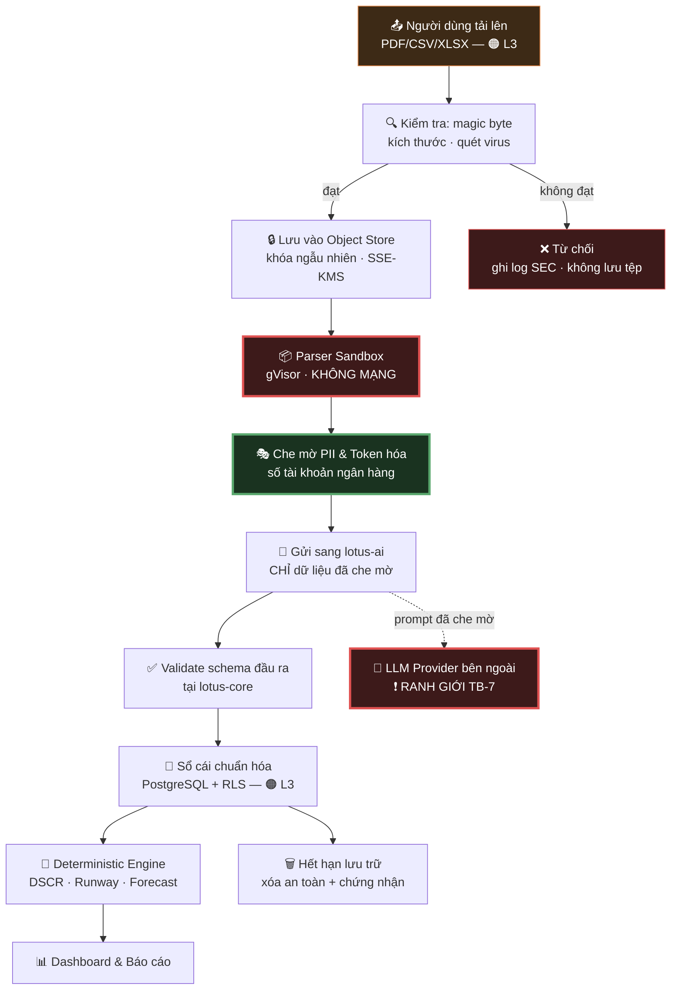

# 02 — Kiểm Kê Tài Sản & Phân Loại Dữ Liệu

> **Tài liệu:** Lotus Fin Security Documentation Set · **Phiên bản:** 1.0 · **Ngày:** 2026-09-18
> **Phân loại:** `INTERNAL`
> **Ánh xạ chuẩn:** ISO/IEC 27001:2022 — A.5.9 (Inventory of information), A.5.10 (Acceptable use), A.5.12 (Classification of information), A.5.13 (Labelling), A.5.14 (Information transfer) · PCI DSS v4.0.1 — Req 3, Req 9.4, Req 12.5.1

---

## 1. Vì sao tài liệu này đứng trước Threat Model

Không thể mô hình hóa mối đe dọa cho thứ chưa biết là mình sở hữu. Thứ tự bắt buộc là: **biết mình có gì → biết nó đáng giá bao nhiêu → mới xác định được ai muốn lấy nó và bằng cách nào.**

Đây cũng chính là lý do khoản mục đầu tiên của ISO/IEC 27001 Annex A về tài sản (A.5.9) là *kiểm kê*, chứ không phải *bảo vệ*. Bảo vệ một cách đồng đều mọi thứ là cách chắc chắn nhất để bảo vệ sai chỗ: chi phí dồn vào dữ liệu ít giá trị trong khi dữ liệu quyết định sự sống còn lại được canh giữ ngang mức với ảnh logo công ty.

---

## 2. Thang phân loại dữ liệu (Data Classification Scheme)

Lotus Fin dùng **4 mức**. Bốn mức là con số có chủ ý: ba mức quá thô để tách biệt dữ liệu tài chính khỏi PII thông thường, năm mức trở lên thì trong thực tế người dùng sẽ phân loại sai vì ranh giới quá mong manh.

| Mức | Nhãn | Định nghĩa | Hậu quả nếu lộ | Ví dụ trong Lotus Fin |
| :--- | :--- | :--- | :--- | :--- |
| **L4** | 🔴 `RESTRICTED` | Lộ ra gây thiệt hại tài chính trực tiếp hoặc chấm dứt hoạt động kinh doanh | Nghiêm trọng, không thể khắc phục | Số tài khoản ngân hàng · Hash mật khẩu · Khóa mã hóa (DEK/KEK) · MFA secret · Chứng chỉ mTLS tới Bank API · Khóa ký webhook |
| **L3** | 🟠 `CONFIDENTIAL` | Bí mật kinh doanh của tenant; lộ ra gây bất lợi cạnh tranh hoặc tổn hại quan hệ tín dụng | Nặng, khắc phục được một phần | Báo cáo tài chính · Sổ cái giao dịch · DSCR & chỉ số tín dụng · Dự báo dòng tiền · Hồ sơ xin cấp vốn · Nội dung hội thoại Copilot |
| **L2** | 🟡 `INTERNAL` | Dữ liệu vận hành nội bộ hệ thống | Trung bình | Nhật ký ứng dụng (đã lọc) · Metric hiệu năng · Cấu hình không chứa secret · Tài liệu thiết kế |
| **L1** | 🟢 `PUBLIC` | Công bố được mà không gây hại | Không đáng kể | Trang marketing · Tài liệu API công khai · Điều khoản dịch vụ |

### 2.1. Quy tắc suy diễn (Derivation Rule) — điểm hay bị bỏ sót

> **Dữ liệu dẫn xuất thừa hưởng mức phân loại cao nhất trong các nguồn tạo ra nó.**

Đây là quy tắc thường bị vi phạm nhất trong thực tế, và nó là nguồn gốc của rất nhiều vụ rò rỉ. Ví dụ cụ thể trong Lotus Fin:

* Chỉ số DSCR là một con số duy nhất, trông vô hại. Nhưng nó được tính từ sổ cái giao dịch (`L3`) → **DSCR là `L3`**, không phải `L2`.
* Một biểu đồ dự báo dòng tiền xuất ra PNG vẫn là `L3` — định dạng tệp không làm thay đổi độ nhạy cảm của thông tin.
* Một embedding vector sinh từ báo cáo tài chính là `L3`, **không phải `L2`**. Nhiều đội coi vector là "chỉ là dãy số" và lưu nó ở nơi kiểm soát lỏng hơn. Embedding có thể bị đảo ngược một phần để phục hồi nội dung gốc — nó là dữ liệu tài chính ở dạng nén, không phải dữ liệu ẩn danh.
* Bản ghi hội thoại Copilot là `L3` vì câu trả lời có trích dẫn số liệu thật, **và** câu hỏi của người dùng tự nó đã tiết lộ tình hình kinh doanh ("tháng sau tôi có trả nổi nợ không").

---

## 3. Kiểm kê tài sản thông tin (Information Asset Inventory)

### 3.1. Tài sản dữ liệu

| ID | Tài sản | Mức | Nơi lưu | Mã hóa khi nghỉ | Thời hạn lưu | Chủ sở hữu |
| :--- | :--- | :--- | :--- | :--- | :--- | :--- |
| `AS-D01` | Tệp tài chính gốc tải lên (PDF/CSV/XLSX) | 🟠 L3 | Object Store, khóa ngẫu nhiên | SSE-KMS (AES-256) | 7 năm *(nghĩa vụ lưu chứng từ kế toán)* | Tenant |
| `AS-D02` | Sổ cái đã chuẩn hóa (`ledger_entry`) | 🟠 L3 | PostgreSQL | TDE + mã hóa cấp trường cho cột nhạy cảm | 7 năm | Tenant |
| `AS-D03` | Số tài khoản ngân hàng | 🔴 L4 | PostgreSQL — **chỉ lưu dạng token** | Token hóa (vault riêng) | Theo vòng đời tenant | Tenant |
| `AS-D04` | Chỉ số tín dụng (DSCR, Quick Ratio…) | 🟠 L3 | PostgreSQL | TDE | 3 năm | Tenant |
| `AS-D05` | Dự báo dòng tiền & kịch bản stress-test | 🟠 L3 | PostgreSQL | TDE | 3 năm | Tenant |
| `AS-D06` | Hồ sơ xin cấp vốn | 🟠 L3 | PostgreSQL | TDE | 7 năm | Tenant |
| `AS-D07` | Lịch sử hội thoại Copilot | 🟠 L3 | PostgreSQL | TDE | 1 năm | Tenant |
| `AS-D08` | Chỉ mục vector RAG (embedding) | 🟠 L3 | pgvector, phân vùng theo tenant | TDE | Đồng bộ vòng đời nguồn | Tenant |
| `AS-D09` | Tài khoản người dùng & hash mật khẩu | 🔴 L4 | PostgreSQL | Argon2id (hash, không phải mã hóa) | Vòng đời tài khoản + 90 ngày | Nền tảng |
| `AS-D10` | MFA secret (TOTP) | 🔴 L4 | PostgreSQL | Mã hóa cấp trường bằng KMS | Vòng đời tài khoản | Nền tảng |
| `AS-D11` | Phiên đăng nhập | 🟠 L3 | Redis | TLS khi truyền + mã hóa khi nghỉ | TTL 8 giờ trượt / tối đa 24 giờ | Nền tảng |
| `AS-D12` | Nhật ký kiểm toán | 🟠 L3 | PostgreSQL + WORM S3 | Bất biến, chuỗi băm | **10 năm — không thể xóa** | Nền tảng |
| `AS-D13` | Nhật ký ứng dụng | 🟡 L2 | Loki/CloudWatch | Mã hóa khi nghỉ | 90 ngày | Nền tảng |
| `AS-D14` | Bản sao lưu cơ sở dữ liệu | 🟠 L3 | Object Store vùng khác | AES-256, khóa riêng biệt với khóa production | 35 ngày | Nền tảng |

### 3.2. Tài sản bí mật (Secrets) — luôn là 🔴 L4

| ID | Bí mật | Nơi lưu | Chu kỳ luân chuyển | Ai truy cập được |
| :--- | :--- | :--- | :--- | :--- |
| `AS-S01` | Khóa gốc mã hóa (KEK) | KMS/HSM — **không bao giờ rời khỏi KMS** | 1 năm | Không con người nào (chỉ dịch vụ) |
| `AS-S02` | Khóa mã hóa dữ liệu (DEK) | Sinh theo tenant, lưu dạng đã bọc (wrapped) | 90 ngày | `lotus-core` |
| `AS-S03` | Khóa ký JWT (ES256) | Vault | 30 ngày, có chồng lấn qua JWKS | `lotus-core` |
| `AS-S04` | Khóa ký cookie phiên | Vault | 90 ngày | `lotus-web` |
| `AS-S05` | Mật khẩu PostgreSQL | Vault, sinh động qua database engine | 24 giờ | `lotus-core`, `lotus-worker` |
| `AS-S06` | Chứng chỉ mTLS tới Bank API | Vault PKI | 90 ngày | `lotus-core` |
| `AS-S07` | Bí mật ký webhook (HMAC) | Vault | 180 ngày, hỗ trợ 2 khóa song song | `lotus-core` |
| `AS-S08` | API key nhà cung cấp LLM | Vault | 90 ngày | `lotus-ai` **(chỉ mình nó)** |

> **Nguyên tắc thực thi:** Không một bí mật nào tồn tại trong biến môi trường tĩnh, tệp `.env` trên máy chủ, hay mã nguồn. Ứng dụng lấy bí mật lúc khởi động qua Vault Agent / CSI driver và nạp vào bộ nhớ. `.gitignore` của dự án đã chặn `.env` — nhưng đó là lưới an toàn cuối cùng, **không phải** cơ chế chính.

### 3.3. Tài sản hệ thống

| ID | Tài sản | Mức độ trọng yếu | RTO | RPO |
| :--- | :--- | :--- | :--- | :--- |
| `AS-C01` | `lotus-core` (API) | 🔴 Sống còn | 15 phút | 0 |
| `AS-C02` | PostgreSQL primary | 🔴 Sống còn | 30 phút | 5 phút |
| `AS-C03` | `lotus-web` (BFF/UI) | 🟠 Cao | 15 phút | 0 |
| `AS-C04` | Redis (phiên) | 🟠 Cao | 10 phút | 15 phút *(mất phiên = buộc đăng nhập lại, chấp nhận được)* |
| `AS-C05` | Object Store | 🟠 Cao | 1 giờ | 0 *(versioning)* |
| `AS-C06` | `lotus-ai` | 🟡 Trung bình | 4 giờ | N/A *(suy giảm chức năng có kiểm soát)* |
| `AS-C07` | `lotus-worker` | 🟡 Trung bình | 2 giờ | 0 *(job bền vững trong Postgres)* |
| `AS-C08` | Vault/KMS | 🔴 Sống còn | 15 phút | 0 |

> **Ghi chú thiết kế về `AS-C06`:** `lotus-ai` được xếp mức trọng yếu **trung bình**, không phải sống còn — đây là lựa chọn kiến trúc có chủ ý. Khi dịch vụ AI ngừng hoạt động, hệ thống vẫn phải phục vụ đầy đủ: người dùng vẫn xem được dashboard, chỉ số DSCR, dự báo dòng tiền và cảnh báo thâm hụt, vì tất cả những thứ đó do Deterministic Engine tính. Chỉ phần diễn giải bằng ngôn ngữ tự nhiên và Copilot chat bị tạm ngưng, kèm thông báo rõ ràng cho người dùng. Đây vừa là thiết kế về độ sẵn sàng (đáp ứng SLO 99.5% mà không phụ thuộc vào một dịch vụ bên thứ ba), vừa là **kiểm soát bảo mật**: nó cho phép chúng ta *chủ động ngắt* dịch vụ AI khi phát hiện tấn công mà không làm sập nền tảng.

---

## 4. Vòng đời dữ liệu & nơi dữ liệu đi qua

**Ba điểm nghẽn bảo mật (security choke point) trong luồng trên** — mỗi điểm là nơi một lớp phòng thủ được ép buộc, không thể đi vòng:

1. **Bước B — Cổng kiểm tra đầu vào.** Tệp chưa qua bước này không bao giờ chạm tới lưu trữ bền vững. Tệp bị từ chối *không được lưu lại* — vì lưu tệp độc hại vào object store sẽ biến chính kho lưu trữ của ta thành nơi phát tán mã độc.

2. **Bước D — Sandbox giải mã tệp.** Đây là nơi nguy hiểm nhất toàn hệ thống: mã của ta (thực chất là thư viện parse PDF/Excel của bên thứ ba) đang xử lý byte do kẻ tấn công kiểm soát hoàn toàn. Lịch sử CVE của các thư viện parse PDF là một chuỗi dài lỗi thực thi mã tùy ý. Vì vậy bước này chạy trong sandbox nhân cách ly, **không có mạng**, rootfs chỉ đọc, giới hạn CPU/RAM/thời gian cứng. Giả định vận hành là: *quá trình parse sẽ có lúc bị chiếm quyền thực thi* — và khi đó kẻ tấn công không có gì để làm tiếp.

3. **Bước E — Cổng che mờ dữ liệu.** Đây là ranh giới `TB-5`. Sau bước này, dữ liệu rời khỏi vùng tin cậy cao. Việc che mờ **không phải tùy chọn cấu hình** mà là một bước bắt buộc trong pipeline: `lotus-core` không có đường code nào gửi dữ liệu sang `lotus-ai` mà không đi qua hàm masking (chi tiết tại `05 §7.2`).

---

## 5. Ma trận nơi lưu trữ dữ liệu (Data Residency Matrix)

Trả lời câu hỏi kiểm toán viên luôn hỏi: *"Dữ liệu `RESTRICTED` của tôi có thể xuất hiện ở đâu?"*

| Kho lưu trữ | L4 🔴 | L3 🟠 | L2 🟡 | Ghi chú |
| :--- | :---: | :---: | :---: | :--- |
| PostgreSQL (vùng data) | ✅ *(đã mã hóa cấp trường)* | ✅ | ✅ | RLS bắt buộc trên mọi bảng nghiệp vụ |
| Object Store | ❌ | ✅ | ✅ | SSE-KMS · Object Lock cho audit |
| Redis | ❌ | ✅ *(chỉ định danh phiên)* | ✅ | **Không bao giờ** chứa số liệu tài chính |
| Vector Store (pgvector) | ❌ | ✅ | ✅ | Phân vùng cứng theo tenant |
| Nhật ký ứng dụng | ❌ **CẤM** | ❌ **CẤM** | ✅ | Có bộ lọc bắt buộc — xem `09 §2` |
| Hệ thống APM/Tracing | ❌ **CẤM** | ❌ **CẤM** | ✅ | Chỉ ID và metadata, không có payload |
| Bản sao lưu | ✅ | ✅ | ✅ | Khóa mã hóa tách biệt khỏi production |
| LLM Provider bên ngoài | ❌ **CẤM** | ⚠️ **Chỉ dạng đã che mờ** | ✅ | Ranh giới `TB-7` |
| Máy trạm lập trình viên | ❌ **CẤM** | ❌ **CẤM** | ✅ | Chỉ dữ liệu tổng hợp |
| Kênh chat / email nội bộ | ❌ **CẤM** | ❌ **CẤM** | ✅ | Kể cả khi xử lý sự cố — dùng liên kết, không dán dữ liệu |

> **Hàng quan trọng nhất của bảng này là hàng "Nhật ký ứng dụng".** Rò rỉ qua log là con đường rò rỉ dữ liệu tài chính phổ biến nhất trong thực tế, và cũng là con đường âm thầm nhất: không ai tấn công gì cả, chỉ là một câu `log.Printf("payload: %+v", req)` viết lúc debug rồi quên gỡ. Từ đó dữ liệu `L3` chảy vào hệ thống log — nơi có chính sách lưu trữ khác, kiểm soát truy cập lỏng hơn, và thường được đẩy sang một nhà cung cấp SaaS bên thứ ba. Biện pháp cưỡng chế bằng kỹ thuật được mô tả tại `09 §2`.

---

## 6. Quy tắc lưu trữ & xóa dữ liệu (Retention & Disposal)

| Loại dữ liệu | Thời hạn | Căn cứ | Cách xóa |
| :--- | :--- | :--- | :--- |
| Chứng từ tài chính | 7 năm | Nghĩa vụ lưu trữ chứng từ kế toán | Xóa mềm → hết hạn → xóa vật lý + xóa khóa mã hóa |
| Nhật ký kiểm toán | 10 năm | Yêu cầu điều tra & tuân thủ | **Không thể xóa** trong thời hạn (WORM Object Lock) |
| Hội thoại Copilot | 1 năm | Nhu cầu vận hành | Xóa vật lý theo lịch |
| Phiên đăng nhập | 24 giờ | Kiểm soát bảo mật | TTL Redis tự động |
| Nhật ký ứng dụng | 90 ngày | Nhu cầu vận hành | Xoay vòng tự động |
| Bản sao lưu | 35 ngày | Khôi phục thảm họa | Hết hạn tự động theo vòng đời đối tượng |
| Tài khoản đã đóng | 90 ngày sau khi đóng | Cửa sổ khôi phục nhầm lẫn | Ẩn danh hóa PII, giữ lại bản ghi tài chính theo nghĩa vụ luật định |

### 6.1. Xóa bằng cách hủy khóa (Crypto-Shredding)

Với dữ liệu `L3`/`L4` được mã hóa bằng DEK riêng theo tenant, hành động xóa dứt điểm là **hủy DEK của tenant đó**. Điều này giải quyết một vấn đề mà việc "xóa bản ghi" không bao giờ giải quyết được: dữ liệu đã nằm trong các bản sao lưu cũ.

Bạn không thể đi vào từng bản sao lưu lịch sử để xóa một dòng — bản sao lưu là ảnh chụp bất biến, và việc sửa chúng sẽ phá vỡ chính tính toàn vẹn khiến chúng có giá trị. Nhưng khi DEK bị hủy, mọi bản sao lưu chứa dữ liệu đã mã hóa của tenant đó **trở thành dữ liệu rác không thể phục hồi** — kể cả khi kẻ tấn công lấy được toàn bộ file backup.

> **Điều kiện tiên quyết bắt buộc:** Cơ chế này chỉ hiệu lực nếu DEK được phân tách theo tenant **ngay từ ngày đầu**. Không thể trang bị bổ sung về sau cho dữ liệu đã mã hóa bằng khóa dùng chung. Đây là lý do `05 §3.1` đặt phân tách khóa theo tenant làm quyết định thiết kế nền tảng, chứ không phải tối ưu hóa để dành cho giai đoạn sau.

---

## 7. Chủ sở hữu & trách nhiệm (RACI rút gọn)

| Hoạt động | Security Lead | Backend Lead | Frontend Lead | DevOps | Nhóm AI |
| :--- | :---: | :---: | :---: | :---: | :---: |
| Duy trì kiểm kê tài sản | **A/R** | C | C | C | C |
| Gán nhãn phân loại dữ liệu | **A** | R | R | C | R |
| Thực thi masking trước `TB-5` | **A** | **R** | I | I | C |
| Quản lý vòng đời khóa | **A** | C | I | **R** | I |
| Thực thi chính sách lưu trữ | **A** | R | I | R | I |
| Kiểm soát bảo mật pipeline AI | C | C | I | I | **A/R** |

*(A = Chịu trách nhiệm cuối cùng · R = Thực hiện · C = Được hỏi ý kiến · I = Được thông báo)*

---

## 8. Điều hướng

| ← Trước | Tiếp theo → |
| :--- | :--- |
| [01 — Kiến trúc hệ thống](01-system-architecture.md) | [03 — Mô hình mối đe dọa STRIDE](03-threat-model-stride.md) |
