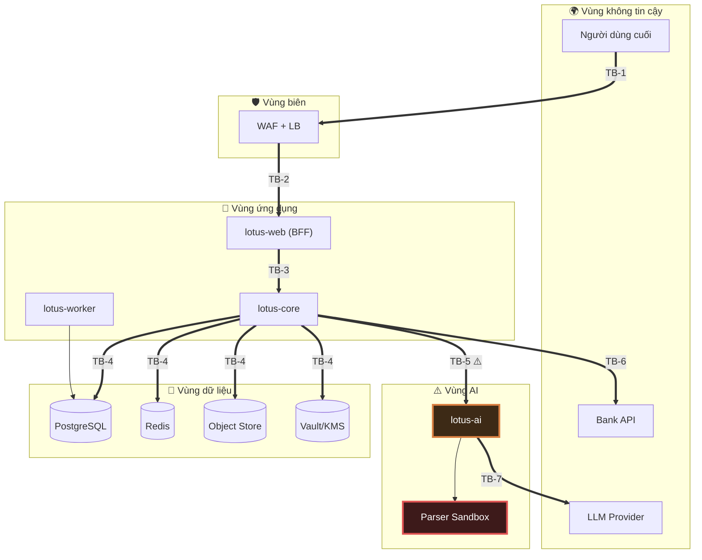
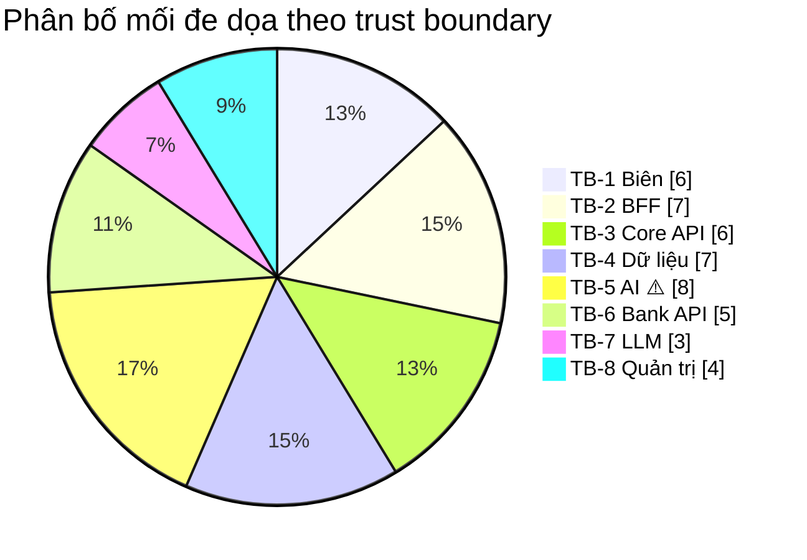

# 03 — Mô Hình Mối Đe Dọa STRIDE

> **Tài liệu:** Lotus Fin Security Documentation Set · **Phiên bản:** 1.0 · **Ngày:** 2026-09-18
> **Phân loại:** `INTERNAL`
> **Phương pháp:** Microsoft STRIDE trên Data Flow Diagram · Xếp hạng rủi ro theo CVSS v3.1
> **Ánh xạ chuẩn:** ISO/IEC 27001:2022 — A.5.7 (Threat intelligence), A.8.8 (Management of technical vulnerabilities), A.8.25 (Secure development lifecycle) · PCI DSS v4.0.1 — Req 6.2, Req 12.3.1

---

## 1. Phương pháp luận

### 1.1. Vì sao chọn STRIDE

STRIDE phân loại mối đe dọa theo **thuộc tính bảo mật bị vi phạm**, không theo kỹ thuật tấn công. Đây là khác biệt quyết định: danh sách kỹ thuật tấn công thì vô hạn và lỗi thời liên tục, còn số thuộc tính bảo mật có thể bị vi phạm thì hữu hạn và ổn định. Một mô hình xây trên STRIDE năm nay vẫn đúng cấu trúc vào năm sau, chỉ cần cập nhật phần kỹ thuật cụ thể.

| Chữ | Mối đe dọa | Vi phạm thuộc tính | Câu hỏi cần trả lời |
| :--- | :--- | :--- | :--- |
| **S** | Spoofing — Giả mạo danh tính | Xác thực (Authentication) | Kẻ tấn công có thể giả làm ai đó khác không? |
| **T** | Tampering — Can thiệp dữ liệu | Toàn vẹn (Integrity) | Có thể sửa dữ liệu khi truyền hoặc khi nghỉ không? |
| **R** | Repudiation — Chối bỏ hành vi | Không thể chối bỏ (Non-repudiation) | Có thể phủ nhận đã làm điều gì đó không? |
| **I** | Information Disclosure — Lộ thông tin | Bảo mật (Confidentiality) | Có thể đọc thứ không được phép đọc không? |
| **D** | Denial of Service — Từ chối dịch vụ | Sẵn sàng (Availability) | Có thể làm hệ thống ngừng phục vụ không? |
| **E** | Elevation of Privilege — Leo thang đặc quyền | Phân quyền (Authorization) | Có thể làm điều vượt quá quyền hạn không? |

### 1.2. Thang xếp hạng rủi ro

Rủi ro được đánh giá **trước khi áp dụng kiểm soát (inherent risk)** để không tự đánh lừa mình. Rủi ro tồn dư sau kiểm soát ghi ở cột riêng.

| Mức | Điểm CVSS | Ý nghĩa với Lotus Fin | SLA xử lý |
| :--- | :--- | :--- | :--- |
| 🔴 `CRITICAL` | 9.0–10.0 | Rò rỉ dữ liệu tài chính đa tenant · Thao túng được quyết định tín dụng · Chiếm quyền hệ thống | Chặn phát hành · Vá trong 24 giờ |
| 🟠 `HIGH` | 7.0–8.9 | Rò rỉ dữ liệu một tenant · Chiếm tài khoản · Mất toàn vẹn sổ cái | Vá trong 7 ngày |
| 🟡 `MEDIUM` | 4.0–6.9 | Suy giảm dịch vụ · Rò rỉ metadata · Thiếu dấu vết kiểm toán | Vá trong 30 ngày |
| 🟢 `LOW` | 0.1–3.9 | Tác động hạn chế, khai thác khó | Vá trong 90 ngày |

### 1.3. Hồ sơ kẻ tấn công (Threat Actors)

Mô hình mối đe dọa vô nghĩa nếu không xác định *ai* tấn công và họ *có gì trong tay*.

| ID | Tác nhân | Động cơ | Năng lực | Điểm truy cập ban đầu |
| :--- | :--- | :--- | :--- | :--- |
| `TA-1` | Kẻ tấn công cơ hội (opportunistic) | Tiền · Ransomware | Quét tự động, khai thác CVE công khai | Internet công cộng |
| `TA-2` | **Tenant độc hại** | Đánh cắp dữ liệu đối thủ · Gian lận hạn mức vay | Có tài khoản hợp lệ, hiểu rõ ứng dụng | **Tài khoản hợp lệ trong hệ thống** |
| `TA-3` | Kẻ tấn công có chủ đích | Dữ liệu tài chính SME có giá trị cao | Kỹ thuật cao, kiên trì, có thể phishing nhân sự | Nhiều hướng |
| `TA-4` | Người trong nội bộ (vô ý hoặc cố ý) | Nhầm lẫn · Bất mãn · Bị mua chuộc | Có quyền truy cập hợp pháp vào hạ tầng | Bên trong vành đai |
| `TA-5` | Chuỗi cung ứng bị xâm phạm | Xâm nhập diện rộng | Cao — chèn mã vào thư viện phụ thuộc | Qua dependency / ảnh container |
| `TA-6` | **Tài liệu thù địch** *(tác nhân gián tiếp)* | Là vũ khí do `TA-2`/`TA-3` gửi vào | Khai thác lỗ hổng parser · Prompt injection gián tiếp | **Chức năng tải tệp lên** |

> **`TA-2` là tác nhân được chú trọng nhất trong tài liệu này.** Lý do: nền tảng SaaS đa người thuê phục vụ các SME, mà các SME trong cùng ngành thì cạnh tranh trực tiếp với nhau. Một tenant lấy được dự báo dòng tiền và hồ sơ tín dụng của tenant khác là lợi thế cạnh tranh có giá trị thương mại rõ ràng. Quan trọng hơn, `TA-2` khởi đầu **đã ở bên trong** vành đai phòng thủ — mọi kiểm soát ở tầng biên (WAF, chống DDoS, rate limit theo IP) đều vô hiệu trước tác nhân này. Chỉ có cô lập tenant ở tầng dữ liệu mới ngăn được họ.
>
> **`TA-6` là tác nhân đặc thù của hệ thống có AI.** Kẻ tấn công không cần chiếm quyền gì cả — họ chỉ cần *tải lên một tệp*. Tệp đó sau đó được hệ thống tự nguyện đưa vào parser, vào pipeline RAG, vào ngữ cảnh LLM. Tài liệu trở thành payload và hệ thống trở thành phương tiện vận chuyển.

---

## 2. Data Flow Diagram — Mức 0

---

## 3. Phân tích mối đe dọa theo từng ranh giới

Mã định danh: `THR-<số>`. Cột **Dư** = rủi ro tồn dư sau khi áp dụng kiểm soát.

---

### 3.1. `TB-1` — Internet → Vùng biên

| ID | STRIDE | Mối đe dọa | Tác nhân | Rủi ro | Biện pháp giảm thiểu | Dư |
| :--- | :---: | :--- | :--- | :---: | :--- | :---: |
| `THR-001` | **D** | Tấn công từ chối dịch vụ thể tích (L3/L4) làm ngưng nền tảng | `TA-1`, `TA-3` | 🟠 HIGH | CDN chống DDoS · Anycast · Giới hạn tốc độ tại biên · Tự động mở rộng | 🟢 |
| `THR-002` | **D** | DDoS tầng ứng dụng (L7) nhắm endpoint tốn tài nguyên — đặc biệt `POST /copilot/messages` và `POST /forecasts/recalculations` | `TA-1`, `TA-2` | 🟠 HIGH | **Rate limit theo chi phí tính toán**, không chỉ theo số request · Hàng đợi có giới hạn · Circuit breaker · Ngân sách token theo tenant | 🟡 |
| `THR-003` | **I** | Hạ cấp TLS / tấn công xen giữa | `TA-3` | 🟠 HIGH | Chỉ TLS 1.3 (cho phép 1.2 với bộ mã hiện đại) · HSTS `max-age=63072000; includeSubDomains; preload` · Giám sát CT log | 🟢 |
| `THR-004` | **S** | Nhồi thông tin đăng nhập (credential stuffing) trên endpoint đăng nhập | `TA-1`, `TA-3` | 🔴 CRITICAL | Khóa lũy tiến theo tài khoản · Rate limit theo IP và theo tài khoản · Đối chiếu danh sách mật khẩu rò rỉ · **MFA bắt buộc cho vai trò OWNER** · CAPTCHA thích ứng | 🟡 |
| `THR-005` | **T** | Chèn payload thù địch trong tham số HTTP | `TA-1` | 🟡 MEDIUM | WAF OWASP CRS 4.x · Validate đầu vào theo allowlist · Giới hạn kích thước request | 🟢 |
| `THR-006` | **I** | Liệt kê tài khoản qua khác biệt phản hồi hoặc thời gian phản hồi | `TA-1`, `TA-3` | 🟡 MEDIUM | Thông báo lỗi đồng nhất · Thời gian phản hồi hằng định (luôn tính hash kể cả khi user không tồn tại) | 🟢 |

---

### 3.2. `TB-2` — Vùng biên → BFF (`lotus-web`)

| ID | STRIDE | Mối đe dọa | Tác nhân | Rủi ro | Biện pháp giảm thiểu | Dư |
| :--- | :---: | :--- | :--- | :---: | :--- | :---: |
| `THR-007` | **S** | Đánh cắp cookie phiên qua XSS | `TA-2`, `TA-3` | 🔴 CRITICAL | Cookie `__Host-` + `HttpOnly` + `Secure` + `SameSite=Strict` · CSP dùng nonce, `strict-dynamic`, **không** `unsafe-inline` · React tự escape mặc định · **Cấm `dangerouslySetInnerHTML`** ép bởi lint rule | 🟡 |
| `THR-008` | **E** | CSRF trên thao tác thay đổi trạng thái (nộp hồ sơ vay) | `TA-3` | 🟠 HIGH | `SameSite=Strict` · Double-submit CSRF token · Kiểm tra `Origin`/`Sec-Fetch-Site` · Step-up MFA cho thao tác nhạy cảm | 🟢 |
| `THR-009` | **S** | Cố định phiên (session fixation) | `TA-3` | 🟠 HIGH | **Sinh lại session ID sau mỗi lần nâng cấp đặc quyền** (đăng nhập, hoàn tất MFA) · Session ID ngẫu nhiên mật mã 256-bit | 🟢 |
| `THR-010` | **I** | Rò rỉ dữ liệu `L3` qua payload RSC/SSR gửi về trình duyệt | `TA-2` | 🟠 HIGH | DTO riêng cho tầng hiển thị · **Cấm truyền thẳng entity domain ra client** · Review bắt buộc mọi Server Component chạm dữ liệu tài chính | 🟡 |
| `THR-011` | **I** | Đầu độc bộ đệm — dữ liệu tenant A được phục vụ cho tenant B | `TA-2` | 🔴 CRITICAL | `Cache-Control: private, no-store` cho mọi phản hồi chứa dữ liệu tenant · Khóa cache **luôn** bao gồm `tenant_id` · Tắt cache dùng chung cho route đã xác thực | 🟡 |
| `THR-012` | **T** | Chèn mã qua thư viện npm bị xâm phạm (supply chain) | `TA-5` | 🟠 HIGH | Khóa phiên bản `package-lock.json` · Subresource Integrity · Chính sách CSP chặn domain lạ · Quét SCA trong CI · Tự host font & script | 🟡 |
| `THR-013` | **S** | Clickjacking dụ người dùng phê duyệt khoản vay | `TA-3` | 🟡 MEDIUM | `Content-Security-Policy: frame-ancestors 'none'` · `X-Frame-Options: DENY` | 🟢 |

---

### 3.3. `TB-3` — BFF → Core API

| ID | STRIDE | Mối đe dọa | Tác nhân | Rủi ro | Biện pháp giảm thiểu | Dư |
| :--- | :---: | :--- | :--- | :---: | :--- | :---: |
| `THR-014` | **S** | Giả mạo JWT nội bộ bằng tấn công `alg: none` hoặc nhầm lẫn thuật toán | `TA-3` | 🔴 CRITICAL | **Khai báo tường minh thuật toán kỳ vọng** khi verify (`ES256`) · Từ chối mọi `alg` khác · Xác thực `iss`, `aud`, `exp`, `nbf` · Khóa bất đối xứng (core ký, không dùng secret chung) | 🟢 |
| `THR-015` | **E** | Leo thang đặc quyền bằng cách sửa claim `role` trong token | `TA-2` | 🔴 CRITICAL | Token ký bằng ES256 · **Tra cứu lại vai trò từ DB tại tầng UseCase**, không tin claim · TTL 5 phút giới hạn cửa sổ khai thác | 🟢 |
| `THR-016` | **E** | **IDOR — truy cập tài nguyên tenant khác bằng cách đổi ID trên URL** | `TA-2` | 🔴 CRITICAL | **Ba lớp độc lập:** (1) middleware kiểm tra vai trò, (2) UseCase kiểm tra quyền sở hữu tài nguyên, (3) **PostgreSQL RLS lọc theo `tenant_id`** · Dùng UUIDv7 thay vì ID tuần tự | 🟢 |
| `THR-017` | **S** | Gọi trực tiếp Core API, vượt qua BFF | `TA-2`, `TA-3` | 🟠 HIGH | mTLS giữa workload · NetworkPolicy chỉ cho phép namespace `app` gọi core · Core **không** được expose ra Internet | 🟢 |
| `THR-018` | **R** | Người dùng chối bỏ đã nộp hồ sơ vay | `TA-2` | 🟠 HIGH | Nhật ký kiểm toán chuỗi băm · Ghi lại danh tính, IP, user-agent, dấu vân tay thiết bị · Step-up MFA để lại bằng chứng mạnh | 🟢 |
| `THR-019` | **T** | Ô nhiễm tham số / gán thuộc tính hàng loạt (mass assignment) sửa trường không được phép | `TA-2` | 🟠 HIGH | DTO allowlist tường minh · **Không bao giờ bind thẳng request vào entity domain** · Từ chối trường lạ (`DisallowUnknownFields`) | 🟢 |

---

### 3.4. `TB-4` — Core API → Tầng dữ liệu

| ID | STRIDE | Mối đe dọa | Tác nhân | Rủi ro | Biện pháp giảm thiểu | Dư |
| :--- | :---: | :--- | :--- | :---: | :--- | :---: |
| `THR-020` | **T/I** | SQL Injection | `TA-2`, `TA-1` | 🔴 CRITICAL | **`sqlc` sinh code từ SQL viết sẵn → không tồn tại đường nối chuỗi SQL trong codebase** · Lint chặn `fmt.Sprintf` trong ngữ cảnh query · Semgrep rule chuyên biệt | 🟢 |
| `THR-021` | **I** | **Rò rỉ dữ liệu chéo tenant do thiếu điều kiện `WHERE tenant_id`** | `TA-2` + lỗi lập trình | 🔴 CRITICAL | **PostgreSQL Row-Level Security bật `FORCE` trên mọi bảng nghiệp vụ** · `SET LOCAL app.current_tenant` mỗi transaction · Tài khoản ứng dụng **không** có quyền `BYPASSRLS` · Test tích hợp bắt buộc cho từng bảng | 🟡 |
| `THR-022` | **I** | Trộm dữ liệu từ bản sao lưu bị lộ | `TA-3`, `TA-4` | 🟠 HIGH | Sao lưu mã hóa AES-256 với **khóa tách biệt khỏi khóa production** · Kiểm soát truy cập riêng · Diễn tập khôi phục định kỳ | 🟢 |
| `THR-023` | **E** | Dùng tài khoản DB quyền cao khi ứng dụng bị xâm phạm | `TA-3` | 🟠 HIGH | Tài khoản ứng dụng chỉ có `SELECT/INSERT/UPDATE` trên bảng cần thiết · **Không** `DROP`, **không** `SUPERUSER`, **không** `BYPASSRLS` · Credential động TTL 24 giờ từ Vault | 🟢 |
| `THR-024` | **I** | Truy cập trực tiếp đối tượng trong Object Store bằng cách đoán khóa | `TA-2` | 🟠 HIGH | Khóa đối tượng là UUID ngẫu nhiên (**không** dùng tên tệp gốc) · Bucket chặn truy cập công khai · Chỉ phát URL ký tạm TTL 60 giây · Kiểm tra quyền sở hữu trước khi ký | 🟢 |
| `THR-025` | **D** | Cạn kiệt kết nối DB do truy vấn nặng | `TA-2` | 🟡 MEDIUM | Connection pool có giới hạn · `statement_timeout` · Hàng đợi riêng cho tác vụ nặng · Giới hạn tài nguyên theo tenant | 🟢 |
| `THR-026` | **T** | Sửa trực tiếp nhật ký kiểm toán để xóa dấu vết | `TA-4` | 🔴 CRITICAL | Bảng audit **chỉ cho phép INSERT** (revoke `UPDATE`/`DELETE` kể cả với tài khoản ứng dụng) · Chuỗi băm liên kết · Niêm phong định kỳ lên WORM Object Lock | 🟡 |

---

### 3.5. `TB-5` — ⚠️ Core API → AI Service *(ranh giới bàn giao)*

> Phần này phân tích mối đe dọa **từ góc nhìn nền tảng**: nền tảng tự bảo vệ mình trước một dịch vụ AI có thể bị xâm phạm. Các mối đe dọa *bên trong* pipeline AI (prompt injection, jailbreak, đầu độc RAG) thuộc tài liệu của nhóm AI Security.

| ID | STRIDE | Mối đe dọa | Tác nhân | Rủi ro | Biện pháp giảm thiểu | Dư |
| :--- | :---: | :--- | :--- | :---: | :--- | :---: |
| `THR-027` | **I** | Dữ liệu tài chính chưa che mờ bị gửi sang dịch vụ AI rồi tiếp tục ra LLM bên ngoài | `TA-4` + lỗi lập trình | 🔴 CRITICAL | **Masking bắt buộc bằng kiến trúc:** client gọi AI chỉ nhận kiểu dữ liệu `MaskedPayload` — không tồn tại chữ ký hàm nào nhận dữ liệu thô · Test tự động chặn regression · DLP quét luồng ra tại Egress Proxy | 🟡 |
| `THR-028` | **T** | **AI trả về con số tài chính bị thao túng, hệ thống dùng làm cơ sở quyết định tín dụng** | `TA-6` qua `TA-2` | 🔴 CRITICAL | **Kiểm soát kiến trúc cốt lõi: LLM KHÔNG BAO GIỜ sinh ra con số tài chính.** Deterministic Engine tính toàn bộ DSCR/Runway/lịch trả nợ. AI chỉ nhận số đã tính và diễn giải thành văn bản · Validate schema đầu ra nghiêm ngặt · Đối chiếu chéo mọi số xuất hiện trong văn bản AI với giá trị engine | 🟢 |
| `THR-029` | **E** | Dịch vụ AI bị chiếm quyền, dùng làm bàn đạp tấn công tầng dữ liệu | `TA-3`, `TA-6` | 🔴 CRITICAL | AI **không có** credential DB · NetworkPolicy chặn cổng DB · Không có đường ra Internet trực tiếp · Container non-root, rootfs chỉ đọc, drop mọi capability · Không có quyền gọi Bank API | 🟢 |
| `THR-030` | **T** | Thực thi mã tùy ý qua lỗ hổng thư viện parse PDF/Excel | `TA-6` | 🔴 CRITICAL | **Sandbox nhân cách ly (gVisor/Firecracker) không mạng** · Rootfs chỉ đọc · Giới hạn CPU/RAM/thời gian cứng · Tiến trình parse dùng một lần rồi hủy · Cập nhật thư viện parse theo SLA nghiêm ngặt | 🟡 |
| `THR-031` | **D** | Zip bomb / PDF bomb / XML entity expansion làm cạn tài nguyên | `TA-6` | 🟠 HIGH | Giới hạn tỉ lệ giải nén · Giới hạn số trang/sheet/dòng · Tắt xử lý external entity (chống XXE) · Timeout cứng · Hạn mức tài nguyên theo cgroup | 🟢 |
| `THR-032` | **I** | Rò rỉ ngữ cảnh chéo tenant trong vector store | `TA-2` | 🔴 CRITICAL | Phân vùng cứng theo `tenant_id` trong pgvector · Truy vấn RAG **luôn** kèm bộ lọc tenant ở tầng DB, không chỉ ở tầng ứng dụng · *(Chi tiết thuộc tài liệu AI Security)* | 🟡 |
| `THR-033` | **D** | Dịch vụ AI treo hoặc nhà cung cấp LLM gián đoạn kéo sập toàn nền tảng | `TA-1` / sự cố bên thứ ba | 🟡 MEDIUM | **Suy giảm chức năng có kiểm soát:** dashboard, chỉ số, cảnh báo vẫn hoạt động đầy đủ khi AI chết · Circuit breaker · Timeout ngắn · Thông báo rõ ràng cho người dùng | 🟢 |
| `THR-034` | **R** | Không thể tái dựng lại vì sao AI đưa ra một khuyến nghị cụ thể | Tranh chấp với khách hàng | 🟡 MEDIUM | Ghi log toàn bộ prompt/response kèm phiên bản mô hình, tham số, ID phiên bản dữ liệu nguồn · Gắn `trace_id` xuyên suốt | 🟢 |

---

### 3.6. `TB-6` — Core API → Bank / Financial Institution API

| ID | STRIDE | Mối đe dọa | Tác nhân | Rủi ro | Biện pháp giảm thiểu | Dư |
| :--- | :---: | :--- | :--- | :---: | :--- | :---: |
| `THR-035` | **S** | Webhook giả mạo tạo gói vay không có thật hoặc thay đổi trạng thái hồ sơ | `TA-3` | 🔴 CRITICAL | Xác thực HMAC-SHA256 bắt buộc · **So sánh chuỗi thời gian hằng định** (chống tấn công đo thời gian) · mTLS · Allowlist IP | 🟢 |
| `THR-036` | **T** | Tấn công phát lại (replay) webhook đã hợp lệ | `TA-3` | 🟠 HIGH | Timestamp trong chữ ký với cửa sổ chấp nhận ±5 phút · Nonce lưu trong Redis để phát hiện trùng lặp | 🟢 |
| `THR-037` | **T** | Yêu cầu cấp vốn bị gửi trùng do lỗi mạng/thử lại | Lỗi hệ thống | 🟠 HIGH | **`Idempotency-Key` bắt buộc** theo quy chuẩn API §5.1 · Lưu kết quả theo khóa · Giao dịch DB kèm ràng buộc duy nhất | 🟢 |
| `THR-038` | **I** | Bị xen giữa khi gọi Bank API | `TA-3` | 🟠 HIGH | mTLS với chứng chỉ khách hàng · Ghim chứng chỉ · TLS 1.3 · Bắt buộc đi qua Egress Proxy | 🟢 |
| `THR-039` | **S** | SSRF — ép hệ thống gọi tới endpoint nội bộ qua URL do người dùng cung cấp | `TA-2` | 🟠 HIGH | **Không chấp nhận URL từ người dùng** cho lời gọi ra ngoài · Allowlist domain cứng tại Egress Proxy · Chặn dải IP nội bộ và metadata endpoint (`169.254.169.254`) | 🟢 |

---

### 3.7. `TB-7` — AI Service → LLM Provider

| ID | STRIDE | Mối đe dọa | Tác nhân | Rủi ro | Biện pháp giảm thiểu | Dư |
| :--- | :---: | :--- | :--- | :---: | :--- | :---: |
| `THR-040` | **I** | Dữ liệu tài chính SME rời khỏi biên giới hạ tầng tới bên thứ ba | `TA-4` + thiết kế | 🟠 HIGH | Masking trước khi gửi · Egress Proxy allowlist · DLP quét mẫu số tài khoản/mã số thuế trong luồng ra · Hợp đồng zero-retention với nhà cung cấp | 🟡 |
| `THR-041` | **I** | Trích xuất API key LLM để lạm dụng hạn mức | `TA-3` | 🟡 MEDIUM | Key chỉ cấp cho `lotus-ai` · Lấy động từ Vault · Luân chuyển 90 ngày · Giám sát bất thường về mức tiêu thụ | 🟢 |
| `THR-042` | **D** | Chi phí tăng đột biến do lạm dụng (financial DoS) | `TA-2` | 🟠 HIGH | Ngân sách token theo tenant · Cảnh báo ngưỡng chi phí · Circuit breaker tự ngắt khi vượt · Rate limit theo chi phí | 🟡 |

---

### 3.8. `TB-8` — Quản trị viên → Hệ thống

| ID | STRIDE | Mối đe dọa | Tác nhân | Rủi ro | Biện pháp giảm thiểu | Dư |
| :--- | :---: | :--- | :--- | :---: | :--- | :---: |
| `THR-043` | **S** | Chiếm tài khoản quản trị qua lừa đảo (phishing) | `TA-3` | 🔴 CRITICAL | **MFA chống lừa đảo bắt buộc — WebAuthn/FIDO2**, không chấp nhận SMS/TOTP cho vai trò quản trị · Truy cập Just-in-Time · Chỉ từ thiết bị đã đăng ký | 🟡 |
| `THR-044` | **I** | Nhân sự nội bộ xem dữ liệu tài chính khách hàng ngoài nhiệm vụ | `TA-4` | 🟠 HIGH | Truy cập production theo phê duyệt JIT có thời hạn · Mọi truy vấn đều ghi audit · Cảnh báo tự động khi truy cập bất thường · Rà soát định kỳ hàng quý | 🟡 |
| `THR-045` | **E** | Lạm dụng quy trình break-glass | `TA-4` | 🟠 HIGH | Nguyên tắc 4 mắt (hai người phê duyệt) · Ghi hình toàn bộ phiên · Cảnh báo tức thời tới Security Lead · Rà soát bắt buộc sau mỗi lần dùng | 🟢 |
| `THR-046` | **T** | Thay đổi hạ tầng không được phê duyệt | `TA-4` | 🟡 MEDIUM | Infrastructure as Code · Cấm thay đổi thủ công trên production · Phát hiện trôi cấu hình (drift detection) · Bắt buộc pull request có phê duyệt | 🟢 |

---

## 4. Tổng hợp rủi ro

| Mức rủi ro | Trước kiểm soát (inherent) | Sau kiểm soát (residual) |
| :--- | :---: | :---: |
| 🔴 CRITICAL | 16 | **0** |
| 🟠 HIGH | 22 | **0** |
| 🟡 MEDIUM | 8 | 15 |
| 🟢 LOW | 0 | 31 |
| **Tổng** | **46** | **46** |

*Không có mối đe dọa nào bị bỏ ngỏ: toàn bộ 38 mối đe dọa mức `CRITICAL`/`HIGH` đều được hạ xuống `MEDIUM` hoặc `LOW` sau khi áp dụng kiểm soát. 15 rủi ro tồn dư mức `MEDIUM` được gom thành 7 nhóm và chấp nhận tường minh tại §5.*

**Điều đáng chú ý trong phân bố này:** `TB-5` (ranh giới AI) tập trung nhiều mối đe dọa nhất và có tỉ lệ `CRITICAL` cao nhất — 5 trên 8. Đây không phải sự trùng hợp mà là hệ quả tất yếu: đó là ranh giới duy nhất nơi **nội dung do kẻ tấn công kiểm soát** gặp **thành phần phi tất định** gặp **dữ liệu có giá trị tài chính cao**. Chính vì vậy toàn bộ kiến trúc được thiết kế xoay quanh việc làm cho ranh giới này *có thể sống sót được khi bị xuyên thủng*, thay vì cố gắng làm cho nó không bao giờ bị xuyên thủng.

---

## 5. Rủi ro tồn dư được chấp nhận (Accepted Residual Risks)

Không có hệ thống nào đưa rủi ro về không. Danh sách này ghi lại những gì còn lại, ai chấp nhận, và điều kiện để xem xét lại. **Một rủi ro tồn dư không được ghi ra là một rủi ro chưa được chấp nhận — nó chỉ đơn giản là chưa bị phát hiện.**

| ID | Rủi ro tồn dư | Mức | Lý do chấp nhận | Điều kiện kích hoạt xem xét lại |
| :--- | :--- | :---: | :--- | :--- |
| `RR-01` | XSS vẫn cho phép hành động thay mặt người dùng trong phiên hiện tại, dù không đánh cắp được token | 🟡 | Step-up MFA bảo vệ các thao tác tài chính quan trọng nhất | Phát hiện bất kỳ XSS nào trong kiểm thử xâm nhập |
| `RR-02` | Lỗi lập trình vẫn có thể bỏ sót điều kiện tenant ở tầng ứng dụng | 🟡 | RLS ở tầng DB là lưới an toàn thứ hai, độc lập | Bất kỳ lần nào RLS bị tắt cho một bảng |
| `RR-03` | Lỗ hổng zero-day trong thư viện parse tài liệu | 🟡 | Sandbox giới hạn thiệt hại ở mức thoát khỏi sandbox — một rào cản cao hơn nhiều | Công bố CVE thoát sandbox gVisor |
| `RR-04` | Dữ liệu đã che mờ vẫn có thể suy luận ngược trong một số trường hợp biên | 🟡 | Không thể vừa che mờ tuyệt đối vừa giữ được giá trị phân tích | Thay đổi thuật toán masking · Mở rộng phạm vi dữ liệu gửi sang AI |
| `RR-05` | Chi phí LLM tăng đột biến trước khi circuit breaker kịp ngắt | 🟡 | Tổn thất tài chính có giới hạn trần, không ảnh hưởng bảo mật dữ liệu | Ghi nhận vượt ngân sách hơn 2 lần/tháng |
| `RR-06` | Người trong nội bộ có quyền JIT hợp lệ vẫn xem được dữ liệu khách hàng | 🟡 | Ngăn chặn hoàn toàn sẽ chặn cả khả năng vận hành và hỗ trợ khách hàng · Chuyển trọng tâm sang **phát hiện** | Mở rộng quy mô đội vận hành · Có phát hiện lạm dụng |
| `RR-07` | Nhật ký kiểm toán có thể bị xóa bởi kẻ tấn công có quyền quản trị hạ tầng, trong khoảng thời gian trước lần niêm phong WORM gần nhất | 🟡 | Niêm phong theo giờ giới hạn cửa sổ ở mức tối đa 60 phút | Tăng tần suất niêm phong nếu yêu cầu tuân thủ siết chặt |

| Vai trò chấp nhận rủi ro | Phạm vi |
| :--- | :--- |
| Security Lead | `RR-01` → `RR-07` |
| Product Owner | `RR-04`, `RR-05` *(ảnh hưởng tới trải nghiệm và chi phí)* |

---

## 6. Điều hướng

| ← Trước | Tiếp theo → |
| :--- | :--- |
| [02 — Kiểm kê tài sản & Phân loại dữ liệu](02-data-classification-assets.md) | [04 — Định danh & Kiểm soát truy cập](04-identity-access-control.md) |
