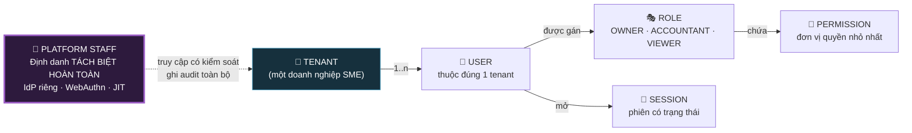
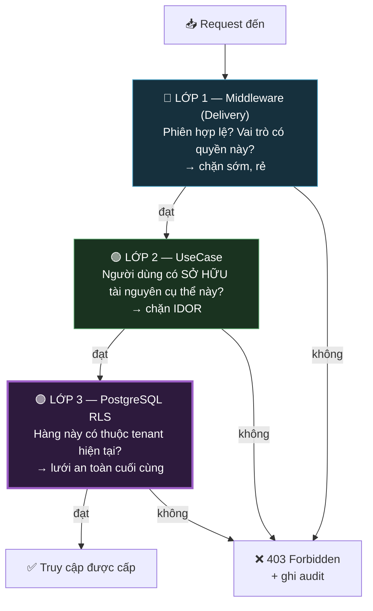
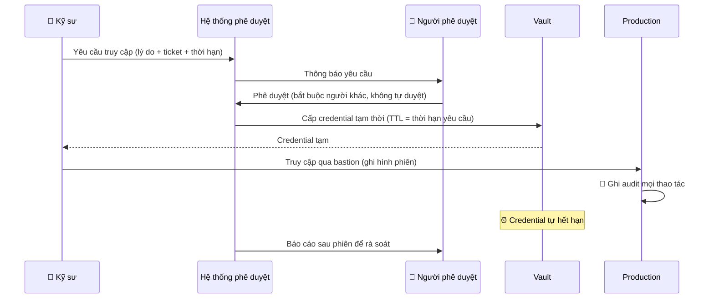

# 04 — Định Danh & Kiểm Soát Truy Cập

> **Tài liệu:** Lotus Fin Security Documentation Set · **Phiên bản:** 1.0 · **Ngày:** 2026-09-18
> **Phân loại:** `INTERNAL`
> **Giảm thiểu các mối đe dọa:** `THR-004`, `THR-007`, `THR-009`, `THR-014`, `THR-015`, `THR-016`, `THR-017`, `THR-021`, `THR-023`, `THR-043`, `THR-044`, `THR-045`
> **Ánh xạ chuẩn:** ISO/IEC 27001:2022 — A.5.15–A.5.18, A.8.2, A.8.3, A.8.5 · PCI DSS v4.0.1 — Req 7, Req 8 · OWASP ASVS 4.0.3 — V2, V3, V4

---

## 1. Mô hình định danh

Lotus Fin là nền tảng **đa người thuê (multi-tenant)**. Mọi danh tính đều tồn tại *bên trong* một tenant — không có khái niệm "người dùng toàn cục" ở tầng nghiệp vụ. Đây là ràng buộc nền tảng: nó khiến việc rò rỉ chéo tenant trở thành một hành vi phải được *tạo ra có chủ đích*, chứ không phải điều xảy ra do quên một điều kiện lọc.



> **Quyết định thiết kế: nhân sự nền tảng dùng hệ thống định danh hoàn toàn tách biệt.** Không tồn tại "tài khoản admin" trong bảng `users` của tenant. Nhân viên vận hành đăng nhập qua một IdP riêng với WebAuthn, và quyền chạm vào dữ liệu tenant được cấp theo cơ chế Just-in-Time có thời hạn.
>
> Lý do: nếu quản trị viên nền tảng chỉ là một hàng trong cùng bảng `users` với một cờ `is_admin`, thì **mọi lỗ hổng leo thang đặc quyền ở tầng ứng dụng đều trở thành lỗ hổng chiếm toàn bộ nền tảng**. Tách biệt định danh biến đường đi đó thành không tồn tại — kẻ tấn công không thể leo lên một thứ không nằm trong cùng không gian.

---

## 2. Xác thực (Authentication)

### 2.1. Xác thực bằng mật khẩu

| Kiểm soát | Cấu hình | Căn cứ |
| :--- | :--- | :--- |
| Thuật toán băm | **Argon2id** · memory 64 MiB · iterations 3 · parallelism 4 | Chống tấn công GPU/ASIC — OWASP Password Storage Cheat Sheet |
| Độ dài tối thiểu | 12 ký tự | NIST SP 800-63B: độ dài quan trọng hơn độ phức tạp |
| Quy tắc phức tạp | **Không áp đặt** | NIST SP 800-63B khuyến nghị bỏ — quy tắc phức tạp đẩy người dùng tới mẫu dễ đoán (`Password1!`) |
| Đối chiếu mật khẩu rò rỉ | Kiểm tra với tập hash k-anonymity (HIBP) khi đặt/đổi | Chặn mật khẩu đã lộ — hiệu quả cao hơn nhiều so với quy tắc phức tạp |
| Bắt buộc đổi định kỳ | **Không** *(trừ khi có dấu hiệu lộ)* | NIST SP 800-63B: đổi cưỡng bức làm giảm chất lượng mật khẩu |
| Khóa tài khoản | Lũy tiến: 5 lần sai → chờ 1 phút · 10 lần → 15 phút · 20 lần → khóa, cần quản trị viên tenant mở | Cân bằng giữa chống dò và chống DoS lên tài khoản người khác |
| Chống dò tài khoản | Thông báo lỗi đồng nhất + **luôn thực hiện một phép băm giả** khi user không tồn tại | Loại bỏ kênh rò rỉ qua thời gian phản hồi (`THR-006`) |

### 2.2. Xác thực đa yếu tố (MFA)

| Vai trò | MFA | Phương thức chấp nhận | Lý do |
| :--- | :--- | :--- | :--- |
| `OWNER` | **Bắt buộc** | WebAuthn/FIDO2 *(ưu tiên)* · TOTP | Vai trò phê duyệt hồ sơ vay — tác động tài chính trực tiếp |
| `ACCOUNTANT` | **Bắt buộc** | WebAuthn/FIDO2 · TOTP | Có quyền ghi dữ liệu tài chính |
| `VIEWER` | Khuyến nghị | TOTP | Chỉ đọc |
| `PLATFORM_STAFF` | **Bắt buộc, chỉ WebAuthn** | **Chỉ FIDO2** — không chấp nhận TOTP/SMS | Chống lừa đảo ở mức mã hóa, không phụ thuộc cảnh giác của con người |

> **Vì sao nhân sự nền tảng chỉ được dùng WebAuthn:** TOTP vẫn có thể bị đánh cắp qua trang lừa đảo trung gian theo thời gian thực — người dùng nhập mã 6 số vào trang giả, kẻ tấn công chuyển tiếp ngay sang trang thật. WebAuthn không thể bị tấn công theo cách này vì chữ ký được **ràng buộc mật mã với origin của trang web**. Trang lừa đảo ở domain khác sẽ nhận được chữ ký không hợp lệ với domain thật. Đây là khác biệt về *bản chất*, không phải về mức độ: nó chuyển việc chống phishing từ "phụ thuộc vào việc người dùng có tinh ý nhìn thanh địa chỉ không" sang "không thể thực hiện được về mặt toán học".

### 2.3. Xác thực nâng cấp cho thao tác nhạy cảm (Step-Up Authentication)

Một số thao tác yêu cầu xác thực lại **ngay tại thời điểm thực hiện**, kể cả khi phiên đang hợp lệ:

| Thao tác | Yêu cầu | Lý do |
| :--- | :--- | :--- |
| `POST /api/v1/financing-applications` — Nộp hồ sơ vay | MFA lại trong vòng 5 phút | Hậu quả tài chính không thể hoàn tác |
| Thay đổi vai trò người dùng | MFA lại | Ngăn leo thang đặc quyền âm thầm |
| Thêm/xóa thành viên trong tenant | MFA lại | Ngăn cài cắm quyền truy cập dai dẳng |
| Đổi mật khẩu / thiết bị MFA | Mật khẩu hiện tại + MFA | Chống chiếm tài khoản vĩnh viễn |
| Xuất toàn bộ dữ liệu tenant | MFA lại + ghi audit `HIGH` | Kênh trích xuất dữ liệu hàng loạt |

Step-up chính là biện pháp hạ mức rủi ro tồn dư `RR-01`: kể cả khi kẻ tấn công có XSS và hành động được thay mặt người dùng trong phiên, họ **vẫn không** nộp được hồ sơ vay vì không vượt được thử thách MFA.

---

## 3. 🎭 Ma trận phân quyền RBAC

### 3.1. Định nghĩa vai trò

| Vai trò | Mô tả | Nguyên tắc |
| :--- | :--- | :--- |
| `OWNER` | Chủ doanh nghiệp SME — quyền cao nhất trong tenant | Người duy nhất phê duyệt được việc cấp vốn |
| `ACCOUNTANT` | Kế toán nội bộ — nhập liệu và phân tích | Ghi dữ liệu được, **không** cam kết tài chính được |
| `VIEWER` | Chỉ xem — dành cho cố vấn, kiểm toán viên bên ngoài | Không ghi bất cứ thứ gì |
| `SYSTEM` | Định danh dịch vụ của `lotus-worker` | Vẫn bị RLS ràng buộc theo tenant của job |
| `PLATFORM_SUPPORT` | Nhân sự hỗ trợ khách hàng | Chỉ metadata, **không** xem nội dung tài chính |
| `PLATFORM_BREAKGLASS` | Truy cập khẩn cấp | Cần 2 người phê duyệt · Ghi hình phiên · Tự hết hạn |

### 3.2. Ma trận quyền chi tiết

Đối chiếu với SRS §4.1 và bề mặt API tại `01 §6`.

| Quyền | UC | `OWNER` | `ACCOUNTANT` | `VIEWER` | `SYSTEM` | `PLATFORM_SUPPORT` |
| :--- | :--- | :---: | :---: | :---: | :---: | :---: |
| `document:upload` | UC001 | ✅ | ✅ | ❌ | ❌ | ❌ |
| `document:read` | UC001 | ✅ | ✅ | ✅ | ✅ | ❌ |
| `document:delete` | UC001 | ✅ | ❌ | ❌ | ❌ | ❌ |
| `ledger:write` | UC001 | ✅ | ✅ | ❌ | ✅ | ❌ |
| `ledger:read` | UC001 | ✅ | ✅ | ✅ | ✅ | ❌ |
| `forecast:read` | UC002 | ✅ | ✅ | ✅ | ✅ | ❌ |
| `forecast:trigger` | UC002 | ✅ | ✅ | ❌ | ✅ | ❌ |
| `alert:acknowledge` | UC002 | ✅ | ✅ | ❌ | ❌ | ❌ |
| `alert:configure_threshold` | UC002 | ✅ | ❌ | ❌ | ❌ | ❌ |
| `creditmetric:read` | UC003 | ✅ | ✅ | ✅ | ✅ | ❌ |
| `report:generate` | UC003 | ✅ | ✅ | ❌ | ❌ | ❌ |
| `report:export_pdf` | UC003 | ✅ | ✅ | ✅ | ❌ | ❌ |
| `financing:browse_offers` | UC004 | ✅ | ❌ | ❌ | ❌ | ❌ |
| `financing:submit_application` | UC004 | ✅ ⚡ | ❌ | ❌ | ❌ | ❌ |
| `financing:withdraw_application` | UC004 | ✅ ⚡ | ❌ | ❌ | ❌ | ❌ |
| `copilot:chat` | UC005 | ✅ | ✅ | ❌ | ❌ | ❌ |
| `copilot:read_history` | UC005 | ✅ | ✅ | ❌ | ❌ | ❌ |
| `scenario:simulate` | UC006 | ✅ | ✅ | ❌ | ❌ | ❌ |
| `scenario:commit` | UC006 | ✅ ⚡ | ❌ | ❌ | ❌ | ❌ |
| `user:invite` | — | ✅ ⚡ | ❌ | ❌ | ❌ | ❌ |
| `user:change_role` | — | ✅ ⚡ | ❌ | ❌ | ❌ | ❌ |
| `auditlog:read` | — | ✅ | ❌ | ❌ | ❌ | ✅ *(chỉ metadata)* |
| `tenant:export_all` | — | ✅ ⚡ | ❌ | ❌ | ❌ | ❌ |
| `tenant:delete` | — | ✅ ⚡ | ❌ | ❌ | ❌ | ❌ |

*⚡ = yêu cầu Step-Up Authentication (§2.3)*

### 3.3. Nguyên tắc phân tách nhiệm vụ (Separation of Duties)

| Cặp nhiệm vụ tách biệt | Vì sao |
| :--- | :--- |
| `ledger:write` ✚ `financing:submit_application` | Người sửa số liệu tài chính **không** được là người dùng chính số liệu đó để xin vay. Tách biệt này ngăn một kế toán viên tự thổi phồng doanh thu rồi tự nộp hồ sơ. |
| `user:change_role` ✚ `auditlog:read` | `OWNER` giữ cả hai, nhưng việc đọc audit log **tự nó cũng bị ghi audit** — nên không tồn tại hành vi che dấu vết im lặng. |
| `PLATFORM_SUPPORT` ✚ đọc nội dung tài chính | Nhân sự hỗ trợ giải quyết được vấn đề kỹ thuật mà không cần nhìn thấy số liệu kinh doanh của khách hàng. |

---

## 4. Quản lý phiên (Session Management)

### 4.1. Kiến trúc phiên hai lớp

```mermaid
sequenceDiagram
    participant B as 🌐 Trình duyệt
    participant W as lotus-web (BFF)
    participant R as Redis
    participant C as lotus-core

    B->>W: POST /login (email, password)
    W->>C: xác thực thông tin đăng nhập
    C->>C: kiểm tra Argon2id
    C-->>W: yêu cầu thử thách MFA
    W-->>B: chuyển sang bước MFA
    B->>W: POST /mfa (mã TOTP)
    W->>C: xác minh MFA
    C-->>W: OK + hồ sơ người dùng

    Note over W,R: 🔑 SINH LẠI session ID<br/>(chống session fixation THR-009)
    W->>R: lưu phiên (256-bit ngẫu nhiên)
    W-->>B: Set-Cookie: __Host-lfsid=<opaque><br/>HttpOnly; Secure; SameSite=Strict; Path=/

    Note over B,C: Từ đây, mỗi request
    B->>W: GET /api/forecasts (kèm cookie)
    W->>R: tra cứu phiên
    R-->>W: {user_id, tenant_id, role}
    W->>C: gọi API kèm JWT ES256 (TTL 5 phút, mTLS)
    C->>C: verify JWT + TRA CỨU LẠI vai trò từ DB
    C-->>W: dữ liệu
    W-->>B: HTML/JSON đã render
```

### 4.2. Cấu hình cookie phiên

```
Set-Cookie: __Host-lfsid=<256-bit ngẫu nhiên mật mã>;
            HttpOnly;          → JavaScript không đọc được (chống THR-007)
            Secure;            → chỉ gửi qua HTTPS
            SameSite=Strict;   → không gửi kèm request từ site khác (chống THR-008)
            Path=/;            → bắt buộc cho tiền tố __Host-
            Max-Age=28800      → 8 giờ
```

**Vì sao dùng tiền tố `__Host-`:** Trình duyệt cưỡng chế rằng cookie mang tiền tố này **bắt buộc** phải có `Secure`, `Path=/`, và **không được** có thuộc tính `Domain`. Điều cuối cùng là điểm mấu chốt: nó ngăn một subdomain bị chiếm quyền (ví dụ một trang marketing tạm bợ ở `promo.lotusfin.vn`) ghi đè cookie phiên của domain chính. Không có tiền tố này, bảo mật của ứng dụng chính phụ thuộc vào bảo mật của *subdomain yếu nhất*.

### 4.3. Vòng đời phiên

| Thuộc tính | Giá trị | Lý do |
| :--- | :--- | :--- |
| Thời gian chờ không hoạt động | 30 phút | Cân bằng bảo mật và trải nghiệm cho công cụ dùng hằng ngày |
| Thời hạn tuyệt đối | 8 giờ | Giới hạn cửa sổ khai thác nếu phiên bị đánh cắp |
| Sinh lại ID | Sau đăng nhập, sau MFA, sau đổi vai trò | Chống session fixation (`THR-009`) |
| Số phiên đồng thời | Tối đa 5 thiết bị/người dùng | Phát hiện chia sẻ tài khoản; người dùng xem và thu hồi được từng phiên |
| Thu hồi | **Phía server** — xóa khỏi Redis, hiệu lực tức thì | Xóa cookie phía client không phải cơ chế thu hồi thực sự |
| Thu hồi hàng loạt | Khi đổi mật khẩu, phát hiện xâm phạm | Đẩy kẻ tấn công ra khỏi mọi phiên |

### 4.4. JWT nội bộ (BFF → Core)

| Thuộc tính | Giá trị | Lý do bảo mật |
| :--- | :--- | :--- |
| Thuật toán | **ES256** (ECDSA P-256) | Bất đối xứng: chỉ core ký, các bên khác chỉ verify — không có secret chung để rò rỉ |
| TTL | **5 phút** | Cửa sổ khai thác cực ngắn nếu token bị lộ |
| Claim bắt buộc | `iss`, `aud`, `sub`, `exp`, `nbf`, `jti`, `tenant_id`, `role` | Verify đầy đủ mọi claim, không chỉ chữ ký |
| Xác thực thuật toán | **Khai báo tường minh `ES256` khi verify** | Chặn `alg: none` và nhầm lẫn thuật toán (`THR-014`) |
| Luân chuyển khóa | 30 ngày, công bố qua JWKS với khoảng chồng lấn | Luân chuyển không gây gián đoạn |
| Nguồn chân lý về vai trò | **Cơ sở dữ liệu, không phải claim trong token** | Claim chỉ là gợi ý; thu hồi quyền có hiệu lực tức thì (`THR-015`) |

> **Điểm tinh tế thường bị làm sai:** Nhiều hệ thống tin tưởng claim `role` trong JWT để phân quyền. Điều đó tạo ra cửa sổ tối đa bằng TTL của token, trong đó một người dùng vừa bị hạ quyền hoặc bị sa thải **vẫn tiếp tục thực hiện được hành động cũ**. Lotus Fin dùng claim chỉ như một bộ lọc nhanh, còn quyết định phân quyền cuối cùng luôn tra cứu lại trạng thái hiện tại từ cơ sở dữ liệu ở tầng UseCase.

---

## 5. Thực thi phân quyền — 3 lớp độc lập

Đây là hiện thân cụ thể của nguyên tắc *Defense in Depth*. Ba lớp **độc lập về mặt cơ chế**: một lỗi lập trình làm hỏng lớp này không làm hỏng các lớp còn lại.



### 5.1. Lớp 1 — Middleware

Kiểm tra rẻ tiền, chặn sớm: phiên còn hiệu lực, vai trò có chứa quyền được yêu cầu. Middleware **không** biết gì về tài nguyên cụ thể — nó chỉ trả lời "vai trò này về nguyên tắc có được làm việc này không".

### 5.2. Lớp 2 — UseCase

Trả lời câu hỏi mà middleware không thể trả lời: *"Người dùng này có sở hữu chính tài nguyên `doc_abc123` mà họ đang yêu cầu không?"*

Đây là lớp chặn **IDOR** (`THR-016`) — loại lỗ hổng phổ biến nhất trong các ứng dụng đa người thuê. Việc đặt kiểm tra này ở tầng UseCase (không phải ở handler) là có chủ đích: mọi đường vào nghiệp vụ đều đi qua UseCase, kể cả khi sau này ta thêm giao diện gRPC hay CLI worker. Đặt ở handler thì mỗi giao diện mới lại phải nhớ cài lại kiểm tra.

### 5.3. 🛡️ Lớp 3 — PostgreSQL Row-Level Security

**Đây là kiểm soát bảo mật giá trị nhất trong toàn bộ hệ thống.** Hai lớp trên phụ thuộc vào việc lập trình viên nhớ viết đúng. Lớp này thì không.

```sql
-- Áp dụng cho MỌI bảng nghiệp vụ
ALTER TABLE ledger_entry ENABLE ROW LEVEL SECURITY;
ALTER TABLE ledger_entry FORCE ROW LEVEL SECURITY;   -- áp dụng cả với chủ sở hữu bảng

CREATE POLICY tenant_isolation ON ledger_entry
  USING      (tenant_id = current_setting('app.current_tenant')::uuid)
  WITH CHECK (tenant_id = current_setting('app.current_tenant')::uuid);
```

Mỗi transaction bắt đầu bằng:

```sql
SET LOCAL app.current_tenant = '<tenant_id lấy từ phiên đã xác thực>';
```

**Bốn chi tiết quyết định hiệu lực của cơ chế này:**

1. **`FORCE ROW LEVEL SECURITY`** — Nếu không có `FORCE`, RLS **bị bỏ qua đối với chủ sở hữu bảng**. Rất nhiều triển khai RLS trên thực tế vô hiệu vì thiếu đúng từ khóa này: policy tồn tại, trông có vẻ đang bảo vệ, nhưng ứng dụng kết nối bằng chính tài khoản sở hữu bảng nên không có gì được thực thi cả.

2. **`WITH CHECK` bên cạnh `USING`** — `USING` lọc dữ liệu đọc ra; `WITH CHECK` chặn dữ liệu ghi vào. Chỉ có `USING` thì tenant A vẫn **ghi được** một hàng mang `tenant_id` của tenant B — dữ liệu bị đầu độc mà không ai đọc được để phát hiện.

3. **Tài khoản ứng dụng tuyệt đối không có `BYPASSRLS`** — Và điều này được kiểm tra tự động trong CI, không phải tin vào quy trình. Một lần `GRANT` sai trong migration là toàn bộ cơ chế sụp đổ im lặng.

4. **`SET LOCAL`, không phải `SET`** — `SET LOCAL` chỉ có hiệu lực trong transaction hiện tại. Với connection pool, dùng `SET` thường sẽ khiến giá trị tenant **rò rỉ sang request tiếp theo dùng lại cùng kết nối đó** — tạo ra đúng lỗ hổng rò rỉ chéo tenant mà ta đang cố ngăn chặn, theo một cách cực kỳ khó tái hiện khi debug.

**Kiểm chứng bắt buộc trong CI:** với mỗi bảng nghiệp vụ, một test tích hợp phải chứng minh rằng khi đặt `app.current_tenant` = tenant A, truy vấn không trả về bất kỳ hàng nào của tenant B, và lệnh `INSERT` mang `tenant_id` của B bị từ chối. Test này chạy trên PostgreSQL thật, không phải mock. Bảng mới không có test tương ứng thì **không được phép merge**.

---

## 6. Cô lập tenant — Tổng hợp các lớp

| Lớp | Cơ chế | Chặn được gì | Hỏng khi nào |
| :--- | :--- | :--- | :--- |
| Ứng dụng | UseCase kiểm tra quyền sở hữu | IDOR có chủ đích | Lập trình viên quên gọi |
| **Cơ sở dữ liệu** | **PostgreSQL RLS** | **Mọi truy vấn thiếu điều kiện tenant** | Cấu hình sai `FORCE`/`BYPASSRLS` — có test CI chặn |
| Lưu trữ đối tượng | Tiền tố khóa theo tenant + kiểm tra quyền trước khi ký URL | Truy cập trực tiếp blob | Logic ký URL sai |
| Bộ đệm | `tenant_id` là thành phần bắt buộc của khóa cache | Đầu độc cache chéo tenant | Xây khóa cache thủ công sai |
| Vector store | Phân vùng cứng theo tenant | Rò rỉ ngữ cảnh RAG | *Thuộc tài liệu AI Security* |
| Sao lưu | Crypto-shredding bằng DEK riêng theo tenant | Rò rỉ từ bản sao lưu | Khóa dùng chung giữa các tenant |

---

## 7. Truy cập quản trị & Break-Glass

### 7.1. Truy cập Just-in-Time



| Kiểm soát | Cấu hình |
| :--- | :--- |
| Thời hạn tối đa | 4 giờ |
| Bắt buộc phê duyệt | **Có** — người khác duyệt, cấm tự duyệt |
| Bắt buộc lý do | Có — liên kết tới ticket sự cố hoặc thay đổi |
| Ghi hình phiên | Có — toàn bộ phiên bastion |
| Hết hạn credential | Tự động, không cần thao tác thu hồi thủ công |
| Rà soát sau phiên | Bắt buộc trong vòng 24 giờ |

### 7.2. Break-Glass

Dành cho tình huống hệ thống phê duyệt thông thường không khả dụng (ví dụ chính IdP đang sập).

| Kiểm soát | Yêu cầu |
| :--- | :--- |
| Kích hoạt | **Hai người** cùng xác thực (nguyên tắc 4 mắt) |
| Cảnh báo | Tức thời tới Security Lead + kênh trực + SMS |
| Thời hạn | 1 giờ, không gia hạn được |
| Ghi hình | Toàn bộ phiên, lưu bất biến |
| Rà soát bắt buộc | Trong 24 giờ, có biên bản |
| Sau khi dùng | Luân chuyển toàn bộ credential mà phiên đó đã chạm tới |
| Diễn tập | Mỗi quý — quy trình khẩn cấp chưa từng diễn tập là quy trình sẽ thất bại đúng lúc cần nhất |

---

## 8. Rà soát quyền truy cập định kỳ

| Đối tượng rà soát | Tần suất | Người chịu trách nhiệm | Hành động |
| :--- | :--- | :--- | :--- |
| Vai trò người dùng trong tenant | Hàng quý | `OWNER` của tenant | Xác nhận hoặc thu hồi |
| Truy cập của nhân sự nền tảng | Hàng tháng | Security Lead | Thu hồi quyền không còn cần thiết |
| Tài khoản dịch vụ & quyền DB | Hàng quý | Backend Lead + DevOps | Kiểm tra nguyên tắc quyền tối thiểu |
| Lịch sử dùng break-glass | Hàng tháng | Security Lead | Điều tra mọi trường hợp bất thường |
| Tài khoản không hoạt động > 90 ngày | Tự động | Hệ thống | Vô hiệu hóa tự động |

---

## 9. Đối chiếu OWASP ASVS Level 2

| ASVS | Yêu cầu | Trạng thái | Nơi triển khai |
| :--- | :--- | :---: | :--- |
| V2.1.1 | Mật khẩu tối thiểu 12 ký tự | ✅ | §2.1 |
| V2.1.7 | Đối chiếu danh sách mật khẩu rò rỉ | ✅ | §2.1 |
| V2.2.1 | Chống tấn công tự động (khóa lũy tiến) | ✅ | §2.1 |
| V2.4.1 | Băm mật khẩu bằng thuật toán chống brute-force | ✅ | Argon2id — §2.1 |
| V2.5.4 | Không có tài khoản/mật khẩu mặc định | ✅ | Kiểm tra trong CI |
| V2.8.1 | OTP dựa trên thời gian hợp lệ trong cửa sổ ngắn | ✅ | TOTP ±1 bước |
| V3.2.1 | Sinh lại session ID khi nâng cấp đặc quyền | ✅ | §4.3 |
| V3.3.1 | Đăng xuất vô hiệu hóa phiên phía server | ✅ | §4.3 |
| V3.4.1 | Cookie có thuộc tính `Secure` | ✅ | §4.2 |
| V3.4.2 | Cookie có thuộc tính `HttpOnly` | ✅ | §4.2 |
| V3.4.3 | Cookie có `SameSite` | ✅ | `Strict` — §4.2 |
| V3.4.4 | Dùng tiền tố `__Host-` | ✅ | §4.2 |
| V4.1.1 | Thực thi phân quyền ở tầng đáng tin cậy phía server | ✅ | §5 — cả 3 lớp |
| V4.1.3 | Nguyên tắc quyền tối thiểu | ✅ | §3.2 |
| V4.2.1 | Bảo vệ khỏi IDOR | ✅ | §5.2 + §5.3 |
| V4.3.1 | Giao diện quản trị có MFA | ✅ | WebAuthn — §2.2 |

---

## 10. Điều hướng

| ← Trước | Tiếp theo → |
| :--- | :--- |
| [03 — Mô hình mối đe dọa STRIDE](03-threat-model-stride.md) | [05 — Bảo vệ dữ liệu & Mật mã](05-data-protection-cryptography.md) |
