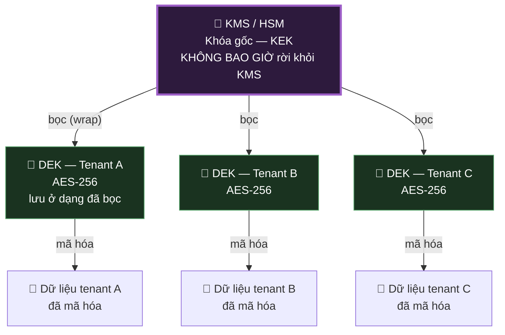
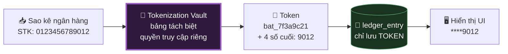

# 05 — Bảo Vệ Dữ Liệu & Mật Mã

> **Tài liệu:** Lotus Fin Security Documentation Set · **Phiên bản:** 1.0 · **Ngày:** 2026-09-18
> **Phân loại:** `INTERNAL`
> **Giảm thiểu các mối đe dọa:** `THR-003`, `THR-022`, `THR-024`, `THR-027`, `THR-040`
> **Ánh xạ chuẩn:** ISO/IEC 27001:2022 — A.8.24 (Use of cryptography), A.8.10 (Information deletion), A.8.11 (Data masking), A.8.12 (Data leakage prevention) · PCI DSS v4.0.1 — Req 3, Req 4 · OWASP ASVS 4.0.3 — V6, V8, V9

---

## 1. Nguyên tắc nền tảng

Mật mã học trong Lotus Fin tuân theo ba quy tắc, xếp theo thứ tự quan trọng:

1. **Không tự viết thuật toán mật mã.** Chỉ dùng các primitive đã được kiểm định trong thư viện chuẩn của Go (`crypto/*`, `golang.org/x/crypto`). Không có ngoại lệ, kể cả cho những thứ "trông đơn giản" như so sánh chuỗi hay sinh số ngẫu nhiên.
2. **Mã hóa là vô nghĩa nếu quản lý khóa sai.** Phần khó của mật mã ứng dụng không nằm ở thuật toán — nó nằm ở việc khóa được sinh ra, lưu trữ, luân chuyển và hủy như thế nào. Vì vậy §2 và §3 của tài liệu này dài hơn phần thuật toán.
3. **Mã hóa không thay thế kiểm soát truy cập.** Dữ liệu đã mã hóa khi nghỉ vẫn hiển thị nguyên vẹn với ứng dụng có quyền giải mã. Mã hóa bảo vệ trước việc đánh cắp phương tiện lưu trữ và rò rỉ bản sao lưu, **không** bảo vệ trước một truy vấn SQL hợp lệ mà thiếu điều kiện lọc tenant.

---

## 2. Bộ thuật toán mật mã chuẩn (Cryptographic Standards)

| Mục đích | Thuật toán | Tham số | Cấm dùng |
| :--- | :--- | :--- | :--- |
| Mã hóa đối xứng | **AES-256-GCM** | Nonce 96-bit ngẫu nhiên, tag 128-bit | AES-ECB, AES-CBC không kèm MAC, 3DES, RC4 |
| Mã hóa bất đối xứng | **ECDSA P-256** / **RSA-3072** | — | RSA < 2048, khóa DSA |
| Băm | **SHA-256** / **SHA-384** | — | MD5, SHA-1 |
| Băm mật khẩu | **Argon2id** | m=64MiB, t=3, p=4 | MD5, SHA-*, bcrypt cost thấp |
| MAC | **HMAC-SHA256** | Khóa ≥ 256-bit | Tự ghép chuỗi rồi băm |
| Chữ ký JWT | **ES256** | Khóa P-256 | `none`, HS256 cho token liên dịch vụ |
| TLS | **TLS 1.3** *(cho phép 1.2 với bộ mã AEAD)* | — | SSLv3, TLS 1.0/1.1, bộ mã không AEAD |
| Sinh số ngẫu nhiên | **`crypto/rand`** | — | **`math/rand`** — kể cả cho "thứ không quan trọng" |
| Trao đổi khóa | ECDHE | Curve P-256 / X25519 | Trao đổi khóa tĩnh |

> **Về `math/rand`:** Đây là lỗi kinh điển trong Go, và nó đặc biệt nguy hiểm vì code chạy *đúng* — chỉ là có thể dự đoán được. Một session ID, một token đặt lại mật khẩu, hay một `Idempotency-Key` sinh từ `math/rand` đều có thể bị kẻ tấn công tính ra. Dự án cưỡng chế quy tắc này bằng lint rule chặn mọi import `math/rand` trong toàn bộ codebase, không phải bằng lời nhắc trong tài liệu.

---

## 3. 🔑 Quản lý khóa — Mô hình Envelope Encryption

### 3.1. Kiến trúc phân cấp khóa

**Vì sao dùng envelope encryption thay vì mã hóa trực tiếp bằng khóa KMS:**

| Vấn đề | Mã hóa trực tiếp bằng KMS | Envelope encryption |
| :--- | :--- | :--- |
| Hiệu năng | Mỗi thao tác là một lời gọi mạng tới KMS | DEK nằm trong bộ nhớ, mã hóa cục bộ |
| Luân chuyển khóa gốc | Phải giải mã và mã hóa lại **toàn bộ dữ liệu** | Chỉ cần bọc lại các DEK — vài nghìn thao tác nhỏ |
| Xóa theo tenant | Không thực hiện được | **Hủy DEK là xong** |
| Bán kính thiệt hại | Một khóa cho tất cả | Lộ một DEK chỉ ảnh hưởng một tenant |

### 3.2. Vòng đời khóa

| Giai đoạn | Kiểm soát |
| :--- | :--- |
| **Sinh khóa** | DEK sinh trong KMS hoặc bằng `crypto/rand`, không bao giờ từ dữ liệu có thể đoán |
| **Lưu trữ** | KEK ở trong HSM · DEK lưu ở dạng đã bọc bên cạnh dữ liệu · Bản rõ của DEK **chỉ tồn tại trong bộ nhớ**, có thời hạn |
| **Sử dụng** | DEK được cache trong bộ nhớ tối đa 15 phút · Xóa khỏi bộ nhớ sau khi dùng |
| **Luân chuyển** | KEK: 1 năm · DEK: 90 ngày · Khóa ký JWT: 30 ngày · Khóa webhook: 180 ngày với 2 khóa song song |
| **Sao lưu khóa** | KEK sao lưu trong HSM ở vùng địa lý khác · **DEK không sao lưu riêng** — chúng nằm cùng dữ liệu ở dạng đã bọc |
| **Hủy khóa** | Hủy DEK = crypto-shredding dữ liệu tenant · Cần phê duyệt hai người · Không thể hoàn tác |

### 3.3. Luân chuyển khóa không gián đoạn

Quy tắc chung: **luôn có hai khóa hợp lệ trong thời gian chuyển tiếp** — khóa cũ để giải mã/xác minh, khóa mới để mã hóa/ký.

| Loại khóa | Cơ chế chuyển tiếp | Thời gian chồng lấn |
| :--- | :--- | :--- |
| Khóa ký JWT | Công bố cả hai khóa công khai qua JWKS, ký bằng khóa mới | 10 phút *(gấp đôi TTL token)* |
| Khóa ký webhook | Chấp nhận chữ ký từ cả hai khóa | 7 ngày |
| DEK | Mã hóa lại dữ liệu theo nền (lazy re-encryption khi ghi) | 30 ngày |
| Chứng chỉ mTLS | Cài chứng chỉ mới trước khi chứng chỉ cũ hết hạn | 14 ngày |

---

## 4. Mã hóa khi truyền (Encryption in Transit)

| Đoạn đường | Giao thức | Xác thực | Ghi chú |
| :--- | :--- | :--- | :--- |
| Trình duyệt → Biên | TLS 1.3 | Chứng chỉ server | HSTS preload · Giám sát Certificate Transparency |
| Biên → BFF | TLS 1.3 | mTLS | Trong mạng riêng nhưng **vẫn mã hóa** — Zero Trust |
| BFF → Core API | TLS 1.3 | **mTLS** | Định danh workload qua chứng chỉ |
| Core → PostgreSQL | TLS 1.3 | `verify-full` | **Bắt buộc `verify-full`**, không phải `require` |
| Core → Redis | TLS 1.3 | mTLS + Redis ACL | — |
| Core → AI Service | TLS 1.3 | **mTLS** | Ranh giới `TB-5` |
| Core → Bank API | TLS 1.3 | **mTLS + ghim chứng chỉ** | Ranh giới `TB-6` |
| AI → LLM Provider | TLS 1.3 | Chứng chỉ server + API key | Qua Egress Proxy · Ranh giới `TB-7` |

> **Vì sao `sslmode=verify-full` chứ không phải `require` khi kết nối PostgreSQL:** Chế độ `require` mã hóa kết nối nhưng **không xác minh danh tính máy chủ** — nó chấp nhận bất kỳ chứng chỉ nào, kể cả chứng chỉ tự ký của kẻ tấn công. Điều này khiến nó vô hiệu hoàn toàn trước tấn công xen giữa: dữ liệu vẫn được mã hóa, chỉ là mã hóa *tới kẻ tấn công*. Chỉ `verify-full` mới kiểm tra cả chuỗi tin cậy lẫn tên máy chủ.

---

## 5. Mã hóa khi nghỉ (Encryption at Rest)

### 5.1. Mã hóa theo tầng

| Tầng | Cơ chế | Bảo vệ trước | Không bảo vệ trước |
| :--- | :--- | :--- | :--- |
| Ổ đĩa | Mã hóa toàn bộ volume (LUKS / cloud disk encryption) | Đánh cắp phần cứng vật lý | Bất cứ thứ gì khi hệ thống đang chạy |
| Cơ sở dữ liệu | TDE (Transparent Data Encryption) | Đánh cắp tệp dữ liệu, rò rỉ snapshot | Truy vấn SQL hợp lệ |
| **Cấp trường** | **AES-256-GCM với DEK theo tenant** | Rò rỉ dump DB, truy cập từ DBA, bản sao lưu | Ứng dụng có quyền giải mã hợp lệ |
| Object Store | SSE-KMS | Rò rỉ bucket, đánh cắp phương tiện | URL ký hợp lệ bị lạm dụng |
| Sao lưu | AES-256 với khóa riêng biệt | Rò rỉ bản sao lưu | — |

### 5.2. Trường được mã hóa cấp ứng dụng

Chỉ những trường này được mã hóa riêng ở tầng ứng dụng — vì mã hóa cấp trường đánh đổi bằng việc **mất khả năng truy vấn và đánh chỉ mục**, nên phải dùng đúng chỗ.

| Bảng | Trường | Lý do | Vẫn truy vấn được? |
| :--- | :--- | :--- | :--- |
| `user` | `mfa_secret_enc` | Lộ ra = vượt qua được MFA vĩnh viễn | Không cần |
| `tenant` | `tax_code_enc` | Định danh doanh nghiệp | Qua chỉ mục băm mù (blind index) |
| `ledger_entry` | `counterparty_name_enc` | Tên đối tác là bí mật kinh doanh | Không |
| `bank_account_vault` | `account_number_enc` | 🔴 `L4` — dữ liệu nhạy cảm nhất | Qua token (§6) |
| `financing_application` | `representative_info_enc` | PII người đại diện pháp luật | Không |

### 5.3. Chỉ mục băm mù (Blind Index)

Với trường vừa cần mã hóa vừa cần tìm kiếm chính xác (ví dụ tra cứu theo mã số thuế), lưu thêm một cột `HMAC-SHA256(giá_trị, khóa_chỉ_mục)`. Tìm kiếm thực hiện trên HMAC, không phải trên bản rõ.

* Khóa chỉ mục **khác** khóa mã hóa — nếu dùng chung, lộ một khóa là mất cả hai thuộc tính.
* Chỉ hỗ trợ **so khớp chính xác**, không hỗ trợ tìm kiếm mờ hay sắp xếp. Đây là giới hạn cố hữu, không phải khuyết điểm triển khai.
* Cần ý thức rằng blind index làm rò rỉ **tần suất**: hai bản ghi có cùng HMAC thì chắc chắn có cùng giá trị gốc. Với mã số thuế (giá trị gần như duy nhất theo tenant), điều này chấp nhận được. Với một trường có ít giá trị phân biệt (ví dụ "loại hình doanh nghiệp"), nó sẽ rò rỉ thông tin đáng kể — nên trường như vậy **không** dùng blind index.

---

## 6. 🎭 Token hóa số tài khoản ngân hàng

Số tài khoản ngân hàng là dữ liệu `L4` và xuất hiện dày đặc trong sao kê. Nếu lưu trực tiếp (dù có mã hóa), mọi truy vấn sổ cái đều chạm vào dữ liệu nhạy cảm nhất của hệ thống.

**Giải pháp: tách ra khỏi đường đi chính.**

| Thuộc tính | Thiết kế |
| :--- | :--- |
| Định dạng token | `bat_` + 16 ký tự hex ngẫu nhiên — **không** suy ra được giá trị gốc từ token |
| Nơi lưu ánh xạ | Bảng `bank_account_vault` riêng, quyền DB tách biệt, mã hóa cấp trường |
| Ai giải mã được | **Chỉ** UseCase nộp hồ sơ vay, và chỉ khi có step-up MFA |
| Hiển thị mặc định | 4 số cuối (`****9012`) — đủ để người dùng nhận ra tài khoản của mình |
| Gửi sang AI | **Chỉ gửi token**, không bao giờ gửi giá trị gốc |
| Ghi audit | Mọi lần giải mã đều ghi audit mức `HIGH` |

**Lợi ích quan trọng nhất không nằm ở chỗ mã hóa mạnh hơn** — mà ở chỗ *thu hẹp phạm vi*. Sau khi token hóa, bảng `ledger_entry` (bảng được truy vấn nhiều nhất, bởi nhiều UseCase nhất, có nhiều đường code chạm tới nhất) **không còn chứa dữ liệu `L4` nào cả**. Bề mặt tấn công của dữ liệu nhạy cảm nhất thu về đúng một bảng với một đường truy cập duy nhất. Đây cũng chính là kỹ thuật PCI DSS khuyến nghị để giảm phạm vi CDE, áp dụng vào bối cảnh số tài khoản ngân hàng.

---

## 7. 🎭 Che mờ dữ liệu trước ranh giới AI (`TB-5`)

Đây là kiểm soát trực tiếp giảm thiểu `THR-027` và `THR-040` — và là điểm bàn giao kỹ thuật cho nhóm AI Security.

### 7.1. Quy tắc che mờ

| Loại dữ liệu | Xử lý trước khi gửi sang `lotus-ai` | Ví dụ |
| :--- | :--- | :--- |
| Số tài khoản ngân hàng | Thay bằng token | `0123456789012` → `bat_7f3a9c21` |
| Mã số thuế | Thay bằng định danh giả ổn định | `0301234567` → `TAX_A1` |
| Tên đối tác/khách hàng | Bút danh ổn định trong phạm vi tenant | `Công ty TNHH Minh Phát` → `COUNTERPARTY_07` |
| Tên & CCCD người đại diện | **Loại bỏ hoàn toàn** | *(không gửi)* |
| Email, số điện thoại | **Loại bỏ hoàn toàn** | *(không gửi)* |
| Địa chỉ | Rút gọn còn cấp tỉnh/thành | `123 Lê Lợi, Q.1, TP.HCM` → `TP.HCM` |
| Số tiền | **Giữ nguyên** | Cần cho phân tích — xem §7.3 |
| Ngày tháng | **Giữ nguyên** | Cần cho phân tích chuỗi thời gian |
| Tên tenant | Thay bằng ID nội bộ | `Công ty ABC` → `TENANT_CTX` |

### 7.2. Cưỡng chế bằng kiến trúc, không bằng kỷ luật

> **Đây là điểm thiết kế quan trọng nhất của mục này.** Việc che mờ không được triển khai như "một hàm mà lập trình viên nhớ gọi trước khi gửi". Nó được cưỡng chế bằng **hệ thống kiểu dữ liệu**.

Client gọi dịch vụ AI chỉ có duy nhất một chữ ký hàm, và hàm đó **chỉ nhận kiểu `MaskedPayload`**. Kiểu `MaskedPayload` không thể được khởi tạo trực tiếp từ bên ngoài package — cách duy nhất tạo ra nó là gọi hàm masking. Kết quả: **không tồn tại một đường code hợp lệ nào gửi được dữ liệu thô sang AI**. Nếu lập trình viên quên che mờ, code sẽ *không biên dịch được* — chứ không phải chạy bình thường rồi rò rỉ dữ liệu âm thầm trong production.

Đây là khác biệt giữa một kiểm soát *được tài liệu hóa* và một kiểm soát *được thực thi*. Tài liệu có thể bị bỏ qua; trình biên dịch thì không.

Các lớp kiểm chứng bổ sung:

* **Test tự động:** bộ test regression thử gửi dữ liệu chứa mẫu PII và khẳng định chúng không xuất hiện ở đầu ra masking.
* **DLP tại Egress Proxy:** quét luồng ra tìm mẫu số tài khoản, mã số thuế, CCCD. Phát hiện = chặn + cảnh báo `CRITICAL`.
* **Lấy mẫu kiểm toán:** 1% prompt gửi đi được lưu lại (ở dạng đã che mờ) để rà soát định kỳ.

### 7.3. Vì sao vẫn gửi số tiền thật — và rủi ro tồn dư kèm theo

Số tiền không bị che mờ vì việc che mờ chúng sẽ phá hủy toàn bộ giá trị phân tích: Copilot không thể giải thích "vì sao dòng tiền tháng này giảm" nếu nó không nhìn thấy các con số.

Điều này tạo ra rủi ro tồn dư `RR-04` được ghi nhận tường minh tại `03 §5`: một đối thủ có được toàn bộ log prompt của nhà cung cấp LLM **có thể** suy ra quy mô doanh thu và cơ cấu chi phí của doanh nghiệp, ngay cả khi mọi định danh đã bị loại bỏ. Các lớp bù đắp:

* Tên doanh nghiệp và mọi định danh đã bị loại bỏ → dữ liệu khó quy về một doanh nghiệp cụ thể.
* Hợp đồng zero-retention với nhà cung cấp LLM.
* Rủi ro được chấp nhận tường minh bởi Security Lead và Product Owner, có điều kiện xem xét lại.

Ghi nhận trung thực giới hạn của một kiểm soát có giá trị hơn nhiều so với tuyên bố nó hoàn hảo — vì chỉ những rủi ro được ghi ra mới được theo dõi.

---

## 8. Ngăn rò rỉ dữ liệu (Data Leakage Prevention)

| Kênh rò rỉ | Kiểm soát |
| :--- | :--- |
| Nhật ký ứng dụng | Logger có cấu trúc với danh sách trường cấm · Test CI quét mẫu nhạy cảm trong log · Kiểu dữ liệu nhạy cảm tự che khi định dạng (`String()` trả về `[REDACTED]`) |
| Thông báo lỗi | Lỗi trả về client là mã lỗi ngữ nghĩa + `requestId` · Chi tiết kỹ thuật chỉ ghi ở log phía server |
| Phản hồi API | DTO allowlist tường minh — thêm trường vào entity domain **không** tự động lộ ra API |
| Báo cáo xuất ra | PDF có watermark nguồn · Ghi audit khi xuất |
| Luồng ra Internet | Egress Proxy + quét DLP |
| Máy trạm lập trình viên | Chỉ dữ liệu tổng hợp · Cấm dump production |
| Bản sao lưu | Mã hóa khóa riêng · Kiểm soát truy cập tách biệt |
| Hệ thống APM/Tracing | Chỉ ID và metadata, tuyệt đối không có payload |

---

## 9. Xóa dữ liệu an toàn

| Kịch bản | Cơ chế | Kiểm chứng |
| :--- | :--- | :--- |
| Người dùng xóa một tài liệu | Xóa mềm → sau 30 ngày xóa vật lý + xóa đối tượng trong store | Ghi audit cả hai bước |
| Tenant đóng tài khoản | Ẩn danh hóa PII sau 90 ngày · Giữ bản ghi tài chính theo nghĩa vụ luật định | Chứng nhận xóa |
| Tenant yêu cầu xóa hoàn toàn | **Crypto-shredding: hủy DEK của tenant** | Chứng nhận hủy khóa từ KMS |
| Hết hạn lưu trữ | Job tự động theo chính sách tại `02 §6` | Báo cáo hằng tháng |
| Thay thế phương tiện lưu trữ | Trách nhiệm nhà cung cấp cloud | Chứng chỉ của nhà cung cấp |

> **Vì sao crypto-shredding là cơ chế xóa duy nhất thực sự triệt để:** Xóa một hàng trong bảng `users` không xóa hàng đó khỏi bản sao lưu ngày hôm qua, khỏi bản sao lưu tuần trước, hay khỏi WAL archive. Bạn không thể "đi vào" bản sao lưu để xóa — chúng là ảnh chụp bất biến, và việc sửa chúng phá hủy chính tính toàn vẹn khiến chúng có giá trị. Nhưng khi DEK của tenant bị hủy, **mọi bản sao dữ liệu của tenant đó — ở mọi bản sao lưu, mọi ảnh chụp, mọi vùng địa lý — đồng thời trở thành chuỗi byte vô nghĩa.**
>
> Điều kiện tiên quyết: DEK phải được phân tách theo tenant từ ngày đầu tiên. Không thể trang bị bổ sung về sau.

---

## 10. Đối chiếu OWASP ASVS Level 2

| ASVS | Yêu cầu | Trạng thái | Nơi triển khai |
| :--- | :--- | :---: | :--- |
| V6.2.1 | Module mật mã lỗi theo hướng an toàn | ✅ | Fail-closed trên mọi đường lỗi |
| V6.2.2 | Dùng thuật toán đã được kiểm định | ✅ | §2 |
| V6.2.3 | Chế độ mã hóa có xác thực (AEAD) | ✅ | AES-256-GCM |
| V6.2.5 | Không dùng chế độ không an toàn (ECB, CBC trần) | ✅ | §2 — danh sách cấm |
| V6.3.1 | Sinh số ngẫu nhiên bằng CSPRNG | ✅ | `crypto/rand` + lint chặn `math/rand` |
| V6.4.1 | Khóa quản lý bằng giải pháp chuyên dụng | ✅ | Vault/KMS — §3 |
| V6.4.2 | Có quy trình luân chuyển khóa | ✅ | §3.2, §3.3 |
| V8.1.1 | Dữ liệu nhạy cảm không lưu trong log | ✅ | §8 |
| V8.3.4 | Dữ liệu nhạy cảm được phân loại | ✅ | Tài liệu `02` |
| V9.1.1 | TLS cho mọi kết nối client | ✅ | §4 |
| V9.1.2 | Cấu hình TLS mạnh, bộ mã hiện đại | ✅ | §4 |
| V9.2.1 | Kết nối tới server khác cũng xác thực | ✅ | mTLS — §4 |
| V9.2.2 | Kết nối mã hóa tới mọi thành phần | ✅ | Kể cả trong mạng riêng |

---

## 11. Điều hướng

| ← Trước | Tiếp theo → |
| :--- | :--- |
| [04 — Định danh & Kiểm soát truy cập](04-identity-access-control.md) | [06 — An toàn ứng dụng OWASP ASVS L2](06-application-security-owasp.md) |
