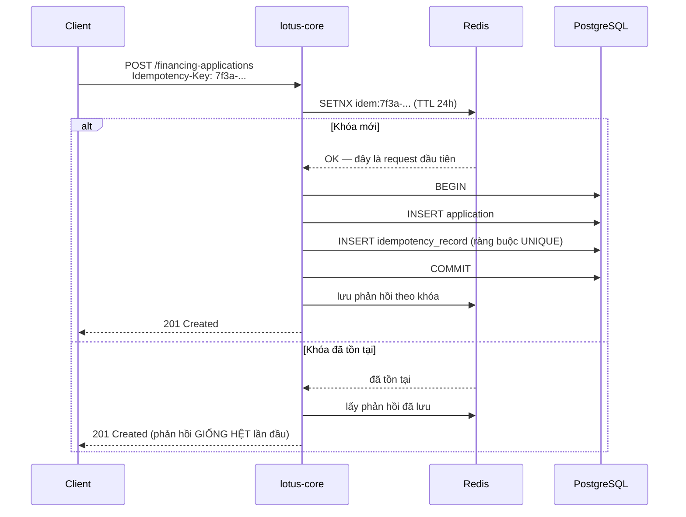
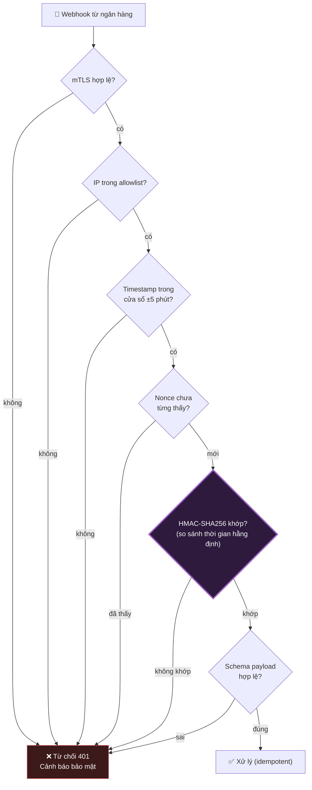
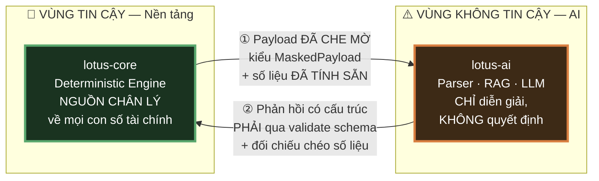
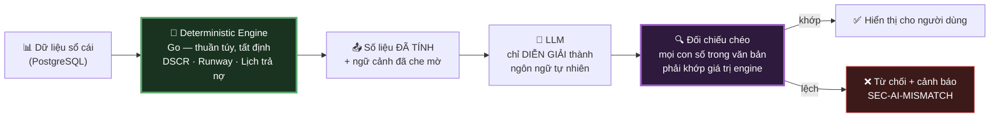

# 07 — An Toàn API & Tích Hợp

> **Tài liệu:** Lotus Fin Security Documentation Set · **Phiên bản:** 1.0 · **Ngày:** 2026-09-18
> **Phân loại:** `INTERNAL`
> **Giảm thiểu các mối đe dọa:** `THR-002`, `THR-016`, `THR-027` → `THR-042`
> **Ánh xạ chuẩn:** OWASP API Security Top 10:2023 · ISO/IEC 27001:2022 — A.5.14, A.5.19–A.5.22, A.8.21 · PCI DSS v4.0.1 — Req 4, Req 6.2, Req 12.8
> **📌 Mục §7 là điểm bàn giao chính thức cho nhóm AI Security.**

---

## 1. Đối chiếu OWASP API Security Top 10:2023

| # | Rủi ro | Mức độ | Kiểm soát | Chi tiết |
| :--- | :--- | :---: | :--- | :--- |
| **API1** | Broken Object Level Authorization | 🔴 | Kiểm tra quyền sở hữu ở UseCase + RLS | `04 §5` |
| **API2** | Broken Authentication | 🔴 | MFA · Argon2id · JWT ES256 | `04 §2` |
| **API3** | Broken Object Property Level Authorization | 🟠 | DTO allowlist hai chiều | `06 §2.3` |
| **API4** | Unrestricted Resource Consumption | 🟠 | Rate limit theo chi phí · Ngân sách token | §3 |
| **API5** | Broken Function Level Authorization | 🔴 | Ma trận RBAC theo endpoint | `04 §3.2` |
| **API6** | Unrestricted Access to Sensitive Business Flows | 🟠 | Step-up MFA · Idempotency · Giới hạn tần suất nghiệp vụ | §4 |
| **API7** | Server Side Request Forgery | 🟠 | Không nhận URL người dùng · Egress allowlist | §5 |
| **API8** | Security Misconfiguration | 🟡 | IaC · Quét cấu hình CI | `08` |
| **API9** | Improper Inventory Management | 🟡 | Đăng ký API bắt buộc · Chính sách ngừng phiên bản | §2.3 |
| **API10** | Unsafe Consumption of APIs | 🟠 | **Validate schema mọi phản hồi từ bên thứ ba** | §6, §7 |

---

## 2. Nền tảng an toàn API

### 2.1. Kiểm soát áp dụng cho mọi endpoint

Thứ tự middleware chain là một quyết định bảo mật — không phải chi tiết triển khai:

```
Request
  ↓ 1. RequestID          (sinh requestId, gắn vào context — mọi log sau đó truy vết được)
  ↓ 2. Recover            (bắt panic → 500, KHÔNG lộ stack trace)
  ↓ 3. SecurityHeaders    (đặt header trước, để cả đường lỗi cũng có header)
  ↓ 4. RateLimit          (chặn sớm, trước khi tốn tài nguyên xác thực)
  ↓ 5. Authentication     (xác minh JWT/phiên)
  ↓ 6. TenantContext      (đặt app.current_tenant — BẮT BUỘC trước mọi truy vấn)
  ↓ 7. Authorization      (kiểm tra vai trò có quyền)
  ↓ 8. Idempotency        (chỉ cho method thay đổi trạng thái)
  ↓ 9. AuditLog           (ghi lại ý định trước khi thực thi)
  ↓ → Handler → UseCase → Domain
```

| Vị trí | Vì sao đặt ở đó |
| :--- | :--- |
| `Recover` **trước** mọi thứ | Panic trong middleware bảo mật không được để lộ stack trace ra client |
| `SecurityHeaders` **trước** xác thực | Phản hồi lỗi `401`/`403` cũng phải mang đầy đủ security header |
| `RateLimit` **trước** xác thực | Nếu ngược lại, kẻ tấn công ép hệ thống thực hiện Argon2id (tốn 64 MiB RAM) cho mỗi request rác — biến chính cơ chế bảo vệ mật khẩu thành vector DoS |
| `TenantContext` **trước** phân quyền | RLS cần `app.current_tenant` được đặt trước bất kỳ truy vấn nào, kể cả truy vấn tra cứu quyền |
| `AuditLog` **trước** handler | Ghi lại *ý định* — nếu handler sập giữa chừng, ta vẫn biết có ai đó đã thử làm gì |

### 2.2. Nguyên tắc từ quy chuẩn API dự án

Tuân theo [API Design Conventions §5](../API_DESIGN_CONVENTIONS.md):

| Nguyên tắc | Thực thi bảo mật |
| :--- | :--- |
| `Idempotency-Key` cho thao tác thay đổi trạng thái tài chính | §4 |
| Xác thực chữ ký webhook HMAC-SHA256 | §6 |
| Mã lỗi ngữ nghĩa | Không lộ chi tiết nội bộ qua thông báo lỗi |
| `requestId` trong mọi log | Truy vết xuyên suốt khi điều tra |

### 2.3. Quản trị vòng đời API

| Kiểm soát | Chính sách |
| :--- | :--- |
| Đăng ký API | Mọi endpoint phải có trong OpenAPI spec — **endpoint không có spec bị CI chặn** |
| Phiên bản | `/api/v1/...` bắt buộc |
| Ngừng phiên bản | Thông báo 6 tháng · Trả header `Sunset` · Giám sát lưu lượng còn lại |
| Endpoint "bóng tối" | Quét định kỳ so sánh route thực tế với OpenAPI spec |
| Môi trường không production | **Không** expose ra Internet công cộng |

> **Về "endpoint bóng tối" (shadow API):** Đây là rủi ro âm thầm nhất trong quản trị API. Một endpoint debug thêm vào lúc phát triển, không có trong spec, không ai nhớ tới, không nằm trong phạm vi kiểm thử xâm nhập — nhưng vẫn phục vụ lưu lượng thật trên production. Quét đối chiếu tự động biến vấn đề tổ chức này thành một kiểm tra kỹ thuật.

---

## 3. Giới hạn tốc độ & Hạn ngạch (`THR-002`, `THR-042`)

### 3.1. Rate limit nhiều chiều

| Chiều | Ngưỡng | Chống lại |
| :--- | :--- | :--- |
| Theo IP | 300 req/phút | Quét tự động, bot |
| Theo người dùng | 120 req/phút | Lạm dụng từ tài khoản hợp lệ |
| Theo tenant | 600 req/phút | Một tenant làm ảnh hưởng tenant khác |
| Theo endpoint đăng nhập | 5 lần/phút/IP **và** 10 lần/giờ/tài khoản | Credential stuffing (`THR-004`) |
| **Theo chi phí tính toán** | Xem §3.2 | DoS tầng ứng dụng |

### 3.2. Rate limit theo chi phí — kiểm soát then chốt

Giới hạn theo *số lượng request* không bảo vệ được hệ thống có các endpoint chênh lệch chi phí hàng trăm lần. Một request `GET /api/v1/forecasts` đọc từ cache tốn vài mili-giây. Một request `POST /api/v1/copilot/messages` kích hoạt truy xuất RAG cộng suy luận LLM, tốn vài giây CPU và một khoản tiền thật trả cho nhà cung cấp mô hình.

Với hạn mức 120 request/phút, kẻ tấn công không cần lưu lượng lớn — họ chỉ cần gửi **đúng 120 request đắt nhất mỗi phút**, hoàn toàn trong giới hạn hợp lệ, và làm cạn kiệt cả tài nguyên tính toán lẫn ngân sách LLM.

**Giải pháp: gán trọng số chi phí cho từng endpoint và giới hạn theo tổng chi phí.**

| Endpoint | Trọng số | Ngân sách/tenant/giờ |
| :--- | :---: | :--- |
| `GET` các endpoint đọc | 1 | 10.000 đơn vị |
| `POST /documents` | 50 | — |
| `POST /forecasts/recalculations` | 100 | — |
| `POST /analysis-reports` | 200 | — |
| `POST /copilot/messages` | 300 | — |
| `POST /repayment-scenarios` | 80 | — |

Bổ sung: **ngân sách token LLM riêng theo tenant** với cảnh báo ở 80% và circuit breaker cứng ở 100% — biến một cuộc tấn công gây thiệt hại tài chính thành một sự suy giảm dịch vụ có kiểm soát và có trần thiệt hại xác định.

### 3.3. Hành vi khi vượt ngưỡng

| Thuộc tính | Giá trị |
| :--- | :--- |
| Mã trạng thái | `429 Too Many Requests` *(theo quy chuẩn API §4)* |
| Header | `Retry-After`, `X-RateLimit-Limit`, `X-RateLimit-Remaining`, `X-RateLimit-Reset` |
| Thuật toán | Sliding window counter trên Redis |
| Fail mode | **Fail closed** — Redis không khả dụng thì từ chối, không cho qua |
| Ghi log | Vượt ngưỡng liên tục → cảnh báo bảo mật (`09 §4`) |

---

## 4. Idempotency cho thao tác tài chính (`THR-037`)

### 4.1. Vì sao bắt buộc

Nộp hồ sơ vay hai lần do người dùng nhấn đúp, do mạng chập chờn khiến client thử lại, hay do kẻ tấn công cố ý phát lại request — cả ba đều dẫn tới cùng một hậu quả: hai hồ sơ tín dụng cho cùng một nhu cầu vốn. Trong nghiệp vụ tài chính, đây không phải bất tiện mà là lỗi toàn vẹn dữ liệu có hậu quả pháp lý.

### 4.2. Cơ chế



| Quy tắc | Chi tiết |
| :--- | :--- |
| Phạm vi khóa | Theo `tenant_id` + endpoint — tenant này không thể can thiệp khóa của tenant khác |
| TTL | 24 giờ |
| Nguồn chân lý | **Ràng buộc `UNIQUE` trong PostgreSQL**, không phải Redis |
| Payload khác nhau, cùng khóa | Trả `422` — dấu hiệu lỗi client hoặc tấn công |
| Request đang xử lý | Trả `409 Conflict` kèm `Retry-After` |

> **Vì sao nguồn chân lý phải là PostgreSQL chứ không phải Redis:** Redis nhanh, và nó là lớp kiểm tra đầu tiên. Nhưng Redis có thể mất dữ liệu khi failover hoặc bị evict khi đầy bộ nhớ. Nếu đó là cơ chế duy nhất, một sự cố Redis đúng lúc sẽ cho phép trùng lặp đi lọt. Ràng buộc `UNIQUE` trong cùng transaction với việc ghi hồ sơ là bảo đảm tuyệt đối: hoặc cả hai cùng thành công, hoặc cả hai cùng thất bại. Redis đóng vai trò tối ưu hiệu năng; PostgreSQL đóng vai trò đảm bảo tính đúng đắn.

---

## 5. Chống SSRF & Kiểm soát luồng ra (`THR-039`)

### 5.1. Nguyên tắc nền tảng

> **Hệ thống không bao giờ thực hiện lời gọi HTTP tới URL do người dùng cung cấp.**

Đây là cách phòng chống SSRF triệt để nhất — loại bỏ toàn bộ lớp lỗ hổng bằng cách không tạo ra khả năng đó. Mọi endpoint bên ngoài mà Lotus Fin gọi tới đều được cấu hình sẵn từ phía server và nằm trong allowlist cứng.

### 5.2. Egress Proxy

Mọi lưu lượng đi ra Internet — từ `lotus-core` và từ `lotus-ai` — **bắt buộc** đi qua Egress Proxy. NetworkPolicy chặn mọi đường ra khác ở tầng mạng, nên đây không phải quy ước mà là ràng buộc kỹ thuật.

| Kiểm soát | Cấu hình |
| :--- | :--- |
| Allowlist domain | Chỉ các domain đã đăng ký: Bank API, LLM Provider, dịch vụ email |
| Allowlist theo workload | `lotus-ai` **không** được phép gọi Bank API; `lotus-core` **không** được phép gọi LLM trực tiếp |
| Chặn IP nội bộ | Từ chối `10.0.0.0/8`, `172.16.0.0/12`, `192.168.0.0/16`, `127.0.0.0/8`, `169.254.0.0/16` |
| Chặn metadata endpoint | Chặn tuyệt đối `169.254.169.254` — điểm trích xuất credential cloud kinh điển |
| Xác thực DNS | Phân giải DNS tại proxy, chặn DNS rebinding |
| Quét DLP | Phát hiện mẫu số tài khoản, mã số thuế, CCCD trong luồng ra |
| Ghi log | Toàn bộ kết nối ra được ghi lại phục vụ điều tra |

---

## 6. Tích hợp Bank API (`TB-6`)

### 6.1. Xác thực lẫn nhau

| Kiểm soát | Cấu hình |
| :--- | :--- |
| Giao thức | TLS 1.3 + **mTLS** với chứng chỉ khách hàng |
| Nguồn chứng chỉ | Vault PKI, luân chuyển 90 ngày |
| Ghim chứng chỉ | Ghim CA của ngân hàng, cảnh báo khi thay đổi |
| Ký request | HMAC-SHA256 trên `method + path + body + timestamp` |
| Chống phát lại | Timestamp cửa sổ ±5 phút + nonce lưu Redis |

### 6.2. Xác thực webhook đến (`THR-035`, `THR-036`)



> **Vì sao phải so sánh HMAC bằng hàm thời gian hằng định:** Toán tử so sánh chuỗi thông thường dừng lại ngay tại byte đầu tiên khác nhau. Điều này khiến thời gian thực thi phụ thuộc vào *số byte đầu khớp đúng* — và kẻ tấn công đo được sự chênh lệch đó. Bằng cách gửi hàng nghìn request và đo thời gian phản hồi, họ khôi phục dần chữ ký hợp lệ từng byte một, biến bài toán vét cạn 2²⁵⁶ thành bài toán 32×256 phép thử. Trong Go, luôn dùng `hmac.Equal` — hàm này được thiết kế để chạy hết toàn bộ độ dài bất kể khác biệt ở đâu.

### 6.3. Xử lý phản hồi từ ngân hàng (OWASP API10)

Dữ liệu từ đối tác bên ngoài là **dữ liệu không tin cậy**, kể cả khi đối tác đó là một ngân hàng có uy tín. Ngân hàng có thể bị xâm phạm; kết nối có thể bị can thiệp; hoặc đơn giản là API của họ thay đổi mà không báo trước.

| Kiểm soát | Lý do |
| :--- | :--- |
| Validate schema nghiêm ngặt | Trường lạ hoặc thiếu → từ chối, ghi log |
| Kiểm tra khoảng giá trị | Lãi suất âm, hạn mức phi lý → từ chối |
| Giới hạn kích thước phản hồi | Chống cạn kiệt bộ nhớ |
| Timeout | 10 giây, có circuit breaker |
| Escape trước khi hiển thị | Tên gói vay từ ngân hàng được escape như mọi đầu vào không tin cậy |

---

## 7. 🔥 `TB-5` — Hợp Đồng Bảo Mật Với Dịch Vụ AI

> ## 📌 ĐIỂM BÀN GIAO CHO NHÓM AI SECURITY
>
> Mục này định nghĩa **hợp đồng kỹ thuật** tại ranh giới giữa nền tảng và pipeline AI. Nó mô tả:
> * Những gì nền tảng **đảm bảo** với dịch vụ AI;
> * Những gì nền tảng **yêu cầu** ở dịch vụ AI;
> * Những gì nền tảng **giả định** về dịch vụ AI — và cách nền tảng tự bảo vệ khi các giả định đó sai.
>
> Nhóm AI Security lấy mục này làm đầu vào. Mọi thay đổi ở đây phải được thống nhất giữa hai nhóm.

### 7.1. Mô hình tin cậy



### 7.2. Nền tảng ĐẢM BẢO với dịch vụ AI

| # | Đảm bảo | Cơ chế |
| :--- | :--- | :--- |
| G1 | Mọi dữ liệu gửi sang đã được che mờ theo quy tắc `05 §7.1` | Cưỡng chế bằng hệ thống kiểu — không có chữ ký hàm nào nhận dữ liệu thô |
| G2 | Mọi payload đều mang `tenant_id` tường minh | Bắt buộc trong cấu trúc payload |
| G3 | Kết nối luôn được xác thực lẫn nhau | mTLS |
| G4 | Số liệu tài chính gửi kèm **đã được Deterministic Engine tính sẵn** | AI không cần và không được phép tự tính |
| G5 | Mỗi request mang `trace_id` để truy vết | Gắn xuyên suốt, phục vụ điều tra |
| G6 | Rate limit và ngân sách token được áp ở tầng nền tảng | AI không phải tự bảo vệ trước lạm dụng khối lượng |

### 7.3. Nền tảng YÊU CẦU ở dịch vụ AI

| # | Yêu cầu | Kiểm chứng |
| :--- | :--- | :--- |
| R1 | Phản hồi **đúng JSON schema đã định nghĩa**, không có trường tự do | `lotus-core` validate, từ chối nếu sai |
| R2 | **Không bao giờ sinh ra con số tài chính mới** — chỉ trích dẫn lại số nhận được | Đối chiếu chéo tự động (§7.5) |
| R3 | Không yêu cầu quyền truy cập cơ sở dữ liệu nghiệp vụ | Không cấp credential; NetworkPolicy chặn |
| R4 | Không gọi ra Internet ngoài Egress Proxy | NetworkPolicy `deny-all` |
| R5 | Mọi truy vấn RAG có bộ lọc `tenant_id` ở **tầng cơ sở dữ liệu** | Rà soát kiến trúc chung giữa hai nhóm |
| R6 | Ghi log đầy đủ prompt/response kèm phiên bản mô hình | Yêu cầu kiểm toán |
| R7 | Xử lý tài liệu trong sandbox không mạng | Rà soát cấu hình hạ tầng |
| R8 | Chịu được timeout và trả lỗi có cấu trúc | Kiểm thử hỗn loạn (chaos testing) |

### 7.4. Nền tảng GIẢ ĐỊNH — và cách tự bảo vệ

Đây là phần quan trọng nhất của hợp đồng: **nền tảng giả định rằng dịch vụ AI có thể bị xâm phạm hoàn toàn**, và mọi kiểm soát dưới đây vẫn đứng vững trong giả định đó.

| Giả định phòng thủ | Nếu điều đó xảy ra, nền tảng vẫn an toàn nhờ |
| :--- | :--- |
| AI **có thể** bị chiếm quyền điều khiển hoàn toàn | Không có credential DB · Không có đường ra Internet · Không gọi được Bank API · Container quyền tối thiểu |
| AI **có thể** trả về dữ liệu bị thao túng | Validate schema · **Đối chiếu chéo mọi con số** · Không có đường ghi trực tiếp vào DB |
| AI **có thể** cố đọc dữ liệu tenant khác | RLS ở tầng DB · AI không có kết nối DB nào để tận dụng |
| AI **có thể** bị prompt injection thành công | LLM không có quyền hành động — mọi thay đổi trạng thái đều do `lotus-core` thực hiện sau khi kiểm tra phân quyền |
| AI **có thể** rò rỉ prompt ra bên ngoài | Prompt chỉ chứa dữ liệu đã che mờ |
| AI **có thể** ngừng hoạt động hoàn toàn | Suy giảm chức năng có kiểm soát — nền tảng vẫn phục vụ đầy đủ chức năng tất định |

### 7.5. ⭐ Kiểm soát quan trọng nhất: LLM không bao giờ sinh ra con số tài chính

Đây là kiểm soát giảm thiểu `THR-028` — mối đe dọa nguy hiểm nhất mà một hệ thống tài chính có AI phải đối mặt.

**Vấn đề:** Nếu LLM được phép tính toán hoặc sinh ra chỉ số DSCR, lịch trả nợ hay dự báo dòng tiền, thì bất kỳ thao tác nào lên ngữ cảnh của nó — qua prompt injection gián tiếp giấu trong một hóa đơn PDF, qua đầu độc chỉ mục RAG, hay đơn giản là qua ảo giác của mô hình — đều **trực tiếp bẻ cong một quyết định tín dụng**.

**Giải pháp kiến trúc:**



| Bước | Kiểm soát |
| :--- | :--- |
| 1 | Deterministic Engine (Go) tính toàn bộ chỉ số từ dữ liệu sổ cái. Thuần túy, tất định, có unit test bao phủ, **có thể kiểm toán lại từng bước** |
| 2 | Số liệu đã tính được gửi sang AI **như dữ liệu đầu vào**, kèm ngữ cảnh đã che mờ |
| 3 | LLM chỉ sinh **văn bản diễn giải** — "DSCR của bạn là 0.85, dưới ngưỡng an toàn 1.0, chủ yếu do khoản phải thu từ khách hàng A trễ hạn 45 ngày" |
| 4 | **Đối chiếu chéo tự động:** trích xuất mọi giá trị số trong văn bản AI sinh ra và so với giá trị engine. Lệch → từ chối hiển thị, ghi cảnh báo `SEC-AI-MISMATCH` |
| 5 | Giao diện hiển thị con số **từ engine**, không phải từ văn bản AI |

**Hệ quả:** Kể cả khi kẻ tấn công thành công hoàn toàn trong việc thao túng LLM — giấu chỉ thị trong hóa đơn PDF, đầu độc chỉ mục vector, hay khai thác một jailbreak chưa từng được biết tới — họ **vẫn không thay đổi được một con số nào** trong quyết định tín dụng. Điều tệ nhất họ đạt được là khiến hệ thống hiển thị một đoạn văn bản diễn giải sai lệch, và ngay cả điều đó cũng bị bước đối chiếu chéo chặn lại và tạo cảnh báo.

Đây là minh họa rõ nhất cho nguyên tắc số 6 tại `README §5`: **an toàn đạt được bằng cách giới hạn quyền hạn của thành phần phi tất định, chứ không bằng cách cố làm cho nó không bao giờ sai.**

### 7.6. Schema phản hồi từ AI

`lotus-core` chỉ chấp nhận phản hồi đúng cấu trúc sau. Trường lạ → từ chối. Trường thiếu → từ chối. Sai kiểu → từ chối.

| Trường | Kiểu | Ràng buộc |
| :--- | :--- | :--- |
| `trace_id` | string | Phải khớp `trace_id` của request |
| `tenant_id` | uuid | Phải khớp tenant của request |
| `kind` | enum | `interpretation` \| `extraction` \| `answer` — không có giá trị nào khác |
| `text` | string | Tối đa 4000 ký tự · Không chứa HTML · Không chứa URL |
| `referenced_metrics` | array | Chỉ chứa **định danh** chỉ số, không chứa giá trị |
| `confidence` | float | 0.0 – 1.0 |
| `model_version` | string | Bắt buộc, phục vụ kiểm toán |

| Quy tắc từ chối | Hành động |
| :--- | :--- |
| Trường không có trong schema | Từ chối, ghi log `WARN` |
| Có URL trong `text` | Từ chối — vector trích xuất dữ liệu |
| Có thẻ HTML trong `text` | Từ chối — vector XSS |
| Số trong `text` không khớp giá trị engine | Từ chối, cảnh báo `SEC-AI-MISMATCH` mức `HIGH` |
| `tenant_id` không khớp | Từ chối, cảnh báo **`CRITICAL`** — dấu hiệu rò rỉ chéo tenant |

---

## 8. Quản lý rủi ro bên thứ ba

| Bên thứ ba | Dữ liệu chia sẻ | Mức rủi ro | Kiểm soát |
| :--- | :--- | :---: | :--- |
| LLM Provider | Dữ liệu tài chính **đã che mờ** | 🟠 Cao | Hợp đồng zero-retention · Egress Proxy · DLP · Masking |
| Bank / FI API | Hồ sơ vay *(có sự đồng ý của người dùng)* | 🟠 Cao | mTLS · Ký request · Thỏa thuận xử lý dữ liệu |
| Nhà cung cấp cloud | Toàn bộ dữ liệu đã mã hóa | 🟠 Cao | Chứng chỉ ISO 27001/SOC 2 · Khóa do ta kiểm soát |
| Dịch vụ email | Địa chỉ email + **nội dung không chứa số liệu** | 🟡 Trung bình | Email cảnh báo chỉ chứa liên kết đăng nhập |
| CDN/WAF | Lưu lượng đã mã hóa | 🟡 Trung bình | Chứng chỉ do ta kiểm soát |

| Quy trình đánh giá nhà cung cấp | Yêu cầu |
| :--- | :--- |
| Trước khi tích hợp | Rà soát bảo mật · Kiểm tra chứng chỉ · Thỏa thuận xử lý dữ liệu |
| Định kỳ | Rà soát hằng năm · Theo dõi thông báo sự cố của nhà cung cấp |
| Điều khoản hợp đồng | Nghĩa vụ thông báo vi phạm · Quyền kiểm toán · Cam kết xóa dữ liệu |
| Kế hoạch thoát | Có phương án thay thế cho mọi nhà cung cấp trọng yếu |

---

## 9. Điều hướng

| ← Trước | Tiếp theo → |
| :--- | :--- |
| [06 — An toàn ứng dụng OWASP ASVS L2](06-application-security-owasp.md) | [08 — An toàn hạ tầng & Mạng](08-infrastructure-network-security.md) |
