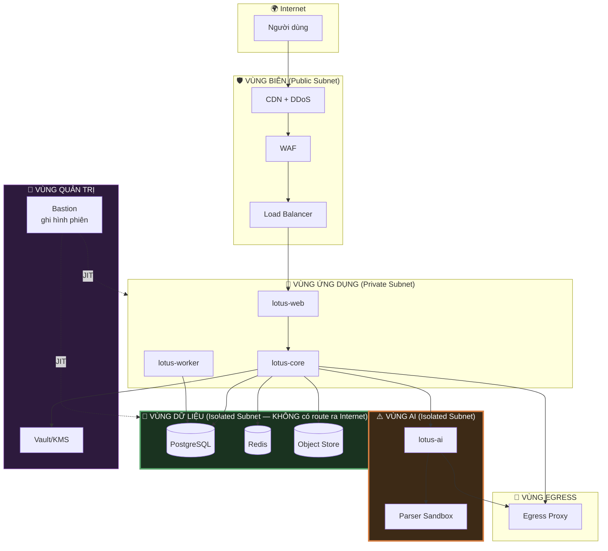
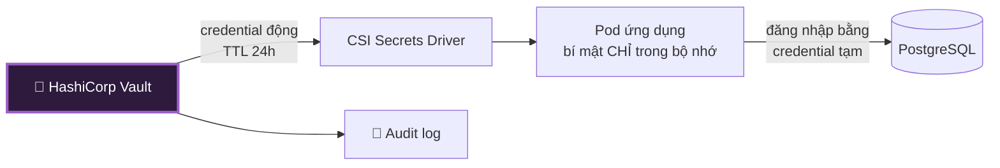

# 08 — An Toàn Hạ Tầng & Mạng

> **Tài liệu:** Lotus Fin Security Documentation Set · **Phiên bản:** 1.0 · **Ngày:** 2026-09-18
> **Phân loại:** `INTERNAL`
> **Giảm thiểu các mối đe dọa:** `THR-001`, `THR-002`, `THR-003`, `THR-017`, `THR-029`, `THR-039`, `THR-046`
> **Ánh xạ chuẩn:** ISO/IEC 27001:2022 — A.7.x (Physical), A.8.1, A.8.9, A.8.13, A.8.20–A.8.23 · PCI DSS v4.0.1 — Req 1, 2, 5, 11

---

## 1. Nguyên tắc phân vùng mạng

Kiến trúc mạng tuân theo **Zero Trust**: không có "mạng nội bộ đáng tin cậy". Lưu lượng giữa hai pod trong cùng cluster được đối xử giống lưu lượng đến từ Internet — phải xác thực, phải mã hóa, phải nằm trong allowlist.

Mô hình vành đai truyền thống ("cứng ở ngoài, mềm ở trong") thất bại vì nó cho rằng kẻ tấn công chỉ đến từ bên ngoài. Trong thực tế, một container bị xâm phạm, một dependency độc hại, hay một dịch vụ AI bị chiếm quyền đều **khởi đầu từ bên trong** — và khi đó, toàn bộ giá trị của vành đai biến mất.

### 1.1. Ma trận luồng mạng cho phép

Mọi luồng **không** có trong bảng này đều bị chặn ở tầng NetworkPolicy. Mặc định là `deny-all`.

| Nguồn | Đích | Cổng | Giao thức | Ghi chú |
| :--- | :--- | :--- | :--- | :--- |
| Internet | Load Balancer | 443 | HTTPS | Chỉ cổng duy nhất mở ra Internet |
| Load Balancer | `lotus-web` | 8080 | mTLS | — |
| `lotus-web` | `lotus-core` | 8443 | mTLS | — |
| `lotus-core` | PostgreSQL | 5432 | TLS `verify-full` | — |
| `lotus-core` | Redis | 6379 | TLS + ACL | — |
| `lotus-core` | Object Store | 443 | HTTPS | — |
| `lotus-core` | Vault | 8200 | mTLS | — |
| `lotus-core` | `lotus-ai` | 8443 | mTLS | Ranh giới `TB-5` |
| `lotus-core` | Egress Proxy | 3128 | HTTPS | Ra Bank API |
| `lotus-worker` | PostgreSQL | 5432 | TLS | — |
| `lotus-ai` | Egress Proxy | 3128 | HTTPS | **Đường ra duy nhất** |
| `lotus-ai` | pgvector | 5432 | TLS | **Instance riêng, không phải DB nghiệp vụ** |
| Egress Proxy | Internet *(allowlist)* | 443 | HTTPS | — |
| Bastion | Mọi vùng | SSH/DB | mTLS | Chỉ khi có phê duyệt JIT |

### 1.2. Các luồng bị chặn có chủ đích

Đây là những luồng **cố tình không tồn tại**, và mỗi luồng vắng mặt là một kiểm soát bảo mật:

| Luồng bị chặn | Vì sao |
| :--- | :--- |
| `lotus-ai` → PostgreSQL nghiệp vụ | Dịch vụ AI bị xâm phạm không đọc được dữ liệu tài chính (`THR-029`) |
| `lotus-ai` → Internet trực tiếp | Không trích xuất được dữ liệu ra ngoài |
| `lotus-ai` → Bank API | Prompt injection không dẫn tới hành động tài chính |
| `lotus-web` → PostgreSQL | BFF không có đường vòng qua tầng nghiệp vụ |
| Parser Sandbox → **mọi thứ** | Khai thác RCE trên parser không đi được đâu cả (`THR-030`) |
| Vùng dữ liệu → Internet | Dữ liệu bị đánh cắp không có đường tự đi ra |
| Internet → mọi thứ trừ Load Balancer | Bề mặt tấn công thu về đúng một điểm |

---

## 2. Hardening Container & Kubernetes

### 2.1. Ảnh container

| Kiểm soát | Cấu hình |
| :--- | :--- |
| Ảnh nền | `distroless` hoặc `scratch` cho Go — **không có shell, không có package manager** |
| Build | Multi-stage — công cụ build không có mặt trong ảnh cuối |
| Người dùng | Non-root (UID ≥ 10000) |
| Hệ tệp gốc | `readOnlyRootFilesystem: true` |
| Capability | `drop: ["ALL"]` |
| Leo thang đặc quyền | `allowPrivilegeEscalation: false` |
| Seccomp | `RuntimeDefault` |
| Quét lỗ hổng | Trivy trong CI — CVE mức `HIGH`/`CRITICAL` chặn phát hành |
| Ký ảnh | Cosign — cluster từ chối ảnh không có chữ ký hợp lệ |
| Thẻ phiên bản | Ghim theo digest, **không** dùng `:latest` |

> **Vì sao dùng ảnh distroless:** Khi kẻ tấn công đạt được khả năng thực thi mã trong container, việc đầu tiên họ làm là tìm công cụ — `sh`, `curl`, `wget`, `apt`, `python`. Ảnh distroless không có bất cứ thứ gì trong số đó. Kẻ tấn công phải tự mang theo mọi công cụ, qua một kênh mà kiểm soát egress đã chặn sẵn. Điều này không ngăn được việc xâm nhập, nhưng nó biến bước "leo thang và mở rộng" từ chuyện vài phút thành một bài toán đáng kể — và trong khoảng thời gian đó, hệ thống phát hiện có cơ hội hoạt động.

### 2.2. Kubernetes

| Kiểm soát | Cấu hình |
| :--- | :--- |
| Pod Security Standard | `restricted` cho mọi namespace ứng dụng |
| NetworkPolicy | `default-deny` cho cả ingress và egress ở mọi namespace |
| RBAC | ServiceAccount riêng cho từng workload, quyền tối thiểu |
| Secrets | Qua CSI driver từ Vault — **không** dùng Kubernetes Secret thuần (chỉ base64, không phải mã hóa) |
| Giới hạn tài nguyên | `requests`/`limits` bắt buộc — chống một pod làm cạn tài nguyên node |
| Admission control | OPA Gatekeeper / Kyverno cưỡng chế chính sách |
| Cách ly node | Node riêng cho vùng AI *(taint + toleration)* |
| Bảo mật etcd | Mã hóa khi nghỉ, chỉ control plane truy cập |
| Server API | Không expose công khai, chỉ qua bastion |
| Audit log | Bật đầy đủ, đẩy sang SIEM |

### 2.3. Sandbox cho Parser

Cấu hình cứng nhất trong toàn hệ thống, dành riêng cho thành phần xử lý nội dung thù địch:

| Kiểm soát | Giá trị |
| :--- | :--- |
| Runtime | gVisor (`runsc`) hoặc Kata Containers/Firecracker |
| Mạng | **Không có interface mạng** |
| Hệ tệp | Rootfs chỉ đọc + `tmpfs` cho vùng làm việc, giới hạn dung lượng |
| CPU | Tối đa 2 giây thời gian CPU |
| Bộ nhớ | Tối đa 512 MB |
| Thời gian chạy | Timeout cứng 30 giây |
| Số tiến trình | Giới hạn PID chống fork bomb |
| Vòng đời | Tạo mới cho mỗi tài liệu, hủy ngay sau khi xong |
| Credential | **Không có gì** |

---

## 3. Bảo vệ tầng biên

### 3.1. Chống DDoS

| Tầng | Kiểm soát |
| :--- | :--- |
| L3/L4 | CDN Anycast hấp thụ tấn công thể tích · SYN cookie |
| L7 | Rate limit tại biên · Thử thách JavaScript cho lưu lượng đáng ngờ · Quản lý bot |
| Ứng dụng | Rate limit theo chi phí (`07 §3.2`) · Circuit breaker · Hàng đợi có giới hạn |
| Tự động mở rộng | Horizontal Pod Autoscaler với trần chi phí |

### 3.2. Web Application Firewall

| Kiểm soát | Cấu hình |
| :--- | :--- |
| Bộ luật | OWASP Core Rule Set 4.x · Mức paranoia 2 |
| Chế độ | Bắt đầu ở `DetectionOnly` → tinh chỉnh false positive → chuyển sang `Blocking` |
| Luật tùy chỉnh | Chặn mẫu tấn công đặc thù ứng dụng tài chính |
| Ghi log | Mọi lần chặn đẩy sang SIEM |
| Cập nhật | Bộ luật cập nhật hằng tháng |

> **Lưu ý quan trọng về vai trò của WAF:** WAF là một **lớp phòng thủ bổ sung**, không phải lớp phòng thủ chính. Nó mua thời gian khi có CVE mới công bố mà bản vá chưa kịp triển khai, và nó lọc bớt nhiễu từ các công cụ quét tự động. Nhưng WAF hoạt động bằng cách nhận dạng mẫu, nên nó luôn có thể bị vượt qua bằng payload đủ sáng tạo. Việc dựa vào WAF thay cho việc viết code an toàn là một sai lầm kiến trúc phổ biến và tốn kém.

### 3.3. TLS

| Kiểm soát | Cấu hình |
| :--- | :--- |
| Phiên bản | TLS 1.3 *(cho phép 1.2 với bộ mã AEAD)* |
| Bộ mã | Chỉ AEAD: `TLS_AES_256_GCM_SHA384`, `TLS_CHACHA20_POLY1305_SHA256` |
| Chứng chỉ | ECDSA P-256, tự động gia hạn qua ACME |
| HSTS | `max-age=63072000; includeSubDomains; preload` |
| OCSP Stapling | Bật |
| Giám sát CT | Cảnh báo khi có chứng chỉ lạ được cấp cho domain |

---

## 4. Quản lý bí mật

| Kiểm soát | Cấu hình |
| :--- | :--- |
| Kho lưu trữ | HashiCorp Vault *(hoặc KMS của nhà cung cấp cloud)* |
| Xác thực | Kubernetes ServiceAccount → Vault role |
| Credential DB | **Động** — Vault sinh user/password riêng cho mỗi pod, TTL 24 giờ |
| Nạp vào ứng dụng | CSI driver → `tmpfs` trong bộ nhớ, **không bao giờ ghi xuống đĩa** |
| Luân chuyển | Tự động theo lịch tại `02 §3.2` |
| Audit | Mọi lần truy cập bí mật đều ghi log |
| Chống lộ trong mã nguồn | gitleaks trong pre-commit hook **và** trong CI |
| Xử lý khi lộ | Luân chuyển ngay lập tức + điều tra phạm vi |

> **Giá trị của credential động:** Với credential tĩnh, một bí mật bị lộ vẫn dùng được cho tới khi có người phát hiện và luân chuyển — có thể là hàng tháng. Với credential động TTL 24 giờ, cùng bí mật đó tự hết hiệu lực sau một ngày mà không cần ai làm gì. Nó chuyển việc ứng phó sự cố từ "phải phát hiện kịp thời" sang "thiệt hại tự giới hạn".

---

## 5. Kiểm soát luồng ra (Egress Control)

Chi tiết cấu hình tại `07 §5.2`. Bổ sung ở tầng hạ tầng:

| Kiểm soát | Cấu hình |
| :--- | :--- |
| Thực thi | NetworkPolicy chặn mọi egress trừ đường tới proxy — **không phải quy ước, mà là ràng buộc mạng** |
| Allowlist | Theo domain **và** theo workload nguồn |
| Chặn metadata endpoint | `169.254.169.254` bị chặn tuyệt đối từ mọi pod |
| DLP | Quét mẫu số tài khoản, mã số thuế, CCCD trong luồng ra |
| Ghi log | Toàn bộ kết nối ra, kể cả bị từ chối |
| Cảnh báo | Kết nối tới domain ngoài allowlist → cảnh báo `CRITICAL` |

> **Vì sao chặn metadata endpoint là kiểm soát bắt buộc:** Địa chỉ `169.254.169.254` là endpoint metadata của hầu hết nhà cung cấp cloud. Một lỗ hổng SSRF cho phép truy cập nó sẽ trả về **credential IAM của chính instance đang chạy** — biến một lỗ hổng ứng dụng mức trung bình thành quyền truy cập toàn bộ tài khoản cloud. Đây là chuỗi khai thác đứng sau nhiều vụ rò rỉ dữ liệu quy mô lớn trong ngành. Chặn nó ở tầng mạng là một dòng cấu hình đổi lấy việc loại bỏ toàn bộ một lớp leo thang đặc quyền.

---

## 6. Sao lưu & Khôi phục

| Đối tượng | Tần suất | Lưu giữ | Mã hóa | Kiểm thử khôi phục |
| :--- | :--- | :--- | :--- | :--- |
| PostgreSQL — full | Hằng ngày | 35 ngày | AES-256, khóa riêng | Hằng tháng |
| PostgreSQL — WAL | Liên tục | 7 ngày | AES-256 | Hằng tháng |
| Object Store | Versioning + sao chép liên vùng | 90 ngày | SSE-KMS | Hằng quý |
| Nhật ký kiểm toán | Liên tục → WORM | 10 năm | Bất biến | Hằng quý |
| Cấu hình hạ tầng | Mỗi lần thay đổi *(Git)* | Vô thời hạn | — | Mỗi lần triển khai |

| Kiểm soát | Cấu hình |
| :--- | :--- |
| Cách ly | Bản sao lưu ở tài khoản/vùng khác — kẻ tấn công chiếm production **không** xóa được bản sao lưu |
| Bất biến | Object Lock chế độ compliance — không xóa được kể cả bởi tài khoản gốc |
| Khóa mã hóa | **Tách biệt hoàn toàn** khỏi khóa production |
| Kiểm chứng | Khôi phục tự động vào môi trường cách ly + kiểm tra toàn vẹn |
| RTO/RPO | Theo bảng `02 §3.3` |

> **Bản sao lưu bất biến là kiểm soát chống ransomware quan trọng nhất.** Các chiến dịch ransomware hiện đại không mã hóa dữ liệu ngay — bước đầu tiên của chúng là **tìm và phá hủy bản sao lưu**, vì bản sao lưu còn nguyên thì tiền chuộc không có giá trị đàm phán. Object Lock ở chế độ compliance khiến việc xóa là bất khả thi về mặt kỹ thuật, kể cả với credential quản trị bị đánh cắp, kể cả với tài khoản root của chính tổ chức.

---

## 7. Quản lý lỗ hổng

| Nguồn phát hiện | Tần suất | Công cụ |
| :--- | :--- | :--- |
| Quét ảnh container | Mỗi lần build + hằng ngày cho ảnh đang chạy | Trivy |
| Quét dependency | Mỗi PR + hằng ngày | govulncheck, `npm audit`, Dependabot |
| Quét cấu hình hạ tầng | Mỗi PR | Checkov, tfsec |
| Quét mã nguồn (SAST) | Mỗi PR | **Semgrep** *(đã có trong CI hiện tại)*, gosec |
| Quét động (DAST) | Hằng tuần trên staging | OWASP ZAP |
| Kiểm thử xâm nhập | Hằng năm + khi có thay đổi lớn | Bên thứ ba |
| Chương trình báo lỗi | Liên tục | — |

### 7.1. SLA vá lỗi

| Mức nghiêm trọng | Môi trường production | Ghi chú |
| :--- | :--- | :--- |
| 🔴 CRITICAL *(CVSS 9.0+)* | **24 giờ** | Kích hoạt quy trình thay đổi khẩn cấp |
| 🟠 HIGH *(7.0–8.9)* | 7 ngày | — |
| 🟡 MEDIUM *(4.0–6.9)* | 30 ngày | — |
| 🟢 LOW *(< 4.0)* | 90 ngày | Có thể gộp vào chu kỳ bảo trì |

Nếu không thể vá trong SLA: bắt buộc có **biện pháp giảm thiểu tạm thời** *(luật WAF, tắt tính năng, cách ly mạng)* kèm ngoại lệ có thời hạn, được Security Lead phê duyệt và ghi nhận.

---

## 8. Quản lý thay đổi hạ tầng (`THR-046`)

| Kiểm soát | Chính sách |
| :--- | :--- |
| Infrastructure as Code | Terraform · **Cấm thay đổi thủ công trên production** |
| Phê duyệt | Pull request bắt buộc có review |
| Phát hiện trôi cấu hình | Quét hằng ngày, cảnh báo khi thực tế lệch khỏi mã |
| Đóng băng thay đổi | Ngoài giờ làm việc và cuối tuần, trừ sự cố khẩn cấp |
| Kế hoạch quay lui | Bắt buộc có trước mỗi lần triển khai |
| Quyền truy cập production | Chỉ qua JIT (`04 §7.1`) |

---

## 9. Điều hướng

| ← Trước | Tiếp theo → |
| :--- | :--- |
| [07 — An toàn API & Tích hợp](07-api-integration-security.md) | [09 — Nhật ký, Kiểm toán & Giám sát](09-logging-audit-monitoring.md) |
