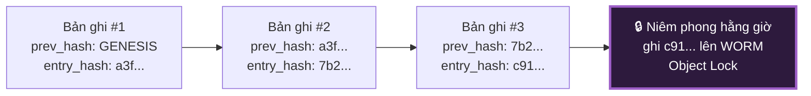
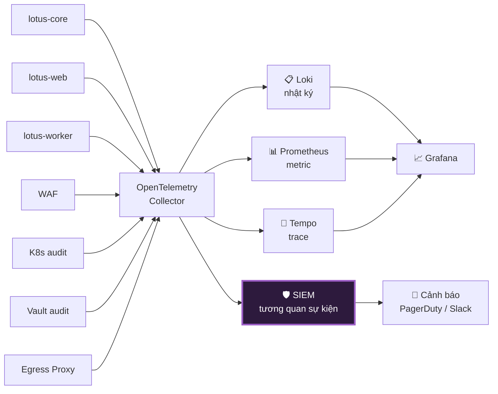

# 09 — Nhật Ký, Kiểm Toán & Giám Sát

> **Tài liệu:** Lotus Fin Security Documentation Set · **Phiên bản:** 1.0 · **Ngày:** 2026-09-18
> **Phân loại:** `INTERNAL`
> **Giảm thiểu các mối đe dọa:** `THR-018`, `THR-026`, `THR-034`, `THR-044`, `THR-045`
> **Ánh xạ chuẩn:** ISO/IEC 27001:2022 — A.8.15 (Logging), A.8.16 (Monitoring activities), A.8.17 (Clock synchronisation) · PCI DSS v4.0.1 — Req 10 · OWASP ASVS 4.0.3 — V7

---

## 1. Ba loại nhật ký — và vì sao phải tách bạch

Trộn lẫn ba loại nhật ký dưới đây là sai lầm thiết kế phổ biến, và nó gây ra hai hậu quả cùng lúc: dữ liệu nhạy cảm rò rỉ vào nơi kiểm soát lỏng, và bằng chứng kiểm toán bị lẫn trong hàng triệu dòng nhiễu không thể truy vấn.

| Loại | Mục đích | Phân loại | Thời hạn | Nơi lưu | Có thể sửa? |
| :--- | :--- | :---: | :--- | :--- | :---: |
| **Nhật ký ứng dụng** | Gỡ lỗi, chẩn đoán vận hành | 🟡 L2 | 90 ngày | Loki / CloudWatch | Có *(xoay vòng)* |
| **Nhật ký bảo mật** | Phát hiện tấn công, điều tra | 🟡 L2 | 1 năm | SIEM | Không |
| **Nhật ký kiểm toán** | Bằng chứng pháp lý, không thể chối bỏ | 🟠 L3 | **10 năm** | PostgreSQL + WORM | **Không bao giờ** |

---

## 2. Nhật ký ứng dụng

### 2.1. Định dạng bắt buộc

Log có cấu trúc dạng JSON — không bao giờ nối chuỗi. Điều này vừa chống log injection (`06 §3.2`), vừa làm cho log truy vấn được thay vì chỉ đọc bằng mắt.

| Trường | Bắt buộc | Ví dụ |
| :--- | :---: | :--- |
| `timestamp` | ✅ | RFC 3339 với múi giờ UTC |
| `level` | ✅ | `DEBUG` / `INFO` / `WARN` / `ERROR` |
| `service` | ✅ | `lotus-core` |
| `request_id` | ✅ | Theo quy chuẩn API §5.4 |
| `trace_id` | ✅ | OpenTelemetry — truy vết xuyên dịch vụ |
| `tenant_id` | ✅ *(nếu có ngữ cảnh)* | UUID |
| `user_id` | ✅ *(nếu đã xác thực)* | UUID |
| `message` | ✅ | Văn bản tĩnh, **không nội suy dữ liệu người dùng** |
| `error` | Khi có lỗi | Loại lỗi + mã, **không có stack trace ở production** |

### 2.2. 🚫 Kiểm soát chống rò rỉ qua log

> Như đã nêu tại `02 §5`, rò rỉ qua nhật ký là con đường rò rỉ dữ liệu tài chính phổ biến nhất và âm thầm nhất. Không ai tấn công gì cả — chỉ là một dòng `log.Printf("payload: %+v", req)` viết lúc gỡ lỗi rồi quên xóa.

Phòng chống bằng **bốn lớp kỹ thuật**, không bằng quy ước:

| Lớp | Cơ chế | Chặn được gì |
| :--- | :--- | :--- |
| 1 | **Kiểu dữ liệu tự che mờ** — các kiểu nhạy cảm cài đặt lại phương thức định dạng chuỗi để luôn trả về `[REDACTED]` | Vô tình in ra cả struct chứa dữ liệu nhạy cảm |
| 2 | **Logger chỉ nhận trường có nhãn** — không có API nào nhận một struct tùy ý rồi tự serialize | In cả object không chủ đích |
| 3 | **Lint chặn `%+v` và `%#v`** trong lời gọi log | Verb định dạng in toàn bộ nội dung struct |
| 4 | **Quét CI + quét runtime** — bộ test sinh dữ liệu chứa mẫu nhạy cảm và khẳng định chúng không xuất hiện trong log; cảnh báo runtime khi log khớp mẫu số tài khoản/mã số thuế | Mọi trường hợp lọt qua ba lớp trên |

**Danh sách cấm tuyệt đối trong nhật ký ứng dụng:**

| ❌ Không bao giờ ghi | ✅ Ghi thay thế |
| :--- | :--- |
| Mật khẩu, token, khóa API | *(không ghi gì cả)* |
| Số tài khoản ngân hàng | Token — `bat_7f3a9c21` |
| Cookie phiên | `session_id` đã băm |
| Số tiền giao dịch | *(không ghi — thuộc audit log)* |
| Nội dung tài chính chi tiết | ID tham chiếu bản ghi |
| PII *(tên, email, CCCD)* | ID người dùng |
| Toàn bộ payload request/response | Tên trường + kết quả validate |
| Stack trace *(ở production)* | Loại lỗi + mã lỗi |

---

## 3. 🔐 Nhật ký kiểm toán chống giả mạo

### 3.1. Danh mục sự kiện kiểm toán

Mọi hành động làm **thay đổi trạng thái** hoặc **truy cập dữ liệu nhạy cảm** đều sinh một bản ghi kiểm toán.

| Nhóm | Sự kiện | Mức |
| :--- | :--- | :---: |
| **Xác thực** | `auth.login.success` · `auth.login.failure` · `auth.logout` · `auth.mfa.success` · `auth.mfa.failure` · `auth.account.locked` · `auth.password.changed` · `auth.session.revoked` | INFO / **WARN** khi thất bại |
| **Phân quyền** | `authz.denied` · `authz.role.changed` · `authz.stepup.required` · `authz.stepup.completed` | **WARN** / HIGH |
| **Tài liệu** | `document.uploaded` · `document.scan.failed` · `document.parse.failed` · `document.downloaded` · `document.deleted` | INFO / **HIGH** khi quét thất bại |
| **Dữ liệu tài chính** | `ledger.created` · `ledger.modified` · `ledger.deleted` | **HIGH** |
| **Phân tích** | `forecast.generated` · `creditmetric.calculated` · `report.generated` · `report.exported` | INFO |
| **Cấp vốn** | `financing.offers.viewed` · `financing.application.submitted` · `financing.application.withdrawn` | **HIGH** |
| **Copilot** | `copilot.query` · `copilot.blocked` *(guardrail chặn)* | INFO / **HIGH** khi bị chặn |
| **Dữ liệu nhạy cảm** | `bankaccount.detokenized` · `tenant.data.exported` | 🔴 **CRITICAL** |
| **Quản trị** | `admin.jit.granted` · `admin.jit.used` · `admin.breakglass.activated` · `admin.config.changed` | 🔴 **CRITICAL** |
| **Kiểm toán** | `auditlog.read` — *bản thân việc đọc audit log cũng bị audit* | **HIGH** |
| **Bảo mật AI** | `ai.schema.rejected` · `ai.number.mismatch` · `ai.tenant.mismatch` | **HIGH** / 🔴 **CRITICAL** |

### 3.2. Cấu trúc bản ghi kiểm toán

| Trường | Mô tả |
| :--- | :--- |
| `seq` | Số thứ tự đơn điệu tăng — phát hiện được bản ghi bị xóa |
| `timestamp` | Đồng bộ NTP, UTC |
| `tenant_id` | Tenant liên quan |
| `actor_id` | Ai thực hiện *(người dùng, hệ thống, hoặc nhân sự nền tảng)* |
| `actor_type` | `user` / `system` / `platform_staff` |
| `action` | Mã sự kiện theo §3.1 |
| `resource_type` · `resource_id` | Đối tượng bị tác động |
| `outcome` | `success` / `failure` / `denied` |
| `source_ip` · `user_agent` | Ngữ cảnh mạng |
| `request_id` · `trace_id` | Liên kết sang nhật ký ứng dụng |
| `metadata` | Ngữ cảnh bổ sung — **không chứa dữ liệu nhạy cảm** |
| `prev_hash` | 🔗 Băm của bản ghi liền trước |
| `entry_hash` | 🔗 `SHA-256(nội dung bản ghi ‖ prev_hash)` |

### 3.3. Chuỗi băm chống giả mạo

**Cách cơ chế này hoạt động trong thực tế:** Mỗi bản ghi chứa băm của bản ghi liền trước. Nếu kẻ tấn công sửa bản ghi #2, băm của nó thay đổi, khiến `prev_hash` trong bản ghi #3 không còn khớp — và toàn bộ chuỗi từ đó trở đi đều lệch. Để che giấu, họ phải tính lại **mọi bản ghi sau đó**.

Nhưng ngay cả khi làm được điều đó, chuỗi vẫn sẽ lệch so với **bản niêm phong đã ghi lên WORM Object Lock**, mà theo thiết kế ở `08 §6` thì không thể xóa hay sửa được kể cả bằng credential quản trị.

**Các lớp bảo vệ cộng dồn:**

| Lớp | Cơ chế | Chặn được gì |
| :--- | :--- | :--- |
| 1 | Bảng chỉ cho phép `INSERT` — revoke `UPDATE`/`DELETE` kể cả với tài khoản ứng dụng | Sửa qua đường ứng dụng |
| 2 | Chuỗi băm liên kết | Sửa trực tiếp trong DB *(phát hiện được)* |
| 3 | Niêm phong hằng giờ lên WORM | Tính lại toàn bộ chuỗi |
| 4 | Số thứ tự đơn điệu | Xóa bản ghi *(thấy được lỗ hổng trong dãy số)* |
| 5 | Sao chép sang SIEM theo thời gian thực | Mất toàn bộ cơ sở dữ liệu |

**Rủi ro tồn dư được ghi nhận** *(`RR-07`)*: Kẻ tấn công có quyền quản trị hạ tầng vẫn có thể xóa các bản ghi **chưa được niêm phong** — cửa sổ tối đa 60 phút. Có thể thu hẹp bằng cách tăng tần suất niêm phong nếu yêu cầu tuân thủ siết chặt hơn.

---

## 4. Giám sát & Phát hiện

### 4.1. Kiến trúc

### 4.2. Use case phát hiện

Đây là danh mục quy tắc phát hiện được cấu hình trong SIEM. Mỗi quy tắc gắn với mối đe dọa cụ thể trong `03`.

| # | Use case phát hiện | Điều kiện kích hoạt | Mức | Đe dọa liên quan |
| :--- | :--- | :--- | :---: | :--- |
| `D-01` | Credential stuffing | > 50 lần đăng nhập thất bại từ 1 IP trong 5 phút | 🟠 | `THR-004` |
| `D-02` | Phun mật khẩu (password spraying) | > 20 tài khoản khác nhau bị thử từ 1 IP trong 1 giờ | 🟠 | `THR-004` |
| `D-03` | Đăng nhập bất khả thi về địa lý | Hai lần đăng nhập thành công ở hai quốc gia trong thời gian không thể di chuyển | 🟠 | Chiếm tài khoản |
| `D-04` | Bùng nổ lỗi phân quyền | > 10 lần `authz.denied` từ 1 người dùng trong 5 phút | 🟠 | `THR-016` — dò IDOR |
| `D-05` | **Nỗ lực truy cập chéo tenant** | Bất kỳ truy vấn nào bị RLS chặn | 🔴 | `THR-021` |
| `D-06` | Trích xuất dữ liệu hàng loạt | > 100 lần tải tài liệu từ 1 người dùng trong 1 giờ | 🟠 | Đánh cắp dữ liệu |
| `D-07` | Giải token bất thường | > 10 lần `bankaccount.detokenized` trong 1 giờ | 🔴 | Trích xuất dữ liệu `L4` |
| `D-08` | Tải lên tệp nhiễm mã độc | Bất kỳ `document.scan.failed` nào | 🟠 | `TA-6` |
| `D-09` | Parser sandbox bất thường | Timeout hoặc vượt giới hạn tài nguyên | 🟠 | `THR-030`, `THR-031` |
| `D-10` | **AI trả về số liệu lệch** | Bất kỳ `ai.number.mismatch` nào | 🔴 | `THR-028` |
| `D-11` | **AI trả về sai tenant** | Bất kỳ `ai.tenant.mismatch` nào | 🔴 | `THR-032` |
| `D-12` | Kết nối egress bị từ chối | Kết nối tới domain ngoài allowlist | 🔴 | Trích xuất dữ liệu · `THR-029` |
| `D-13` | Webhook sai chữ ký | > 5 lần trong 10 phút | 🟠 | `THR-035` |
| `D-14` | Ngân sách LLM tăng đột biến | Vượt 80% ngân sách tenant | 🟡 | `THR-042` |
| `D-15` | Kích hoạt break-glass | Bất kỳ lần nào | 🔴 | `THR-045` |
| `D-16` | Truy vấn bất thường từ nhân sự nền tảng | Truy cập ngoài giờ hoặc khối lượng bất thường | 🟠 | `THR-044` |
| `D-17` | Vi phạm CSP | Tăng đột biến báo cáo CSP | 🟠 | `THR-007` — nỗ lực XSS |
| `D-18` | Trôi cấu hình hạ tầng | Thực tế lệch khỏi Terraform | 🟡 | `THR-046` |
| `D-19` | Đứt chuỗi băm audit | Xác minh chuỗi thất bại | 🔴 | `THR-026` |
| `D-20` | Bí mật bị lộ trong mã nguồn | gitleaks phát hiện | 🔴 | Lộ credential |

> **Về `D-05` — quy tắc phát hiện có giá trị nhất trong danh mục:** Khi RLS chặn một truy vấn, điều đó có nghĩa là hai lớp phòng thủ phía trên (`04 §5.1` và `§5.2`) **đều đã thất bại**. Sự kiện này có hai cách diễn giải, và cả hai đều cần hành động ngay: hoặc có một lỗi lập trình nghiêm trọng trong logic phân quyền, hoặc có một cuộc tấn công chủ động đang diễn ra. Trong cả hai trường hợp, RLS vừa hoàn thành đúng vai trò lưới an toàn cuối cùng của nó — và cảnh báo này là cách duy nhất ta biết điều đó đã xảy ra.

### 4.3. Phân cấp cảnh báo

| Mức | Kênh | Thời gian phản hồi mục tiêu | Ví dụ |
| :--- | :--- | :--- | :--- |
| 🔴 `CRITICAL` | PagerDuty *(gọi điện)* + Slack + SMS | 15 phút | `D-05`, `D-10`, `D-11`, `D-12`, `D-19` |
| 🟠 `HIGH` | Slack `#security-alerts` + email | 1 giờ | `D-01`, `D-04`, `D-06` |
| 🟡 `MEDIUM` | Slack `#security-alerts` | 1 ngày làm việc | `D-14`, `D-18` |
| 🟢 `LOW` | Dashboard | Rà soát hằng tuần | Ghi nhận xu hướng |

### 4.4. Chống mệt mỏi cảnh báo (Alert Fatigue)

> Một hệ thống giám sát sinh ra quá nhiều cảnh báo sẽ bị con người bỏ qua — và khi đó nó tệ hơn không có giám sát, vì nó tạo ra cảm giác an toàn giả. Đây là chế độ hỏng phổ biến nhất của các hệ thống SIEM trong thực tế.

| Kiểm soát | Cách làm |
| :--- | :--- |
| Gom nhóm | Gộp các cảnh báo cùng loại trong cửa sổ thời gian |
| Ngưỡng động | Điều chỉnh theo đường cơ sở hành vi bình thường |
| Rà soát định kỳ | Hằng tháng — cảnh báo có tỉ lệ dương tính giả cao phải được tinh chỉnh hoặc loại bỏ |
| Đo lường | Theo dõi tỉ lệ dương tính giả cho từng quy tắc |
| Phân loại rõ ràng | Mỗi cảnh báo `CRITICAL` phải có playbook ứng phó tương ứng (`11 §4`) |

---

## 5. Đồng bộ thời gian

| Kiểm soát | Cấu hình |
| :--- | :--- |
| Nguồn thời gian | NTP từ nguồn tin cậy, tối thiểu 3 nguồn |
| Múi giờ | **UTC ở mọi nơi** — chuyển đổi chỉ thực hiện ở tầng hiển thị |
| Độ lệch cho phép | < 1 giây |
| Giám sát | Cảnh báo khi lệch quá ngưỡng |

> Yêu cầu này *(ISO 27001 A.8.17, PCI DSS Req 10.6)* tồn tại vì một lý do rất thực tế: khi điều tra sự cố, bạn cần dựng lại chính xác dòng thời gian từ nhiều nguồn log khác nhau. Nếu đồng hồ của `lotus-core` lệch 30 giây so với đồng hồ của WAF, thứ tự sự kiện trở nên mơ hồ — và trong một cuộc điều tra, thứ tự sự kiện chính là thứ quyết định *nguyên nhân* so với *hệ quả*.

---

## 6. Rà soát nhật ký định kỳ

| Hoạt động | Tần suất | Người thực hiện |
| :--- | :--- | :--- |
| Rà soát cảnh báo `CRITICAL`/`HIGH` | Hằng ngày | Trực bảo mật |
| Rà soát truy cập của nhân sự nền tảng | Hằng tuần | Security Lead |
| Xác minh chuỗi băm audit | Hằng ngày *(tự động)* | Hệ thống |
| Rà soát hiệu quả quy tắc phát hiện | Hằng tháng | Security Lead |
| Rà soát độ bao phủ log | Hằng quý | Security Lead + Backend Lead |
| Rà soát lịch sử break-glass | Hằng tháng | Security Lead |

---

## 7. Điều hướng

| ← Trước | Tiếp theo → |
| :--- | :--- |
| [08 — An toàn hạ tầng & Mạng](08-infrastructure-network-security.md) | [10 — Secure SDLC & Chuỗi cung ứng](10-secure-sdlc-supply-chain.md) |
