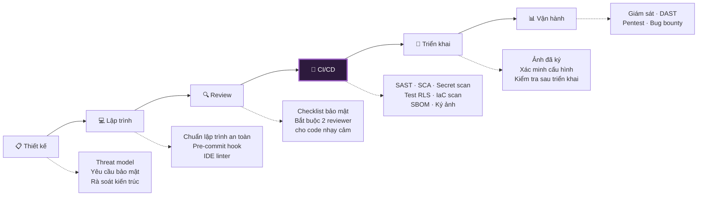

# 10 — Secure SDLC & An Toàn Chuỗi Cung Ứng

> **Tài liệu:** Lotus Fin Security Documentation Set · **Phiên bản:** 1.0 · **Ngày:** 2026-09-18
> **Phân loại:** `INTERNAL`
> **Giảm thiểu các mối đe dọa:** `THR-012`, `THR-020`, `THR-046` · Toàn bộ các mối đe dọa do lỗi lập trình gây ra
> **Ánh xạ chuẩn:** ISO/IEC 27001:2022 — A.8.25–A.8.32 · PCI DSS v4.0.1 — Req 6 · OWASP SAMM · SLSA Framework

---

## 1. Bảo mật trong vòng đời phát triển

Nguyên tắc nền tảng: **chi phí sửa một lỗ hổng tăng theo cấp số nhân theo giai đoạn phát hiện.** Một lỗi thiết kế phát hiện lúc vẽ kiến trúc tốn vài giờ thảo luận. Cũng lỗi đó phát hiện sau khi lên production có thể đồng nghĩa với việc viết lại một module, di trú dữ liệu, thông báo cho khách hàng, và trong trường hợp xấu nhất là thông báo vi phạm dữ liệu cho cơ quan quản lý.

---

## 2. Giai đoạn thiết kế

| Hoạt động | Khi nào bắt buộc | Kết quả đầu ra |
| :--- | :--- | :--- |
| Threat modeling | Tính năng mới chạm dữ liệu `L3`/`L4` · Thêm trust boundary · Thêm tích hợp bên ngoài | Cập nhật tài liệu `03` |
| Rà soát yêu cầu bảo mật | Mọi user story | Tiêu chí chấp nhận có phần bảo mật |
| Rà soát kiến trúc | Thay đổi kiến trúc | Cập nhật tài liệu `01` |
| Đánh giá tác động quyền riêng tư | Thay đổi cách xử lý dữ liệu cá nhân | Cập nhật tài liệu `02` |

### 2.1. Câu hỏi bắt buộc trước mỗi tính năng mới

Danh sách này cố tình ngắn — một checklist dài sẽ bị điền cho có lệ:

1. Tính năng này chạm vào dữ liệu ở mức phân loại nào?
2. Nó có tạo ra một trust boundary mới không?
3. Ai được phép thực hiện, và điều đó được thực thi ở đâu trong cả **ba** lớp phân quyền?
4. Nó có sinh ra sự kiện kiểm toán không? Sự kiện nào?
5. Nếu thành phần này bị xâm phạm hoàn toàn, kẻ tấn công làm được gì?
6. Nó có gửi dữ liệu ra ngoài trust boundary nào không?

---

## 3. Giai đoạn lập trình

### 3.1. Chuẩn lập trình an toàn — Go

| Quy tắc | Cưỡng chế bằng |
| :--- | :--- |
| Không nối chuỗi SQL | sqlc + Semgrep rule |
| Không dùng `math/rand` | Lint chặn import |
| Không dùng `%+v` / `%#v` trong log | Lint |
| Không bỏ qua lỗi *(`_ = err`)* | `errcheck` |
| Không panic trong đường xử lý request | Middleware `Recover` + review |
| Luôn `defer` đóng tài nguyên | `bodyclose`, `sqlclosecheck` |
| Luôn khai báo thuật toán khi verify JWT | Semgrep rule tùy chỉnh |
| So sánh giá trị mật mã bằng hàm thời gian hằng định | Semgrep rule |
| File < 200 dòng | Lint *(theo ADR-001)* |
| Tiền tệ dùng `numeric`, không dùng `float` | Semgrep rule + review |

### 3.2. Chuẩn lập trình an toàn — TypeScript/Next.js

| Quy tắc | Cưỡng chế bằng |
| :--- | :--- |
| Không dùng `dangerouslySetInnerHTML` | ESLint rule — vi phạm cần phê duyệt bảo mật |
| Không dùng `eval` / `new Function` | ESLint |
| TypeScript `strict` mode | `tsconfig` |
| Không có `any` ở ranh giới dữ liệu | ESLint |
| Validate dữ liệu ở ranh giới *(Zod)* | Review |
| Không lưu dữ liệu nhạy cảm trong client state | Review |
| Server Component không trả entity domain ra client | Review + DTO tường minh |

### 3.3. Pre-commit hook

| Kiểm tra | Công cụ |
| :--- | :--- |
| Quét bí mật | gitleaks |
| Định dạng mã | gofmt, prettier |
| Lint | golangci-lint, eslint |
| Kiểm tra kiểu | tsc |

---

## 4. Giai đoạn CI/CD — Cổng kiểm soát bảo mật

### 4.1. Mở rộng pipeline hiện tại

Pipeline CI hiện tại *(`.github/workflows/ci.yml`)* đã có **Semgrep SAST** với các bộ luật `p/security-audit`, `p/secrets`, `p/owasp-top-ten` — một nền tảng tốt. Tài liệu này định nghĩa bộ cổng kiểm soát đầy đủ cần bổ sung khi tech stack được triển khai.

> ⚠️ **Một thay đổi cần thực hiện ngay ở pipeline hiện tại:** job `security-scan` đang đặt `continue-on-error: true`. Điều này khiến Semgrep **báo cáo nhưng không chặn** — nghĩa là một lỗ hổng `CRITICAL` vẫn merge được vào `main` mà không ai bị chặn lại. Cấu hình này hợp lý trong giai đoạn khởi động *(tránh chặn đội khi chưa tinh chỉnh xong false positive)*, nhưng phải được gỡ bỏ trước khi hệ thống xử lý dữ liệu thật. Lộ trình đề xuất tại §4.4.

### 4.2. Bộ cổng kiểm soát đầy đủ

| # | Cổng | Công cụ | Chặn phát hành khi |
| :--- | :--- | :--- | :--- |
| 1 | **Quét bí mật** | gitleaks, Semgrep `p/secrets` | Phát hiện bất kỳ bí mật nào |
| 2 | **SAST — Go** | Semgrep, gosec | Phát hiện lỗi `HIGH`/`CRITICAL` |
| 3 | **SAST — TypeScript** | Semgrep, ESLint security plugin | Phát hiện lỗi `HIGH`/`CRITICAL` |
| 4 | **SCA — dependency** | govulncheck, `npm audit`, Trivy | CVE `HIGH`/`CRITICAL` có bản vá |
| 5 | **Quét ảnh container** | Trivy | CVE `HIGH`/`CRITICAL` |
| 6 | **Quét cấu hình IaC** | Checkov, tfsec | Lỗi cấu hình `HIGH` |
| 7 | **🔑 Test cô lập tenant (RLS)** | Test tích hợp trên PostgreSQL thật | **Bất kỳ test nào thất bại** |
| 8 | **Kiểm tra quyền DB** | Script tùy chỉnh | Tài khoản ứng dụng có `BYPASSRLS` hoặc quyền thừa |
| 9 | **Test regression masking** | Test tùy chỉnh | Dữ liệu chưa che mờ lọt qua ranh giới `TB-5` |
| 10 | **Test rò rỉ log** | Test tùy chỉnh | Mẫu dữ liệu nhạy cảm xuất hiện trong log |
| 11 | **Đối chiếu OpenAPI** | Script tùy chỉnh | Tồn tại route không có trong spec |
| 12 | **Sinh SBOM** | Syft *(CycloneDX)* | — *(luôn sinh)* |
| 13 | **Ký ảnh container** | Cosign | — *(luôn ký)* |
| 14 | **DAST** *(chỉ trên staging)* | OWASP ZAP | Lỗ hổng `HIGH` |

### 4.3. Cổng số 7 — Test cô lập tenant

Đây là cổng kiểm soát quan trọng nhất trong pipeline, vì nó bảo vệ trực tiếp `THR-021` — mối đe dọa nguy hiểm nhất của một nền tảng SaaS đa tenant.

Với **mỗi bảng nghiệp vụ**, bộ test tích hợp phải chứng minh trên một instance PostgreSQL thật *(không phải mock)*:

| Kịch bản test | Kỳ vọng |
| :--- | :--- |
| Đặt `app.current_tenant` = A, `SELECT` toàn bảng | **Không** trả về hàng nào của tenant B |
| Đặt `app.current_tenant` = A, `INSERT` với `tenant_id` = B | Bị từ chối bởi `WITH CHECK` |
| Đặt `app.current_tenant` = A, `UPDATE` hàng của B | Ảnh hưởng 0 hàng |
| Đặt `app.current_tenant` = A, `DELETE` hàng của B | Ảnh hưởng 0 hàng |
| **Không** đặt `app.current_tenant` | Truy vấn thất bại *(không phải trả về mọi thứ)* |
| Kiểm tra `FORCE ROW LEVEL SECURITY` đã bật | Đã bật |
| Kiểm tra tài khoản ứng dụng | **Không** có `BYPASSRLS` |

**Quy tắc cưỡng chế:** Thêm một bảng nghiệp vụ mới mà không có bộ test tương ứng → CI thất bại. Danh sách bảng cần test được sinh tự động từ schema, không phải duy trì thủ công — vì một danh sách duy trì thủ công chắc chắn sẽ lạc hậu.

### 4.4. Lộ trình siết chặt cổng kiểm soát

| Giai đoạn | Cấu hình | Điều kiện chuyển giai đoạn |
| :--- | :--- | :--- |
| **Hiện tại** — Khởi động | `continue-on-error: true` cho mọi cổng · Chỉ báo cáo | Tech stack được triển khai |
| **Giai đoạn 2** — Chặn có chọn lọc | Cổng 1 *(bí mật)*, 7 *(RLS)*, 9 *(masking)* chuyển sang chặn cứng | Tinh chỉnh xong false positive |
| **Giai đoạn 3** — Chặn đầy đủ | Mọi cổng chặn cứng · Ngoại lệ cần Security Lead phê duyệt có thời hạn | Trước khi xử lý dữ liệu thật |

> Việc ghi rõ lộ trình này quan trọng hơn vẻ ngoài của nó. Cấu hình `continue-on-error` là một khoản **nợ bảo mật**, và nợ không được ghi ra thì không bao giờ được trả. Nhiều dự án bật `continue-on-error` "tạm thời" trong tuần đầu tiên rồi giữ nguyên tới lúc lên production, vì không ai định nghĩa điều kiện để gỡ nó.

---

## 5. An toàn chuỗi cung ứng

### 5.1. Quản lý dependency

| Kiểm soát | Chính sách |
| :--- | :--- |
| Khóa phiên bản | `go.sum`, `package-lock.json` bắt buộc commit |
| Xác minh checksum | Go module proxy + `GONOSUMDB` cấu hình đúng |
| Dependency mới | Cần review: mức độ bảo trì, số người dùng, lịch sử CVE, số lượng dependency con |
| Cập nhật tự động | Dependabot cho bản vá bảo mật |
| Dependency trực tiếp | Giữ ở mức tối thiểu — mỗi thư viện là một bề mặt tấn công |
| Thư viện mật mã | **Chỉ** dùng thư viện chuẩn của Go |
| Chống typosquatting | Đối chiếu tên gói với danh sách đã duyệt |

### 5.2. SBOM & Xuất xứ (Provenance)

| Kiểm soát | Cấu hình |
| :--- | :--- |
| Định dạng SBOM | CycloneDX, sinh mỗi lần build |
| Lưu trữ | Gắn kèm release artifact |
| Mức SLSA | Mục tiêu Level 2 *(có xuất xứ đã ký)* |
| Ký ảnh | Cosign keyless qua OIDC |
| Xác minh khi triển khai | Admission controller từ chối ảnh không có chữ ký hợp lệ |
| Build có thể tái lập | Mục tiêu — cho phép kiểm chứng độc lập |

> **Vì sao SBOM có giá trị thực tế, không chỉ là yêu cầu tuân thủ:** Khi một CVE nghiêm trọng được công bố cho một thư viện phổ biến, câu hỏi đầu tiên và cấp bách nhất là *"chúng ta có dùng nó không, ở đâu, phiên bản nào?"*. Không có SBOM, việc trả lời câu hỏi đó mất nhiều giờ tìm kiếm thủ công qua nhiều repository và nhiều phiên bản đang chạy — trong khi kẻ tấn công đã bắt đầu quét diện rộng. Có SBOM, đó là một truy vấn mất vài giây.

### 5.3. Bảo vệ nhánh & Toàn vẹn mã nguồn

| Kiểm soát | Cấu hình |
| :--- | :--- |
| Bảo vệ nhánh `main` | Không push trực tiếp · Bắt buộc pull request |
| Số reviewer bắt buộc | 1 · **2 cho code nhạy cảm bảo mật** *(auth, crypto, RLS, ranh giới AI)* |
| Ký commit | Khuyến khích GPG/SSH signing |
| CODEOWNERS | Security Lead là owner bắt buộc cho thư mục nhạy cảm |
| Trạng thái CI | Mọi cổng phải xanh trước khi merge |
| Lịch sử tuyến tính | Bắt buộc — giúp truy vết thay đổi rõ ràng |

---

## 6. Kiểm thử bảo mật

| Loại | Tần suất | Phạm vi | Ai thực hiện |
| :--- | :--- | :--- | :--- |
| Unit test cho kiểm soát bảo mật | Mỗi commit | Logic phân quyền, masking, validate | Lập trình viên |
| **Test cô lập tenant** | Mỗi commit | Mọi bảng nghiệp vụ | Tự động |
| Test tích hợp | Mỗi PR | Luồng xác thực, phân quyền | Tự động |
| DAST | Hằng tuần | Staging | Tự động |
| Kiểm thử xâm nhập | Hằng năm + sau thay đổi lớn | Toàn hệ thống | Bên thứ ba |
| **Mô phỏng AI bị xâm phạm** | Hằng quý | Ranh giới `TB-5` | Đội nội bộ |
| Diễn tập break-glass | Hằng quý | Quy trình khẩn cấp | Đội nội bộ |
| Diễn tập khôi phục dữ liệu | Hằng tháng | Sao lưu | DevOps |

### 6.1. Bài tập mô phỏng AI bị xâm phạm

Bài tập này kiểm chứng trực tiếp giả định phòng thủ cốt lõi tại `07 §7.4`. Đội đỏ được cấp **quyền thực thi mã hoàn toàn bên trong container `lotus-ai`** và có nhiệm vụ:

| Mục tiêu tấn công | Kết quả kỳ vọng |
| :--- | :--- |
| Đọc dữ liệu tài chính từ PostgreSQL | ❌ Thất bại — không có credential, NetworkPolicy chặn |
| Gọi ra Internet | ❌ Thất bại — egress `deny-all` |
| Gọi Bank API | ❌ Thất bại — Egress Proxy từ chối theo workload |
| Sửa một chỉ số DSCR | ❌ Thất bại — engine tính độc lập, có đối chiếu chéo |
| Truy cập dữ liệu tenant khác | ❌ Thất bại — không có đường tới DB |
| Làm sập nền tảng | ❌ Thất bại — suy giảm chức năng có kiểm soát |
| **Bất kỳ mục tiêu nào thành công** | 🔴 Phát hiện nghiêm trọng — phải sửa trước khi phát hành |

> Đây là cách duy nhất để biết rằng các kiểm soát tại `07 §7.4` thực sự hoạt động, thay vì chỉ tồn tại trên giấy. Một giả định phòng thủ chưa từng được kiểm chứng bằng thực nghiệm chỉ là một hy vọng được viết ra trang trọng.

---

## 7. Đào tạo & Nhận thức

| Đối tượng | Nội dung | Tần suất |
| :--- | :--- | :--- |
| Toàn đội | Nhận thức an toàn thông tin, nhận biết lừa đảo | Khi gia nhập + hằng năm |
| Lập trình viên | Lập trình an toàn, OWASP Top 10, đặc thù Go/TypeScript | Khi gia nhập + hằng nửa năm |
| Lập trình viên | Threat modeling thực hành | Hằng năm |
| DevOps | An toàn hạ tầng, quản lý bí mật | Khi gia nhập + hằng năm |
| Toàn đội | Diễn tập ứng phó sự cố | Hằng quý |
| Toàn đội | Mô phỏng tấn công lừa đảo | Hằng quý |

---

## 8. Điều hướng

| ← Trước | Tiếp theo → |
| :--- | :--- |
| [09 — Nhật ký, Kiểm toán & Giám sát](09-logging-audit-monitoring.md) | [11 — Ứng phó sự cố & Liên tục kinh doanh](11-incident-response-bcdr.md) |
