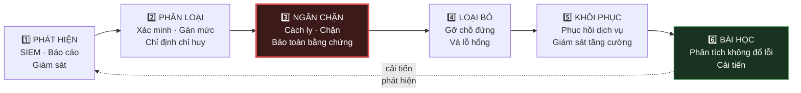

# 11 — Ứng Phó Sự Cố & Liên Tục Kinh Doanh

> **Tài liệu:** Lotus Fin Security Documentation Set · **Phiên bản:** 1.0 · **Ngày:** 2026-09-18
> **Phân loại:** `INTERNAL`
> **Ánh xạ chuẩn:** ISO/IEC 27001:2022 — A.5.24–A.5.30 (Incident management & Continuity), A.8.13 (Backup) · PCI DSS v4.0.1 — Req 12.10 · NIST SP 800-61r2

---

## 1. Nguyên tắc

Kế hoạch ứng phó sự cố tồn tại vì một lý do đơn giản: **vào lúc sự cố xảy ra, không ai có đủ bình tĩnh và thời gian để thiết kế quy trình.** Áp lực cao, thông tin không đầy đủ, đồng hồ đang chạy, và mọi quyết định đều có thể làm tình hình tệ hơn. Kế hoạch được viết trước, trong lúc còn tỉnh táo, để lúc đó chỉ cần *thực thi* thay vì *nghĩ ra*.

Bốn nguyên tắc chi phối mọi playbook trong tài liệu này:

1. **Ngăn chặn trước, điều tra sau.** Cầm máu trước khi chẩn đoán. Một cuộc điều tra hoàn hảo trên một hệ thống vẫn đang rò rỉ dữ liệu là một thất bại.
2. **Bảo toàn bằng chứng.** Đừng vội khởi động lại hay xóa container — làm vậy là hủy bằng chứng cần cho cả điều tra kỹ thuật lẫn nghĩa vụ pháp lý.
3. **Giả định kẻ tấn công đang quan sát.** Trao đổi qua kênh ngoài băng tần *(out-of-band)* nếu nghi ngờ hệ thống nội bộ bị xâm phạm.
4. **Ghi chép mọi thứ theo thời gian thực.** Dòng thời gian tái dựng sau sự cố luôn kém chính xác hơn ghi chép tại chỗ.

---

## 2. Phân loại mức độ sự cố

| Mức | Định nghĩa | Ví dụ | Phản hồi | Thông báo |
| :--- | :--- | :--- | :--- | :--- |
| 🔴 **S1 — Nghiêm trọng** | Rò rỉ dữ liệu đã xác nhận · Hệ thống bị chiếm quyền · Toàn bộ dịch vụ ngừng | Xác nhận rò rỉ dữ liệu tài chính đa tenant · Ransomware · Chiếm quyền quản trị | **15 phút** · Toàn đội · Lập phòng chỉ huy | Ban lãnh đạo ngay · Khách hàng trong 24h · Cơ quan quản lý theo luật định |
| 🟠 **S2 — Cao** | Nghi ngờ rò rỉ · Xâm phạm một tenant · Suy giảm dịch vụ nghiêm trọng | Chiếm một tài khoản · Khai thác lỗ hổng thành công · RLS bị vượt qua | **1 giờ** · Đội bảo mật + đội liên quan | Ban lãnh đạo trong 4h · Khách hàng bị ảnh hưởng trong 72h |
| 🟡 **S3 — Trung bình** | Nỗ lực tấn công bị chặn · Lỗ hổng phát hiện trên production | Credential stuffing bị chặn · CVE `CRITICAL` chưa vá | **4 giờ** · Đội bảo mật | Báo cáo nội bộ |
| 🟢 **S4 — Thấp** | Bất thường cần điều tra | Cảnh báo bất thường · Nghi vấn cần xác minh | **1 ngày làm việc** | Ghi nhận |

---

## 3. Quy trình ứng phó

### 3.1. Vai trò trong sự cố

| Vai trò | Trách nhiệm |
| :--- | :--- |
| **Chỉ huy sự cố** | Ra quyết định · Điều phối · **Không** trực tiếp làm kỹ thuật |
| Trưởng nhóm kỹ thuật | Điều tra và khắc phục |
| Người ghi chép | Ghi dòng thời gian theo thời gian thực |
| Liên lạc | Trao đổi với ban lãnh đạo, khách hàng, cơ quan quản lý |
| Cố vấn pháp lý | Nghĩa vụ thông báo, bảo toàn bằng chứng |

> **Vì sao chỉ huy sự cố không được trực tiếp gỡ lỗi:** Đây là sai lầm phổ biến nhất trong các sự cố thực tế. Người giỏi kỹ thuật nhất tự nhiên sẽ lao vào terminal — và ngay lập tức, không còn ai theo dõi bức tranh tổng thể, không ai quyết định có nên thông báo khách hàng, không ai nhận ra rằng đội đã điều tra nhầm hướng suốt 40 phút. Chỉ huy giữ vai trò điều phối, và đó là một công việc toàn thời gian trong lúc sự cố.

---

## 4. Playbook ứng phó

### 4.1. `PB-01` — Nghi ngờ rò rỉ dữ liệu

| Bước | Hành động | Thời gian mục tiêu |
| :--- | :--- | :--- |
| 1 | Xác minh cảnh báo — phân biệt dương tính giả | 15 phút |
| 2 | Xác định phạm vi: tenant nào, dữ liệu nào, khối lượng bao nhiêu | 30 phút |
| 3 | **Ngăn chặn:** thu hồi credential liên quan · chặn IP · vô hiệu hóa tài khoản | Ngay lập tức |
| 4 | Bảo toàn bằng chứng: snapshot, xuất log, **không khởi động lại** | 1 giờ |
| 5 | Xác định con đường xâm nhập qua audit log và chuỗi băm | 4 giờ |
| 6 | Đánh giá nghĩa vụ thông báo | 12 giờ |
| 7 | Thông báo khách hàng bị ảnh hưởng | Trong 24h *(S1)* |
| 8 | Khắc phục căn nguyên | Theo SLA |
| 9 | Phân tích sau sự cố | Trong 5 ngày làm việc |

### 4.2. `PB-02` — Chiếm đoạt tài khoản

| Bước | Hành động |
| :--- | :--- |
| 1 | Thu hồi **toàn bộ** phiên của tài khoản *(phía server)* |
| 2 | Buộc đặt lại mật khẩu + đăng ký lại thiết bị MFA |
| 3 | Rà soát audit log tìm hành động đã thực hiện trong thời gian bị chiếm |
| 4 | Hoàn tác thay đổi trái phép nếu có |
| 5 | Kiểm tra dấu hiệu lan sang tài khoản khác trong cùng tenant |
| 6 | Thông báo chủ tài khoản và `OWNER` của tenant |
| 7 | Nếu có nộp hồ sơ vay trái phép → liên hệ ngân hàng đối tác ngay |

### 4.3. `PB-03` — 🔥 Dịch vụ AI bị xâm phạm

> Đây là playbook đặc thù nhất của Lotus Fin, và cũng là playbook mà kiến trúc hệ thống được thiết kế để làm cho nó *đơn giản*.

| Bước | Hành động | Ghi chú |
| :--- | :--- | :--- |
| 1 | **Cô lập ngay:** thu hẹp NetworkPolicy của `lotus-ai` về `deny-all` tuyệt đối | Nền tảng vẫn chạy — xem bước 3 |
| 2 | Snapshot container phục vụ điều tra | Bảo toàn bằng chứng |
| 3 | **Kích hoạt chế độ suy giảm chức năng:** tắt Copilot và diễn giải ngôn ngữ tự nhiên; dashboard, chỉ số, cảnh báo **vẫn hoạt động đầy đủ** | `02 §3.3` — đây là lý do AI chỉ ở mức trọng yếu trung bình |
| 4 | Xác minh **không** có truy cập dữ liệu trái phép: kiểm tra log DB, log egress, cảnh báo `D-05`/`D-12` | Kiến trúc dự kiến kết quả là *không có* |
| 5 | Luân chuyển API key LLM và chứng chỉ mTLS của dịch vụ AI | `AS-S08`, `AS-S06` |
| 6 | Phối hợp với **nhóm AI Security** để phân tích căn nguyên | Ranh giới trách nhiệm `README §2` |
| 7 | Rà soát lại mọi phản hồi AI trong cửa sổ bị ảnh hưởng, đối chiếu với giá trị engine | `07 §7.5` |
| 8 | Khôi phục dịch vụ sau khi vá và xác minh | — |

> **Vì sao playbook này ngắn hơn hẳn các playbook khác:** Bởi vì phần lớn công việc ứng phó đã được *thực hiện trước* tại tầng kiến trúc. Dịch vụ AI không có credential cơ sở dữ liệu để thu hồi, không có đường ra Internet để chặn, không có quyền ghi dữ liệu để hoàn tác. Câu hỏi "kẻ tấn công đã lấy được gì?" — vốn là câu hỏi tốn kém nhất trong mọi cuộc điều tra — ở đây có câu trả lời được biết trước từ lúc thiết kế.

### 4.4. `PB-04` — Ransomware

| Bước | Hành động |
| :--- | :--- |
| 1 | Cách ly ngay hệ thống bị ảnh hưởng khỏi mạng |
| 2 | **Xác minh tính toàn vẹn của bản sao lưu bất biến** *(Object Lock)* |
| 3 | Đánh giá phạm vi mã hóa |
| 4 | **Không trả tiền chuộc** — khôi phục từ bản sao lưu |
| 5 | Dựng lại hạ tầng từ IaC *(sạch, không dựa vào hệ thống bị nhiễm)* |
| 6 | Khôi phục dữ liệu từ bản sao lưu đã xác minh |
| 7 | Luân chuyển toàn bộ credential |
| 8 | Điều tra pháp chứng để xác định con đường xâm nhập ban đầu |

### 4.5. `PB-05` — Lộ bí mật

| Bước | Hành động |
| :--- | :--- |
| 1 | Xác định bí mật nào bị lộ và phạm vi tác động *(tra bảng `02 §3.2`)* |
| 2 | **Luân chuyển ngay lập tức** |
| 3 | Rà soát log tìm dấu hiệu bí mật đã bị sử dụng |
| 4 | Nếu lộ trong Git → xóa khỏi lịch sử **và** coi như đã bị xâm phạm vĩnh viễn |
| 5 | Xác định vì sao cổng kiểm soát số 1 *(gitleaks)* không chặn được |
| 6 | Bổ sung mẫu phát hiện |

### 4.6. `PB-06` — Tấn công từ chối dịch vụ

| Bước | Hành động |
| :--- | :--- |
| 1 | Xác định tầng tấn công *(L3/L4 hay L7)* |
| 2 | Kích hoạt chế độ bảo vệ tăng cường của CDN |
| 3 | Siết rate limit tạm thời |
| 4 | Chặn dải IP nguồn nếu đặc trưng rõ ràng |
| 5 | Mở rộng tài nguyên **trong phạm vi trần chi phí** |
| 6 | Nếu là tấn công nhắm vào chi phí LLM → kích hoạt circuit breaker ngân sách |
| 7 | Trao đổi tình trạng với người dùng qua trang trạng thái |

---

## 5. Thông báo vi phạm dữ liệu

| Đối tượng | Thời hạn | Nội dung |
| :--- | :--- | :--- |
| Ban lãnh đạo | Ngay *(S1)* / 4 giờ *(S2)* | Đánh giá ban đầu, phạm vi, hành động đang thực hiện |
| Tenant bị ảnh hưởng | 24 giờ *(S1)* / 72 giờ *(S2)* | Dữ liệu nào bị ảnh hưởng, việc gì đã làm, người dùng cần làm gì |
| Cơ quan quản lý | Theo yêu cầu pháp lý áp dụng | Theo mẫu quy định |
| Ngân hàng đối tác | 24 giờ nếu ảnh hưởng tới hồ sơ tín dụng | Theo thỏa thuận tích hợp |
| Công chúng | Khi cần thiết | Qua trang trạng thái và thông cáo |

**Nội dung bắt buộc trong thông báo cho khách hàng:**

* Chuyện gì đã xảy ra và khi nào phát hiện;
* Dữ liệu nào bị ảnh hưởng — **cụ thể**, không nói chung chung;
* Chúng ta đã làm gì để ngăn chặn;
* Khách hàng nên làm gì *(đổi mật khẩu, rà soát hoạt động)*;
* Đầu mối liên hệ để hỏi thêm.

> Sự minh bạch trong thông báo không phải là lựa chọn về đạo đức — nó là lựa chọn thực dụng. Trong hầu hết các sự cố lớn của ngành, thiệt hại về uy tín đến từ việc *che giấu và giảm nhẹ* nhiều hơn là từ bản thân vụ rò rỉ. Một thông báo trung thực trong 24 giờ gây tổn hại ít hơn nhiều so với việc sự thật bị phát hiện sau ba tháng.

---

## 6. Liên tục kinh doanh & Khôi phục thảm họa

### 6.1. Mục tiêu khôi phục

Theo bảng `02 §3.3`:

| Dịch vụ | RTO | RPO | Chiến lược |
| :--- | :--- | :--- | :--- |
| `lotus-core` | 15 phút | 0 | Multi-AZ, tự động chuyển đổi |
| PostgreSQL | 30 phút | 5 phút | Bản sao streaming + khôi phục theo thời điểm |
| `lotus-web` | 15 phút | 0 | Multi-AZ |
| Redis | 10 phút | 15 phút | Mất phiên chấp nhận được — buộc đăng nhập lại |
| Object Store | 1 giờ | 0 | Sao chép liên vùng |
| `lotus-ai` | 4 giờ | N/A | **Suy giảm chức năng có kiểm soát** |
| Vault/KMS | 15 phút | 0 | HA + sao lưu liên vùng |

### 6.2. Kịch bản thảm họa

| Kịch bản | Phản hồi | RTO |
| :--- | :--- | :--- |
| Mất một availability zone | Tự động chuyển sang AZ khác | 15 phút |
| Mất toàn bộ một vùng | Khôi phục thủ công sang vùng dự phòng | 4 giờ |
| Hỏng dữ liệu cơ sở dữ liệu | Khôi phục theo thời điểm | 2 giờ |
| Ransomware | Dựng lại từ IaC + bản sao lưu bất biến | 8 giờ |
| Nhà cung cấp LLM ngừng hoạt động | Suy giảm chức năng có kiểm soát *(không cần khôi phục)* | 0 — dịch vụ cốt lõi không bị ảnh hưởng |
| Bank API ngừng hoạt động | Circuit breaker, dùng dữ liệu cache, thông báo người dùng | 0 — chức năng khác vẫn chạy |

### 6.3. Lịch diễn tập

| Bài diễn tập | Tần suất | Phạm vi |
| :--- | :--- | :--- |
| Khôi phục dữ liệu từ sao lưu | Hằng tháng | Khôi phục vào môi trường cách ly + kiểm tra toàn vẹn |
| Diễn tập trên bàn *(tabletop)* | Hằng quý | Diễn kịch bản sự cố, không chạm hệ thống thật |
| Chuyển đổi dự phòng | Hằng nửa năm | Chuyển AZ thật |
| Break-glass | Hằng quý | Kiểm chứng quy trình khẩn cấp |
| Mô phỏng AI bị xâm phạm | Hằng quý | `10 §6.1` |
| Diễn tập khôi phục toàn diện | Hằng năm | Dựng lại từ đầu trong môi trường cách ly |

---

## 7. Phân tích sau sự cố

| Nguyên tắc | Chi tiết |
| :--- | :--- |
| **Không đổ lỗi** | Tập trung vào lỗi hệ thống và quy trình, không vào cá nhân |
| Thời hạn | Trong 5 ngày làm việc kể từ khi khắc phục xong |
| Người tham gia | Toàn bộ những người liên quan tới sự cố |
| Kết quả đầu ra | Dòng thời gian · Căn nguyên · Hạng mục hành động có người chịu trách nhiệm và thời hạn |
| Theo dõi | Hạng mục hành động vào backlog, rà soát hằng tháng |
| Chia sẻ | Bài học phổ biến cho toàn đội |

### 7.1. Câu hỏi bắt buộc trong mỗi phân tích

1. Vì sao hệ thống phát hiện không bắt được sớm hơn? *(Hoặc: nó có bắt được không, và ta có phản hồi không?)*
2. Kiểm soát nào đã hoạt động đúng như thiết kế?
3. Kiểm soát nào đã thất bại, và nó thất bại vì lỗi thiết kế hay lỗi vận hành?
4. Mối đe dọa này có trong tài liệu `03` không? Nếu không, vì sao threat model bỏ sót?
5. Ta có thể tự động hóa phần nào của quy trình ứng phó này?
6. Một sự cố tương tự nhưng nghiêm trọng hơn sẽ diễn ra thế nào?

> Câu hỏi số 2 quan trọng ngang câu hỏi số 3, và thường bị bỏ qua. Biết được kiểm soát nào đã cứu mình sẽ ngăn việc vô tình gỡ bỏ nó trong một đợt tối ưu hóa sáu tháng sau.

---

## 8. Điều hướng

| ← Trước | Tiếp theo → |
| :--- | :--- |
| [10 — Secure SDLC & Chuỗi cung ứng](10-secure-sdlc-supply-chain.md) | [12 — Bản đồ tuân thủ ISO 27001 & PCI DSS](12-compliance-iso27001-pcidss.md) |
