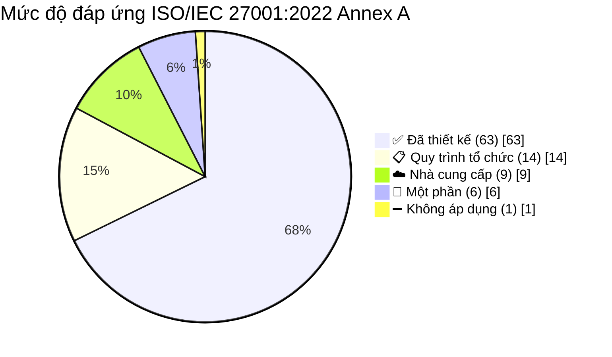

# 12 — Bản Đồ Tuân Thủ: ISO/IEC 27001:2022 & PCI DSS v4.0.1

> **Tài liệu:** Lotus Fin Security Documentation Set · **Phiên bản:** 1.0 · **Ngày:** 2026-09-18
> **Phân loại:** `INTERNAL`
> **Mục đích:** Ánh xạ toàn bộ kiểm soát đã thiết kế trong bộ tài liệu này sang hai khung chuẩn quốc tế, phục vụ đánh giá độc lập và kiểm toán.

---

## 1. ⚠️ Tuyên bố phạm vi PCI DSS (Scoping Statement)

> **Đây là mục quan trọng nhất của tài liệu, và nó phải được đọc trước mọi bảng mapping.**

### 1.1. Xác định phạm vi

PCI DSS áp dụng cho các tổ chức **lưu trữ, xử lý hoặc truyền tải dữ liệu chủ thẻ (Cardholder Data — CHD)** hoặc **dữ liệu xác thực nhạy cảm (Sensitive Authentication Data — SAD)**. Cụ thể:

| Loại dữ liệu | Thành phần | Lotus Fin có xử lý? |
| :--- | :--- | :---: |
| **CHD** | Số thẻ chính (PAN) | ❌ **Không** |
| **CHD** | Tên chủ thẻ | ❌ Không |
| **CHD** | Ngày hết hạn thẻ | ❌ Không |
| **CHD** | Mã dịch vụ | ❌ Không |
| **SAD** | Dữ liệu vệt từ đầy đủ | ❌ Không |
| **SAD** | CAV2/CVC2/CVV2/CID | ❌ Không |
| **SAD** | PIN / PIN block | ❌ Không |

**Căn cứ loại trừ:** Theo SRS §1.2, việc *"tự động giải ngân trực tiếp tài khoản ngân hàng thực tế"* nằm **ngoài phạm vi** hệ thống — Lotus Fin dừng ở mức đánh giá hồ sơ và mô phỏng sandbox. Hệ thống không nhận thanh toán bằng thẻ, không lưu thông tin thẻ, không đóng vai trò đơn vị chấp nhận thẻ hay nhà cung cấp dịch vụ thanh toán.

### 1.2. Kết luận về phạm vi

> ### 🔍 **PCI DSS v4.0.1 KHÔNG áp dụng bắt buộc cho Lotus Fin ở phiên bản hiện tại.**
>
> Vùng dữ liệu chủ thẻ (Cardholder Data Environment — CDE) của hệ thống là **rỗng**.

### 1.3. Vì sao vẫn thực hiện mapping

Việc tuyên bố "không áp dụng" rồi bỏ qua sẽ là một sai lầm về mặt quản trị rủi ro, vì ba lý do thực tế:

1. **Lotus Fin xử lý dữ liệu có mức nhạy cảm tương đương.** Số tài khoản ngân hàng, dòng tiền doanh nghiệp và hồ sơ tín dụng không phải dữ liệu thẻ, nhưng hậu quả khi rò rỉ thì hoàn toàn so sánh được. Các nguyên tắc của PCI DSS — thu hẹp phạm vi, token hóa, phân đoạn mạng, giám sát toàn diện — được thiết kế cho đúng loại rủi ro này.

2. **Phạm vi có thể mở rộng trong tương lai.** Nếu hệ thống tiến tới tích hợp giải ngân thật hoặc thu phí dịch vụ bằng thẻ, PCI DSS sẽ trở thành bắt buộc. Xây dựng kiến trúc đáp ứng sẵn rẻ hơn nhiều so với cải tạo sau này — đặc biệt với các kiểm soát như token hóa hay phân tách khóa theo tenant, vốn không thể trang bị bổ sung cho dữ liệu đã tồn tại.

3. **Đối tác ngân hàng sẽ hỏi.** Khi tích hợp với tổ chức tín dụng, bộ phận quản trị rủi ro của họ đánh giá nhà cung cấp theo các khung chuẩn quen thuộc. Có sẵn bản đồ đối chiếu rút ngắn đáng kể quá trình thẩm định.

**Vì vậy:** PCI DSS v4.0.1 được áp dụng như một **chuẩn nền tự nguyện (voluntary security baseline)**, với cột trạng thái phản ánh trung thực mức độ đáp ứng — không tuyên bố tuân thủ chính thức, vì một tuyên bố tuân thủ PCI DSS chỉ có giá trị khi được QSA đánh giá độc lập.

---

## 2. Ký hiệu trạng thái

| Ký hiệu | Ý nghĩa |
| :--- | :--- |
| ✅ **Đã thiết kế** | Kiểm soát đã được đặc tả đầy đủ trong bộ tài liệu, sẵn sàng triển khai |
| 🔶 **Một phần** | Đã thiết kế phần kỹ thuật, còn thiếu phần quy trình tổ chức |
| 📋 **Quy trình tổ chức** | Thuộc trách nhiệm quản trị, nằm ngoài phạm vi thiết kế kỹ thuật |
| ☁️ **Nhà cung cấp** | Thuộc trách nhiệm nhà cung cấp hạ tầng cloud *(mô hình trách nhiệm chia sẻ)* |
| ➖ **Không áp dụng** | Có lý do loại trừ tường minh |

---

## 3. 📘 ISO/IEC 27001:2022 — Annex A (93 controls)

### 3.1. A.5 — Kiểm soát tổ chức (Organizational Controls) — 37 controls

| Control | Tên | Trạng thái | Triển khai trong Lotus Fin |
| :--- | :--- | :---: | :--- |
| A.5.1 | Chính sách an toàn thông tin | 🔶 | Bộ tài liệu này là phần kỹ thuật; cần bổ sung chính sách cấp tổ chức |
| A.5.2 | Vai trò và trách nhiệm ATTT | ✅ | `02 §7` — ma trận RACI · `11 §3.1` — vai trò trong sự cố |
| A.5.3 | Phân tách nhiệm vụ | ✅ | `04 §3.3` — tách `ledger:write` khỏi `financing:submit` |
| A.5.4 | Trách nhiệm của quản lý | 📋 | Cam kết lãnh đạo |
| A.5.5 | Liên hệ với cơ quan chức năng | 📋 | `11 §5` — nghĩa vụ thông báo |
| A.5.6 | Liên hệ với nhóm chuyên môn | 📋 | Theo dõi nguồn thông tin lỗ hổng |
| A.5.7 | Thông tin tình báo mối đe dọa | ✅ | `03 §1.3` — hồ sơ tác nhân · `08 §7` — nguồn phát hiện lỗ hổng |
| A.5.8 | ATTT trong quản lý dự án | ✅ | `10 §2` — threat model bắt buộc ở giai đoạn thiết kế |
| A.5.9 | **Kiểm kê tài sản thông tin** | ✅ | `02 §3` — đầy đủ `AS-D01`→`AS-D14`, `AS-S01`→`AS-S08`, `AS-C01`→`AS-C08` |
| A.5.10 | Sử dụng tài sản hợp lệ | 🔶 | `02 §5` — ma trận nơi lưu trữ; cần chính sách sử dụng |
| A.5.11 | Thu hồi tài sản | 📋 | Quy trình nhân sự nghỉ việc |
| A.5.12 | **Phân loại thông tin** | ✅ | `02 §2` — 4 mức L1→L4 + quy tắc suy diễn |
| A.5.13 | Gắn nhãn thông tin | ✅ | `02 §2` · Header phân loại trên mọi tài liệu |
| A.5.14 | Truyền tải thông tin | ✅ | `05 §4` — mã hóa khi truyền · `07 §7` — hợp đồng `TB-5` |
| A.5.15 | Kiểm soát truy cập | ✅ | `04 §3` — ma trận RBAC · `04 §5` — 3 lớp thực thi |
| A.5.16 | Quản lý định danh | ✅ | `04 §1` — mô hình định danh đa tenant |
| A.5.17 | Thông tin xác thực | ✅ | `04 §2` — Argon2id, MFA, chính sách mật khẩu |
| A.5.18 | Quyền truy cập | ✅ | `04 §3.2`, `04 §8` — rà soát định kỳ |
| A.5.19 | ATTT trong quan hệ nhà cung cấp | ✅ | `07 §8` — quản lý rủi ro bên thứ ba |
| A.5.20 | ATTT trong thỏa thuận nhà cung cấp | ✅ | `07 §8` — điều khoản hợp đồng bắt buộc |
| A.5.21 | ATTT trong chuỗi cung ứng ICT | ✅ | `10 §5` — SBOM, ký ảnh, khóa phiên bản |
| A.5.22 | Giám sát dịch vụ nhà cung cấp | ✅ | `07 §8` — rà soát hằng năm |
| A.5.23 | ATTT khi dùng dịch vụ cloud | ✅ | `08` — toàn bộ tài liệu · `02 §3.3` — giả định A4 |
| A.5.24 | Lập kế hoạch quản lý sự cố | ✅ | `11 §2`, `§3` — phân loại và quy trình |
| A.5.25 | Đánh giá và quyết định về sự kiện | ✅ | `11 §2` — ma trận phân loại S1→S4 |
| A.5.26 | Ứng phó sự cố | ✅ | `11 §4` — 6 playbook |
| A.5.27 | Học hỏi từ sự cố | ✅ | `11 §7` — phân tích không đổ lỗi |
| A.5.28 | Thu thập bằng chứng | ✅ | `09 §3` — audit chuỗi băm · `11 §1` nguyên tắc 2 |
| A.5.29 | ATTT trong gián đoạn | ✅ | `11 §6` — kịch bản thảm họa |
| A.5.30 | Sẵn sàng ICT cho liên tục kinh doanh | ✅ | `11 §6.1` — RTO/RPO · `§6.3` — lịch diễn tập |
| A.5.31 | Yêu cầu pháp lý và hợp đồng | 🔶 | `02 §6` — thời hạn lưu trữ; cần rà soát pháp lý đầy đủ |
| A.5.32 | Quyền sở hữu trí tuệ | 📋 | Quản lý giấy phép mã nguồn mở qua SBOM |
| A.5.33 | Bảo vệ hồ sơ | ✅ | `09 §3` — audit bất biến 10 năm · `08 §6` — WORM |
| A.5.34 | Quyền riêng tư và bảo vệ PII | ✅ | `02` — phân loại · `05 §7` — masking · `05 §9` — xóa an toàn |
| A.5.35 | Rà soát độc lập về ATTT | 🔶 | `10 §6` — pentest hằng năm bởi bên thứ ba |
| A.5.36 | Tuân thủ chính sách và chuẩn | ✅ | `10 §4` — cưỡng chế bằng cổng CI/CD |
| A.5.37 | Quy trình vận hành có tài liệu | ✅ | `11 §4` — playbook · `08 §8` — quản lý thay đổi |

### 3.2. A.6 — Kiểm soát con người (People Controls) — 8 controls

| Control | Tên | Trạng thái | Triển khai |
| :--- | :--- | :---: | :--- |
| A.6.1 | Sàng lọc nhân sự | 📋 | Quy trình tuyển dụng |
| A.6.2 | Điều khoản lao động | 📋 | Hợp đồng lao động có điều khoản ATTT |
| A.6.3 | Nhận thức và đào tạo ATTT | ✅ | `10 §7` — chương trình đào tạo theo vai trò |
| A.6.4 | Quy trình kỷ luật | 📋 | Nội quy tổ chức |
| A.6.5 | Trách nhiệm sau khi nghỉ việc | 📋 | Thu hồi quyền truy cập · Cam kết bảo mật |
| A.6.6 | Thỏa thuận bảo mật (NDA) | 📋 | Với nhân sự và nhà cung cấp |
| A.6.7 | Làm việc từ xa | 🔶 | `04 §7` — truy cập JIT qua bastion; cần chính sách thiết bị |
| A.6.8 | Báo cáo sự kiện ATTT | ✅ | `11 §3` — kênh báo cáo · `09 §4.3` — phân cấp cảnh báo |

### 3.3. A.7 — Kiểm soát vật lý (Physical Controls) — 14 controls

> Toàn bộ nhóm này chủ yếu thuộc **trách nhiệm của nhà cung cấp hạ tầng cloud** theo mô hình trách nhiệm chia sẻ. Lotus Fin xác minh thông qua chứng chỉ ISO 27001 / SOC 2 của nhà cung cấp *(giả định A4 tại `01 §8`)*.

| Control | Tên | Trạng thái | Ghi chú |
| :--- | :--- | :---: | :--- |
| A.7.1 | Vành đai an ninh vật lý | ☁️ | Trung tâm dữ liệu của nhà cung cấp |
| A.7.2 | Kiểm soát ra vào vật lý | ☁️ | Nhà cung cấp |
| A.7.3 | Bảo vệ văn phòng, phòng, cơ sở | 📋 | Văn phòng của tổ chức |
| A.7.4 | Giám sát an ninh vật lý | ☁️ | Nhà cung cấp |
| A.7.5 | Bảo vệ khỏi mối đe dọa vật lý và môi trường | ☁️ | Nhà cung cấp |
| A.7.6 | Làm việc trong khu vực an toàn | 📋 | Không áp dụng cho mô hình cloud-native |
| A.7.7 | Bàn sạch, màn hình sạch | 📋 | Chính sách nơi làm việc |
| A.7.8 | Bố trí và bảo vệ thiết bị | ☁️ | Nhà cung cấp |
| A.7.9 | An toàn tài sản ngoài cơ sở | 📋 | Máy tính xách tay có mã hóa toàn ổ đĩa |
| A.7.10 | Phương tiện lưu trữ | ✅ | `02 §5` — cấm dữ liệu `L3`/`L4` trên máy trạm |
| A.7.11 | Tiện ích hỗ trợ *(điện, làm mát)* | ☁️ | Nhà cung cấp |
| A.7.12 | An toàn hệ thống cáp | ☁️ | Nhà cung cấp |
| A.7.13 | Bảo trì thiết bị | ☁️ | Nhà cung cấp |
| A.7.14 | Hủy hoặc tái sử dụng thiết bị an toàn | ☁️ + ✅ | Nhà cung cấp + `05 §9` — crypto-shredding |

### 3.4. A.8 — Kiểm soát công nghệ (Technological Controls) — 34 controls

> Đây là nhóm cốt lõi của bộ tài liệu này — **32/34 kiểm soát đã được thiết kế đầy đủ.**

| Control | Tên | Trạng thái | Triển khai |
| :--- | :--- | :---: | :--- |
| A.8.1 | Thiết bị đầu cuối người dùng | 🔶 | `02 §5` — cấm dữ liệu nhạy cảm trên máy trạm |
| A.8.2 | Quyền truy cập đặc quyền | ✅ | `04 §7` — JIT + break-glass 4 mắt |
| A.8.3 | Hạn chế truy cập thông tin | ✅ | `04 §5` — 3 lớp · **PostgreSQL RLS** |
| A.8.4 | Truy cập mã nguồn | ✅ | `10 §5.3` — bảo vệ nhánh, CODEOWNERS |
| A.8.5 | Xác thực an toàn | ✅ | `04 §2` — Argon2id, MFA, WebAuthn cho quản trị |
| A.8.6 | Quản lý năng lực | ✅ | `07 §3` — rate limit · `08 §2.2` — resource limit |
| A.8.7 | Bảo vệ khỏi mã độc | ✅ | `06 §6.2` — ClamAV · `08 §2.3` — sandbox |
| A.8.8 | Quản lý lỗ hổng kỹ thuật | ✅ | `08 §7` — quy trình + SLA vá lỗi |
| A.8.9 | Quản lý cấu hình | ✅ | `08 §8` — IaC, phát hiện trôi cấu hình |
| A.8.10 | **Xóa thông tin** | ✅ | `05 §9` — crypto-shredding · `02 §6` — chính sách lưu trữ |
| A.8.11 | **Che mờ dữ liệu** | ✅ | `05 §7` — masking trước `TB-5` · `05 §6` — token hóa |
| A.8.12 | **Ngăn rò rỉ dữ liệu** | ✅ | `05 §8` — DLP đa kênh · `07 §5.2` — Egress Proxy |
| A.8.13 | Sao lưu thông tin | ✅ | `08 §6` — sao lưu bất biến, khóa tách biệt |
| A.8.14 | Dự phòng hệ thống xử lý | ✅ | `11 §6` — Multi-AZ, RTO/RPO |
| A.8.15 | **Ghi nhật ký** | ✅ | `09 §2`, `§3` — 3 loại log tách bạch |
| A.8.16 | **Giám sát hoạt động** | ✅ | `09 §4` — 20 use case phát hiện |
| A.8.17 | Đồng bộ đồng hồ | ✅ | `09 §5` — NTP, UTC, độ lệch < 1s |
| A.8.18 | Sử dụng tiện ích đặc quyền | ✅ | `08 §2.1` — ảnh distroless, không có shell |
| A.8.19 | Cài đặt phần mềm trên hệ thống vận hành | ✅ | `08 §2.1` — rootfs chỉ đọc · Chỉ ảnh đã ký |
| A.8.20 | An toàn mạng | ✅ | `08 §1` — phân vùng · NetworkPolicy `default-deny` |
| A.8.21 | An toàn dịch vụ mạng | ✅ | `08 §1.1` — ma trận luồng cho phép |
| A.8.22 | Phân đoạn mạng | ✅ | `08 §1` — 6 vùng cách ly |
| A.8.23 | Lọc web | ✅ | `07 §5.2` — Egress Proxy allowlist |
| A.8.24 | **Sử dụng mật mã** | ✅ | `05 §2`, `§3` — bộ thuật toán + envelope encryption |
| A.8.25 | Vòng đời phát triển an toàn | ✅ | `10 §1` — SSDLC đầy đủ |
| A.8.26 | Yêu cầu bảo mật ứng dụng | ✅ | `06` — OWASP ASVS L2 |
| A.8.27 | Kiến trúc và kỹ thuật hệ thống an toàn | ✅ | `01` — trust boundary · `README §5` — 7 nguyên tắc |
| A.8.28 | Lập trình an toàn | ✅ | `10 §3` — chuẩn cho Go và TypeScript |
| A.8.29 | Kiểm thử bảo mật trong phát triển | ✅ | `10 §4` — 14 cổng CI/CD · `§6` — kiểm thử |
| A.8.30 | Phát triển thuê ngoài | ➖ | Không có thuê ngoài phát triển |
| A.8.31 | Tách biệt môi trường dev/test/prod | ✅ | `01 §7` — 3 môi trường, cấm dữ liệu production ở dev |
| A.8.32 | Quản lý thay đổi | ✅ | `08 §8` — IaC, PR bắt buộc, đóng băng thay đổi |
| A.8.33 | Thông tin kiểm thử | ✅ | `01 §7` — dữ liệu tổng hợp ở local, ẩn danh hóa ở staging |
| A.8.34 | Bảo vệ hệ thống trong kiểm toán | ✅ | `09 §3` — audit bất biến · Đọc audit log cũng bị audit |

### 3.5. Tổng hợp mức độ đáp ứng ISO/IEC 27001:2022

| Nhóm | Tổng | ✅ Đã thiết kế | 🔶 Một phần | 📋 Tổ chức | ☁️ Nhà cung cấp | ➖ N/A |
| :--- | :---: | :---: | :---: | :---: | :---: | :---: |
| A.5 — Tổ chức | 37 | 28 | 4 | 5 | 0 | 0 |
| A.6 — Con người | 8 | 2 | 1 | 5 | 0 | 0 |
| A.7 — Vật lý | 14 | 1 | 0 | 4 | 9 | 0 |
| A.8 — Công nghệ | 34 | 32 | 1 | 0 | 0 | 1 |
| **Tổng** | **93** | **63** | **6** | **14** | **9** | **1** |

> **Cách đọc kết quả này một cách trung thực:** Bộ tài liệu đạt độ bao phủ cao nhất ở nhóm **A.8 — Công nghệ (32/34)**, đúng như kỳ vọng, vì đây là bộ tài liệu thiết kế kỹ thuật. Nhóm **A.6 — Con người** và một phần **A.5** có nhiều mục ở trạng thái `📋 Quy trình tổ chức` — đó không phải thiếu sót của thiết kế, mà là các kiểm soát cần được ban hành ở cấp tổ chức *(hợp đồng lao động, quy trình sàng lọc nhân sự, nội quy kỷ luật)*, nằm ngoài phạm vi một tài liệu kiến trúc bảo mật.
>
> Để đạt chứng nhận ISO 27001 thực sự, tổ chức cần bổ sung phần ISMS *(chính sách, mục tiêu, đánh giá rủi ro cấp tổ chức, rà soát của lãnh đạo, kiểm toán nội bộ)* — và bộ tài liệu này chính là phần nền tảng kỹ thuật cho việc đó.

---

## 4. 💳 PCI DSS v4.0.1 — 12 Yêu cầu

> Nhắc lại: áp dụng như **chuẩn nền tự nguyện**, không phải tuyên bố tuân thủ chính thức. CDE của hệ thống là rỗng *(§1)*.

| Req | Tên | Trạng thái | Triển khai tương đương trong Lotus Fin |
| :--- | :--- | :---: | :--- |
| **1** | Cài đặt và duy trì kiểm soát an toàn mạng | ✅ | `08 §1` — 6 vùng mạng, NetworkPolicy `default-deny`, ma trận luồng cho phép tường minh, egress control |
| **2** | Áp dụng cấu hình an toàn cho mọi thành phần | ✅ | `08 §2` — hardening container/K8s, ảnh distroless, Pod Security `restricted`, không có mật khẩu mặc định |
| **3** | Bảo vệ dữ liệu tài khoản được lưu trữ | ✅* | `05 §5`, `§6` — mã hóa cấp trường AES-256-GCM, **token hóa số tài khoản ngân hàng** *(áp dụng đúng kỹ thuật thu hẹp phạm vi của PCI DSS cho dữ liệu tương đương)* |
| **4** | Bảo vệ dữ liệu bằng mật mã khi truyền qua mạng công cộng | ✅ | `05 §4` — TLS 1.3 mọi nơi, mTLS giữa dịch vụ, `verify-full` tới DB, ghim chứng chỉ với Bank API |
| **5** | Bảo vệ hệ thống khỏi phần mềm độc hại | ✅ | `06 §6.2` — ClamAV quét tệp tải lên · `08 §2.3` — sandbox parser · `08 §2.1` — quét ảnh Trivy |
| **6** | Phát triển và duy trì hệ thống, phần mềm an toàn | ✅ | `10` — toàn bộ SSDLC · 14 cổng CI/CD · SLA vá lỗi theo mức nghiêm trọng |
| **7** | Hạn chế truy cập theo nguyên tắc cần-mới-biết | ✅ | `04 §3` — ma trận RBAC · `04 §5` — 3 lớp thực thi · RLS ở tầng DB |
| **8** | Định danh người dùng và xác thực truy cập | ✅ | `04 §2` — MFA bắt buộc cho vai trò có tác động tài chính, WebAuthn cho quản trị, Argon2id |
| **9** | Hạn chế truy cập vật lý | ☁️ | Trách nhiệm nhà cung cấp cloud *(A.7)* |
| **10** | Ghi log và giám sát mọi truy cập | ✅ | `09` — audit chuỗi băm bất biến, 20 use case phát hiện, đồng bộ NTP, lưu 10 năm |
| **11** | Kiểm thử bảo mật hệ thống và mạng định kỳ | ✅ | `10 §6` — SAST/SCA/DAST/pentest · `08 §7` — quét lỗ hổng · Mô phỏng AI bị xâm phạm hằng quý |
| **12** | Hỗ trợ ATTT bằng chính sách và chương trình tổ chức | 🔶 | `11` — quản lý sự cố · `10 §7` — đào tạo · Cần bổ sung chính sách cấp tổ chức |

*\* Req 3 được đánh dấu ✅ theo nghĩa: kỹ thuật bảo vệ tương đương đã được áp dụng cho dữ liệu tài chính nhạy cảm. Không có CHD trong hệ thống nên yêu cầu gốc không phát sinh.*

### 4.1. Các yêu cầu mới của PCI DSS v4.0 đặc biệt đáng chú ý

Phiên bản 4.0 bổ sung một số yêu cầu mà Lotus Fin đã đáp ứng sẵn về mặt thiết kế:

| Yêu cầu v4.0 | Nội dung | Đáp ứng |
| :--- | :--- | :--- |
| 6.4.3 | Quản lý script trên trang thanh toán | ✅ `06 §4.2` — CSP với nonce, SRI, allowlist domain |
| 8.3.6 | Mật khẩu tối thiểu 12 ký tự | ✅ `04 §2.1` |
| 8.4.2 | MFA cho mọi truy cập vào CDE | ✅ `04 §2.2` — MFA bắt buộc |
| 8.6.x | Quản lý tài khoản dịch vụ và credential ứng dụng | ✅ `08 §4` — credential động Vault TTL 24h |
| 11.6.1 | Phát hiện thay đổi trái phép trên trang thanh toán | ✅ `09 §4.2` `D-17` — giám sát vi phạm CSP |
| 12.10.7 | Quy trình xử lý khi phát hiện PAN ngoài vùng lưu trữ dự kiến | ✅ `07 §5.2` — DLP quét luồng ra |

---

## 5. Khoảng trống & Lộ trình hoàn thiện

Liệt kê trung thực những gì còn thiếu. Một bản đồ tuân thủ chỉ toàn dấu ✅ là một bản đồ chưa được đọc kỹ.

| # | Khoảng trống | Chuẩn liên quan | Ưu tiên | Hành động |
| :--- | :--- | :--- | :---: | :--- |
| `G-01` | Chưa có chính sách ATTT cấp tổ chức | ISO A.5.1, PCI 12 | 🟠 Cao | Ban hành chính sách, lãnh đạo phê duyệt |
| `G-02` | Chưa có quy trình sàng lọc nhân sự và điều khoản ATTT trong hợp đồng | ISO A.6.1, A.6.2 | 🟡 TB | Phối hợp bộ phận nhân sự |
| `G-03` | Chưa rà soát đầy đủ nghĩa vụ pháp lý về dữ liệu | ISO A.5.31 | 🟠 Cao | Tư vấn pháp lý về lưu trữ và bảo vệ dữ liệu |
| `G-04` | CI đang đặt `continue-on-error: true` | ISO A.8.29, PCI 6 | 🔴 **Rất cao** | Thực hiện lộ trình `10 §4.4` |
| `G-05` | Chưa có kiểm thử xâm nhập độc lập | ISO A.5.35, PCI 11.4 | 🟠 Cao | Đặt lịch pentest bên thứ ba |
| `G-06` | Chưa có chính sách thiết bị làm việc từ xa | ISO A.6.7, A.8.1 | 🟡 TB | Ban hành chính sách máy trạm |
| `G-07` | Chưa có kiểm toán nội bộ ISMS | ISO Clause 9.2 | 🟡 TB | Cần nếu theo đuổi chứng nhận chính thức |
| `G-08` | Chưa có đăng ký rủi ro cấp tổ chức | ISO Clause 6.1 | 🟡 TB | Mở rộng từ `03 §5` lên cấp tổ chức |

> **`G-04` là khoảng trống cần xử lý sớm nhất**, và nó cũng là khoảng trống dễ bị bỏ qua nhất — vì pipeline vẫn "xanh", vẫn chạy, vẫn có vẻ đang bảo vệ. Một cổng kiểm soát báo cáo mà không chặn tạo ra cảm giác an toàn mà không có an toàn thực tế.

---

## 6. Điều hướng

| ← Trước | Tiếp theo → |
| :--- | :--- |
| [11 — Ứng phó sự cố & Liên tục kinh doanh](11-incident-response-bcdr.md) | [13 — Ma trận truy vết yêu cầu bảo mật](13-traceability-matrix.md) |
