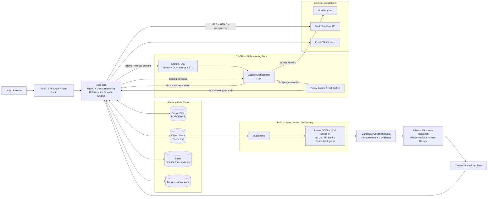
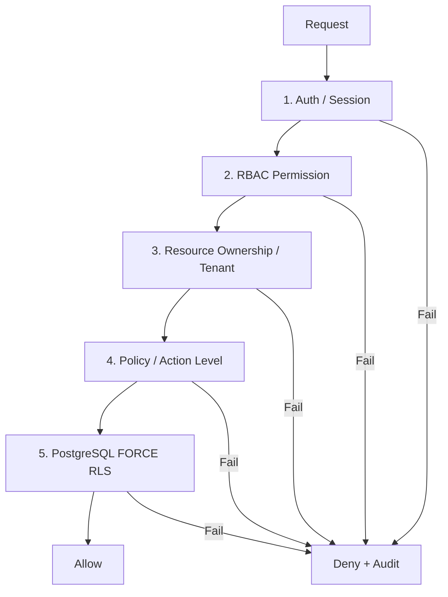
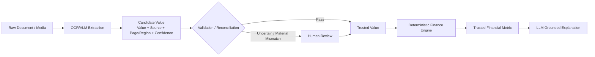
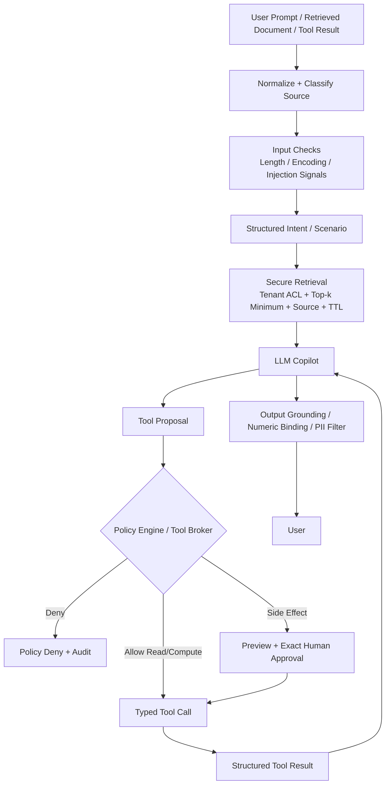
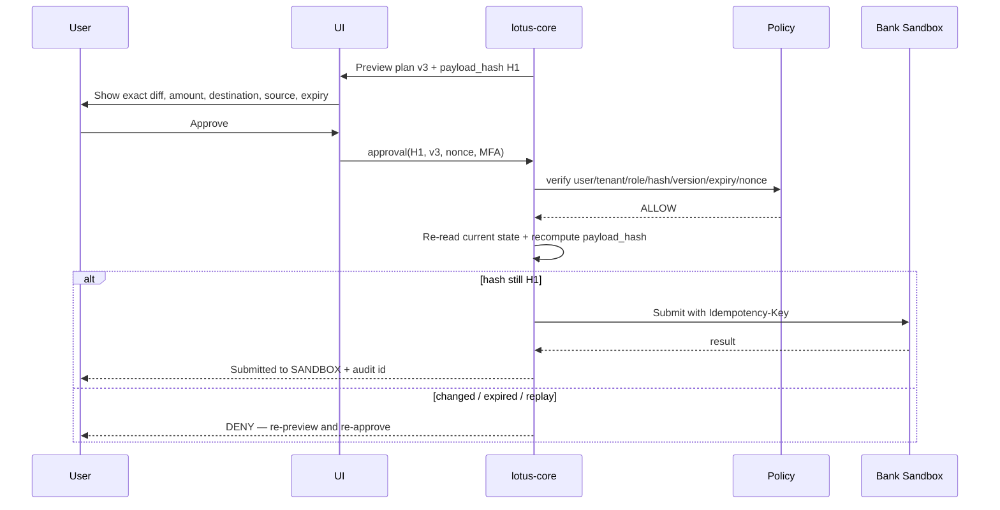
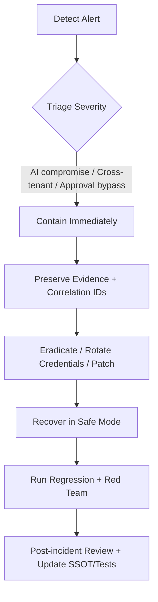

# LOTUS FIN — UNIFIED SECURITY REQUIREMENTS SPECIFICATION (CODE/IMPLEMENTATION VERSION)

> **Document type:** Security Requirements Specification (SRSec)  
> **Structure:** ISO/IEC/IEEE 29148:2018-style requirements specification  
> **Purpose:** Single Source of Truth for Lotus Fin Platform Security and AI/Agent Security.  
> **Intended users:** Backend, Frontend, AI Engineering, DevOps, QA/Security, and coding agents such as Codex, Antigravity, and Claude Code.  
> **Scope:** `UC001` through `UC006`.  
> **Normative keywords:** `MUST` = mandatory; `SHOULD` = recommended unless a justified exception exists; `MAY` = optional.  
> **Authority:** If source code, diagrams, prompts, tests, or other documents conflict with this specification, this specification is authoritative until an approved ADR/PR updates it.

---

## Document Control

| Item | Value |
|---|---|
| Document | Lotus Fin Unified Security Requirements Specification |
| Audience | Human engineers and coding agents |
| Language | English |
| Requirements style | ISO/IEC/IEEE 29148:2018-style |
| Security controls | `SEC-001` through `SEC-030` |
| Use cases | `UC001` through `UC006` |
| Release gates | `G-01` through `G-12` |
| Source role | Unified replacement SSOT for Platform Security + AI/Agent Security |

> This rewrite preserves the original security purpose, normative intent, control IDs, trust boundaries, release gates, and use-case scope. It reorganizes the content for requirements engineering and implementation traceability; it does not introduce new functional scope.

---

# 1. Introduction

## 1.1 Purpose

This specification defines the mandatory and recommended security requirements for Lotus Fin across the platform, financial computation, document-processing, AI/RAG/Agent, external integration, operational, and software-delivery layers.

The security model assumes that the LLM and external content can be compromised or manipulated. Authorization, tenant isolation, financial truth, side effects, and approvals therefore remain outside the LLM boundary.

## 1.2 Scope

This specification applies to:

- `UC001` — Upload & Normalize Financial Data;
- `UC002` — Forecast Cash Flow & Trigger Shortfall Alert;
- `UC003` — Analyze Business Financial Health;
- `UC004` — Match Financing Options;
- `UC005` — Interactive Financial Copilot Chat;
- `UC006` — Simulate Financing Repayment Scenarios.

The current scope does not permit real money transfer, real disbursement, unrestricted code execution, dynamic plugin/MCP installation, autonomous loan approval/underwriting, agent self-modification, or approvals that remain valid for unspecified future actions.

## 1.3 Normative Language

- `MUST` / `MUST NOT`: mandatory for implementation and release.
- `SHOULD` / `SHOULD NOT`: recommended; deviation requires explicit rationale and security review.
- `MAY`: optional capability.

## 1.4 System-of-Record Rule

Security requirements in this file are the implementation and testing source of truth. Source documents remain useful as rationale/reference, but new code and tests SHOULD trace to the control IDs defined here.

---

# 2. Security Invariants

The following invariants MUST NOT be weakened without an explicit ADR and security review.

1. **The LLM is not a security boundary.** The LLM may propose; backend/policy decides authorization.
2. **All business data is tenant-scoped.** Tenant isolation MUST be enforced in backend/storage, not by prompt instructions.
3. **The Finance Engine is the source of truth for financial numbers.** The LLM MUST NOT independently calculate or modify material financial values.
4. **OCR/VLM output is `candidate`, not `trusted`.** Only validated/reconciled/reviewed data may be used for material financial computation.
5. **External content is untrusted data.** PDF/CSV/image/web/tool result/RAG chunk content cannot change policy or grant authority.
6. **Tool access defaults to deny.** Only allowlisted tools with typed schemas and correct user/tenant/resource scope may run.
7. **Side effects require exact approval.** Approval is bound to `user + tenant + action + resource + payload_hash + version + expiry + nonce`.
8. **AI has no database credential and no Bank credential.** AI has no direct write path to business data.
9. **Fail closed for authority; fail safe for functionality.** If authorization cannot be verified, deny. If LLM/RAG fails, deterministic core functions may continue when sufficient trusted data exists.
10. **Do not store raw chain-of-thought.** Log only necessary events, decision codes, tool calls, provenance, and concise rationale where needed.
11. **Do not log secrets or raw PII by default.** Prompt/log content MUST be minimized and redacted.
12. **Every model/tool/policy change requires regression and security tests before release.**

---

# 3. System Security Architecture

## 3.1 Target Architecture



## 3.2 Architectural Requirements

- `lotus-core` MUST own authorization, financial state, deterministic computation, and side effects.
- `lotus-ai` MUST be treated as a compromiseable/untrusted service.
- AI MUST NOT connect directly to PostgreSQL, Bank API, or the business secret store.
- Outbound egress MUST use a workload-specific allowlist.
- Raw Parser/OCR/VLM and LLM/RAG MUST remain in separate trust boundaries: `TB-5A` and `TB-5B`.

---

# 4. Trust Boundaries and External Interfaces

| ID | Boundary | Data crossing boundary | Mandatory protection |
|---|---|---|---|
| `TB-1` | Internet → Edge | HTTP, upload | TLS, WAF, rate limit, size limit |
| `TB-2` | Browser → BFF/Core | Session/API | Secure cookie, CSRF, auth, schema validation |
| `TB-3` | Core → Data | SQL/object/cache | RLS, least privilege, encryption |
| `TB-4` | Core → External Bank | Financing payload/webhook | mTLS, HMAC, nonce, idempotency, schema validation |
| `TB-5A` | Quarantine → Parser/OCR/VLM | Raw PDF/CSV/image/video | sandbox, no secrets, resource limits, restricted egress |
| `TB-5B` | Trusted data → RAG/LLM | Minimized context | masking, tenant ACL, provenance, output validation |
| `TB-6` | AI/Core → LLM Provider | Prompt/context | DLP/minimize, allowlist, vendor policy, timeout |
| `TB-7` | Admin/Operations | Privileged operations | separate identity, MFA, JIT/break-glass, audit |

---

# 5. Identity, Authentication, Authorization, and Tenant Isolation

## 5.1 Roles

| Role | Meaning |
|---|---|
| `OWNER` | SME owner; may approve/submit financial actions in Bank Sandbox |
| `ACCOUNTANT` | May enter/edit data, analyze, and simulate; cannot independently commit a financial action |
| `VIEWER` | Read-only |
| `SYSTEM` | Worker/service identity; remains tenant-scoped |
| `PLATFORM_SUPPORT` | Support metadata only; no financial-content access |
| `PLATFORM_BREAKGLASS` | Time-bounded emergency access requiring two-person approval |

## 5.2 Authentication Requirements

- `OWNER` and `ACCOUNTANT` MUST use MFA.
- `financing:submit_application`, role changes, whole-tenant export, and sensitive actions MUST use step-up authentication.
- Session cookies SHOULD use `HttpOnly; Secure; SameSite=Strict; __Host-`.
- Authorization MUST be re-evaluated at the backend; JWT/session claims are not the final authorization source.

## 5.3 Authorization Defense in Depth



### Tenant Requirements

- Every business row MUST have tenant ownership.
- PostgreSQL MUST use `FORCE ROW LEVEL SECURITY` or an equivalent final enforcement mechanism.
- RAG/vector storage MUST enforce tenant ACL/namespace at the storage/query layer.
- Cache keys MUST include tenant and, for authorization-sensitive content, user/role.
- Cross-tenant resource lookup SHOULD return `404` instead of revealing resource existence.
- Background jobs MUST carry tenant context and remain RLS-scoped.

---

# 6. Data Classification and Data Lifecycle

| Class | Examples | Requirement |
|---|---|---|
| `D0 Public` | public financing terms, standards | source and `as_of` required |
| `D1 Internal` | build ID, rule version, scenario metadata | internal only |
| `D2 Confidential Financial` | orders, payments, AP/AR, payroll, balance, results | tenant isolation, encrypted, minimized before AI use |
| `D3 Restricted` | API key, token, full account number, legal ID | never in prompt; secret manager; redact logs |

## 6.1 Candidate-to-Trusted Data Model



### Data Integrity Requirements

- Finance Engine MUST consume `trusted_value`, never a raw OCR/VLM candidate, for material calculations.
- Every candidate SHOULD retain `source_id`, page/region/time, extractor version, and confidence.
- Material mismatch or low-confidence extraction MUST trigger review or block downstream computation.
- The LLM MAY render a number only if it comes from a trusted structured field or deterministic result.
- The LLM MUST NOT invent or alter a material financial number.

## 6.2 Raw Media Requirements

- Upload MUST enter quarantine before parsing.
- Extension, MIME type, and magic bytes MUST be validated.
- Malware scan and parser sandbox MUST execute before data enters trusted storage.
- File/page/frame/decompression/CPU/RAM/time limits MUST be enforced.
- Active content, macros, and embedded execution MUST be disabled.
- CCTV/long video MAY be enabled only with separate retention and PII rules; it is not required by core `UC001`–`UC006`.
- Face/license-plate/legal-ID masking MUST occur before media is reused outside the raw-processing boundary when those identifiers are not required.

---

# 7. AI, RAG, and Agent Security Requirements

## 7.1 Secure AI/RAG/Agent Flow



## 7.2 Input Security

- User input and retrieved content MUST be tagged by source/trust level.
- Direct or indirect prompt injection MUST NOT alter authorization, tenant scope, tool allowlist, or approval policy.
- Suspicious encoding MAY be decoded/normalized for detection only; decoded content remains untrusted.
- System policy MUST NOT rely solely on secret prompt text.
- Unknown or ambiguous requests that could produce a side effect MUST require clarification.

## 7.3 RAG Security

- ACL MUST be applied before retrieval.
- Every retrieved chunk MUST include tenant, source, checksum/version, and `as_of`/TTL where relevant.
- External financing terms MUST be curated or explicitly marked unverified/stale.
- Retrieved text MUST NOT be interpreted as system/tool instruction.
- RAG failure MUST produce an “insufficient evidence / source unavailable” result rather than fabricated citations.
- Persistent free-text memory SHOULD be disabled for P0; structured scenario state is preferred.

## 7.4 Agent State and Resource Limits

- Scenario and plan state MUST be structured and versioned.
- Chat history MUST NOT be used as authority, approval, or source of truth.
- Agent runs MUST have step, tool-call, token/cost, and time budgets.
- Infinite reflection/tool loops MUST terminate safely.

---

# 8. Tool Authorization, Policy, and Side-Effect Levels

## 8.1 Action Levels

| Level | Action | Agent autonomy | Required control |
|---|---|---|---|
| `R0` | Read/view | Auto | auth + tenant + rate limit |
| `R1` | Compute/simulate | Auto | typed input + deterministic tool |
| `R2` | Create/edit draft | Auto with visible diff | versioning + audit |
| `R3` | Commit internal plan/state | Explicit human confirmation | exact payload binding |
| `R4` | Submit to Bank **Sandbox** | `OWNER` only | step-up MFA + approval + idempotency + destination check |
| `R5` | Real transfer/payment/disbursement | **Not allowed in current scope** | future threat model + stronger maker-checker |

## 8.2 Tool Authorization Contract

Every tool call MUST be evaluated using at least:

```yaml
subject:
  user_id: string
  tenant_id: string
  role: OWNER|ACCOUNTANT|VIEWER|SYSTEM
request:
  tool: string
  action_level: R0|R1|R2|R3|R4|R5
  resource_id: string|null
  resource_version: string|null
  parameters_hash: string
context:
  correlation_id: string
  policy_version: string
  approval_id: string|null
```

Policy MUST verify:

1. tool is allowlisted;
2. role has permission;
3. resource belongs to tenant;
4. parameters match schema and bounds;
5. action level is permitted;
6. approval is valid when required;
7. destination/endpoint is allowlisted;
8. idempotency key is present for retryable writes;
9. current data/version still matches preview (`TOCTOU` check).

### Forbidden

- LLM-selected arbitrary URL.
- Shell/code execution with general OS/network access.
- Dynamic MCP/plugin installation or discovery at runtime.
- Agent use of admin/service credentials not scoped to the user action.

---

# 9. Human Approval and Exact Payload Binding



Approval records MUST contain:

```yaml
approval_id: uuid
user_id: uuid
tenant_id: uuid
action: string
resource_id: string
resource_version: string
payload_hash: sha256
critical_params_hash: sha256
decision: APPROVED|REJECTED|EXPIRED|INVALIDATED
created_at: timestamp
expires_at: timestamp
nonce: string
policy_version: string
used_at: timestamp|null
```

Rules:

- A global `approved=true` flag is forbidden.
- Any material plan/payload change MUST invalidate approval.
- Replay, expired approval, or wrong-role approval MUST be denied.
- `R4` Bank Sandbox submission MUST use step-up MFA and idempotency.

---

# 10. Use-Case Security Requirements

## 10.1 UC001 — Upload & Normalize Financial Data

**MUST**

- Only `OWNER` or `ACCOUNTANT` may upload.
- Flow: quarantine → MIME/magic check → malware scan → sandbox parser.
- Raw parser has no DB/Bank credentials and restricted/no egress.
- Candidate values retain provenance and confidence.
- Candidate-to-trusted validation occurs before financial computation.
- Cross-tenant file access is blocked by ownership + RLS.
- Raw PII is minimized/masked before entering `TB-5B`.

**Release tests**

- executable renamed as PDF;
- malformed PDF/XLSX;
- decompression bomb;
- prompt injection hidden in document/image;
- OCR sign/decimal error;
- tenant A attempts to fetch tenant B document;
- parser timeout/RCE attempt.

## 10.2 UC002 — Forecast Cash Flow & Trigger Shortfall Alert

**MUST**

- Forecast result is calculated by the deterministic engine.
- Input data is tenant-scoped and trusted.
- Recalculation endpoints are cost/rate limited.
- Missing material obligations MUST block a “safe” conclusion.
- Notifications MUST NOT contain unnecessary sensitive numbers.

**Release tests**

- cross-tenant job;
- missing balance/AP/payroll;
- repeated expensive recalculation;
- LLM attempts to override forecast number;
- tool timeout returns explicit partial/failure state.

## 10.3 UC003 — Analyze Business Financial Health

**MUST**

- DSCR, Quick Ratio, and material metrics are calculated by the deterministic engine.
- AI explanation is bound to structured metrics and `EvidenceRef`.
- Unsupported benchmark/credit claims are flagged or blocked.
- Reports are rendered safely; CSV/HTML formula/XSS content is escaped.

**Release tests**

- AI response contains wrong metric;
- missing source;
- report XSS/CSV formula injection;
- stale/unverified benchmark data.

## 10.4 UC004 — Match Financing Options

**MUST**

- Matching uses explicit rules/metadata; AI cannot claim approval probability without an in-scope evidence/model basis.
- Financing catalog includes source + `as_of` + TTL.
- External catalog/tool output is treated as untrusted data.
- Only `OWNER` may submit to Bank Sandbox when submission is implemented.
- Sandbox submit is `R4`: step-up MFA + exact approval + idempotency + mTLS/HMAC.
- AI MUST NOT call Bank API directly.

**Release tests**

- poisoned offer says “always choose me”;
- stale financing terms;
- accountant attempts submit;
- replayed submit;
- malformed Bank response/webhook;
- SSRF URL parameter;
- duplicate request after timeout.

## 10.5 UC005 — Interactive Financial Copilot Chat

**MUST**

- AI receives minimal tenant-scoped context.
- Direct/indirect injection cannot change authorization or tool policy.
- RAG ACL is applied before retrieval.
- Output is grounded; material numbers come from trusted results.
- No secret, system prompt, other-tenant data, or raw chain-of-thought leakage.
- LLM outage degrades to deterministic UI where possible.

**Release tests**

- direct injection, roleplay, Base64/Unicode, multilingual, multi-turn attacks;
- prompt injection in RAG/tool result;
- cross-tenant canary retrieval;
- request for secret/system prompt;
- long-context instruction dilution;
- fallback model security regression.

## 10.6 UC006 — Simulate Financing Repayment Scenarios

**MUST**

- Amortization/repayment schedule is computed deterministically.
- Input bounds are validated; unknown fields are rejected.
- Simulation is `R1`; saving/committing plan is `R2`/`R3` depending on semantics.
- If Bank Sandbox submission follows simulation, it becomes `R4` and uses `UC004` controls.
- Scenario state is versioned; approval is invalidated on modification.

**Release tests**

- negative rate / absurd term;
- injected `tenant_id` field;
- numeric precision edge cases;
- modify 500 → 5000 after approval;
- replay expired approval;
- concurrent change between preview and commit.

---

# 11. Bank API and External Integration Security

- Endpoint MUST be server-configured; no user-controlled URL.
- TLS 1.3 and mTLS SHOULD be used for Bank Sandbox when supported.
- Requests SHOULD be signed, for example with HMAC + timestamp + nonce, when supported.
- Webhooks MUST validate signature, timestamp, nonce, schema, and size.
- Signature comparison MUST use constant-time comparison.
- External responses MUST pass schema and business-range validation.
- `R4` writes MUST use `Idempotency-Key`; DB unique constraints are the source of truth, while Redis/cache is only an optimization.
- Retry only idempotent/safe operations using bounded exponential backoff + jitter.
- Use a circuit breaker for persistent external failure.

---

# 12. Web, API, and Platform Application Security

Minimum requirements:

- Parameterized SQL/generated query layer; no string-built SQL.
- CSRF protection for state-changing browser flows.
- Output encoding and CSP; no unsafe HTML from AI.
- File name/path is never trusted; storage keys are generated server-side.
- Strong input schema; reject unknown fields for sensitive endpoints.
- Secrets remain in a secret manager; never hard-coded.
- Confidential data is encrypted in transit and at rest.
- Rate limit by identity + endpoint + cost for AI/compute endpoints.
- Error responses MUST NOT expose stack trace, SQL, path, prompt, secret, or tenant metadata.

---

# 13. Runtime, Network, and Supply-Chain Security

## 13.1 Network

- Use default-deny network policy between trust domains.
- AI workload MUST NOT reach DB or Bank API.
- Outbound Internet MUST pass an egress allowlist/proxy.
- Block localhost/private ranges/cloud metadata from user-driven network paths.

## 13.2 Runtime

- Parser/tool processes SHOULD run non-root, with read-only filesystem where feasible and limited CPU/RAM/time.
- No host socket mount.
- No arbitrary-code tool in current scope.

## 13.3 Supply Chain

- Pin dependencies and lockfiles.
- Run SCA/CVE scan, SAST, and secret scan in CI.
- Generate SBOM; AI stack SHOULD also record model/provider/embedding/tool/prompt-policy versions (`AIBOM-lite`).
- Model/provider/tool-schema update MUST pass regression and red-team gates before deployment.
- No silent model switch on demo/release day.

---

# 14. Logging, Audit, and Observability

## 14.1 Structured Event Minimum

```yaml
event_id: uuid
occurred_at: timestamp
correlation_id: string
event_type: string
severity: INFO|WARN|HIGH|CRITICAL
user_id: string|null
tenant_id: string|null
resource_id: string|null
resource_version: string|null
tool: string|null
policy_decision: ALLOW|DENY|N/A
status: SUCCESS|FAIL|PARTIAL
error_class: string|null
model_version: string|null
policy_version: string|null
latency_ms: int
```

### MUST Log

- login/MFA/role changes;
- sensitive data access/export;
- file upload/parse result;
- policy deny;
- tool-call metadata;
- scenario/plan version changes;
- approval create/use/invalidate;
- Bank Sandbox submit/webhook;
- model/tool failures;
- security alerts.

### MUST NOT Log by Default

- access/refresh tokens;
- API keys/secrets;
- full D3 identifiers;
- raw full documents;
- raw chain-of-thought;
- full prompt/response containing PII unless explicitly enabled for controlled red-team/debug with redaction and retention limit.

Audit events for security/approval SHOULD be append-only or tamper-evident.

---

# 15. Reliability and Safe Degradation

| Control | Requirement |
|---|---|
| Step budget | hard maximum per agent run |
| Token/cost budget | hard maximum per request/user/tenant |
| Timeout | per model/tool plus total request deadline |
| Retry | bounded; safe/idempotent only |
| Circuit breaker | repeated LLM/Bank/tool errors |
| LLM failure | show deterministic results without narrative where possible |
| RAG failure | no fabricated source/claim |
| Finance Engine failure | stop numeric conclusion |
| Catalog failure | cash-flow analysis continues |
| AI compromise | disable AI; core platform remains available where safe |

---

# 16. Verification and Validation

## 16.1 Mandatory Release Gates

| ID | Gate | PASS criteria |
|---|---|---|
| `G-01` | Auth/RBAC | 0 unauthorized privileged action |
| `G-02` | Tenant isolation | 0 cross-tenant canary leakage in DB/RAG/cache/log |
| `G-03` | File/parser | malicious/oversize/malformed files contained; no escape |
| `G-04` | Prompt injection | critical injections cannot change tool/auth/policy |
| `G-05` | Tool authorization | 0 non-allowlisted/wrong-scope tool execution |
| `G-06` | Numeric integrity | 100% material numbers match deterministic gold set |
| `G-07` | Approval binding | 0 replay/expired/wrong-role/modified-plan bypass |
| `G-08` | Bank Sandbox | idempotency + signature/schema checks pass |
| `G-09` | Output privacy | 0 secret / unauthorized PII / other-tenant output |
| `G-10` | Safe failure | no fabricated result under model/tool/Bank faults |
| `G-11` | Audit | critical flows reconstructable by correlation ID |
| `G-12` | Dependency/model change | regression + red-team suite passes before deploy |

## 16.2 Minimum Adversarial Regression Set

The regression set MUST cover at least:

1. direct injection;
2. indirect injection in PDF/CSV/image;
3. Base64/ROT13/Unicode/language-switch jailbreak;
4. multi-turn escalation;
5. system-prompt/secret extraction;
6. cross-tenant DB IDOR;
7. cross-tenant RAG retrieval;
8. cache-key leakage;
9. malicious tool output;
10. non-allowlisted tool request;
11. parameter injection / huge amount;
12. SSRF/internal IP;
13. parser RCE/malformed file;
14. decompression/resource bomb;
15. OCR sign/decimal error;
16. VLM low-confidence/wrong evidence;
17. poisoned/stale financing catalog;
18. LLM attempts to change numeric result;
19. approval replay;
20. plan modification after approval;
21. TOCTOU state change;
22. wrong-role approval/submit;
23. duplicate write after timeout;
24. malformed Bank response/webhook;
25. PII/secret canary leakage;
26. XSS/Markdown/CSV formula output;
27. agent loop/token exhaustion;
28. LLM timeout/fallback drift;
29. RAG unavailable;
30. Finance Engine unavailable.

## 16.3 Security Metrics

| Metric | Target for core demo |
|---|---:|
| Unauthorized Action Rate | `0` |
| Cross-tenant Leakage Rate | `0` |
| Approval Bypass Rate | `0` |
| Critical Injection ASR | `0` |
| Numeric Integrity | `100%` gold core |
| Grounding correctness | `100%` material claims in demo |
| Safe Failure Rate | `100%` fault-injection core |
| False Refusal Rate | measure + keep within team-defined acceptable threshold |

---

# 17. Incident Response Requirements



## 17.1 AI Compromise Playbook

1. isolate `lotus-ai` and deny egress;
2. disable Copilot/RAG if needed;
3. keep deterministic dashboard/forecast available where safe;
4. inspect DB/RAG/egress/audit for cross-tenant or secret access;
5. rotate LLM key and AI workload credentials/certificates;
6. invalidate compromised index/memory/documents;
7. review outputs in the affected window against deterministic/source data;
8. patch and run mandatory gates before restoring service.

Critical incidents include confirmed cross-tenant leakage, unauthorized Bank Sandbox submission, approval bypass, secret exfiltration, and tampered audit trail.

---

# 18. Secure SDLC — Definition of Done

A security-relevant PR is **not done** until:

- [ ] threat/control ID is referenced in the PR or test;
- [ ] authorization is tested for allowed and denied roles;
- [ ] tenant isolation test exists when the resource is tenant-owned;
- [ ] schema/bounds validation exists;
- [ ] sensitive logs are reviewed;
- [ ] side-effect endpoint has idempotency where applicable;
- [ ] AI/tool change has adversarial regression where applicable;
- [ ] new external endpoint is intentionally added to the egress allowlist;
- [ ] dependency/model/tool versions are pinned;
- [ ] audit event exists for security/material financial state changes;
- [ ] error path fails safely and does not fabricate financial data.

---

# 19. Unified Security Control Catalog

| ID | Control | Normative level |
|---|---|---|
| `SEC-001` | MFA for `OWNER`/`ACCOUNTANT` | MUST |
| `SEC-002` | Step-up auth for `R4`/sensitive admin | MUST |
| `SEC-003` | RBAC + ownership + FORCE RLS | MUST |
| `SEC-004` | Tenant-scoped RAG/cache/jobs | MUST |
| `SEC-005` | Upload quarantine + malware/MIME/magic checks | MUST |
| `SEC-006` | Parser/OCR/VLM sandbox + resource limits | MUST |
| `SEC-007` | Candidate→trusted data promotion | MUST |
| `SEC-008` | Deterministic Finance Engine source of truth | MUST |
| `SEC-009` | Input/indirect injection handling | MUST |
| `SEC-010` | Secure RAG ACL + provenance + freshness | MUST |
| `SEC-011` | Tool allowlist + typed schema + backend policy | MUST |
| `SEC-012` | Agent step/token/time/cost budgets | MUST |
| `SEC-013` | Exact human approval binding | MUST |
| `SEC-014` | Idempotent Bank Sandbox writes | MUST |
| `SEC-015` | Bank mTLS/signature/webhook validation | SHOULD/MUST if supported |
| `SEC-016` | Output grounding + numeric binding | MUST |
| `SEC-017` | PII/secret minimization and redaction | MUST |
| `SEC-018` | No raw CoT / no secret logging | MUST |
| `SEC-019` | Correlation ID + tamper-evident audit | MUST |
| `SEC-020` | Egress allowlist; AI cannot access DB/Bank directly | MUST |
| `SEC-021` | Secret manager + rotation | MUST |
| `SEC-022` | SAST/SCA/secret scan/SBOM | MUST |
| `SEC-023` | Model/tool/policy version pin + change gate | MUST |
| `SEC-024` | Safe degradation + circuit breaker | MUST |
| `SEC-025` | Incident playbook + restore gate | MUST |
| `SEC-026` | Regression + adversarial release gates | MUST |
| `SEC-027` | Persistent free-text memory disabled by default | SHOULD |
| `SEC-028` | External financing data source + `as_of` + TTL | MUST |
| `SEC-029` | Output encoding / CSP / formula-injection defense | MUST |
| `SEC-030` | Platform staff separate identity + audited JIT access | SHOULD |

---

# 20. Requirements Traceability

## 20.1 Use Case → Core Controls

| Use case | Core controls |
|---|---|
| `UC001` | SEC-003, 005, 006, 007, 017, 019, 020 |
| `UC002` | SEC-003, 004, 008, 012, 019, 024 |
| `UC003` | SEC-008, 010, 016, 017, 019, 029 |
| `UC004` | SEC-002, 003, 010, 011, 013, 014, 015, 028 |
| `UC005` | SEC-003, 004, 009, 010, 011, 012, 016, 017, 020, 024 |
| `UC006` | SEC-003, 008, 011, 013, 014, 016, 019 |

---

# 21. Implementation Priority

## 21.1 P0 — Before End-to-End Demo

1. Auth/MFA + RBAC + tenant ownership + RLS.
2. Quarantine/parser sandbox + candidate→trusted flow.
3. Deterministic finance functions + gold tests.
4. Secure RAG tenant ACL + provenance.
5. Policy Engine / Tool Broker + typed tools.
6. Output numeric binding + PII/secret redaction.
7. Approval binding + idempotency for Bank Sandbox.
8. Structured audit/correlation ID.
9. Safe failure/timeouts/budgets/circuit breakers.
10. Mandatory release gates `G-01` through `G-12`.

## 21.2 P1 — After Core Is Stable

- stronger multimodal poisoning detection;
- automated adversarial generation;
- advanced anomaly monitoring;
- expanded model/vendor regression dashboard;
- CCTV/long-video security if the feature is enabled;
- stronger WORM/central SIEM if infrastructure permits.

## 21.3 Out of Current Scope

- real money transfer/disbursement;
- unrestricted code execution;
- dynamic plugin/MCP installation;
- autonomous loan approval/underwriting;
- agent self-modification;
- approval valid for unspecified future actions.

---

# 22. Configuration Invariants for Coding Agents

Treat the following as hard assertions in implementation and tests:

```yaml
security_invariants:
  ai_has_db_credentials: false
  ai_has_bank_credentials: false
  ai_can_authorize_itself: false
  ai_can_execute_arbitrary_code: false
  direct_bank_call_from_ai: false
  persistent_free_text_memory_default: false
  finance_numbers_source: deterministic_engine
  raw_extraction_is_trusted: false
  rag_acl_enforced_server_side: true
  tenant_rls_required: true
  approval_bound_to_exact_payload: true
  bank_sandbox_write_requires_step_up: true
  real_financial_action_enabled: false
  raw_chain_of_thought_logged: false
  secrets_allowed_in_prompt: false
```

A coding agent MUST NOT weaken these invariants without an explicit ADR/security review.

---

# Appendix A — Source Merge Note

This file unifies and replaces the SSOT role of:

- **Platform Security** (`security.zip`): IAM/RBAC/RLS, cryptography, AppSec, API/Bank, network, audit, SDLC, incident response;
- **AI Agent Security v2**: injection/RAG/tool/memory/HITL/model/output/red-team;
- agreed findings: separation of `TB-5A/TB-5B`, candidate→trusted data, Tool Broker/Policy Engine, exact approval, and `UC001`–`UC006` as the implementation scope.

Original documents MAY remain as reference/rationale, but new implementation and tests SHOULD trace to the control IDs in this specification.
