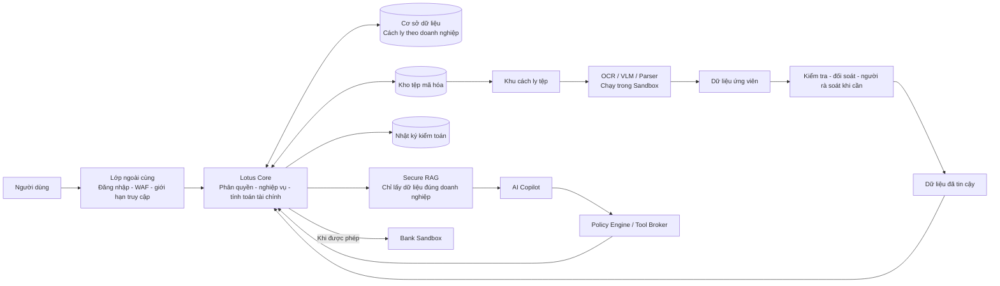
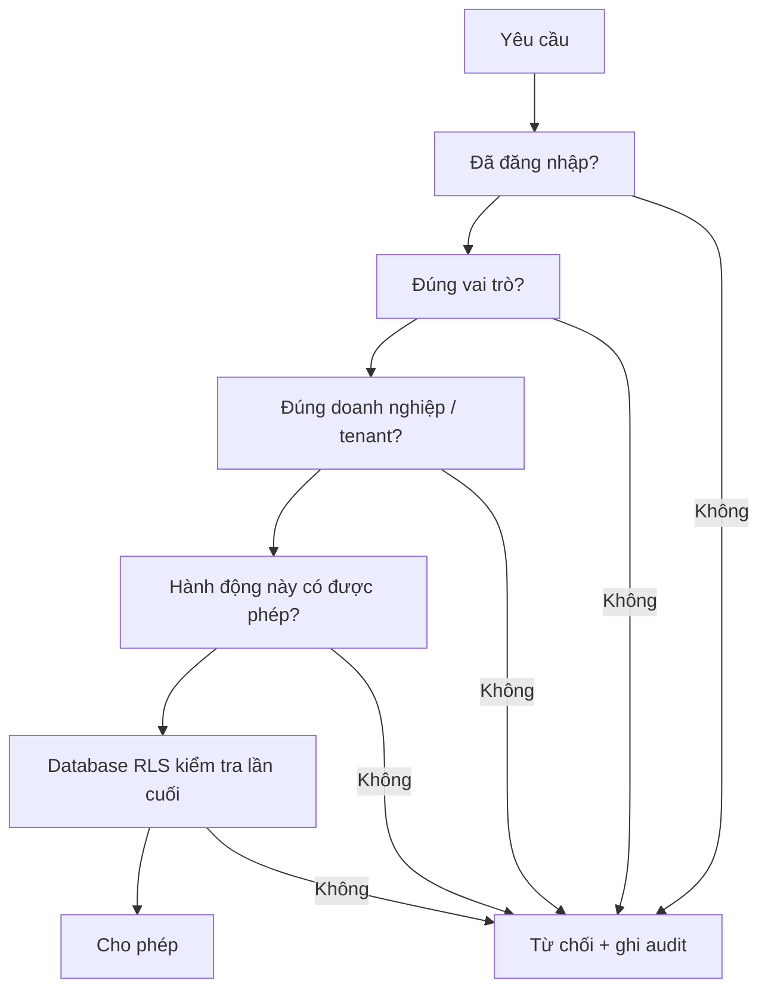
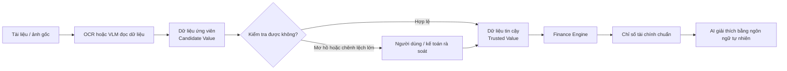
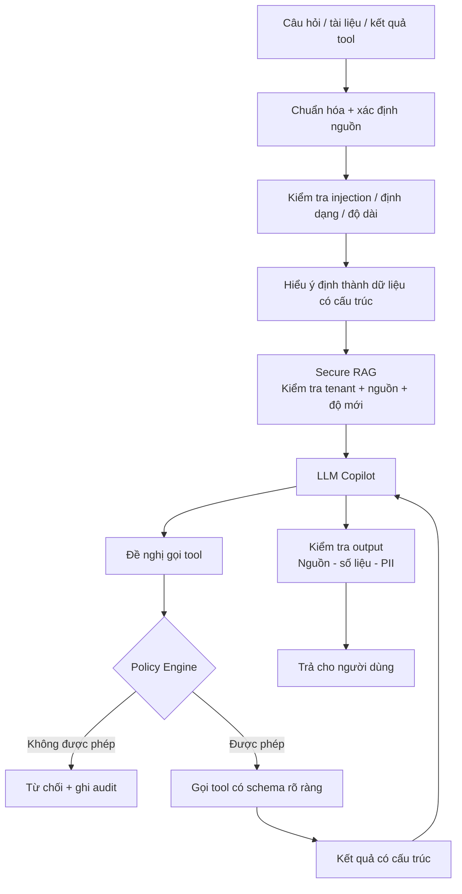
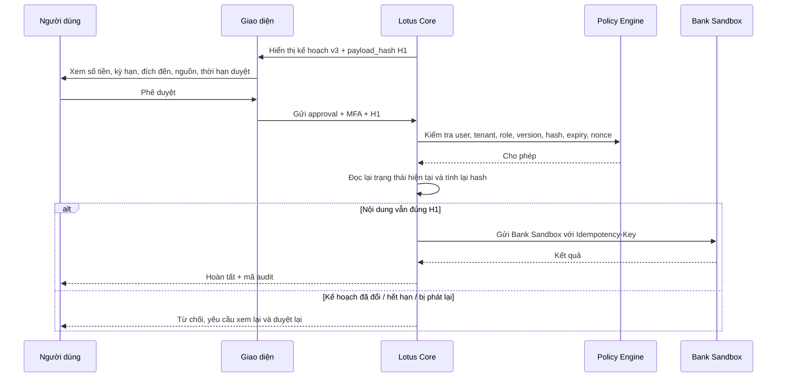
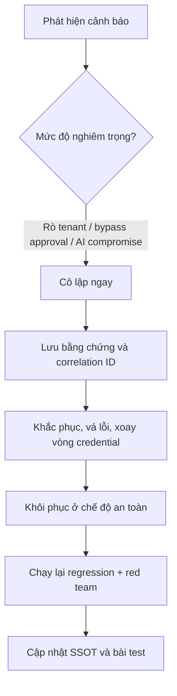

# LOTUS FIN — ĐẶC TẢ YÊU CẦU BẢO MẬT HỢP NHẤT
## Bản tiếng Việt dễ đọc cho cả Tech và Non-tech

> **Loại tài liệu:** Đặc tả yêu cầu bảo mật  
> **Cấu trúc:** theo phong cách đặc tả yêu cầu của ISO/IEC/IEEE 29148:2018  
> **Mục đích:** giải thích toàn bộ thiết kế bảo mật hợp nhất của Lotus Fin theo cách kỹ thuật và người không chuyên đều có thể đọc, kiểm tra và đối chiếu.  
> **Phạm vi:** `UC001` đến `UC006`.  
> **Nguyên tắc:** không thay đổi mục đích, phạm vi, security control, trust boundary, release gate hay quyết định kiến trúc của hai bản gốc; chỉ chuẩn hóa cách tổ chức và diễn đạt để dễ đọc và dễ truy vết.

---

## Kiểm soát tài liệu

| Mục | Nội dung |
|---|---|
| Tài liệu | Lotus Fin — Đặc tả yêu cầu bảo mật hợp nhất |
| Đối tượng đọc | BA, PM, Backend, Frontend, AI Engineer, DevOps, QA, Security, giám khảo và người non-tech |
| Ngôn ngữ | Tiếng Việt, giữ tiếng Anh cho thuật ngữ kỹ thuật cần thiết |
| Use case | `UC001` đến `UC006` |
| Security control | `SEC-001` đến `SEC-030` |
| Release gate | `G-01` đến `G-12` |
| Bản kỹ thuật tương ứng | `FinTechathon_2026_LotusFin_Security_SSOT_IEEE_Code_EN.md` |

---

# 1. Giới thiệu

## 1.1 Mục đích

Lotus Fin xử lý dữ liệu tài chính, tài liệu doanh nghiệp, ảnh/chứng từ và có AI Agent hỗ trợ phân tích. Vì vậy không thể chỉ đặt một bộ lọc trước Chatbot rồi coi như đã an toàn.

Tài liệu này là bản giải thích dễ hiểu của cùng một hệ thống yêu cầu bảo mật dùng cho code. Mỗi nguyên tắc trong bản này đều có thể đối chiếu sang control hoặc release gate ở phần cuối.

## 1.2 Phạm vi

Tài liệu áp dụng cho:

- `UC001` — Tải lên và chuẩn hóa dữ liệu tài chính;
- `UC002` — Dự báo dòng tiền và cảnh báo thiếu hụt;
- `UC003` — Phân tích sức khỏe tài chính;
- `UC004` — Khớp nối phương án tài trợ;
- `UC005` — Chat với Financial Copilot;
- `UC006` — Mô phỏng phương án trả nợ.

Hiện tại hệ thống **không** cho phép chuyển tiền thật, giải ngân thật, chạy mã tùy ý, tự cài plugin/MCP, AI tự phê duyệt khoản vay, Agent tự sửa chính mình hoặc dùng một approval chung cho các hành động tương lai chưa xác định.

## 1.3 Cách đọc các từ bắt buộc

- `MUST` / **phải**: yêu cầu bắt buộc.
- `SHOULD` / **nên**: nên thực hiện; nếu bỏ qua phải có lý do rõ ràng.
- `MAY` / **có thể**: tùy chọn.

---

# 2. Tư tưởng bảo mật cốt lõi

Lotus Fin dựa trên 12 nguyên tắc chính:

1. **AI không phải là nơi quyết định quyền.** AI có thể đề xuất hành động, nhưng Backend và `Policy Engine` mới quyết định hành động đó có được phép hay không.
2. **Mỗi doanh nghiệp phải được cách ly dữ liệu.** Người của doanh nghiệp A không được nhìn thấy dữ liệu của doanh nghiệp B, kể cả khi AI bị đánh lừa.
3. **Số liệu tài chính phải do công cụ tính toán xác định tạo ra.** LLM chỉ giải thích, không tự sửa hay tự tính lại các con số quan trọng.
4. **Dữ liệu do OCR/VLM đọc ra chưa được coi là đúng ngay.** Nó chỉ là dữ liệu ứng viên, phải qua kiểm tra trước khi dùng vào tính toán tài chính.
5. **Mọi nội dung bên ngoài đều được coi là không đáng tin cậy.** PDF, CSV, ảnh, kết quả từ công cụ, dữ liệu RAG hoặc nội dung từ bên thứ ba đều có thể chứa chỉ dẫn độc hại.
6. **Công cụ mặc định là bị chặn.** AI chỉ được gọi đúng các công cụ đã cho phép, với đúng loại tham số và đúng phạm vi dữ liệu.
7. **Hành động có tác động thực phải được người dùng duyệt đúng nội dung.** Nếu kế hoạch thay đổi sau khi duyệt thì phải duyệt lại.
8. **AI không giữ mật khẩu hay khóa truy cập của Database và Bank API.** AI không được kết nối trực tiếp vào các hệ thống nhạy cảm này.
9. **Không xác minh được quyền thì phải chặn.** Ngược lại, nếu LLM hỏng nhưng phần tính toán cốt lõi vẫn hoạt động được thì hệ thống nên tiếp tục ở chế độ an toàn.
10. **Không lưu suy luận nội bộ dài của mô hình.** Chỉ lưu những gì cần cho kiểm toán như hành động, quyết định, nguồn dữ liệu và kết quả.
11. **Không ghi secret hoặc dữ liệu cá nhân thô vào log theo mặc định.**
12. **Mỗi thay đổi về model, tool hoặc policy đều phải chạy lại bộ kiểm thử bảo mật trước khi đưa vào sử dụng.**

---

# 3. Bức tranh tổng thể của hệ thống bảo mật

### Cách hiểu đơn giản

Hệ thống được chia thành ba vùng:

- **Vùng nền tảng đáng tin cậy:** đăng nhập, phân quyền, cơ sở dữ liệu, tính toán tài chính, phê duyệt và audit.
- **Vùng xử lý dữ liệu thô:** nơi OCR/VLM đọc PDF, ảnh hoặc video. Khu vực này bị giới hạn mạnh vì file tải lên có thể nguy hiểm.
- **Vùng AI:** nơi LLM/RAG hoạt động. Vùng này cũng được coi là có thể bị đánh lừa nên không được cấp quyền trực tiếp vào dữ liệu hoặc ngân hàng.

Điểm quan trọng nhất là: **dù AI bị jailbreak, nó vẫn không tự có quyền đọc toàn bộ dữ liệu, ghi cơ sở dữ liệu hoặc gửi yêu cầu sang ngân hàng.**

---

# 4. Các ranh giới tin cậy chính

| Mã | Ranh giới | Dữ liệu đi qua | Cách bảo vệ |
|---|---|---|---|
| `TB-1` | Internet → Edge | HTTP, file upload | TLS, WAF, rate limit, giới hạn dung lượng |
| `TB-2` | Browser → BFF/Core | Session/API | cookie an toàn, CSRF, xác thực, kiểm tra schema |
| `TB-3` | Core → Data | SQL/object/cache | RLS, least privilege, mã hóa |
| `TB-4` | Core → Bank | dữ liệu tài trợ/webhook | mTLS, HMAC, nonce, idempotency, schema validation |
| `TB-5A` | Quarantine → OCR/VLM/Parser | PDF/CSV/ảnh/video thô | Sandbox, không secret, giới hạn tài nguyên, hạn chế Internet |
| `TB-5B` | Trusted data → RAG/LLM | context tối thiểu | masking, tenant ACL, provenance, kiểm tra output |
| `TB-6` | AI/Core → LLM Provider | prompt/context | giảm dữ liệu, allowlist, vendor policy, timeout |
| `TB-7` | Admin/Operations | thao tác đặc quyền | tài khoản riêng, MFA, JIT/break-glass, audit |

## 4.1 `TB-5A` — vùng xử lý dữ liệu thô

Đây là nơi nhận PDF, CSV, ảnh, chứng từ hoặc video.

Tại đây hệ thống phải:

- đưa file vào khu cách ly trước;
- kiểm tra loại file thật, không chỉ dựa vào đuôi file;
- quét mã độc;
- giới hạn kích thước, số trang, thời gian xử lý và tài nguyên CPU/RAM;
- chạy OCR/VLM/Parser trong `Sandbox`;
- không cấp khóa truy cập Database hoặc Bank API cho bộ xử lý file;
- hạn chế truy cập Internet từ bộ xử lý file.

## 4.2 `TB-5B` — vùng AI/RAG

Chỉ dữ liệu đã được làm sạch, giảm bớt thông tin nhạy cảm và có quyền truy cập hợp lệ mới được đưa vào AI.

AI/RAG phải:

- chỉ lấy dữ liệu của đúng doanh nghiệp;
- biết dữ liệu lấy từ đâu và cập nhật khi nào;
- không coi nội dung tài liệu là lệnh hệ thống;
- không tự cấp quyền gọi công cụ;
- không sửa kết quả do Finance Engine tạo ra.

---

# 5. Xác thực, phân quyền và cách ly dữ liệu doanh nghiệp

## 5.1 Vai trò chính

| Vai trò | Quyền chính |
|---|---|
| `OWNER` | Chủ doanh nghiệp; xem, phân tích, duyệt và gửi hành động tài chính trong Bank Sandbox |
| `ACCOUNTANT` | Nhập/sửa dữ liệu, chạy phân tích và mô phỏng; không được tự cam kết tài chính |
| `VIEWER` | Chỉ xem |
| `SYSTEM` | Tài khoản dịch vụ nội bộ; vẫn bị giới hạn theo tenant |
| `PLATFORM_SUPPORT` | Hỗ trợ kỹ thuật, chỉ xem metadata cần thiết |
| `PLATFORM_BREAKGLASS` | Truy cập khẩn cấp có thời hạn, phải có kiểm soát đặc biệt |

`OWNER` và `ACCOUNTANT` phải dùng `MFA`.

Các hành động nhạy cảm như gửi hồ sơ sang `Bank Sandbox`, thay đổi quyền hoặc xuất dữ liệu lớn phải xác thực lại bằng `step-up authentication`.

## 5.2 Nhiều lớp kiểm tra quyền

Không được chỉ dựa vào prompt kiểu “chỉ đọc dữ liệu tenant hiện tại”. Việc cách ly tenant phải được cưỡng chế bằng Backend, Database `RLS`, RAG và cache.

---

# 6. Phân loại dữ liệu và vòng đời dữ liệu

| Nhóm | Ví dụ | Quy tắc |
|---|---|---|
| `D0 Public` | thông tin tài trợ công khai, tiêu chuẩn | phải có nguồn và thời điểm cập nhật |
| `D1 Internal` | build ID, rule version, scenario metadata | chỉ dùng nội bộ |
| `D2 Confidential Financial` | order, payment, AP/AR, payroll, balance, kết quả | cách ly tenant, mã hóa, giảm dữ liệu trước khi đưa AI |
| `D3 Restricted` | API key, token, số tài khoản đầy đủ, legal ID | không đưa vào prompt; Secret Manager; che khỏi log |

## 6.1 Từ OCR/VLM đến số liệu tài chính đáng tin cậy

Một lỗi rất nguy hiểm là coi dữ liệu AI đọc được từ chứng từ là đúng ngay.

Ví dụ: OCR có thể đọc `100.000.000` thành `1.000.000.000`. Nếu số đó đi thẳng vào mô hình tài chính, toàn bộ phân tích sẽ sai.

Mỗi dữ liệu ứng viên nên giữ lại:

- tài liệu nguồn;
- trang hoặc vùng ảnh nơi dữ liệu xuất hiện;
- phiên bản OCR/VLM;
- mức tin cậy;
- thời gian trích xuất.

Các số liệu quan trọng chỉ được sử dụng sau khi đã trở thành `Trusted Value`.

## 6.2 Dữ liệu ảnh, PDF và video

- File tải lên phải vào quarantine trước khi parse.
- Phải kiểm tra extension, MIME và magic bytes.
- Phải quét malware và parse trong Sandbox.
- Phải giới hạn dung lượng, số trang/frame, thời gian, CPU/RAM và decompression.
- Không chạy macro hoặc nội dung thực thi nhúng.
- CCTV/video dài chỉ nên bật khi có quy tắc retention và PII riêng.
- Nếu không cần nhận diện người hoặc xe, phải làm mờ khuôn mặt, biển số và giấy tờ định danh trước khi dữ liệu rời vùng xử lý thô.

---

# 7. Bảo mật RAG và AI Copilot

## 7.1 Luồng an toàn

## 7.2 Những điều AI không được làm

- tự quyết định mình có quyền gì;
- tự thay `tenant_id` để lấy dữ liệu doanh nghiệp khác;
- coi câu viết trong PDF như lệnh hệ thống;
- tự chọn URL bất kỳ để gọi ra Internet;
- chạy shell hoặc mã tùy ý;
- tự cài plugin/MCP mới trong runtime;
- dùng chat history làm bằng chứng rằng một hành động đã được duyệt;
- sửa các số liệu chuẩn từ Finance Engine.

## 7.3 Khi RAG không tìm thấy bằng chứng

AI phải nói rõ rằng chưa đủ nguồn hoặc nguồn không khả dụng. Không được tự tạo citation hay điền số liệu còn thiếu.

Scenario và plan phải được lưu dưới dạng có cấu trúc và có version. Chat history không phải nguồn quyền, không phải approval và không phải source of truth.

Agent cũng phải có giới hạn số bước, số lần gọi tool, token/chi phí và thời gian chạy để tránh vòng lặp vô hạn hoặc làm cạn tài nguyên.

---

# 8. Policy Engine / Tool Broker — lớp kiểm soát hành động của AI

AI chỉ được **đề nghị** gọi tool. `Policy Engine / Tool Broker` mới là lớp ra quyết định cuối.

Trước mỗi lần gọi tool, hệ thống cần kiểm tra:

1. tool có nằm trong danh sách cho phép không;
2. vai trò hiện tại có quyền dùng tool không;
3. tài nguyên có thuộc đúng tenant không;
4. tham số có đúng schema và giới hạn không;
5. mức độ rủi ro của hành động;
6. có cần người dùng duyệt không;
7. đích đến có nằm trong danh sách cho phép không;
8. thao tác ghi có `Idempotency-Key` chưa;
9. dữ liệu hiện tại có còn giống lúc người dùng xem trước hay không.

## 8.1 Các mức hành động

| Mức | Ví dụ | AI được tự làm? | Kiểm soát |
|---|---|---|---|
| `R0` | Xem dữ liệu | Có | đăng nhập + tenant |
| `R1` | Tính toán / mô phỏng | Có | input có cấu trúc + Finance Engine |
| `R2` | Tạo hoặc sửa bản nháp | Có | version + audit + cho người dùng xem thay đổi |
| `R3` | Chốt kế hoạch nội bộ | Không hoàn toàn | người dùng xác nhận đúng nội dung |
| `R4` | Gửi Bank Sandbox | Không | `OWNER` + MFA + approval + idempotency |
| `R5` | Chuyển tiền/giải ngân thật | Không nằm trong phạm vi hiện tại | cần thiết kế bảo mật mới |

## 8.2 Hành động bị cấm

- để LLM tự chọn URL bất kỳ;
- cho Agent chạy shell/mã với quyền hệ điều hành hoặc mạng chung;
- tự cài hoặc tự khám phá MCP/plugin trong runtime;
- cho Agent dùng admin/service credential không gắn với quyền của người dùng hiện tại.

---

# 9. Human-in-the-Loop và phê duyệt đúng nội dung

Một nút “Đồng ý” chung chung là chưa đủ an toàn.

Phê duyệt phải gắn với **đúng nội dung người dùng vừa xem**.

Ví dụ người dùng đã duyệt:

> Vay 500 triệu, kỳ hạn 12 tháng.

Nếu sau đó kế hoạch bị sửa thành 5 tỷ hoặc 24 tháng thì phê duyệt cũ phải tự mất hiệu lực.

Phê duyệt phải lưu ít nhất:

- người duyệt;
- doanh nghiệp;
- hành động;
- tài nguyên;
- phiên bản;
- `payload_hash`;
- thời điểm duyệt và hết hạn;
- `nonce` chống phát lại;
- phiên bản policy;
- thời điểm approval đã được sử dụng.

Không dùng một cờ chung kiểu `approved=true`. Replay, approval hết hạn hoặc người sai role phải bị chặn.

---

# 10. Yêu cầu bảo mật theo từng Use Case

## 10.1 `UC001` — Tải lên và chuẩn hóa dữ liệu tài chính

Hệ thống phải:

- chỉ cho `OWNER` hoặc `ACCOUNTANT` tải file;
- đưa file vào quarantine;
- kiểm tra MIME/magic bytes và malware;
- chạy Parser/OCR/VLM trong Sandbox;
- không cho parser truy cập Database hoặc Bank API;
- giữ nguồn và confidence của dữ liệu trích xuất;
- không dùng dữ liệu OCR/VLM trực tiếp cho Finance Engine;
- chặn truy cập file của tenant khác;
- giảm hoặc che PII trước khi đưa dữ liệu sang AI.

Các lỗi cần test: file giả PDF, file hỏng, decompression bomb, prompt injection trong PDF/ảnh, OCR đọc sai dấu thập phân, truy cập file tenant khác, parser timeout hoặc cố thực thi mã.

## 10.2 `UC002` — Dự báo dòng tiền và cảnh báo thiếu hụt

- Kết quả tài chính phải đến từ Finance Engine.
- Chỉ dùng dữ liệu đã được tin cậy.
- Không được kết luận “an toàn” nếu đang thiếu nghĩa vụ quan trọng như AP/payroll/số dư đầu kỳ.
- Giới hạn tần suất chạy các phép tính tốn tài nguyên.
- Email/thông báo không nên chứa số liệu nhạy cảm không cần thiết.

Phải test cross-tenant job, thiếu balance/AP/payroll, chạy tính toán lặp quá mức, LLM cố thay forecast và tool timeout.

## 10.3 `UC003` — Phân tích sức khỏe tài chính

- DSCR, Quick Ratio và các metric quan trọng do Finance Engine tính.
- AI chỉ giải thích dựa trên metric và `EvidenceRef`.
- Không được tự đưa benchmark hoặc nhận định credit risk khi thiếu bằng chứng.
- File báo cáo xuất ra phải chống XSS, HTML injection và CSV formula injection.

## 10.4 `UC004` — Khớp nối phương án tài trợ

- Matching phải dựa trên rule/metadata cụ thể.
- AI không được tự tuyên bố “khả năng được duyệt 90%” nếu không có mô hình và phạm vi đã được xác minh.
- Gói tài trợ phải có nguồn, ngày cập nhật và TTL.
- Nội dung từ đối tác ngân hàng vẫn là dữ liệu không đáng tin cậy đối với AI.
- Chỉ `OWNER` được gửi sang Bank Sandbox.
- AI không được gọi trực tiếp Bank API.
- Nếu submit sang Bank Sandbox thì phải dùng step-up MFA, exact approval, idempotency và các kiểm tra API tương ứng.

## 10.5 `UC005` — Chat với Financial Copilot

- AI chỉ nhận lượng dữ liệu tối thiểu cần thiết.
- RAG phải kiểm tra tenant trước khi truy xuất.
- Prompt injection không được đổi policy hoặc quyền tool.
- Mọi số quan trọng phải lấy từ kết quả đã tin cậy.
- Không tiết lộ secret, system prompt, dữ liệu tenant khác hoặc raw Chain-of-Thought.
- Nếu LLM lỗi, người dùng vẫn nên xem được kết quả Finance Engine nếu phần đó còn hoạt động.

## 10.6 `UC006` — Mô phỏng phương án trả nợ

- Lịch trả nợ do công thức xác định tính toán.
- Validate số tiền, lãi suất, kỳ hạn và các giới hạn đầu vào.
- Mô phỏng có thể tự chạy, nhưng commit hoặc gửi ra ngoài phải có xác nhận phù hợp.
- Mỗi kịch bản có version.
- Sửa kịch bản sau khi duyệt sẽ làm approval cũ hết hiệu lực.

---

# 11. Bank Sandbox và tích hợp bên ngoài

Bank API phải được gọi từ Backend, không phải từ LLM.

Các yêu cầu chính:

- URL ngân hàng được cấu hình sẵn trên server;
- không nhận URL do người dùng/AI cung cấp;
- dùng TLS và, nếu ngân hàng hỗ trợ, `mTLS`;
- có thể dùng chữ ký `HMAC`, timestamp và nonce;
- webhook phải kiểm tra chữ ký, thời gian, nonce, schema và kích thước;
- mọi response từ ngân hàng phải được kiểm tra lại trước khi dùng;
- thao tác ghi dùng `Idempotency-Key` để tránh gửi trùng;
- retry chỉ dùng cho thao tác an toàn/idempotent;
- lỗi lặp lại phải kích hoạt `Circuit Breaker`.

---

# 12. Bảo mật Web, API và nền tảng

- Không ghép chuỗi SQL thủ công; dùng parameterized query hoặc lớp truy vấn an toàn.
- Browser flow làm thay đổi trạng thái phải chống CSRF.
- Output phải encode an toàn và dùng CSP; AI không được đưa HTML nguy hiểm trực tiếp vào giao diện.
- Không tin file name/path do người dùng cung cấp; storage key do server tạo.
- API nhạy cảm phải dùng schema chặt và từ chối field lạ.
- Secret để trong Secret Manager, không hard-code.
- Dữ liệu tài chính nhạy cảm phải mã hóa khi truyền và khi lưu.
- AI/compute endpoint phải rate limit theo identity, endpoint và chi phí.
- Lỗi trả về không được lộ stack trace, SQL, đường dẫn, prompt, secret hoặc metadata tenant.

---

# 13. Network, Runtime và Supply Chain

## 13.1 Network

- Mặc định chặn kết nối giữa các trust domain nếu chưa được cho phép.
- AI workload không được truy cập DB hoặc Bank API.
- Internet outbound phải đi qua egress allowlist/proxy.
- Phải chặn localhost, private IP range và cloud metadata đối với đường mạng do người dùng/AI điều khiển.

## 13.2 Runtime

- Parser/tool nên chạy non-root, filesystem chỉ đọc khi có thể và bị giới hạn CPU/RAM/thời gian.
- Không mount host socket.
- Không có tool chạy mã tùy ý trong scope hiện tại.

## 13.3 Supply Chain

- Pin dependency và lockfile.
- CI phải có SCA/CVE scan, SAST và secret scan.
- Sinh SBOM; AI stack nên lưu cả model/provider/embedding/tool/prompt-policy version (`AIBOM-lite`).
- Cập nhật model/provider/tool schema phải qua regression + red-team trước deploy.
- Không tự đổi model âm thầm trong ngày demo/release.

---

# 14. Bảo vệ dữ liệu cá nhân, Secret và Log

## 14.1 Không nên gửi vào LLM

- API key;
- access token;
- refresh token;
- thông tin định danh pháp lý đầy đủ;
- số tài khoản đầy đủ nếu không cần;
- dữ liệu của tenant khác;
- tài liệu gốc đầy đủ nếu AI chỉ cần vài trường đã trích xuất.

## 14.2 Log bắt buộc nên có

- đăng nhập/MFA;
- thay đổi vai trò;
- truy cập dữ liệu nhạy cảm;
- upload và kết quả parse;
- policy deny;
- metadata của tool call;
- thay đổi version của scenario/plan;
- tạo, dùng hoặc vô hiệu approval;
- gửi Bank Sandbox;
- lỗi model/tool;
- cảnh báo bảo mật.

## 14.3 Không log mặc định

- token;
- secret;
- dữ liệu định danh đầy đủ;
- toàn bộ tài liệu gốc;
- raw Chain-of-Thought;
- toàn bộ prompt/response có PII nếu không thật sự cần cho debug có kiểm soát.

Các audit event liên quan tới security/approval nên append-only hoặc có khả năng phát hiện bị sửa.

---

# 15. Khi một thành phần bị lỗi, hệ thống phải làm gì?

| Thành phần lỗi | Hành vi an toàn |
|---|---|
| LLM lỗi | vẫn hiển thị kết quả tính toán nếu Finance Engine hoạt động |
| RAG lỗi | không bịa nguồn hoặc citation |
| Finance Engine lỗi | dừng kết luận số liệu tài chính |
| Danh mục tài trợ lỗi | phân tích dòng tiền vẫn tiếp tục |
| Bank API lỗi | không giả vờ đã gửi thành công; retry theo rule an toàn |
| AI bị nghi compromise | tắt AI/RAG, giữ core platform hoạt động nếu an toàn |
| Parser lỗi | file giữ ở quarantine, không tạo trusted data |

Agent cũng phải có giới hạn:

- số bước tối đa;
- số tool call tối đa;
- token/cost tối đa;
- timeout cho từng tool và toàn request.

Điều này ngăn Agent tự lặp vô hạn hoặc làm cạn tài nguyên.

---

# 16. Kiểm thử và điều kiện phát hành

## 16.1 Các cổng bắt buộc trước demo/deploy

| Mã | Nội dung | Tiêu chí đạt |
|---|---|---|
| `G-01` | Auth/RBAC | không có hành động đặc quyền trái phép |
| `G-02` | Tenant isolation | không rò dữ liệu tenant khác ở DB/RAG/cache/log |
| `G-03` | File/Parser | file độc hại không thoát khỏi Sandbox |
| `G-04` | Prompt Injection | injection không đổi được quyền/tool/policy |
| `G-05` | Tool Authorization | không chạy tool ngoài phạm vi |
| `G-06` | Numeric Integrity | số liệu quan trọng khớp bộ đáp án chuẩn |
| `G-07` | Approval | replay/hết hạn/sai role/sửa kế hoạch đều bị chặn |
| `G-08` | Bank Sandbox | idempotency và validation hoạt động |
| `G-09` | Output Privacy | không lộ secret, PII trái phép hoặc dữ liệu tenant khác |
| `G-10` | Safe Failure | lỗi hệ thống không dẫn đến số liệu bịa |
| `G-11` | Audit | dựng lại được luồng sự kiện bằng correlation ID |
| `G-12` | Model/Tool Change | cập nhật model/tool vẫn phải qua regression + red team |

## 16.2 Nhóm tấn công bắt buộc phải test

1. Direct Prompt Injection;
2. Indirect Prompt Injection trong PDF/CSV/ảnh;
3. Base64, ROT13, Unicode, đổi ngôn ngữ;
4. Multi-turn Jailbreak;
5. lấy System Prompt/secret;
6. truy cập chéo tenant qua DB;
7. truy cập chéo tenant qua RAG;
8. cache key leakage;
9. tool output độc hại;
10. gọi tool ngoài allowlist;
11. Parameter Injection / số tiền quá lớn;
12. SSRF/internal IP;
13. malformed file / parser exploit;
14. decompression/resource bomb;
15. OCR đọc sai dấu/số thập phân;
16. VLM confidence thấp hoặc evidence sai;
17. financing catalog bị poisoning hoặc stale;
18. LLM cố thay số Finance Engine;
19. replay approval;
20. sửa kế hoạch sau approval;
21. TOCTOU;
22. sai role khi approve/submit;
23. request ghi trùng sau timeout;
24. Bank response/webhook lỗi;
25. PII/secret canary leakage;
26. XSS/Markdown/CSV formula injection;
27. Agent loop/token exhaustion;
28. LLM timeout hoặc fallback model thay đổi hành vi;
29. RAG unavailable;
30. Finance Engine unavailable.

## 16.3 Chỉ số mục tiêu cho core demo

| Chỉ số | Mục tiêu |
|---|---:|
| Unauthorized Action Rate | `0` |
| Cross-tenant Leakage Rate | `0` |
| Approval Bypass Rate | `0` |
| Critical Injection ASR | `0` |
| Numeric Integrity | `100%` gold core |
| Grounding correctness | `100%` material claims trong demo |
| Safe Failure Rate | `100%` fault-injection core |
| False Refusal Rate | đo và giữ trong ngưỡng team chấp nhận |

---

# 17. Quy trình xử lý sự cố

Nếu nghi AI bị compromise:

1. cô lập `lotus-ai` và chặn egress;
2. tắt Copilot/RAG nếu cần;
3. giữ dashboard/Finance Engine hoạt động nếu vẫn an toàn;
4. kiểm tra DB, RAG, audit và lưu lượng ra ngoài;
5. đổi LLM key và credential liên quan;
6. vô hiệu index/memory/document bị nhiễm;
7. đối chiếu output trong thời gian ảnh hưởng;
8. chỉ bật lại khi toàn bộ security gate đã đạt.

Các ví dụ sự cố nghiêm trọng: rò dữ liệu tenant khác đã xác nhận, Bank Sandbox bị submit trái phép, approval bị bypass, secret bị lấy ra ngoài hoặc audit trail bị sửa.

---

# 18. Secure SDLC — Khi nào một thay đổi được coi là hoàn tất?

Một PR có ảnh hưởng tới bảo mật **chưa được coi là Done** cho tới khi:

- [ ] có threat/control ID trong PR hoặc test;
- [ ] test cả role được phép và bị từ chối;
- [ ] có tenant isolation test khi tài nguyên thuộc tenant;
- [ ] có schema/bounds validation;
- [ ] đã rà soát log nhạy cảm;
- [ ] endpoint có side effect có idempotency nếu phù hợp;
- [ ] thay đổi AI/tool có adversarial regression tương ứng;
- [ ] external endpoint mới được thêm vào egress allowlist có chủ ý;
- [ ] dependency/model/tool version được pin;
- [ ] có audit event cho thay đổi security hoặc trạng thái tài chính quan trọng;
- [ ] error path thất bại an toàn và không bịa dữ liệu tài chính.

---

# 19. Danh mục Security Control hợp nhất

| Mã | Nội dung dễ hiểu | Mức |
|---|---|---|
| `SEC-001` | MFA cho OWNER và ACCOUNTANT | MUST |
| `SEC-002` | Xác thực lại trước hành động nhạy cảm | MUST |
| `SEC-003` | RBAC + kiểm tra chủ sở hữu + Database RLS | MUST |
| `SEC-004` | RAG, cache và job đều phải cách ly tenant | MUST |
| `SEC-005` | File upload phải qua quarantine, malware và kiểm tra định dạng thật | MUST |
| `SEC-006` | OCR/VLM/Parser chạy trong Sandbox | MUST |
| `SEC-007` | Dữ liệu AI trích xuất phải qua Candidate → Trusted | MUST |
| `SEC-008` | Finance Engine là nguồn chuẩn của số liệu tài chính | MUST |
| `SEC-009` | Phòng Direct/Indirect Prompt Injection | MUST |
| `SEC-010` | Secure RAG có ACL, nguồn và độ mới | MUST |
| `SEC-011` | Tool allowlist + schema + Backend policy | MUST |
| `SEC-012` | Giới hạn bước, token, thời gian và chi phí của Agent | MUST |
| `SEC-013` | Approval gắn đúng nội dung được duyệt | MUST |
| `SEC-014` | Gọi Bank Sandbox phải chống gửi trùng | MUST |
| `SEC-015` | Bank API dùng mTLS/signature nếu được hỗ trợ | SHOULD/MUST nếu được hỗ trợ |
| `SEC-016` | Output của AI phải bám nguồn và số liệu chuẩn | MUST |
| `SEC-017` | Giảm thiểu, che và bảo vệ PII/secret | MUST |
| `SEC-018` | Không lưu raw Chain-of-Thought và secret | MUST |
| `SEC-019` | Correlation ID + audit chống sửa lịch sử | MUST |
| `SEC-020` | Egress allowlist; AI không truy cập DB/Bank trực tiếp | MUST |
| `SEC-021` | Secret Manager + rotation | MUST |
| `SEC-022` | SAST/SCA/secret scan/SBOM trong CI/CD | MUST |
| `SEC-023` | Khóa phiên bản model/tool/policy và kiểm thử trước thay đổi | MUST |
| `SEC-024` | Safe degradation và Circuit Breaker | MUST |
| `SEC-025` | Quy trình xử lý sự cố và điều kiện bật lại | MUST |
| `SEC-026` | Regression + adversarial test trước release | MUST |
| `SEC-027` | Không bật persistent free-text memory mặc định | SHOULD |
| `SEC-028` | Dữ liệu tài trợ phải có nguồn, ngày cập nhật và TTL | MUST |
| `SEC-029` | Chống XSS và Formula Injection ở output | MUST |
| `SEC-030` | Tài khoản hỗ trợ Platform tách biệt và được audit | SHOULD |

---

# 20. Truy vết Use Case → Security Control

| Use case | Control chính |
|---|---|
| `UC001` | SEC-003, 005, 006, 007, 017, 019, 020 |
| `UC002` | SEC-003, 004, 008, 012, 019, 024 |
| `UC003` | SEC-008, 010, 016, 017, 019, 029 |
| `UC004` | SEC-002, 003, 010, 011, 013, 014, 015, 028 |
| `UC005` | SEC-003, 004, 009, 010, 011, 012, 016, 017, 020, 024 |
| `UC006` | SEC-003, 008, 011, 013, 014, 016, 019 |

---

# 21. Thứ tự triển khai

## 21.1 P0 — phải có trước demo end-to-end

1. Auth/MFA, RBAC và Tenant RLS.
2. Quarantine + Parser Sandbox + Candidate → Trusted.
3. Finance Engine và bộ test số liệu chuẩn.
4. Secure RAG theo tenant + provenance.
5. Policy Engine / Tool Broker.
6. Kiểm tra output, khóa số liệu và che PII/secret.
7. Approval binding + Idempotency cho Bank Sandbox.
8. Audit + Correlation ID.
9. Timeout, budget, retry an toàn và Circuit Breaker.
10. Chạy đủ `G-01` đến `G-12`.

## 21.2 P1 — làm sau khi core ổn định

- phát hiện poisoning đa phương thức nâng cao;
- tự động sinh thêm adversarial test;
- giám sát bất thường nâng cao;
- dashboard so sánh regression giữa các model/vendor;
- bảo mật CCTV/video dài nếu tính năng này thật sự được bật;
- SIEM/WORM audit mạnh hơn nếu hạ tầng cho phép.

## 21.3 Chưa nằm trong phạm vi hiện tại

- chuyển tiền thật;
- giải ngân thật;
- chạy mã tùy ý;
- tự cài plugin/MCP;
- AI tự phê duyệt khoản vay;
- Agent tự sửa chính mình;
- approval chung chung cho các hành động tương lai chưa xác định.

---

# 22. Tóm tắt ngắn nhất

Nếu chỉ nhớ 8 câu, hãy nhớ:

1. **AI có thể bị lừa, nên không được trao quyền trực tiếp.**
2. **Backend và Policy Engine mới là nơi quyết định quyền.**
3. **Database/RAG phải cách ly tenant ở cấp hệ thống, không bằng prompt.**
4. **OCR/VLM chỉ đọc dữ liệu ứng viên; Finance Engine chỉ dùng dữ liệu đã xác minh.**
5. **Finance Engine tạo số; LLM chỉ giải thích.**
6. **Mọi action có tác động phải được xem trước và phê duyệt đúng payload.**
7. **AI không có credential của Database hoặc Bank API.**
8. **Không có security nào được coi là hoàn tất nếu chưa có bài test chứng minh nó hoạt động.**

---

# Phụ lục A — Quan hệ với bản kỹ thuật

Bản tiếng Việt này và bản coding tiếng Anh mô tả **cùng một kiến trúc và cùng một bộ yêu cầu**. Khi triển khai code hoặc test, dùng control IDs `SEC-001`–`SEC-030`, release gates `G-01`–`G-12`, trust boundaries và invariant trong bản coding để tránh diễn giải mơ hồ.
