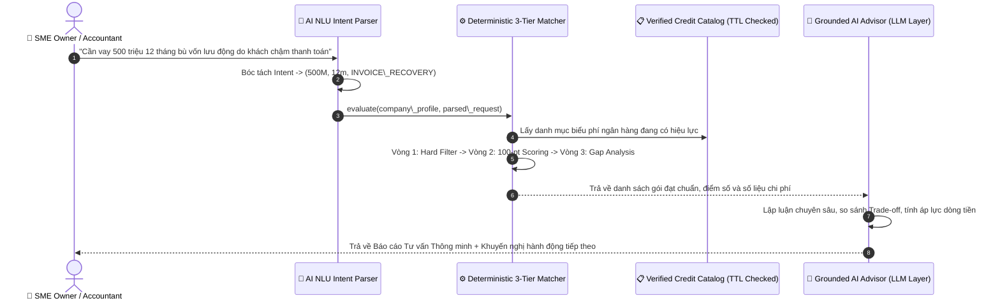
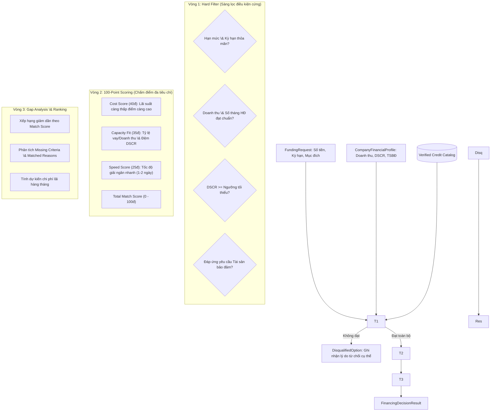

# Lotus Fin — Module AI005: AI Financing Decision Support \& 9 KPIs What-if Engine
## 1\. Vai trò của AI trong Phân hệ `AI-F005` Financing Decision Support

Theo đặc tả sản phẩm của Lotus Fin, **AI không phải là chiếc hộp đen tự ý quyết định duyệt vay hay bịa đặt số liệu**, mà đóng vai trò là một **Financial Copilot thông minh** với 3 nhiệm vụ AI rõ ràng:

1. **NLU Intent \& Parameter Extraction (Hiểu ngôn ngữ tự nhiên):**

   * Cho phép chủ doanh nghiệp SME hoặc kế toán trưởng nhập câu hỏi tự do bằng tiếng Việt/tiếng Anh (VD: *"Công ty tôi đang bị khách hàng chậm trả tiền 15 ngày, cần vay tầm 500 triệu trong 6 tháng để trả lương và xoay vòng vốn..."*).
   * AI tự động bóc tách thành các tham số định kiểu: `amount: 500,000,000 VND`, `term\_months: 6`, `purpose: INVOICE\_RECOVERY`.
2. **Grounded AI Reasoning \& Multi-Option Synthesis (Lập luận \& So sánh đa phương án có căn cứ):**

   * Sau khi **Deterministic 3-Tier Matcher** tính toán ra các gói vay thỏa mãn điều kiện cứng và chấm điểm 100 điểm, **AI Advisor** sẽ tiến hành:

     * **Executive Summary:** Tóm lược báo cáo phân tích tài chính dành cho Giám đốc/CFO.
     * **Top Recommendation Analysis:** Lập luận lý do tại sao gói Top 1 được chọn dựa trên chỉ số DSCR, quy mô doanh thu và nhu cầu vốn.
     * **Trade-off Comparison:** So sánh đánh đổi đa chiều giữa Lựa chọn 1 và Lựa chọn 2/3 (Chi phí lãi vay vs Tốc độ giải ngân vs Yêu cầu tài sản bảo đảm).
     * **Cashflow Impact Warning:** Cảnh báo áp lực dòng tiền chi trả gốc/lãi hàng tháng lên số dư tiền mặt thực tế.
     * **Actionable Next Steps:** Đưa ra các khuyến nghị hành động an toàn tiếp theo (chuyển sang chạy mô phỏng lịch trả nợ `AI-F006` hoặc chuẩn bị hồ sơ).
3. **Strict Numeric Grounding \& Safety Guardrail:**

   * Mọi con số (lãi suất, số tiền, ngày giải ngân) xuất hiện trong văn bản phân tích của AI **bắt buộc phải trùng khớp 100%** với số liệu do Deterministic Engine tính toán.
   * Tự động lọc các canary prompt injection và tuân thủ chính sách `R4/R5 bank-write = OFF` (Không gửi hồ sơ vay đến ngân hàng, không hứa hẹn cam kết duyệt vay).

\---

## 2\. Sơ đồ Luồng Xử lý AI Copilot



\---

## 3\. Kiến trúc Nghiệp vụ: 3-Tier Matcher \& 9 KPIs What-If Engine

### 3.1. Thuật toán Đối soát 3 Vòng (3-Tier Matcher)



### 3.2. Bộ 9 KPIs Tài chính chuẩn hóa trong What-If Engine

|KPI ID|Tên chỉ số|Đơn vị|Công thức \& Ý nghĩa nghiệp vụ|
|-|-|:-:|-|
|**`revenue`**|Doanh thu|VND|`Doanh thu cơ sở × (1 + Δ Doanh số %)`|
|**`gross\_profit`**|Lợi nhuận gộp|VND|`Doanh thu - Giá vốn hàng bán (COGS)`|
|**`gross\_margin`**|Biên lợi nhuận gộp|%|`(Lợi nhuận gộp / Doanh thu) × 100%`|
|**`ar\_outstanding`**|Khoản phải thu|VND|`(Doanh thu × DSO) / Số ngày trong kỳ`|
|**`dso`**|Kỳ thu tiền bình quân|Ngày|`DSO cơ sở + Δ Số ngày chậm thu tiền KH`|
|**`net\_cash\_flow`**|Dòng tiền thuần|VND|`Dòng tiền vào thực thu - Dòng tiền ra thực chi`|
|**`ending\_cash`**|Số dư tiền mặt cuối kỳ|VND|`Tiền đầu kỳ + Dòng tiền thuần + Vốn vay mới giải ngân`|
|**`ccc`**|Chu kỳ chuyển đổi tiền|Ngày|`DIO (Tồn kho) + DSO (Phải thu) - DPO (Phải trả)`|
|**`cash\_shortfall`**|Thâm hụt tiền an toàn|VND|`max(0, Đệm tiền an toàn - Tiền cuối kỳ)`. Cảnh báo nếu > 0.|


\---

## 4\. Cấu trúc Thư mục Module `AI005`

```
lotus\_fin/lotus\_fin/AI005/
├── \_\_init\_\_.py           # Package interfaces \& API exports
├── ai\_advisor.py         # AI NLU Intent Parser \& Grounded LLM Advisor (Multi-provider)
├── models.py             # Data models \& 9 KPIs Layer schemas
├── catalog.py            # Danh mục biểu phí tín dụng SME Việt Nam (VPBank, TCB, VCB, BIDV, TPBank)
├── matcher.py            # Deterministic 3-Tier Matching Engine
├── scenario\_engine.py    # What-if Simulation Engine chuẩn hóa 9 KPIs Layer
├── service.py            # Service Layer \& Frappe Whitelisted REST Endpoints
├── test\_ai005.py         # Test suites tự động (NLU, AI Advisor, Matcher, 9 KPIs)
└── README.md             # Tài liệu đặc tả kiến trúc và hướng dẫn
```

\---

## 5\. Hướng dẫn Sử dụng AI Copilot

### 5.1. Sử dụng qua Python SDK

```python
from lotus\_fin.AI005 import FinancingService

service = FinancingService(ai\_provider="mock")

# Hỏi AI Copilot bằng ngôn ngữ tự nhiên
response = service.ask\_financing\_copilot(
    company="An Phu Trading Ltd",
    user\_query="Công ty tôi cần vay 500 triệu trong 12 tháng để bổ sung vốn lưu động do khách hàng chậm thanh toán"
)

# Kết quả phân tích NLU
print("Ý định NLU bóc tách:", response\["parsed\_intent"])

# Kết quả tư vấn từ AI Advisor
ai\_advice = response\["ai\_advice"]
print("\\n--- EXECUTIVE SUMMARY ---")
print(ai\_advice\["executive\_summary"])

print("\\n--- PHÂN TÍCH GÓI VAY TOP 1 ---")
print(ai\_advice\["top\_recommendation"])

print("\\n--- SO SÁNH ĐÁNH ĐỔI (TRADE-OFFS) ---")
print(ai\_advice\["tradeoff\_comparison"])

print("\\n--- CẢNH BÁO DÒNG TIỀN ---")
print(ai\_advice\["cashflow\_impact\_warning"])
```

### 5.2. Gọi qua REST API (Frappe Whitelist)

* **Endpoint AI Copilot:**
`POST /api/method/lotus\_fin.AI005.service.ask\_copilot`

```json
  {
    "company": "An Phu Trading Ltd",
    "query": "Tôi muốn tìm gói vay 300 triệu trong 6 tháng lãi suất thấp nhất để trả lương nhân viên"
  }
  ```

* **Endpoint Matcher trực tiếp:**
`POST /api/method/lotus\_fin.AI005.service.match\_financing`

```json
  {
    "company": "An Phu Trading Ltd",
    "amount": 500000000,
    "term\_months": 12,
    "purpose": "WORKING\_CAPITAL"
  }
  ```

* **Endpoint What-If Scenario (9 KPIs):**
`POST /api/method/lotus\_fin.AI005.service.simulate\_what\_if`

```json
  {
    "company": "An Phu Trading Ltd",
    "sales\_change\_pct": -0.10,
    "collection\_delay\_days": 15,
    "financing\_amount": 500000000,
    "financing\_term\_months": 12,
    "financing\_rate\_annual": 0.105
  }
  ```

\---

## 6\. Chạy Kiểm thử Tự động (Unit Tests)

```powershell
$env:PYTHONPATH="M:\\lotus-fin-feature-kiennt-refactor-fe\\lotus-fin-feature-kiennt-refactor-fe\\lotus\_fin"
python -m unittest lotus\_fin.AI005.test\_ai005
```

Kết quả:

```
.......
----------------------------------------------------------------------
Ran 7 tests in 0.002s

OK
```

