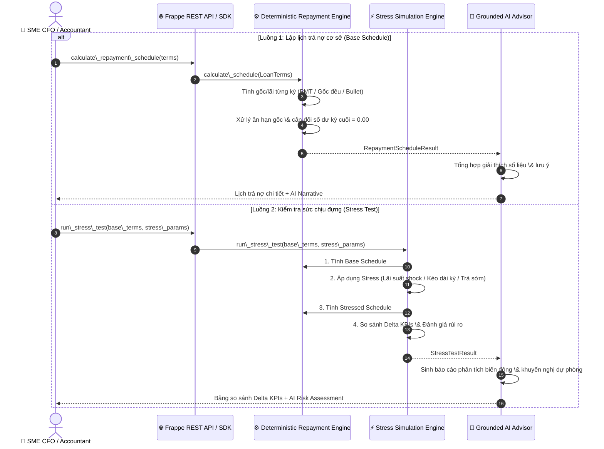

# Lotus Fin — Module AI006: Deterministic Repayment Schedule \& Financial Stress Testing Engine

> \*\*Phiên bản:\*\* 1.1 — 2026-09-30  
> \*\*Phân hệ:\*\* Lotus Fin AI Capabilities · Topic E (FinTechathon 2026)  
> \*\*Kiến trúc:\*\* Deterministic Repayment Engine + Stress Simulation Engine + Grounded AI Advisor  
> \*\*Chính sách kiểm soát bảo mật:\*\* `R4/R5 bank-write = OFF` · `data\_mode = simulation` · `Decimal Arithmetic = ON`

\---

## 1\. Vai trò của AI \& Engine trong Phân hệ `AI-F006` Repayment \& Stress Simulation

Theo kiến trúc cốt lõi của Lotus Fin, phân hệ **AI006** chịu trách nhiệm tính toán dòng tiền trả nợ tất định và đánh giá sức chống chịu tài chính của doanh nghiệp SME trước các cú sốc thị trường:

1. **Deterministic Multi-Method Amortization (Lập lịch trả nợ tất định đa phương pháp):**

   * Tính toán chi tiết từng kỳ trả nợ (gốc, lãi, số dư đầu/cuối kỳ, lũy kế) theo 4 chuẩn tài chính ngân hàng:

     * `EQUAL\_INSTALLMENT`: Trả góp đều (PMT).
     * `EQUAL\_PRINCIPAL`: Trả gốc đều, tiền lãi giảm dần theo dư nợ thực tế.
     * `FLAT\_RATE`: Lãi phẳng tính trên gốc ban đầu.
     * `BULLET`: Trả lãi định kỳ, gốc tất toán toàn bộ ở kỳ cuối cùng.
   * Hỗ trợ thời gian ân hạn gốc (`grace\_period\_months`) và cơ cấu phí xử lý hồ sơ/bảo hiểm (`UPFRONT` hoặc `SPREAD`).
2. **Comprehensive Financial Stress Testing (Kiểm tra sức chịu đựng tài chính):**

   * Cho phép doanh nghiệp chạy giả lập 5 kịch bản rủi ro để chuẩn bị dòng tiền dự phòng:

     * **Rate Shock (+bps):** Mô phỏng rủi ro lãi suất thả nổi tăng vọt (ví dụ +200 bps = +2%/năm).
     * **Term Extension (+tháng):** Mô phỏng giãn nợ để giảm áp lực dòng tiền hàng tháng.
     * **Early Repayment:** Mô phỏng tất toán trước hạn tại tháng $t$ kèm tính phí phạt trả sớm.
     * **Grace Period Injection:** Đưa thêm kỳ ân hạn gốc vào khoản vay hiện hữu.
     * **Combined:** Phối hợp đồng thời nhiều cú sốc thị trường.
3. **Grounded AI Advisor \& Narrative Explanation (Cố vấn AI có căn cứ):**

   * Tự động trích xuất các chỉ số Delta thay đổi giữa kịch bản gốc và kịch bản stress (`Total Interest`, `Total Payment`, `Average Monthly Payment`).
   * Phân loại đánh giá tác động định tính: `ADVERSE` (bất lợi 🔴), `FAVORABLE` (thuận lợi 🟢), `NEUTRAL` (trung lập ⚪).
   * Đưa ra khuyến nghị an toàn dòng tiền mà **tuyệt đối không bịa số liệu** (Zero Hallucination).
4. **Strict Decimal Precision \& Invariant Compliance:**

   * Sử dụng kiểu `Decimal` với độ chính xác `Decimal("0.01")` và quy tắc `ROUND\_HALF\_UP` cho toàn bộ phép tính tài chính.
   * Tự động cân bằng sai số làm tròn ở kỳ cuối cùng để số dư nợ đóng kỳ (`closing\_balance`) về chính xác `0.00`.
   * Mọi dữ liệu xuất ra luôn gắn cờ `data\_mode = 'simulation'` và tuân thủ `R4/R5 bank-write = OFF` (không sinh bút toán tự ý vào General Ledger của ERPNext).

\---

## 2\. Sơ đồ Luồng Xử lý Lập Lịch Trả Nợ \& Stress Test



\---

## 3\. Kiến trúc Nghiệp vụ \& Phương pháp Phân bổ Nợ

### 3.1. Sơ đồ Cấu trúc Thành phần Module

```mermaid
flowchart TD
    subgraph Inputs\["1. Dữ liệu Đầu vào"]
        LT\["LoanTerms: Gốc, Lãi suất, Kỳ hạn, Phương pháp, Ân hạn, Phí"]
        SP\["StressScenarioParams: Loại stress, Rate shock bps, Tháng trả sớm, Phí phạt"]
    end

    subgraph Core\_Engines\["2. Bộ máy Tính toán Tất định (Decimal Engine)"]
        RE\["RepaymentEngine: Bộ máy tính lịch trả nợ"]
        SE\["StressSimulationEngine: Bộ máy kiểm tra sức chịu đựng"]
        
        M1\["EQUAL\_INSTALLMENT (Trả góp đều)"]
        M2\["EQUAL\_PRINCIPAL (Gốc đều, lãi giảm dần)"]
        M3\["FLAT\_RATE (Lãi phẳng trên gốc ban đầu)"]
        M4\["BULLET (Lãi hàng kỳ, gốc cuối kỳ)"]

        RE --> M1 \& M2 \& M3 \& M4
        SE --> RE
    end

    subgraph AI\_Advisor\["3. Tầng Cố vấn Trí tuệ Nhân tạo (Grounded AI)"]
        Adv\["RepaymentAdvisor: Giải thích có căn cứ"]
        Rec\["Đánh giá Rủi ro (ADVERSE / FAVORABLE) + Khuyến nghị"]
        Adv --> Rec
    end

    subgraph Outputs\["4. Kết quả Mô phỏng (data\_mode = 'simulation')"]
        Out1\["RepaymentScheduleResult: Lịch chi tiết từng kỳ + Báo cáo Dòng tiền"]
        Out2\["StressTestResult: So sánh Delta Lãi/Phí + Khuyến nghị rủi ro"]
    end

    LT --> RE --> Out1 --> Adv
    LT \& SP --> SE --> Out2 --> Adv
```

### 3.2. Bảng So sánh 4 Phương pháp Phân bổ Nợ

|Phương pháp|Công thức Tính toán|Đặc điểm Dòng tiền Doanh nghiệp|Trường hợp Áp dụng|
|-|-|-|-|
|**`EQUAL\_INSTALLMENT`** *(Trả góp đều / PMT)*|$PMT = P \\times \\frac{r(1+r)^n}{(1+r)^n - 1}$<br>Gốc tăng dần, lãi giảm dần, tổng trả cố định mỗi kỳ.|Dòng tiền chi trả hàng tháng ổn định, dễ lập kế hoạch tài chính.|Vay trung/dài hạn mua máy móc, xe tải, mở rộng kinh doanh.|
|**`EQUAL\_PRINCIPAL`** *(Gốc đều, lãi giảm dần)*|$\\text{Gốc}\_t = P / n$<br>$\\text{Lãi}\_t = \\text{Dư nợ đầu kỳ}\_t \\times r$|Áp lực trả nợ nặng ở các tháng đầu, sau đó giảm dần theo thời gian.|Doanh nghiệp có nguồn thu lớn ngay sau giải ngân.|
|**`FLAT\_RATE`** *(Lãi phẳng)*|$\\text{Gốc}\_t = P / n$<br>$\\text{Lãi}*t = P \\times r*{\\text{annual}} / \\text{periods\_per\_year}$|Lãi tính đều trên gốc ban đầu suốt kỳ; tổng lãi thực tế cao hơn PMT.|Vay tín chấp tiểu thương hoặc các gói tín dụng vi mô.|
|**`BULLET`** *(Lãi định kỳ, gốc cuối kỳ)*|Kỳ $1 \\to n-1$: Gốc = $0$, Lãi = $P \\times r$<br>Kỳ $n$: Gốc = $P$, Lãi = $P \\times r$|Áp lực trả hàng tháng rất nhẹ, nhưng phải tích lũy dòng tiền để trả gốc cuối kỳ.|Vay bổ sung vốn lưu động xoay vòng theo mùa vụ/hợp đồng dự án.|

\---

## 4\. Cấu trúc Thư mục Module `AI006`

```
lotus\_fin/lotus\_fin/AI006/
├── \_\_init\_\_.py           # Package interfaces \& Canonical alias exports
├── models.py             # Data models, Enums (LoanTerms, StressScenarioParams, StressComparisonKPI)
├── engine.py             # Deterministic Repayment Engine (4 phương pháp phân bổ, xử lý làm tròn Decimal)
├── stress.py             # Stress Simulation Engine (5 kịch bản rủi ro, so sánh delta KPIs)
├── ai\_advisor.py         # Grounded AI Advisor sinh giải thích tài chính không bịa số
├── service.py            # Service Layer \& Frappe Whitelisted REST Endpoints
├── test\_ai006.py         # Unit test suites kiểm chứng độ chính xác toán học
└── README.md             # Tài liệu đặc tả kiến trúc và hướng dẫn
```

\---

## 5\. Hướng dẫn Sử dụng

### 5.1. Sử dụng qua Python SDK

```python
from decimal import Decimal
from lotus\_fin.AI006 import (
    LoanTerms, 
    RepaymentEngine, 
    AmortizationMethod,
    StressScenarioParams,
    StressSimulationEngine,
    StressType,
    RepaymentAdvisor
)

# 1. Tính toán lịch trả nợ cơ sở (Base Schedule)
terms = LoanTerms(
    principal=Decimal("1000000000"),          # 1 Tỷ VND
    annual\_rate=Decimal("0.10"),              # 10%/năm
    term\_months=12,                           # 12 tháng
    amortization\_method=AmortizationMethod.EQUAL\_INSTALLMENT
)
engine = RepaymentEngine()
result = engine.calculate\_schedule(terms)

print(f"Tổng lãi dự kiến: {result.summary\['total\_interest']:,.0f} VND")
print(f"Trả hàng tháng (PMT): {result.summary\['average\_monthly\_payment']:,.0f} VND")

# 2. Chạy bài kiểm tra sức chịu đựng (Stress Test: Lãi suất tăng +200 bps = 2%)
stress\_engine = StressSimulationEngine()
stress\_params = StressScenarioParams(
    stress\_type=StressType.RATE\_SHOCK,
    rate\_shock\_bps=200,                       # Tăng thêm 2%
    description="Kịch bản lãi suất thả nổi tăng 2% do thị trường thắt chặt"
)
stress\_result = stress\_engine.run\_stress\_test(terms, stress\_params)

# 3. AI Advisor giải thích rủi ro
advisor = RepaymentAdvisor()
explanation = advisor.explain\_stress\_test(stress\_result)
print("\\n--- BÁO CÁO CỐ VẤN AI ---")
print(explanation\["narrative"])
```

### 5.2. Gọi qua REST API (Frappe Whitelist)

* **Endpoint Lập lịch trả nợ:**
`POST /api/method/lotus\_fin.AI006.service.calculate\_repayment\_schedule`

```json
  {
    "principal": 1000000000,
    "annual\_rate": 0.10,
    "term\_months": 12,
    "amortization\_method": "EQUAL\_INSTALLMENT",
    "grace\_period\_months": 0,
    "processing\_fee\_pct": 0.01
  }
  ```

* **Endpoint Kiểm tra sức chịu đựng (Stress Test):**
`POST /api/method/lotus\_fin.AI006.service.run\_stress\_test`

```json
  {
    "principal": 1000000000,
    "annual\_rate": 0.10,
    "term\_months": 12,
    "stress\_type": "RATE\_SHOCK",
    "rate\_shock\_bps": 200,
    "amortization\_method": "EQUAL\_INSTALLMENT"
  }
  ```

\---

## 6\. Chạy Kiểm thử Tự động (Unit Tests)

```powershell
$env:PYTHONPATH="M:\\lotus-fin-feature-kiennt-refactor-fe\\lotus-fin-feature-kiennt-refactor-fe\\lotus\_fin"
python -m unittest lotus\_fin.modules.f006\_repayment.test\_ai006
```

