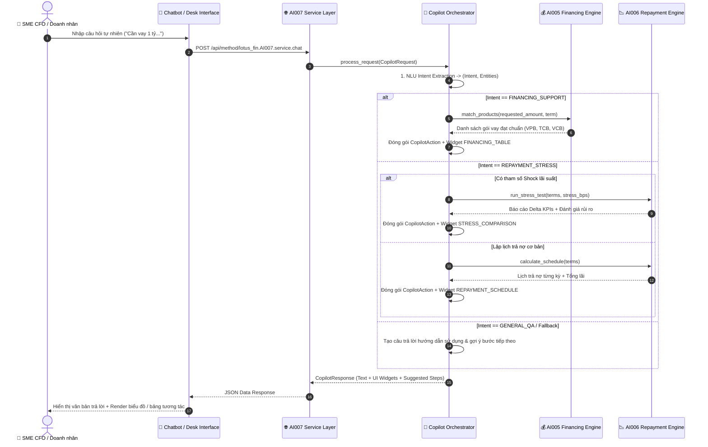
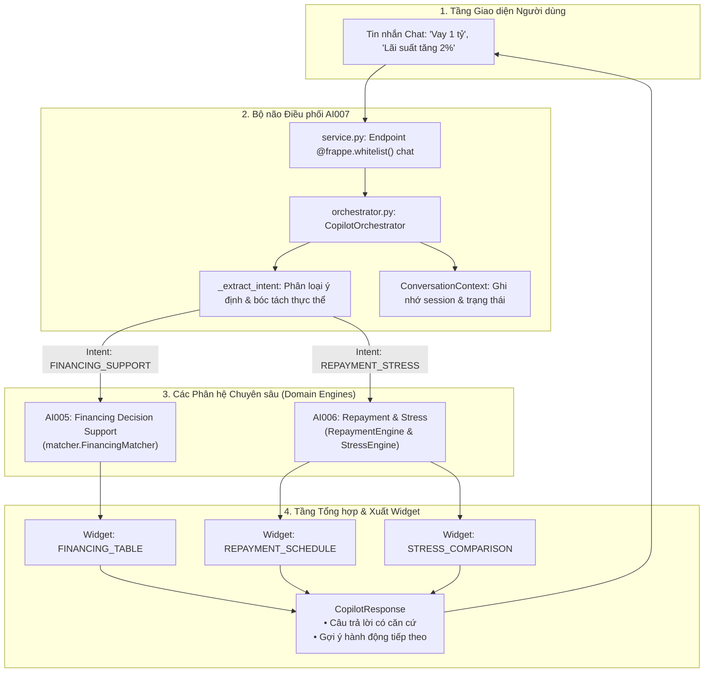

# Lotus Fin — Module AI007: Financial Copilot Central Orchestrator & Multi-Turn Router
## 1. Vai trò của AI trong Phân hệ `AI-F007` Financial Copilot Orchestrator

Module **AI007** đóng vai trò là **"Bộ não điều phối trung tâm" (Central Orchestrator)** cho toàn bộ hệ thống Lotus Fin Copilot. Nó giải quyết bài toán giao tiếp giữa người dùng không chuyên tài chính và các thuật toán tính toán định lượng chuyên sâu thông qua 4 nhiệm vụ cốt lõi:

1. **NLU Intent Classification & Entity Extraction (Phân loại ý định & Bóc tách thực thể):**
   * Phân tích câu hỏi tự nhiên bằng tiếng Việt hoặc tiếng Anh để nhận diện ý đồ người dùng:
     - `FINANCING_SUPPORT`: Nhu cầu tìm kiếm gói vay vốn lưu động, thế chấp, thấu chi.
     - `REPAYMENT_STRESS`: Nhu cầu lập lịch trả nợ hoặc kiểm tra biến động lãi suất tăng.
     - `HEALTH_CHECK`: Nhu cầu kiểm tra sức khỏe tài chính và dự báo thâm hụt tiền.
     - `GENERAL_QA`: Hỏi đáp chung về kiến thức tài chính doanh nghiệp.
   * Bóc tách các thực thể số tiền (1 tỷ, 500 triệu), kỳ hạn (12 tháng), tỷ lệ tăng lãi suất (+2%).

2. **Dynamic Cross-Module Routing (Định tuyến gọi chéo phân hệ linh hoạt):**
   * Đóng vai trò là cầu nối điều hướng đến đúng các module nghiệp vụ chuyên biệt:
     - Khi cần khớp gói vay $\rightarrow$ Gọi phân hệ **`AI005 (Financing Matcher)`**.
     - Khi cần lập lịch trả nợ hoặc stress test $\rightarrow$ Gọi phân hệ **`AI006 (Repayment Engine)`**.
   * Đảm bảo tính mở rộng cao (Modular Monolith): Dễ dàng kết nối thêm `AI008`, `AI009` trong tương lai mà không làm phức tạp hóa logic giao diện.

3. **Multi-Modal UI Widget Synthesis (Tổng hợp phản hồi đa phương thức):**
   * Không chỉ trả về câu trả lời bằng văn bản (Text Reply), Copilot tự động đóng gói các khối dữ liệu cấu trúc (UI Widgets) để giao diện người dùng (Frontend) có thể render ngay lập tức:
     - Widget `FINANCING_TABLE`: Hiển thị thẻ so sánh các gói vay, lãi suất và điểm phù hợp.
     - Widget `REPAYMENT_SCHEDULE`: Hiển thị biểu đồ thanh toán gốc/lãi hàng tháng.
     - Widget `STRESS_COMPARISON`: Hiển thị bảng biến động Delta chi phí kịch bản rủi ro.

4. **Multi-Turn Context & Session Management (Quản lý ngữ cảnh hội thoại đa lượt):**
   * Duy trì đối tượng `ConversationContext` theo từng `session_id`, lưu giữ ý định hiện tại, lịch sử hành động và các tham số tài chính của doanh nghiệp giữa các lượt chat liên tiếp.

---

## 2. Sơ đồ Luồng Xử lý Điều phối Toàn hệ thống



---

## 3. Kiến trúc Nghiệp vụ & Ma trận Định tuyến

### 3.1. Sơ đồ Cấu trúc Thành phần Phân hệ



### 3.2. Ma trận Định tuyến (Routing Matrix)

| Intent nhận diện | Từ khóa NLU kích hoạt | Module được gọi | Phương thức thực thi | UI Widget xuất ra |
| :--- | :--- | :---: | :--- | :--- |
| **`FINANCING_SUPPORT`** | *vay, tìm gói vay, hạn mức, bổ sung vốn lưu động* | **AI005** | `FinancingMatcher.match_products()` | `FINANCING_TABLE` (Danh sách Top gói vay & điểm phù hợp) |
| **`REPAYMENT_STRESS`** *(Normal)* | *lịch trả nợ, mỗi tháng trả bao nhiêu, kỳ hạn* | **AI006** | `RepaymentEngine.calculate_schedule()` | `REPAYMENT_SCHEDULE` (Bảng phân bổ gốc/lãi từng kỳ) |
| **`REPAYMENT_STRESS`** *(Shock)* | *lãi suất tăng, shock lãi suất, stress test* | **AI006** | `StressSimulationEngine.run_stress_test()` | `STRESS_COMPARISON` (So sánh chênh lệch chi phí lãi phát sinh) |
| **`GENERAL_QA`** | *xin chào, giới thiệu, bạn làm được gì* | **AI007** | Local Rule / LLM General Reasoning | Không widget; kèm gợi ý nút bấm thao tác nhanh |

---

## 4. Cấu trúc Thư mục Module `AI007`

```
lotus_fin/lotus_fin/AI007/
├── __init__.py           # Package interfaces & Canonical alias exports
├── models.py             # Data models (CopilotRequest, CopilotResponse, CopilotAction, IntentType)
├── orchestrator.py       # Core CopilotOrchestrator điều phối routing và sinh UI widgets
├── service.py            # Service Layer & Frappe Whitelisted REST Endpoint (chat)
├── test_ai007.py         # Unit test suites kiểm tra định tuyến hội thoại
└── README.md             # Tài liệu đặc tả kiến trúc và hướng dẫn
```

---

## 5. Hướng dẫn Sử dụng AI Copilot

### 5.1. Sử dụng qua Python SDK

```python
from lotus_fin.AI007 import CopilotRequest, CopilotOrchestrator

orchestrator = CopilotOrchestrator()

# 1. Yêu cầu tìm kiếm gói vay vốn
req1 = CopilotRequest(
    message="Công ty tôi cần tìm gói vay 1 tỷ trong 12 tháng",
    session_id="session_sme_001"
)
resp1 = orchestrator.process_request(req1)
print(f"[{resp1.intent.value}] {resp1.reply_message}")
print("Widgets:", resp1.ui_widgets)

# 2. Yêu cầu chạy kiểm tra sốc lãi suất
req2 = CopilotRequest(
    message="Lập lịch trả nợ nếu lãi suất tăng 2% nhé",
    session_id="session_sme_001"
)
resp2 = orchestrator.process_request(req2)
print(f"\n[{resp2.intent.value}] {resp2.reply_message}")
print("Widgets:", resp2.ui_widgets)
```

### 5.2. Gọi qua REST API (Frappe Whitelist)

* **Endpoint Chatbot duy nhất:**
  `POST /api/method/lotus_fin.AI007.service.chat`
  ```json
  {
    "message": "Tôi muốn tìm gói vay 500 triệu để nhập thêm hàng tồn kho",
    "session_id": "client_session_12345"
  }
  ```

* **Dữ liệu phản hồi mẫu (JSON Response):**
  ```json
  {
    "status": "success",
    "data": {
      "session_id": "client_session_12345",
      "intent": "FINANCING_SUPPORT",
      "reply": "Tôi đã tìm thấy các gói vay phù hợp. Gói tốt nhất là VPB_SME_FAST_LOAN với điểm phù hợp 92.5%.",
      "suggested_actions": [
        "Xem chi tiết các gói vay",
        "Mô phỏng lịch trả nợ cho gói vay này"
      ],
      "ui_widgets": [
        {
          "widget_type": "FINANCING_TABLE",
          "data": [
            {
              "product_id": "VPB_SME_FAST_LOAN",
              "score": 0.925,
              "max_amount": 1500000000.0
            }
          ]
        }
      ],
      "data_mode": "simulation"
    }
  }
  ```

---

## 6. Lưu ý khi Triển khai LLM Production

Trong môi trường thực tế (Production), hàm `_extract_intent` trong `orchestrator.py` có thể được kết nối trực tiếp với LLM Client (OpenAI GPT-4o, Google Vertex AI Gemini) thông qua Prompt định dạng JSON:

```text
System: "Bạn là Trợ lý Phân loại Ý định Tài chính Lotus Fin. Hãy phân loại tin nhắn của người dùng vào 1 trong các Intent sau: [FINANCING_SUPPORT, REPAYMENT_STRESS, HEALTH_CHECK, GENERAL_QA] và bóc tách các tham số số tiền (amount), kỳ hạn (term_months), lãi suất biến động (stress_bps) thành định dạng JSON hợp lệ."
```

---

## 7. Chạy Kiểm thử Tự động (Unit Tests)

```powershell
$env:PYTHONPATH="M:\lotus-fin-feature-kiennt-refactor-fe\lotus-fin-feature-kiennt-refactor-fe\lotus_fin"
python -m unittest lotus_fin.AI007.test_ai007
```
